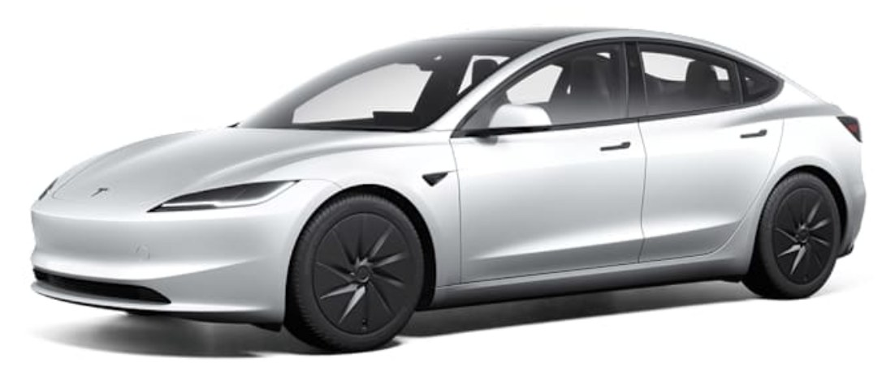
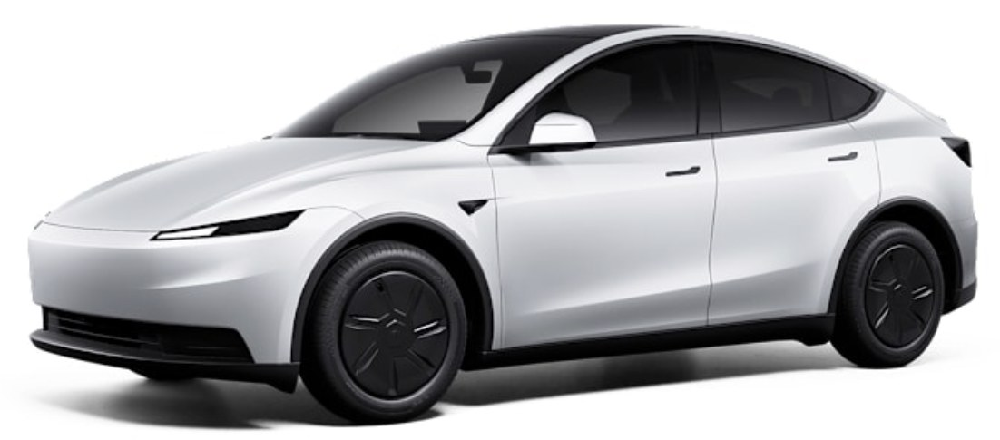

# Cheapest EVs per km

Updated 2026-11-02 17:25 UTC · 240 battery-electric cars from 2022 on · 20.000 km/yr · capital at 7% · best selling year chosen per car (max 12 yr)

Market: EVs lose about **16% of their value per year** at this mileage (fitted on all 164 EV listings, older ones included). Costs in today's krónur. Assumptions: `config.yaml`.

How the number is built

cost per km = (price − resale after N years + capital cost + charging + kílómetragjald + insurance + service + tyres + tax/skoðun + expected battery repairs after warranty) ÷ km driven. Resale comes from today's market: what the same model sells for N years older and 20.000·N km further on. N is whichever year gives the lowest cost per km.

---

**Bands:** 🟢 **Good** under 50 kr/km (18 cars) · 🟡 **Medium** 50–70 kr/km (125 cars) · 🔴 **Bad** 70+ kr/km (97 cars)

---

## 🟢 Good — under 50 kr/km

> 🟢 **under 50 kr/km ≈ under 1,0M kr per year** at 20.000 km/yr · 18 cars · cheap, efficient, holds its value — about as low as a 2022+ EV gets

🟢 **38.4 kr/km** · sell after **11 yr** · 2.390.000 kr

[Leapmotor T03](https://www.isband.is/product/leapmotor-t03/)  
🆕 NEW · 0 km · ÍSBAND (new) · leapmotor t03 · new: 2.890.000 kr list, rafbílastyrkur included (resale ≈ 183.695 kr)

kr/km: depreciation 10.0 · capital 7% 2.9 · charging 5.1 · km-gjald 7.0 · insurance 5.0 · service 3.6 · tyres 2.0 · tax/skoðun 1.2 · battery risk 1.6

⚠️ no nearly-new used ones to compare with: assumed it loses 10% on registration, then the normal EV depreciation; young brand in Iceland: depreciation & battery guessed

---

🟢 **42.0 kr/km** · sell after **12 yr** · 2.990.000 kr

[Leapmotor B03X Life](https://www.isband.is/product/leapmotor-b03x-life/)  
🆕 NEW · 0 km · ÍSBAND (new) · leapmotor b03x · new: 3.490.000 kr list, rafbílastyrkur included (resale ≈ 184.610 kr)

kr/km: depreciation 11.7 · capital 7% 3.4 · charging 5.4 · km-gjald 7.0 · insurance 5.1 · service 4.0 · tyres 2.0 · tax/skoðun 1.2 · battery risk 2.2

⚠️ no nearly-new used ones to compare with: assumed it loses 10% on registration, then the normal EV depreciation; young brand in Iceland: depreciation & battery guessed

---

🟢 **43.7 kr/km** · sell after **6 yr** · 2.090.000 kr

[Nissan Leaf 40kwh 2022](https://bland.is/til-solu/farartaeki/bilar/nissan-leaf-40kwh-2022/5296844/)  
2022 · 98.000 km · Bland · nissan leaf · 22% under market (market ≈ 2.677.806 kr, resale ≈ 759.283 kr)

kr/km: depreciation 11.1 · capital 7% 4.8 · charging 5.8 · km-gjald 7.0 · insurance 5.3 · service 4.4 · tyres 2.0 · tax/skoðun 1.2 · battery risk 2.1

---

🟢 **45.1 kr/km** · sell after **12 yr** · 3.590.000 kr

[Leapmotor B03X Design](https://www.isband.is/product/leapmotor-b03x-design/)  
🆕 NEW · 0 km · ÍSBAND (new) · leapmotor b03x · new: 4.090.000 kr list, rafbílastyrkur included (resale ≈ 221.656 kr)

kr/km: depreciation 14.0 · capital 7% 4.1 · charging 5.4 · km-gjald 7.0 · insurance 5.2 · service 4.0 · tyres 2.0 · tax/skoðun 1.2 · battery risk 2.2

⚠️ no nearly-new used ones to compare with: assumed it loses 10% on registration, then the normal EV depreciation; young brand in Iceland: depreciation & battery guessed

---

🟢 **45.3 kr/km** · sell after **10 yr** · 2.590.000 kr

[MAZDA MX-30](https://bland.is/til-solu/farartaeki/bilar/mazda-mx-30/5295862/)  
2023 · 25.000 km · Bland · mazda mx-30 · 19% under market (market ≈ 3.201.385 kr, resale ≈ 287.263 kr)

kr/km: depreciation 11.5 · capital 7% 3.8 · charging 6.1 · km-gjald 7.0 · insurance 5.2 · service 5.5 · tyres 2.0 · tax/skoðun 1.2 · battery risk 3.0

⚠️ still getting cheaper per km at 10 yr / 225.000 km, where market data ends — keeping it longer is probably cheaper still; little market data for this model: depreciation borrowed from brand/all EVs

---

🟢 **45.3 kr/km** · sell after **7 yr** · 2.290.000 kr

[MG Mg5 Electric 2022](https://bland.is/til-solu/farartaeki/bilar/mg-mg5-electric-2022/5291994/)  
2022 · 90.000 km · Bland · mg5 · 17% under market (market ≈ 2.759.234 kr, resale ≈ 487.465 kr)

kr/km: depreciation 12.9 · capital 7% 4.3 · charging 5.8 · km-gjald 7.0 · insurance 5.2 · service 4.9 · tyres 2.0 · tax/skoðun 1.2 · battery risk 2.1

⚠️ still getting cheaper per km at 7 yr / 230.000 km, where market data ends — keeping it longer is probably cheaper still; little market data for this model: depreciation borrowed from brand/all EVs

---

🟢 **45.7 kr/km** · sell after **9 yr** · 2.350.000 kr

[Mazda Mazda Mx-30 2022](https://bland.is/til-solu/farartaeki/bilar/mazda-mazda-mx-30-2022/5299610/)  
2022 · 22.000 km · Bland · mazda mx-30 · 18% under market (market ≈ 2.858.887 kr, resale ≈ 323.431 kr)

kr/km: depreciation 11.3 · capital 7% 3.7 · charging 6.1 · km-gjald 7.0 · insurance 5.1 · service 5.9 · tyres 2.0 · tax/skoðun 1.2 · battery risk 3.4

⚠️ little market data for this model: depreciation borrowed from brand/all EVs

---

🟢 **46.5 kr/km** · sell after **11 yr** · 2.790.000 kr

[Mazda MX-30 Exclusive-Line](https://notadir.brimborg.is/is/notadir-bilar/bill/VZA79)  
2023 · 18.363 km · Brimborg (used) · mazda mx-30 · 14% under market (market ≈ 3.252.899 kr, resale ≈ 245.694 kr)

kr/km: depreciation 11.6 · capital 7% 3.8 · charging 6.1 · km-gjald 7.0 · insurance 5.2 · service 6.0 · tyres 2.0 · tax/skoðun 1.2 · battery risk 3.6

⚠️ still getting cheaper per km at 11 yr / 238.000 km, where market data ends — keeping it longer is probably cheaper still; little market data for this model: depreciation borrowed from brand/all EVs

---

🟢 **47.2 kr/km** · sell after **8 yr** · 2.590.000 kr

[MG Mg4 Electric 12/ 2022](https://bland.is/til-solu/farartaeki/bilar/mg-mg4-electric-12-2022/5291832/)  
2022 · 66.000 km · Bland · mg4 · 12% under market (market ≈ 2.946.159 kr, resale ≈ 437.818 kr)

kr/km: depreciation 13.5 · capital 7% 4.4 · charging 5.8 · km-gjald 7.0 · insurance 5.3 · service 5.4 · tyres 2.0 · tax/skoðun 1.2 · battery risk 2.7

⚠️ still getting cheaper per km at 8 yr / 226.000 km, where market data ends — keeping it longer is probably cheaper still; little market data for this model: depreciation borrowed from brand/all EVs

---

🟢 **47.2 kr/km** · sell after **12 yr** · 3.990.000 kr

[Leapmotor B05 Design](https://www.isband.is/product/leapmotor-b05-design/)  
🆕 NEW · 0 km · ÍSBAND (new) · leapmotor b05 · new: 4.490.000 kr list, rafbílastyrkur included (resale ≈ 246.353 kr)

kr/km: depreciation 15.6 · capital 7% 4.5 · charging 5.4 · km-gjald 7.0 · insurance 5.3 · service 4.0 · tyres 2.0 · tax/skoðun 1.2 · battery risk 2.2

⚠️ no nearly-new used ones to compare with: assumed it loses 10% on registration, then the normal EV depreciation; young brand in Iceland: depreciation & battery guessed

---

🟢 **48.6 kr/km** · sell after **12 yr** · 4.380.000 kr

[Ford Puma EV Premium](https://nyirbilar.brimborg.is/is/nyir-bilar/bill/NHE86)  
🆕 NEW · 0 km · Brimborg (new) · ford puma ev · new: 4.990.000 kr list, rafbílastyrkur included (resale ≈ 270.432 kr)

kr/km: depreciation 17.1 · capital 7% 5.0 · charging 5.3 · km-gjald 7.0 · insurance 5.3 · service 4.0 · tyres 2.0 · tax/skoðun 1.2 · battery risk 1.7

⚠️ no nearly-new used ones to compare with: assumed it loses 10% on registration, then the normal EV depreciation; little market data for this model: depreciation borrowed from brand/all EVs

---

🟢 **48.7 kr/km** · sell after **10 yr** · 3.190.000 kr

[Opel Mokka-e Ultimate](https://notadir.brimborg.is/is/notadir-bilar/bill/YDG93)  
2023 · 22.797 km · Brimborg (used) · opel mokka-e · 25% under market (market ≈ 4.230.961 kr, resale ≈ 358.833 kr)

kr/km: depreciation 14.2 · capital 7% 4.8 · charging 5.8 · km-gjald 7.0 · insurance 5.3 · service 5.5 · tyres 2.0 · tax/skoðun 1.2 · battery risk 3.0

⚠️ still getting cheaper per km at 10 yr / 223.000 km, where market data ends — keeping it longer is probably cheaper still; little market data for this model: depreciation borrowed from brand/all EVs

---

🟢 **49.4 kr/km** · sell after **9 yr** · 3.300.000 kr

[Nissan Leaf  40kwh](https://bland.is/til-solu/farartaeki/bilar/nissan-leaf-40kwh/5258470/)  
2023 · 59.000 km · Bland · nissan leaf · at market (market ≈ 3.317.348 kr, resale ≈ 688.975 kr)

kr/km: depreciation 14.5 · capital 7% 6.0 · charging 5.8 · km-gjald 7.0 · insurance 5.5 · service 5.0 · tyres 2.0 · tax/skoðun 1.2 · battery risk 2.4

⚠️ still getting cheaper per km at 9 yr / 239.000 km, where market data ends — keeping it longer is probably cheaper still

---

🟢 **49.5 kr/km** · sell after **11 yr** · 3.800.000 kr

[MG Comfort](https://bland.is/til-solu/farartaeki/bilar/mg-comfort/5289959/)  
2025 · 7.000 km · Bland · mg (other) · 20% under market (market ≈ 4.747.358 kr, resale ≈ 339.293 kr)

kr/km: depreciation 15.7 · capital 7% 5.2 · charging 6.5 · km-gjald 7.0 · insurance 5.4 · service 4.4 · tyres 2.0 · tax/skoðun 1.2 · battery risk 2.0

⚠️ still getting cheaper per km at 11 yr / 227.000 km, where market data ends — keeping it longer is probably cheaper still; little market data for this model: depreciation borrowed from brand/all EVs; model not recognised: consumption assumed

---

🟢 **49.7 kr/km** · sell after **12 yr** · 4.590.000 kr

[Ford Puma EV Premium](https://nyirbilar.brimborg.is/is/nyir-bilar/bill/146517)  
🆕 NEW · 0 km · Brimborg (new) · ford puma ev · new: 4.990.000 kr list, rafbílastyrkur included (resale ≈ 283.398 kr)

kr/km: depreciation 17.9 · capital 7% 5.2 · charging 5.3 · km-gjald 7.0 · insurance 5.4 · service 4.0 · tyres 2.0 · tax/skoðun 1.2 · battery risk 1.7

⚠️ no nearly-new used ones to compare with: assumed it loses 10% on registration, then the normal EV depreciation; little market data for this model: depreciation borrowed from brand/all EVs

---

🟢 **49.8 kr/km** · sell after **12 yr** · 4.599.000 kr

[Ford Puma EV Premium](https://nyirbilar.brimborg.is/is/nyir-bilar/bill/GKM99)  
🆕 NEW · 0 km · Brimborg (new) · ford puma ev · new: 5.209.000 kr list, rafbílastyrkur included (resale ≈ 283.954 kr)

kr/km: depreciation 18.0 · capital 7% 5.2 · charging 5.3 · km-gjald 7.0 · insurance 5.4 · service 4.0 · tyres 2.0 · tax/skoðun 1.2 · battery risk 1.7

⚠️ no nearly-new used ones to compare with: assumed it loses 10% on registration, then the normal EV depreciation; little market data for this model: depreciation borrowed from brand/all EVs

---

🟢 **49.8 kr/km** · sell after **9 yr** · 2.990.000 kr

[MG ZS EV 2022 LR Luxury](https://bland.is/til-solu/farartaeki/bilar/mg-zs-ev-2022-lr-luxury/5257047/)  
2022 · 45.000 km · Bland · mg zs ev · at market (market ≈ 3.081.938 kr, resale ≈ 398.097 kr)

kr/km: depreciation 14.4 · capital 7% 4.6 · charging 6.1 · km-gjald 7.0 · insurance 5.3 · service 5.9 · tyres 2.0 · tax/skoðun 1.2 · battery risk 3.4

⚠️ still getting cheaper per km at 9 yr / 225.000 km, where market data ends — keeping it longer is probably cheaper still; little market data for this model: depreciation borrowed from brand/all EVs

---

🟢 **49.9 kr/km** · sell after **9 yr** · 3.100.000 kr

[Nissan Leaf N-Connecta  2022](https://bland.is/til-solu/farartaeki/bilar/nissan-leaf-n-connecta-2022/5296627/)  
2022 · 53.000 km · Bland · nissan leaf · 4% over market (market ≈ 2.983.896 kr, resale ≈ 641.624 kr)

kr/km: depreciation 13.7 · capital 7% 5.6 · charging 5.8 · km-gjald 7.0 · insurance 5.5 · service 5.9 · tyres 2.0 · tax/skoðun 1.2 · battery risk 3.4

⚠️ still getting cheaper per km at 9 yr / 233.000 km, where market data ends — keeping it longer is probably cheaper still

---

## 🟡 Medium — 50–70 kr/km

> 🟡 **50–70 kr/km ≈ 1,0–1,4M kr per year** at 20.000 km/yr · 125 cars · normal family EV — you pay for size, range or a newer car

🟡 **50.3 kr/km** · sell after **10 yr** · 3.490.000 kr

[Citroen E-C4 X Shine Pack](https://notadir.brimborg.is/is/notadir-bilar/bill/GZZ04)  
2023 · 34.697 km · Brimborg (used) · citroen e-c4 · 8% under market (market ≈ 3.792.749 kr, resale ≈ 625.345 kr)

kr/km: depreciation 14.3 · capital 7% 6.0 · charging 5.8 · km-gjald 7.0 · insurance 5.5 · service 5.5 · tyres 2.0 · tax/skoðun 1.2 · battery risk 3.0

⚠️ still getting cheaper per km at 10 yr / 235.000 km, where market data ends — keeping it longer is probably cheaper still

---

🟡 **50.5 kr/km** · sell after **10 yr** · 3.500.000 kr

[MG4 - Rafmagnsbíll](https://bland.is/til-solu/farartaeki/bilar/mg4-rafmagnsbill/5289431/)  
2023 · 27.000 km · Bland · mg4 · 4% under market (market ≈ 3.649.791 kr, resale ≈ 375.215 kr)

kr/km: depreciation 15.6 · capital 7% 5.0 · charging 5.8 · km-gjald 7.0 · insurance 5.4 · service 5.5 · tyres 2.0 · tax/skoðun 1.2 · battery risk 3.0

⚠️ still getting cheaper per km at 10 yr / 227.000 km, where market data ends — keeping it longer is probably cheaper still; little market data for this model: depreciation borrowed from brand/all EVs

---

🟡 **50.5 kr/km** · sell after **9 yr** · 3.200.000 kr

[Nissan Leaf 62kwh 2022](https://bland.is/til-solu/farartaeki/bilar/nissan-leaf-62kwh-2022/5291168/)  
2022 · 54.000 km · Bland · nissan leaf · 8% over market (market ≈ 2.976.728 kr, resale ≈ 657.812 kr)

kr/km: depreciation 14.1 · capital 7% 5.7 · charging 5.8 · km-gjald 7.0 · insurance 5.5 · service 5.9 · tyres 2.0 · tax/skoðun 1.2 · battery risk 3.4

⚠️ still getting cheaper per km at 9 yr / 234.000 km, where market data ends — keeping it longer is probably cheaper still

---

🟡 **50.6 kr/km** · sell after **12 yr** · 4.769.000 kr

[Ford Puma EV Premium](https://nyirbilar.brimborg.is/is/nyir-bilar/bill/146518)  
🆕 NEW · 0 km · Brimborg (new) · ford puma ev · new: 5.169.000 kr list, rafbílastyrkur included (resale ≈ 294.450 kr)

kr/km: depreciation 18.6 · capital 7% 5.4 · charging 5.3 · km-gjald 7.0 · insurance 5.4 · service 4.0 · tyres 2.0 · tax/skoðun 1.2 · battery risk 1.7

⚠️ no nearly-new used ones to compare with: assumed it loses 10% on registration, then the normal EV depreciation; little market data for this model: depreciation borrowed from brand/all EVs

---

🟡 **51.9 kr/km** · sell after **12 yr** · 4.790.000 kr

[Leapmotor B10 Design](https://www.isband.is/product/leapmotor-b10-design/)  
🆕 NEW · 0 km · ÍSBAND (new) · leapmotor b10 · new: 5.290.000 kr list, rafbílastyrkur included (resale ≈ 295.747 kr)

kr/km: depreciation 18.7 · capital 7% 5.4 · charging 6.0 · km-gjald 7.0 · insurance 5.4 · service 4.0 · tyres 2.0 · tax/skoðun 1.2 · battery risk 2.2

⚠️ no nearly-new used ones to compare with: assumed it loses 10% on registration, then the normal EV depreciation; young brand in Iceland: depreciation & battery guessed

---

🟡 **52.0 kr/km** · sell after **11 yr** · 3.500.000 kr

[Nissan Leaf Tekna 2022](https://bland.is/til-solu/farartaeki/bilar/nissan-leaf-tekna-2022/4880347/)  
2022 · 6.000 km · Bland · nissan leaf · 5% over market (market ≈ 3.341.008 kr, resale ≈ 516.337 kr)

kr/km: depreciation 13.6 · capital 7% 5.5 · charging 5.8 · km-gjald 7.0 · insurance 5.4 · service 6.9 · tyres 2.0 · tax/skoðun 1.2 · battery risk 4.6

⚠️ still getting cheaper per km at 11 yr / 226.000 km, where market data ends — keeping it longer is probably cheaper still

---

🟡 **52.4 kr/km** · sell after **10 yr** · 4.090.000 kr

[Citroen E-C4 MAX](https://notadir.brimborg.is/is/notadir-bilar/bill/ABT34)  
2024 · 23.446 km · Brimborg (used) · citroen e-c4 · 7% under market (market ≈ 4.395.222 kr, resale ≈ 731.212 kr)

kr/km: depreciation 16.8 · capital 7% 7.0 · charging 5.8 · km-gjald 7.0 · insurance 5.7 · service 4.7 · tyres 2.0 · tax/skoðun 1.2 · battery risk 2.2

⚠️ still getting cheaper per km at 10 yr / 223.000 km, where market data ends — keeping it longer is probably cheaper still

---

🟡 **52.5 kr/km** · sell after **8 yr** · 3.200.000 kr

[MG Mg Marvel R Electric 2022](https://bland.is/til-solu/farartaeki/bilar/mg-mg-marvel-r-electric-2022/5298992/)  
2022 · 73.000 km · Bland · mg marvel r · 3% under market (market ≈ 3.303.744 kr, resale ≈ 530.547 kr)

kr/km: depreciation 16.7 · capital 7% 5.3 · charging 6.8 · km-gjald 7.0 · insurance 5.4 · service 5.4 · tyres 2.0 · tax/skoðun 1.2 · battery risk 2.7

⚠️ still getting cheaper per km at 8 yr / 233.000 km, where market data ends — keeping it longer is probably cheaper still; little market data for this model: depreciation borrowed from brand/all EVs

---

🟡 **52.6 kr/km** · sell after **12 yr** · 5.170.000 kr · 2 in stock

[VOLKSWAGEN ID. Polo Life](https://www.hekla.is/is/bilar/nyir-bilar-syningasalur/volkswagen-id-polo-8)  
🆕 NEW · 0 km · Hekla (new) · vw id.polo · new: 5.570.000 kr list, rafbílastyrkur included (resale ≈ 319.209 kr)

kr/km: depreciation 20.2 · capital 7% 5.8 · charging 5.1 · km-gjald 7.0 · insurance 5.5 · service 4.0 · tyres 2.0 · tax/skoðun 1.2 · battery risk 1.7

⚠️ no nearly-new used ones to compare with: assumed it loses 10% on registration, then the normal EV depreciation; little market data for this model: depreciation borrowed from brand/all EVs

---

🟡 **52.8 kr/km** · sell after **11 yr** · 4.490.000 kr

[Citroen E-C4 MAX](https://notadir.brimborg.is/is/notadir-bilar/bill/KLN72)  
2025 · 16.790 km · Brimborg (used) · citroen e-c4 · 11% under market (market ≈ 5.037.417 kr, resale ≈ 684.135 kr)

kr/km: depreciation 17.3 · capital 7% 7.3 · charging 5.8 · km-gjald 7.0 · insurance 5.8 · service 4.4 · tyres 2.0 · tax/skoðun 1.2 · battery risk 2.0

⚠️ still getting cheaper per km at 11 yr / 237.000 km, where market data ends — keeping it longer is probably cheaper still

---

🟡 **53.2 kr/km** · sell after **12 yr** · 5.290.000 kr · 4 in stock

[Skoda Epiq 55](https://www.hekla.is/is/bilar/nyir-bilar-syningasalur/skoda-epiq-56)  
🆕 NEW · 0 km · Hekla (new) · skoda epiq · new: 5.690.000 kr list, rafbílastyrkur included (resale ≈ 326.618 kr)

kr/km: depreciation 20.7 · capital 7% 6.0 · charging 5.1 · km-gjald 7.0 · insurance 5.5 · service 4.0 · tyres 2.0 · tax/skoðun 1.2 · battery risk 1.7

⚠️ no nearly-new used ones to compare with: assumed it loses 10% on registration, then the normal EV depreciation; little market data for this model: depreciation borrowed from brand/all EVs

---

🟡 **53.4 kr/km** · sell after **12 yr** · 5.190.000 kr

[Peugeot E-2008 Allure](https://nyirbilar.brimborg.is/is/nyir-bilar/bill/RKV79)  
🆕 NEW · 0 km · Brimborg (new) · peugeot e-2008 · new: 5.590.000 kr list, rafbílastyrkur included (resale ≈ 320.444 kr)

kr/km: depreciation 20.3 · capital 7% 5.9 · charging 5.8 · km-gjald 7.0 · insurance 5.5 · service 4.0 · tyres 2.0 · tax/skoðun 1.2 · battery risk 1.7

⚠️ no nearly-new used ones to compare with: assumed it loses 10% on registration, then the normal EV depreciation; little market data for this model: depreciation borrowed from brand/all EVs

---

🟡 **53.5 kr/km** · sell after **12 yr** · 5.220.000 kr

[Peugeot E-2008 Allure](https://nyirbilar.brimborg.is/is/nyir-bilar/bill/SNN68)  
🆕 NEW · 0 km · Brimborg (new) · peugeot e-2008 · new: 5.620.000 kr list, rafbílastyrkur included (resale ≈ 322.296 kr)

kr/km: depreciation 20.4 · capital 7% 5.9 · charging 5.8 · km-gjald 7.0 · insurance 5.5 · service 4.0 · tyres 2.0 · tax/skoðun 1.2 · battery risk 1.7

⚠️ no nearly-new used ones to compare with: assumed it loses 10% on registration, then the normal EV depreciation; little market data for this model: depreciation borrowed from brand/all EVs

---

🟡 **53.6 kr/km** · sell after **12 yr** · 5.360.000 kr

[VOLKSWAGEN ID. Polo Life](https://www.hekla.is/is/bilar/nyir-bilar-syningasalur/volkswagen-id-polo-14)  
🆕 NEW · 0 km · Hekla (new) · vw id.polo · new: 5.760.000 kr list, rafbílastyrkur included (resale ≈ 330.940 kr)

kr/km: depreciation 21.0 · capital 7% 6.1 · charging 5.1 · km-gjald 7.0 · insurance 5.5 · service 4.0 · tyres 2.0 · tax/skoðun 1.2 · battery risk 1.7

⚠️ no nearly-new used ones to compare with: assumed it loses 10% on registration, then the normal EV depreciation; little market data for this model: depreciation borrowed from brand/all EVs

---

🟡 **53.7 kr/km** · sell after **12 yr** · 5.290.000 kr

[Tesla Model 3 RWD](https://www.tesla.com/is_is/model3/design)  
🆕 NEW · 0 km · Manual (new) · tesla model 3 · new: 5.790.000 kr list, rafbílastyrkur assumed (resale ≈ 599.012 kr)

kr/km: depreciation 19.5 · capital 7% 7.2 · charging 5.3 · km-gjald 7.0 · insurance 5.7 · service 4.0 · tyres 2.0 · tax/skoðun 1.2 · battery risk 1.7

⚠️ no nearly-new used ones to compare with: assumed it loses 10% on registration, then the normal EV depreciation

---

🟡 **54.3 kr/km** · sell after **12 yr** · 5.500.000 kr

[VOLKSWAGEN ID. Polo Life](https://www.hekla.is/is/bilar/nyir-bilar-syningasalur/volkswagen-id-polo-12)  
🆕 NEW · 0 km · Hekla (new) · vw id.polo · new: 5.900.000 kr list, rafbílastyrkur included (resale ≈ 339.584 kr)

kr/km: depreciation 21.5 · capital 7% 6.2 · charging 5.1 · km-gjald 7.0 · insurance 5.6 · service 4.0 · tyres 2.0 · tax/skoðun 1.2 · battery risk 1.7

⚠️ no nearly-new used ones to compare with: assumed it loses 10% on registration, then the normal EV depreciation; little market data for this model: depreciation borrowed from brand/all EVs

---

🟡 **54.3 kr/km** · sell after **12 yr** · 5.370.000 kr

[Peugeot E-2008 GT Exclusive](https://nyirbilar.brimborg.is/is/nyir-bilar/bill/ISE49)  
🆕 NEW · 0 km · Brimborg (new) · peugeot e-2008 · new: 5.770.000 kr list, rafbílastyrkur included (resale ≈ 331.557 kr)

kr/km: depreciation 21.0 · capital 7% 6.1 · charging 5.8 · km-gjald 7.0 · insurance 5.5 · service 4.0 · tyres 2.0 · tax/skoðun 1.2 · battery risk 1.7

⚠️ no nearly-new used ones to compare with: assumed it loses 10% on registration, then the normal EV depreciation; little market data for this model: depreciation borrowed from brand/all EVs

---

🟡 **54.4 kr/km** · sell after **12 yr** · 5.510.000 kr

[VOLKSWAGEN ID. Polo Life](https://www.hekla.is/is/bilar/nyir-bilar-syningasalur/volkswagen-id-polo-1)  
🆕 NEW · 0 km · Hekla (new) · vw id.polo · new: 5.910.000 kr list, rafbílastyrkur included (resale ≈ 340.201 kr)

kr/km: depreciation 21.5 · capital 7% 6.2 · charging 5.1 · km-gjald 7.0 · insurance 5.6 · service 4.0 · tyres 2.0 · tax/skoðun 1.2 · battery risk 1.7

⚠️ no nearly-new used ones to compare with: assumed it loses 10% on registration, then the normal EV depreciation; little market data for this model: depreciation borrowed from brand/all EVs

---

🟡 **54.6 kr/km** · sell after **12 yr** · 5.430.000 kr · 5 in stock

[Peugeot E-2008 GT Exclusive](https://nyirbilar.brimborg.is/is/nyir-bilar/bill/149354)  
🆕 NEW · 0 km · Brimborg (new) · peugeot e-2008 · new: 5.830.000 kr list, rafbílastyrkur included (resale ≈ 335.262 kr)

kr/km: depreciation 21.2 · capital 7% 6.1 · charging 5.8 · km-gjald 7.0 · insurance 5.6 · service 4.0 · tyres 2.0 · tax/skoðun 1.2 · battery risk 1.7

⚠️ no nearly-new used ones to compare with: assumed it loses 10% on registration, then the normal EV depreciation; little market data for this model: depreciation borrowed from brand/all EVs

---

🟡 **54.8 kr/km** · sell after **12 yr** · 5.590.000 kr · 2 in stock

[Skoda Epiq 55](https://www.hekla.is/is/bilar/nyir-bilar-syningasalur/epiq-2)  
🆕 NEW · 0 km · Hekla (new) · skoda epiq · new: 5.990.000 kr list, rafbílastyrkur included (resale ≈ 345.141 kr)

kr/km: depreciation 21.9 · capital 7% 6.3 · charging 5.1 · km-gjald 7.0 · insurance 5.6 · service 4.0 · tyres 2.0 · tax/skoðun 1.2 · battery risk 1.7

⚠️ no nearly-new used ones to compare with: assumed it loses 10% on registration, then the normal EV depreciation; little market data for this model: depreciation borrowed from brand/all EVs

---

🟡 **54.8 kr/km** · sell after **12 yr** · 5.460.000 kr

[Peugeot E-2008 GT Exclusive](https://nyirbilar.brimborg.is/is/nyir-bilar/bill/149361)  
🆕 NEW · 0 km · Brimborg (new) · peugeot e-2008 · new: 5.860.000 kr list, rafbílastyrkur included (resale ≈ 337.114 kr)

kr/km: depreciation 21.3 · capital 7% 6.2 · charging 5.8 · km-gjald 7.0 · insurance 5.6 · service 4.0 · tyres 2.0 · tax/skoðun 1.2 · battery risk 1.7

⚠️ no nearly-new used ones to compare with: assumed it loses 10% on registration, then the normal EV depreciation; little market data for this model: depreciation borrowed from brand/all EVs

---

🟡 **55.2 kr/km** · sell after **12 yr** · 5.580.000 kr · 4 in stock

[VW ID.3 PRO](https://www.hekla.is/is/bilar/nyir-bilar-syningasalur/vw-id3-pro-39)  
🆕 NEW · 0 km · Hekla (new) · vw id.3 · new: 5.980.000 kr list, rafbílastyrkur included (resale ≈ 344.523 kr)

kr/km: depreciation 21.8 · capital 7% 6.3 · charging 5.6 · km-gjald 7.0 · insurance 5.6 · service 4.0 · tyres 2.0 · tax/skoðun 1.2 · battery risk 1.7

⚠️ no nearly-new used ones to compare with: assumed it loses 10% on registration, then the normal EV depreciation; little market data for this model: depreciation borrowed from brand/all EVs

---

🟡 **56.9 kr/km** · sell after **12 yr** · 5.990.000 kr

[VOLKSWAGEN ID. Polo Style](https://www.hekla.is/is/bilar/nyir-bilar-syningasalur/volkswagen-id-polo-style-2)  
🆕 NEW · 0 km · Hekla (new) · vw id.polo · new: 6.390.000 kr list, rafbílastyrkur included (resale ≈ 369.838 kr)

kr/km: depreciation 23.4 · capital 7% 6.8 · charging 5.1 · km-gjald 7.0 · insurance 5.7 · service 4.0 · tyres 2.0 · tax/skoðun 1.2 · battery risk 1.7

⚠️ no nearly-new used ones to compare with: assumed it loses 10% on registration, then the normal EV depreciation; little market data for this model: depreciation borrowed from brand/all EVs

---

🟡 **57.3 kr/km** · sell after **12 yr** · 5.980.000 kr · 2 in stock

[VOLKSWAGEN ID. Cross Life](https://www.hekla.is/is/bilar/nyir-bilar-syningasalur/volkswagen-id-cross-life)  
🆕 NEW · 0 km · Hekla (new) · vw id.cross · new: 6.380.000 kr list, rafbílastyrkur included (resale ≈ 369.220 kr)

kr/km: depreciation 23.4 · capital 7% 6.8 · charging 5.6 · km-gjald 7.0 · insurance 5.7 · service 4.0 · tyres 2.0 · tax/skoðun 1.2 · battery risk 1.7

⚠️ no nearly-new used ones to compare with: assumed it loses 10% on registration, then the normal EV depreciation; little market data for this model: depreciation borrowed from brand/all EVs

---

🟡 **57.6 kr/km** · sell after **10 yr** · 5.100.000 kr

[Tesla Model 3 2025](https://bland.is/til-solu/farartaeki/bilar/tesla-model-3-2025/5300297/)  
2025 · 41.000 km · Bland · tesla model 3 · 35% under market (market ≈ 7.828.734 kr, resale ≈ 979.181 kr)

kr/km: depreciation 20.6 · capital 7% 9.3 · charging 5.3 · km-gjald 7.0 · insurance 6.1 · service 4.0 · tyres 2.0 · tax/skoðun 1.2 · battery risk 2.0

⚠️ still getting cheaper per km at 10 yr / 241.000 km, where market data ends — keeping it longer is probably cheaper still

---

🟡 **57.7 kr/km** · sell after **12 yr** · 5.880.000 kr

[Mazda6e Takumi](https://nyirbilar.brimborg.is/is/nyir-bilar/bill/REK18)  
🆕 NEW · 0 km · Brimborg (new) · unknown · new: 6.580.000 kr list, rafbílastyrkur included (resale ≈ 363.046 kr)

kr/km: depreciation 23.0 · capital 7% 6.7 · charging 6.5 · km-gjald 7.0 · insurance 5.6 · service 4.0 · tyres 2.0 · tax/skoðun 1.2 · battery risk 1.7

⚠️ no nearly-new used ones to compare with: assumed it loses 10% on registration, then the normal EV depreciation; little market data for this model: depreciation borrowed from brand/all EVs; model not recognised: consumption assumed

---

🟡 **57.8 kr/km** · sell after **7 yr** · 3.890.000 kr

[Polestar 2 SRSM Base](https://notadir.brimborg.is/is/notadir-bilar/bill/KJX58)  
2022 · 101.612 km · Brimborg (used) · polestar 2 · 9% under market (market ≈ 4.263.445 kr, resale ≈ 1.157.383 kr)

kr/km: depreciation 19.5 · capital 7% 8.1 · charging 6.3 · km-gjald 7.0 · insurance 5.9 · service 4.9 · tyres 2.0 · tax/skoðun 1.2 · battery risk 2.9

⚠️ still getting cheaper per km at 7 yr / 242.000 km, where market data ends — keeping it longer is probably cheaper still

---

🟡 **57.9 kr/km** · sell after **12 yr** · 6.180.000 kr · 3 in stock

[VOLKSWAGEN ID. Polo Style](https://www.hekla.is/is/bilar/nyir-bilar-syningasalur/volkswagen-id-polo-7)  
🆕 NEW · 0 km · Hekla (new) · vw id.polo · new: 6.580.000 kr list, rafbílastyrkur included (resale ≈ 381.569 kr)

kr/km: depreciation 24.2 · capital 7% 7.0 · charging 5.1 · km-gjald 7.0 · insurance 5.7 · service 4.0 · tyres 2.0 · tax/skoðun 1.2 · battery risk 1.7

⚠️ no nearly-new used ones to compare with: assumed it loses 10% on registration, then the normal EV depreciation; little market data for this model: depreciation borrowed from brand/all EVs

---

🟡 **57.9 kr/km** · sell after **12 yr** · 5.930.000 kr

[Mazda6e Takumi](https://nyirbilar.brimborg.is/is/nyir-bilar/bill/PDH37)  
🆕 NEW · 0 km · Brimborg (new) · unknown · new: 6.630.000 kr list, rafbílastyrkur included (resale ≈ 366.133 kr)

kr/km: depreciation 23.2 · capital 7% 6.7 · charging 6.5 · km-gjald 7.0 · insurance 5.6 · service 4.0 · tyres 2.0 · tax/skoðun 1.2 · battery risk 1.7

⚠️ no nearly-new used ones to compare with: assumed it loses 10% on registration, then the normal EV depreciation; little market data for this model: depreciation borrowed from brand/all EVs; model not recognised: consumption assumed

---

🟡 **58.2 kr/km** · sell after **12 yr** · 6.029.990 kr

[Tesla Model Y RWD](https://www.tesla.com/is_is/modely/design)  
🆕 NEW · 0 km · Manual (new) · tesla model y · new: 6.529.990 kr list, rafbílastyrkur assumed (resale ≈ 682.805 kr)

kr/km: depreciation 22.3 · capital 7% 8.3 · charging 5.8 · km-gjald 7.0 · insurance 5.9 · service 4.0 · tyres 2.0 · tax/skoðun 1.2 · battery risk 1.7

⚠️ no nearly-new used ones to compare with: assumed it loses 10% on registration, then the normal EV depreciation

---

🟡 **58.3 kr/km** · sell after **8 yr** · 4.500.000 kr

[Tesla Model Y 2023](https://bland.is/til-solu/farartaeki/bilar/tesla-model-y-2023/5292750/)  
2023 · 69.000 km · Bland · tesla model y · 24% under market (market ≈ 5.930.911 kr, resale ≈ 1.173.800 kr)

kr/km: depreciation 20.8 · capital 7% 9.1 · charging 5.8 · km-gjald 7.0 · insurance 6.1 · service 4.5 · tyres 2.0 · tax/skoðun 1.2 · battery risk 1.9

⚠️ still getting cheaper per km at 8 yr / 229.000 km, where market data ends — keeping it longer is probably cheaper still

---

🟡 **58.4 kr/km** · sell after **9 yr** · 4.590.000 kr

[Polestar 2 SRSM Plus](https://notadir.brimborg.is/is/notadir-bilar/bill/VFM83)  
2023 · 57.975 km · Brimborg (used) · polestar 2 · 14% under market (market ≈ 5.340.920 kr, resale ≈ 986.751 kr)

kr/km: depreciation 20.0 · capital 7% 8.5 · charging 6.3 · km-gjald 7.0 · insurance 6.0 · service 5.0 · tyres 2.0 · tax/skoðun 1.2 · battery risk 2.4

⚠️ still getting cheaper per km at 9 yr / 238.000 km, where market data ends — keeping it longer is probably cheaper still

---

🟡 **58.7 kr/km** · sell after **12 yr** · 5.990.000 kr

[Leapmotor C10 Design AWD](https://www.isband.is/product/leapmotor-c10-design-awd/)  
🆕 NEW · 0 km · ÍSBAND (new) · leapmotor c10 · new: 6.490.000 kr list, rafbílastyrkur included (resale ≈ 369.838 kr)

kr/km: depreciation 23.4 · capital 7% 6.8 · charging 6.5 · km-gjald 7.0 · insurance 5.7 · service 4.0 · tyres 2.0 · tax/skoðun 1.2 · battery risk 2.2

⚠️ no nearly-new used ones to compare with: assumed it loses 10% on registration, then the normal EV depreciation; young brand in Iceland: depreciation & battery guessed

---

🟡 **58.9 kr/km** · sell after **10 yr** · 4.790.000 kr

[Polestar 2 LRSM Pilot Lite](https://notadir.brimborg.is/is/notadir-bilar/bill/VRY57)  
2023 · 40.233 km · Brimborg (used) · polestar 2 · 14% under market (market ≈ 5.573.762 kr, resale ≈ 870.095 kr)

kr/km: depreciation 19.6 · capital 7% 8.3 · charging 6.3 · km-gjald 7.0 · insurance 5.9 · service 5.5 · tyres 2.0 · tax/skoðun 1.2 · battery risk 3.0

⚠️ still getting cheaper per km at 10 yr / 240.000 km, where market data ends — keeping it longer is probably cheaper still

---

🟡 **59.1 kr/km** · sell after **5 yr** · 3.300.000 kr

[MG Mg Marvel R Electric 2022](https://bland.is/til-solu/farartaeki/bilar/mg-mg-marvel-r-electric-2022/5218418/)  
2022 · 125.000 km · Bland · mg marvel r · 13% over market (market ≈ 2.915.344 kr, resale ≈ 1.023.050 kr)

kr/km: depreciation 22.8 · capital 7% 6.9 · charging 6.8 · km-gjald 7.0 · insurance 5.7 · service 3.9 · tyres 2.0 · tax/skoðun 1.2 · battery risk 2.8

⚠️ still getting cheaper per km at 5 yr / 225.000 km, where market data ends — keeping it longer is probably cheaper still; little market data for this model: depreciation borrowed from brand/all EVs

---

🟡 **59.3 kr/km** · sell after **8 yr** · 4.590.000 kr

[Polestar 2 SRSM Plus](https://notadir.brimborg.is/is/notadir-bilar/bill/JKH73)  
2023 · 62.552 km · Brimborg (used) · polestar 2 · 13% under market (market ≈ 5.282.448 kr, resale ≈ 1.165.244 kr)

kr/km: depreciation 21.4 · capital 7% 9.1 · charging 6.3 · km-gjald 7.0 · insurance 6.1 · service 4.5 · tyres 2.0 · tax/skoðun 1.2 · battery risk 1.8

⚠️ still getting cheaper per km at 8 yr / 223.000 km, where market data ends — keeping it longer is probably cheaper still

---

🟡 **59.3 kr/km** · sell after **12 yr** · 6.200.000 kr

[Mazda6e Takumi Plus](https://nyirbilar.brimborg.is/is/nyir-bilar/bill/RXU96)  
🆕 NEW · 0 km · Brimborg (new) · unknown · new: 6.900.000 kr list, rafbílastyrkur included (resale ≈ 382.804 kr)

kr/km: depreciation 24.2 · capital 7% 7.0 · charging 6.5 · km-gjald 7.0 · insurance 5.7 · service 4.0 · tyres 2.0 · tax/skoðun 1.2 · battery risk 1.7

⚠️ no nearly-new used ones to compare with: assumed it loses 10% on registration, then the normal EV depreciation; little market data for this model: depreciation borrowed from brand/all EVs; model not recognised: consumption assumed

---

🟡 **59.5 kr/km** · sell after **12 yr** · 6.230.000 kr

[Mazda6e Takumi Plus](https://nyirbilar.brimborg.is/is/nyir-bilar/bill/GRY50)  
🆕 NEW · 0 km · Brimborg (new) · unknown · new: 6.930.000 kr list, rafbílastyrkur included (resale ≈ 384.656 kr)

kr/km: depreciation 24.4 · capital 7% 7.0 · charging 6.5 · km-gjald 7.0 · insurance 5.7 · service 4.0 · tyres 2.0 · tax/skoðun 1.2 · battery risk 1.7

⚠️ no nearly-new used ones to compare with: assumed it loses 10% on registration, then the normal EV depreciation; little market data for this model: depreciation borrowed from brand/all EVs; model not recognised: consumption assumed

---

🟡 **59.6 kr/km** · sell after **10 yr** · 4.900.000 kr

[Subaru Solterra 2023 ekinn aðeins 34.000 km.](https://bland.is/til-solu/farartaeki/bilar/subaru-solterra-2023-ekinn-adeins-34-000-km-/5291633/)  
2023 · 34.000 km · Bland · subaru solterra · 5% under market (market ≈ 5.173.574 kr, resale ≈ 526.608 kr)

kr/km: depreciation 21.9 · capital 7% 7.0 · charging 6.3 · km-gjald 7.0 · insurance 5.7 · service 5.5 · tyres 2.0 · tax/skoðun 1.2 · battery risk 3.0

⚠️ still getting cheaper per km at 10 yr / 234.000 km, where market data ends — keeping it longer is probably cheaper still; little market data for this model: depreciation borrowed from brand/all EVs

---

🟡 **60.0 kr/km** · sell after **11 yr** · 5.670.000 kr

[Mazda 6e 2025](https://bland.is/til-solu/farartaeki/bilar/mazda-6e-2025/5291215/)  
2025 · 11.000 km · Bland · mazda (other) · at market (market ≈ 5.608.060 kr, resale ≈ 483.154 kr)

kr/km: depreciation 23.6 · capital 7% 7.5 · charging 6.5 · km-gjald 7.0 · insurance 5.8 · service 4.4 · tyres 2.0 · tax/skoðun 1.2 · battery risk 2.0

⚠️ still getting cheaper per km at 11 yr / 231.000 km, where market data ends — keeping it longer is probably cheaper still; little market data for this model: depreciation borrowed from brand/all EVs; model not recognised: consumption assumed

---

🟡 **60.1 kr/km** · sell after **12 yr** · 6.380.000 kr

[Peugeot E-3008 Allure](https://nyirbilar.brimborg.is/is/nyir-bilar/bill/KJB85)  
🆕 NEW · 0 km · Brimborg (new) · peugeot e-3008 · new: 7.080.000 kr list, rafbílastyrkur included (resale ≈ 393.917 kr)

kr/km: depreciation 24.9 · capital 7% 7.2 · charging 6.3 · km-gjald 7.0 · insurance 5.7 · service 4.0 · tyres 2.0 · tax/skoðun 1.2 · battery risk 1.7

⚠️ no nearly-new used ones to compare with: assumed it loses 10% on registration, then the normal EV depreciation; little market data for this model: depreciation borrowed from brand/all EVs

---

🟡 **60.1 kr/km** · sell after **7 yr** · 4.490.000 kr

[Hyundai Kona. 480 km drægni.](https://bland.is/til-solu/farartaeki/bilar/hyundai-kona-480-km-draegni-/5300445/)  
2023 · 92.000 km · Bland · hyundai kona electric · 8% over market (market ≈ 4.170.501 kr, resale ≈ 1.292.409 kr)

kr/km: depreciation 22.8 · capital 7% 9.1 · charging 5.3 · km-gjald 7.0 · insurance 6.1 · service 4.0 · tyres 2.0 · tax/skoðun 1.2 · battery risk 2.6

⚠️ still getting cheaper per km at 7 yr / 232.000 km, where market data ends — keeping it longer is probably cheaper still

---

🟡 **60.2 kr/km** · sell after **12 yr** · 6.490.000 kr · 2 in stock

[Skoda Elroq 85x 4x4](https://www.hekla.is/is/bilar/nyir-bilar-syningasalur/elroq-23)  
🆕 NEW · 0 km · Hekla (new) · skoda elroq · new: 7.190.000 kr list, rafbílastyrkur included (resale ≈ 400.709 kr)

kr/km: depreciation 25.4 · capital 7% 7.3 · charging 5.8 · km-gjald 7.0 · insurance 5.8 · service 4.0 · tyres 2.0 · tax/skoðun 1.2 · battery risk 1.7

⚠️ no nearly-new used ones to compare with: assumed it loses 10% on registration, then the normal EV depreciation; little market data for this model: depreciation borrowed from brand/all EVs

---

🟡 **60.4 kr/km** · sell after **11 yr** · 5.850.000 kr

[Skoda Elroq 85 2025](https://bland.is/til-solu/farartaeki/bilar/skoda-elroq-85-2025/5296752/)  
2025 · 9.000 km · Bland · skoda elroq · 10% under market (market ≈ 6.509.476 kr, resale ≈ 510.377 kr)

kr/km: depreciation 24.3 · capital 7% 7.9 · charging 5.8 · km-gjald 7.0 · insurance 5.9 · service 4.4 · tyres 2.0 · tax/skoðun 1.2 · battery risk 2.0

⚠️ still getting cheaper per km at 11 yr / 229.000 km, where market data ends — keeping it longer is probably cheaper still; little market data for this model: depreciation borrowed from brand/all EVs

---

🟡 **60.7 kr/km** · sell after **12 yr** · 6.490.000 kr

[Mazda CX-6e Takumi](https://nyirbilar.brimborg.is/is/nyir-bilar/bill/147011)  
🆕 NEW · 0 km · Brimborg (new) · mazda cx-6e · new: 6.890.000 kr list, rafbílastyrkur included (resale ≈ 400.709 kr)

kr/km: depreciation 25.4 · capital 7% 7.3 · charging 6.3 · km-gjald 7.0 · insurance 5.8 · service 4.0 · tyres 2.0 · tax/skoðun 1.2 · battery risk 1.7

⚠️ no nearly-new used ones to compare with: assumed it loses 10% on registration, then the normal EV depreciation; little market data for this model: depreciation borrowed from brand/all EVs

---

🟡 **61.0 kr/km** · sell after **11 yr** · 5.990.000 kr · 🆕

[Kia Ev3 2025](https://bland.is/til-solu/farartaeki/bilar/kia-ev3-2025/5301248/)  
2025 · 21.000 km · Bland · kia ev3 · at market (market ≈ 6.062.544 kr, resale ≈ 512.778 kr)

kr/km: depreciation 24.9 · capital 7% 8.0 · charging 5.6 · km-gjald 7.0 · insurance 5.9 · service 4.4 · tyres 2.0 · tax/skoðun 1.2 · battery risk 2.0

⚠️ still getting cheaper per km at 11 yr / 241.000 km, where market data ends — keeping it longer is probably cheaper still; little market data for this model: depreciation borrowed from brand/all EVs

---

🟡 **61.1 kr/km** · sell after **11 yr** · 5.690.000 kr

[Volvo EX30 Recharge Ultra LRRWD](https://notadir.brimborg.is/is/notadir-bilar/bill/BHK47)  
2024 · 14.892 km · Brimborg (used) · volvo ex30 · 15% under market (market ≈ 6.719.035 kr, resale ≈ 502.352 kr)

kr/km: depreciation 23.6 · capital 7% 7.8 · charging 5.8 · km-gjald 7.0 · insurance 5.8 · service 5.2 · tyres 2.0 · tax/skoðun 1.2 · battery risk 2.7

⚠️ still getting cheaper per km at 11 yr / 235.000 km, where market data ends — keeping it longer is probably cheaper still; little market data for this model: depreciation borrowed from brand/all EVs

---

🟡 **61.2 kr/km** · sell after **12 yr** · 6.680.000 kr

[Skoda Elroq 85x 4x4](https://www.hekla.is/is/bilar/nyir-bilar-syningasalur/skoda-elroq-85x-4x4-277)  
🆕 NEW · 0 km · Hekla (new) · skoda elroq · new: 7.380.000 kr list, rafbílastyrkur included (resale ≈ 412.440 kr)

kr/km: depreciation 26.1 · capital 7% 7.6 · charging 5.8 · km-gjald 7.0 · insurance 5.8 · service 4.0 · tyres 2.0 · tax/skoðun 1.2 · battery risk 1.7

⚠️ no nearly-new used ones to compare with: assumed it loses 10% on registration, then the normal EV depreciation; little market data for this model: depreciation borrowed from brand/all EVs

---

🟡 **61.3 kr/km** · sell after **12 yr** · 6.730.000 kr

[VOLKSWAGEN ID. Cross Style](https://www.hekla.is/is/bilar/nyir-bilar-syningasalur/volkswagen-id-cross-style-3)  
🆕 NEW · 0 km · Hekla (new) · vw id.cross · new: 7.130.000 kr list, rafbílastyrkur included (resale ≈ 415.527 kr)

kr/km: depreciation 26.3 · capital 7% 7.6 · charging 5.6 · km-gjald 7.0 · insurance 5.8 · service 4.0 · tyres 2.0 · tax/skoðun 1.2 · battery risk 1.7

⚠️ no nearly-new used ones to compare with: assumed it loses 10% on registration, then the normal EV depreciation; little market data for this model: depreciation borrowed from brand/all EVs

---

🟡 **61.4 kr/km** · sell after **9 yr** · 4.790.000 kr

[Polestar 2 LRSM Plus](https://notadir.brimborg.is/is/notadir-bilar/bill/UBU46)  
2022 · 54.898 km · Brimborg (used) · polestar 2 · at market (market ≈ 4.770.409 kr, resale ≈ 998.191 kr)

kr/km: depreciation 21.1 · capital 7% 8.6 · charging 6.3 · km-gjald 7.0 · insurance 6.0 · service 5.9 · tyres 2.0 · tax/skoðun 1.2 · battery risk 3.4

⚠️ still getting cheaper per km at 9 yr / 235.000 km, where market data ends — keeping it longer is probably cheaper still

---

🟡 **61.5 kr/km** · sell after **7 yr** · 4.400.000 kr

[Polestar Polestar 2 2022](https://bland.is/til-solu/farartaeki/bilar/polestar-polestar-2-2022/5216910/)  
2022 · 99.000 km · Bland · polestar 2 · at market (market ≈ 4.290.313 kr, resale ≈ 1.278.866 kr)

kr/km: depreciation 22.3 · capital 7% 9.0 · charging 6.3 · km-gjald 7.0 · insurance 6.0 · service 4.9 · tyres 2.0 · tax/skoðun 1.2 · battery risk 2.8

⚠️ still getting cheaper per km at 7 yr / 239.000 km, where market data ends — keeping it longer is probably cheaper still

---

🟡 **61.7 kr/km** · sell after **12 yr** · 6.680.000 kr · 2 in stock

[Mazda CX-6e Takumi](https://nyirbilar.brimborg.is/is/nyir-bilar/bill/146999)  
🆕 NEW · 0 km · Brimborg (new) · mazda cx-6e · new: 7.080.000 kr list, rafbílastyrkur included (resale ≈ 412.440 kr)

kr/km: depreciation 26.1 · capital 7% 7.6 · charging 6.3 · km-gjald 7.0 · insurance 5.8 · service 4.0 · tyres 2.0 · tax/skoðun 1.2 · battery risk 1.7

⚠️ no nearly-new used ones to compare with: assumed it loses 10% on registration, then the normal EV depreciation; little market data for this model: depreciation borrowed from brand/all EVs

---

🟡 **61.7 kr/km** · sell after **12 yr** · 6.690.000 kr · 2 in stock

[Mazda CX-6e Takumi](https://nyirbilar.brimborg.is/is/nyir-bilar/bill/147090)  
🆕 NEW · 0 km · Brimborg (new) · mazda cx-6e · new: 7.090.000 kr list, rafbílastyrkur included (resale ≈ 413.058 kr)

kr/km: depreciation 26.2 · capital 7% 7.6 · charging 6.3 · km-gjald 7.0 · insurance 5.8 · service 4.0 · tyres 2.0 · tax/skoðun 1.2 · battery risk 1.7

⚠️ no nearly-new used ones to compare with: assumed it loses 10% on registration, then the normal EV depreciation; little market data for this model: depreciation borrowed from brand/all EVs

---

🟡 **61.7 kr/km** · sell after **10 yr** · 4.930.000 kr

[Hyundai Ioniq 5 2022 Rafmagn](https://bland.is/til-solu/farartaeki/bilar/hyundai-ioniq-5-2022-rafmagn/5296322/)  
2022 · 40.000 km · Bland · hyundai ioniq 5 · 7% over market (market ≈ 4.614.429 kr, resale ≈ 517.218 kr)

kr/km: depreciation 22.1 · capital 7% 6.9 · charging 6.5 · km-gjald 7.0 · insurance 5.7 · service 6.4 · tyres 2.0 · tax/skoðun 1.2 · battery risk 4.0

⚠️ still getting cheaper per km at 10 yr / 240.000 km, where market data ends — keeping it longer is probably cheaper still; little market data for this model: depreciation borrowed from brand/all EVs

---

🟡 **61.8 kr/km** · sell after **12 yr** · 6.710.000 kr · 2 in stock

[Mazda CX-6e Takumi](https://nyirbilar.brimborg.is/is/nyir-bilar/bill/147004)  
🆕 NEW · 0 km · Brimborg (new) · mazda cx-6e · new: 7.110.000 kr list, rafbílastyrkur included (resale ≈ 414.292 kr)

kr/km: depreciation 26.2 · capital 7% 7.6 · charging 6.3 · km-gjald 7.0 · insurance 5.8 · service 4.0 · tyres 2.0 · tax/skoðun 1.2 · battery risk 1.7

⚠️ no nearly-new used ones to compare with: assumed it loses 10% on registration, then the normal EV depreciation; little market data for this model: depreciation borrowed from brand/all EVs

---

🟡 **61.9 kr/km** · sell after **12 yr** · 6.820.000 kr · 2 in stock

[Volvo EX30 Recharge Ultra LRAWD](https://nyirbilar.brimborg.is/is/nyir-bilar/bill/KMA49)  
🆕 NEW · 0 km · Brimborg (new) · volvo ex30 · new: 7.220.000 kr list, rafbílastyrkur included (resale ≈ 421.084 kr)

kr/km: depreciation 26.7 · capital 7% 7.7 · charging 5.8 · km-gjald 7.0 · insurance 5.8 · service 4.0 · tyres 2.0 · tax/skoðun 1.2 · battery risk 1.7

⚠️ no nearly-new used ones to compare with: assumed it loses 10% on registration, then the normal EV depreciation; little market data for this model: depreciation borrowed from brand/all EVs

---

🟡 **62.0 kr/km** · sell after **12 yr** · 6.740.000 kr

[Mazda CX-6e Takumi](https://nyirbilar.brimborg.is/is/nyir-bilar/bill/147001)  
🆕 NEW · 0 km · Brimborg (new) · mazda cx-6e · new: 7.140.000 kr list, rafbílastyrkur included (resale ≈ 416.145 kr)

kr/km: depreciation 26.3 · capital 7% 7.6 · charging 6.3 · km-gjald 7.0 · insurance 5.8 · service 4.0 · tyres 2.0 · tax/skoðun 1.2 · battery risk 1.7

⚠️ no nearly-new used ones to compare with: assumed it loses 10% on registration, then the normal EV depreciation; little market data for this model: depreciation borrowed from brand/all EVs

---

🟡 **62.2 kr/km** · sell after **9 yr** · 4.790.000 kr

[Audi Q4 2022](https://bland.is/til-solu/farartaeki/bilar/audi-q4-2022/5292009/)  
2022 · 43.000 km · Bland · audi q4 e-tron · 14% under market (market ≈ 5.574.863 kr, resale ≈ 653.435 kr)

kr/km: depreciation 23.0 · capital 7% 7.5 · charging 6.5 · km-gjald 7.0 · insurance 5.8 · service 5.9 · tyres 2.0 · tax/skoðun 1.2 · battery risk 3.4

⚠️ still getting cheaper per km at 9 yr / 223.000 km, where market data ends — keeping it longer is probably cheaper still; little market data for this model: depreciation borrowed from brand/all EVs

---

🟡 **62.2 kr/km** · sell after **12 yr** · 6.920.000 kr · 2 in stock

[VOLKSWAGEN ID. Cross Style](https://www.hekla.is/is/bilar/nyir-bilar-syningasalur/volkswagen-id-cross-style-2)  
🆕 NEW · 0 km · Hekla (new) · vw id.cross · new: 7.320.000 kr list, rafbílastyrkur included (resale ≈ 427.258 kr)

kr/km: depreciation 27.1 · capital 7% 7.8 · charging 5.6 · km-gjald 7.0 · insurance 5.8 · service 4.0 · tyres 2.0 · tax/skoðun 1.2 · battery risk 1.7

⚠️ no nearly-new used ones to compare with: assumed it loses 10% on registration, then the normal EV depreciation; little market data for this model: depreciation borrowed from brand/all EVs

---

🟡 **62.4 kr/km** · sell after **12 yr** · 6.780.000 kr · 9 in stock

[VW ID.4 PRO 4MOTION](https://www.hekla.is/is/bilar/nyir-bilar-syningasalur/vw-id4-pro-4motion-73)  
🆕 NEW · 0 km · Hekla (new) · vw id.4 · new: 7.180.000 kr list, rafbílastyrkur included (resale ≈ 418.614 kr)

kr/km: depreciation 26.5 · capital 7% 7.7 · charging 6.5 · km-gjald 7.0 · insurance 5.8 · service 4.0 · tyres 2.0 · tax/skoðun 1.2 · battery risk 1.7

⚠️ no nearly-new used ones to compare with: assumed it loses 10% on registration, then the normal EV depreciation; little market data for this model: depreciation borrowed from brand/all EVs

---

🟡 **62.7 kr/km** · sell after **7 yr** · 4.690.000 kr

[Polestar 2 LRDM Pilot Lite](https://notadir.brimborg.is/is/notadir-bilar/bill/HTT44)  
2023 · 93.439 km · Brimborg (used) · polestar 2 · 4% under market (market ≈ 4.904.246 kr, resale ≈ 1.382.350 kr)

kr/km: depreciation 23.6 · capital 7% 9.7 · charging 6.3 · km-gjald 7.0 · insurance 6.2 · service 4.0 · tyres 2.0 · tax/skoðun 1.2 · battery risk 2.6

⚠️ still getting cheaper per km at 7 yr / 233.000 km, where market data ends — keeping it longer is probably cheaper still

---

🟡 **62.7 kr/km** · sell after **12 yr** · 6.880.000 kr · 5 in stock

[Mazda CX-6e Takumi](https://nyirbilar.brimborg.is/is/nyir-bilar/bill/UEY69)  
🆕 NEW · 0 km · Brimborg (new) · mazda cx-6e · new: 7.280.000 kr list, rafbílastyrkur included (resale ≈ 424.789 kr)

kr/km: depreciation 26.9 · capital 7% 7.8 · charging 6.3 · km-gjald 7.0 · insurance 5.8 · service 4.0 · tyres 2.0 · tax/skoðun 1.2 · battery risk 1.7

⚠️ no nearly-new used ones to compare with: assumed it loses 10% on registration, then the normal EV depreciation; little market data for this model: depreciation borrowed from brand/all EVs

---

🟡 **62.8 kr/km** · sell after **10 yr** · 5.450.000 kr

[Polestar Polestar 2 2023](https://bland.is/til-solu/farartaeki/bilar/polestar-polestar-2-2023/5297554/)  
2023 · 32.000 km · Bland · polestar 2 · 4% under market (market ≈ 5.685.232 kr, resale ≈ 968.580 kr)

kr/km: depreciation 22.4 · capital 7% 9.3 · charging 6.3 · km-gjald 7.0 · insurance 6.1 · service 5.5 · tyres 2.0 · tax/skoðun 1.2 · battery risk 3.0

⚠️ still getting cheaper per km at 10 yr / 232.000 km, where market data ends — keeping it longer is probably cheaper still

---

🟡 **62.8 kr/km** · sell after **9 yr** · 5.290.000 kr

[Polestar 2 LRDM Pilot Lite](https://notadir.brimborg.is/is/notadir-bilar/bill/TLT75)  
2023 · 60.164 km · Brimborg (used) · polestar 2 · at market (market ≈ 5.312.875 kr, resale ≈ 1.104.243 kr)

kr/km: depreciation 23.3 · capital 7% 9.6 · charging 6.3 · km-gjald 7.0 · insurance 6.1 · service 5.0 · tyres 2.0 · tax/skoðun 1.2 · battery risk 2.4

⚠️ still getting cheaper per km at 9 yr / 240.000 km, where market data ends — keeping it longer is probably cheaper still

---

🟡 **62.9 kr/km** · sell after **12 yr** · 6.910.000 kr · 5 in stock

[Mazda CX-6e Takumi](https://nyirbilar.brimborg.is/is/nyir-bilar/bill/LKN48)  
🆕 NEW · 0 km · Brimborg (new) · mazda cx-6e · new: 7.310.000 kr list, rafbílastyrkur included (resale ≈ 426.641 kr)

kr/km: depreciation 27.0 · capital 7% 7.8 · charging 6.3 · km-gjald 7.0 · insurance 5.8 · service 4.0 · tyres 2.0 · tax/skoðun 1.2 · battery risk 1.7

⚠️ no nearly-new used ones to compare with: assumed it loses 10% on registration, then the normal EV depreciation; little market data for this model: depreciation borrowed from brand/all EVs

---

🟡 **63.0 kr/km** · sell after **12 yr** · 6.940.000 kr · 4 in stock

[Mazda CX-6e Takumi](https://nyirbilar.brimborg.is/is/nyir-bilar/bill/SZD10)  
🆕 NEW · 0 km · Brimborg (new) · mazda cx-6e · new: 7.340.000 kr list, rafbílastyrkur included (resale ≈ 428.493 kr)

kr/km: depreciation 27.1 · capital 7% 7.8 · charging 6.3 · km-gjald 7.0 · insurance 5.8 · service 4.0 · tyres 2.0 · tax/skoðun 1.2 · battery risk 1.7

⚠️ no nearly-new used ones to compare with: assumed it loses 10% on registration, then the normal EV depreciation; little market data for this model: depreciation borrowed from brand/all EVs

---

🟡 **63.1 kr/km** · sell after **6 yr** · 4.390.000 kr

[Polestar 2 LRDM Pilot Lite](https://notadir.brimborg.is/is/notadir-bilar/bill/UJX47)  
2022 · 107.174 km · Brimborg (used) · polestar 2 · 4% over market (market ≈ 4.206.790 kr, resale ≈ 1.504.847 kr)

kr/km: depreciation 24.0 · capital 7% 9.6 · charging 6.3 · km-gjald 7.0 · insurance 6.1 · service 4.4 · tyres 2.0 · tax/skoðun 1.2 · battery risk 2.4

⚠️ still getting cheaper per km at 6 yr / 227.000 km, where market data ends — keeping it longer is probably cheaper still

---

🟡 **63.3 kr/km** · sell after **12 yr** · 7.210.000 kr

[VOLKSWAGEN ID. Polo GTI](https://www.hekla.is/is/bilar/nyir-bilar-syningasalur/volkswagen-id-polo-gti)  
🆕 NEW · 0 km · Hekla (new) · vw id.polo · new: 7.610.000 kr list, rafbílastyrkur included (resale ≈ 445.164 kr)

kr/km: depreciation 28.2 · capital 7% 8.2 · charging 5.1 · km-gjald 7.0 · insurance 5.9 · service 4.0 · tyres 2.0 · tax/skoðun 1.2 · battery risk 1.7

⚠️ no nearly-new used ones to compare with: assumed it loses 10% on registration, then the normal EV depreciation; little market data for this model: depreciation borrowed from brand/all EVs

---

🟡 **63.4 kr/km** · sell after **11 yr** · 5.990.000 kr

[Polestar 2 LRDM Performance](https://notadir.brimborg.is/is/notadir-bilar/bill/PGL78)  
2024 · 17.442 km · Brimborg (used) · polestar 2 · 10% under market (market ≈ 6.640.936 kr, resale ≈ 910.522 kr)

kr/km: depreciation 23.1 · capital 7% 9.7 · charging 6.3 · km-gjald 7.0 · insurance 6.2 · service 5.2 · tyres 2.0 · tax/skoðun 1.2 · battery risk 2.7

⚠️ still getting cheaper per km at 11 yr / 237.000 km, where market data ends — keeping it longer is probably cheaper still

---

🟡 **63.5 kr/km** · sell after **9 yr** · 5.390.000 kr

[Polestar 2 LRDM Performance](https://notadir.brimborg.is/is/notadir-bilar/bill/SSP96)  
2023 · 58.530 km · Brimborg (used) · polestar 2 · at market (market ≈ 5.333.796 kr, resale ≈ 1.121.792 kr)

kr/km: depreciation 23.7 · capital 7% 9.7 · charging 6.3 · km-gjald 7.0 · insurance 6.2 · service 5.0 · tyres 2.0 · tax/skoðun 1.2 · battery risk 2.4

⚠️ still getting cheaper per km at 9 yr / 239.000 km, where market data ends — keeping it longer is probably cheaper still

---

🟡 **63.5 kr/km** · sell after **9 yr** · 5.390.000 kr

[Polestar 2 LRDM Pilot Lite](https://notadir.brimborg.is/is/notadir-bilar/bill/ROZ34)  
2023 · 56.097 km · Brimborg (used) · polestar 2 · at market (market ≈ 5.365.099 kr, resale ≈ 1.123.106 kr)

kr/km: depreciation 23.7 · capital 7% 9.7 · charging 6.3 · km-gjald 7.0 · insurance 6.2 · service 5.0 · tyres 2.0 · tax/skoðun 1.2 · battery risk 2.4

⚠️ still getting cheaper per km at 9 yr / 236.000 km, where market data ends — keeping it longer is probably cheaper still

---

🟡 **63.8 kr/km** · sell after **12 yr** · 7.090.000 kr

[Mazda CX-6e Takumi Plus](https://nyirbilar.brimborg.is/is/nyir-bilar/bill/148334)  
🆕 NEW · 0 km · Brimborg (new) · mazda cx-6e · new: 7.490.000 kr list, rafbílastyrkur included (resale ≈ 437.755 kr)

kr/km: depreciation 27.7 · capital 7% 8.0 · charging 6.3 · km-gjald 7.0 · insurance 5.9 · service 4.0 · tyres 2.0 · tax/skoðun 1.2 · battery risk 1.7

⚠️ no nearly-new used ones to compare with: assumed it loses 10% on registration, then the normal EV depreciation; little market data for this model: depreciation borrowed from brand/all EVs

---

🟡 **63.9 kr/km** · sell after **10 yr** · 5.890.000 kr

[Polestar 2 LRDM Performance](https://notadir.brimborg.is/is/notadir-bilar/bill/UME97)  
2024 · 26.166 km · Brimborg (used) · polestar 2 · 9% under market (market ≈ 6.503.043 kr, resale ≈ 1.058.728 kr)

kr/km: depreciation 24.2 · capital 7% 10.2 · charging 6.3 · km-gjald 7.0 · insurance 6.2 · service 4.7 · tyres 2.0 · tax/skoðun 1.2 · battery risk 2.2

⚠️ still getting cheaper per km at 10 yr / 226.000 km, where market data ends — keeping it longer is probably cheaper still

---

🟡 **63.9 kr/km** · sell after **10 yr** · 5.890.000 kr

[Polestar 2 LRDM Performance](https://notadir.brimborg.is/is/notadir-bilar/bill/RKY59)  
2024 · 23.225 km · Brimborg (used) · polestar 2 · 10% under market (market ≈ 6.549.206 kr, resale ≈ 1.060.226 kr)

kr/km: depreciation 24.1 · capital 7% 10.2 · charging 6.3 · km-gjald 7.0 · insurance 6.2 · service 4.7 · tyres 2.0 · tax/skoðun 1.2 · battery risk 2.2

⚠️ still getting cheaper per km at 10 yr / 223.000 km, where market data ends — keeping it longer is probably cheaper still

---

🟡 **64.1 kr/km** · sell after **9 yr** · 5.390.000 kr

[Volvo C40 Recharge Ultimate](https://notadir.brimborg.is/is/notadir-bilar/bill/FYK71)  
2023 · 60.453 km · Brimborg (used) · volvo c40 · 11% under market (market ≈ 6.041.150 kr, resale ≈ 1.150.083 kr)

kr/km: depreciation 23.6 · capital 7% 9.9 · charging 6.8 · km-gjald 7.0 · insurance 6.2 · service 5.0 · tyres 2.0 · tax/skoðun 1.2 · battery risk 2.4

⚠️ still getting cheaper per km at 9 yr / 240.000 km, where market data ends — keeping it longer is probably cheaper still

---

🟡 **64.1 kr/km** · sell after **9 yr** · 5.490.000 kr

[Polestar 2 LRDM Pilot Lite](https://notadir.brimborg.is/is/notadir-bilar/bill/HLM44)  
2023 · 55.486 km · Brimborg (used) · polestar 2 · at market (market ≈ 5.372.989 kr, resale ≈ 1.140.080 kr)

kr/km: depreciation 24.2 · capital 7% 9.9 · charging 6.3 · km-gjald 7.0 · insurance 6.2 · service 5.0 · tyres 2.0 · tax/skoðun 1.2 · battery risk 2.4

⚠️ still getting cheaper per km at 9 yr / 235.000 km, where market data ends — keeping it longer is probably cheaper still

---

🟡 **64.2 kr/km** · sell after **5 yr** · 4.190.000 kr

[Polestar 2 LRDM Pilot](https://notadir.brimborg.is/is/notadir-bilar/bill/OYY82)  
2022 · 126.355 km · Brimborg (used) · polestar 2 · 4% over market (market ≈ 4.017.126 kr, resale ≈ 1.700.006 kr)

kr/km: depreciation 24.9 · capital 7% 9.9 · charging 6.3 · km-gjald 7.0 · insurance 6.2 · service 3.9 · tyres 2.0 · tax/skoðun 1.2 · battery risk 2.9

⚠️ still getting cheaper per km at 5 yr / 226.000 km, where market data ends — keeping it longer is probably cheaper still

---

🟡 **64.3 kr/km** · sell after **12 yr** · 7.090.000 kr

[Polestar 2 LRDM Plus](https://nyirbilar.brimborg.is/is/nyir-bilar/bill/DFF39)  
🆕 NEW · 0 km · Brimborg (new) · polestar 2 · new: 7.990.000 kr list, rafbílastyrkur included (resale ≈ 802.835 kr)

kr/km: depreciation 26.2 · capital 7% 9.7 · charging 6.3 · km-gjald 7.0 · insurance 6.2 · service 4.0 · tyres 2.0 · tax/skoðun 1.2 · battery risk 1.7

⚠️ no nearly-new used ones to compare with: assumed it loses 10% on registration, then the normal EV depreciation

---

🟡 **64.6 kr/km** · sell after **12 yr** · 7.240.000 kr · 2 in stock

[Peugeot E-3008 Allure AWD](https://nyirbilar.brimborg.is/is/nyir-bilar/bill/AXR28)  
🆕 NEW · 0 km · Brimborg (new) · peugeot e-3008 · new: 7.640.000 kr list, rafbílastyrkur included (resale ≈ 447.016 kr)

kr/km: depreciation 28.3 · capital 7% 8.2 · charging 6.3 · km-gjald 7.0 · insurance 5.9 · service 4.0 · tyres 2.0 · tax/skoðun 1.2 · battery risk 1.7

⚠️ no nearly-new used ones to compare with: assumed it loses 10% on registration, then the normal EV depreciation; little market data for this model: depreciation borrowed from brand/all EVs

---

🟡 **64.7 kr/km** · sell after **9 yr** · 5.490.000 kr

[Volvo XC40 Recharge Ultimate](https://notadir.brimborg.is/is/notadir-bilar/bill/RYK83)  
2023 · 55.033 km · Brimborg (used) · volvo c40 · 10% under market (market ≈ 6.120.418 kr, resale ≈ 1.170.168 kr)

kr/km: depreciation 24.0 · capital 7% 10.1 · charging 6.8 · km-gjald 7.0 · insurance 6.2 · service 5.0 · tyres 2.0 · tax/skoðun 1.2 · battery risk 2.4

⚠️ still getting cheaper per km at 9 yr / 235.000 km, where market data ends — keeping it longer is probably cheaper still

---

🟡 **64.8 kr/km** · sell after **8 yr** · 5.200.000 kr

[Tesla Model Y 2022](https://bland.is/til-solu/farartaeki/bilar/tesla-model-y-2022/5300693/)  
2022 · 72.000 km · Bland · tesla model y · at market (market ≈ 5.220.513 kr, resale ≈ 1.284.532 kr)

kr/km: depreciation 24.5 · capital 7% 10.0 · charging 5.8 · km-gjald 7.0 · insurance 6.2 · service 5.4 · tyres 2.0 · tax/skoðun 1.2 · battery risk 2.7

⚠️ still getting cheaper per km at 8 yr / 232.000 km, where market data ends — keeping it longer is probably cheaper still

---

🟡 **64.8 kr/km** · sell after **12 yr** · 7.280.000 kr · 2 in stock

[Mazda CX-6e Takumi Plus](https://nyirbilar.brimborg.is/is/nyir-bilar/bill/IFT90)  
🆕 NEW · 0 km · Brimborg (new) · mazda cx-6e · new: 7.680.000 kr list, rafbílastyrkur included (resale ≈ 449.486 kr)

kr/km: depreciation 28.5 · capital 7% 8.2 · charging 6.3 · km-gjald 7.0 · insurance 5.9 · service 4.0 · tyres 2.0 · tax/skoðun 1.2 · battery risk 1.7

⚠️ no nearly-new used ones to compare with: assumed it loses 10% on registration, then the normal EV depreciation; little market data for this model: depreciation borrowed from brand/all EVs

---

🟡 **64.9 kr/km** · sell after **8 yr** · 5.390.000 kr

[Polestar 2 LRDM Pilot Lite](https://notadir.brimborg.is/is/notadir-bilar/bill/DUK42)  
2023 · 68.402 km · Brimborg (used) · polestar 2 · 3% over market (market ≈ 5.208.643 kr, resale ≈ 1.321.343 kr)

kr/km: depreciation 25.4 · capital 7% 10.3 · charging 6.3 · km-gjald 7.0 · insurance 6.3 · service 4.5 · tyres 2.0 · tax/skoðun 1.2 · battery risk 1.8

⚠️ still getting cheaper per km at 8 yr / 228.000 km, where market data ends — keeping it longer is probably cheaper still

---

🟡 **65.0 kr/km** · sell after **12 yr** · 7.310.000 kr · 2 in stock

[Mazda CX-6e Takumi Plus](https://nyirbilar.brimborg.is/is/nyir-bilar/bill/149082)  
🆕 NEW · 0 km · Brimborg (new) · mazda cx-6e · new: 7.710.000 kr list, rafbílastyrkur included (resale ≈ 451.338 kr)

kr/km: depreciation 28.6 · capital 7% 8.3 · charging 6.3 · km-gjald 7.0 · insurance 5.9 · service 4.0 · tyres 2.0 · tax/skoðun 1.2 · battery risk 1.7

⚠️ no nearly-new used ones to compare with: assumed it loses 10% on registration, then the normal EV depreciation; little market data for this model: depreciation borrowed from brand/all EVs

---

🟡 **65.0 kr/km** · sell after **8 yr** · 4.990.000 kr

[Nissan ARIYA](https://notadir.brimborg.is/is/notadir-bilar/bill/TBB90)  
2022 · 74.774 km · Brimborg (used) · nissan ariya · 22% over market (market ≈ 4.091.828 kr, resale ≈ 790.071 kr)

kr/km: depreciation 26.2 · capital 7% 8.0 · charging 6.6 · km-gjald 7.0 · insurance 5.9 · service 5.4 · tyres 2.0 · tax/skoðun 1.2 · battery risk 2.7

⚠️ still getting cheaper per km at 8 yr / 235.000 km, where market data ends — keeping it longer is probably cheaper still; little market data for this model: depreciation borrowed from brand/all EVs

---

🟡 **65.1 kr/km** · sell after **12 yr** · 7.370.000 kr

[Ford Explorer Premium](https://nyirbilar.brimborg.is/is/nyir-bilar/bill/TZB60)  
🆕 NEW · 0 km · Brimborg (new) · ford explorer ev · new: 8.120.000 kr list, rafbílastyrkur included (resale ≈ 455.042 kr)

kr/km: depreciation 28.8 · capital 7% 8.3 · charging 6.1 · km-gjald 7.0 · insurance 5.9 · service 4.0 · tyres 2.0 · tax/skoðun 1.2 · battery risk 1.7

⚠️ no nearly-new used ones to compare with: assumed it loses 10% on registration, then the normal EV depreciation; little market data for this model: depreciation borrowed from brand/all EVs

---

🟡 **65.2 kr/km** · sell after **12 yr** · 7.260.000 kr · 3 in stock

[Polestar 2 LRDM Plus](https://nyirbilar.brimborg.is/is/nyir-bilar/bill/SFA36)  
🆕 NEW · 0 km · Brimborg (new) · polestar 2 · new: 8.160.000 kr list, rafbílastyrkur included (resale ≈ 822.085 kr)

kr/km: depreciation 26.8 · capital 7% 9.9 · charging 6.3 · km-gjald 7.0 · insurance 6.2 · service 4.0 · tyres 2.0 · tax/skoðun 1.2 · battery risk 1.7

⚠️ no nearly-new used ones to compare with: assumed it loses 10% on registration, then the normal EV depreciation

---

🟡 **65.2 kr/km** · sell after **11 yr** · 6.350.000 kr

[Volkswagen, Vw Id.5 Gtx 4x4 220 Kw Nýskráður 2024](https://bland.is/til-solu/farartaeki/bilar/volkswagen-vw-id-5-gtx-4x4-220-kw-nyskradur-2024/5269647/)  
2024 · 6.000 km · Bland · vw id.5 · 13% over market (market ≈ 5.598.739 kr, resale ≈ 528.803 kr)

kr/km: depreciation 26.5 · capital 7% 8.2 · charging 6.5 · km-gjald 7.0 · insurance 5.9 · service 5.2 · tyres 2.0 · tax/skoðun 1.2 · battery risk 2.7

⚠️ still getting cheaper per km at 11 yr / 226.000 km, where market data ends — keeping it longer is probably cheaper still; little market data for this model: depreciation borrowed from brand/all EVs

---

🟡 **65.2 kr/km** · sell after **7 yr** · 4.890.000 kr

[Polestar 2 LRDM Performance](https://notadir.brimborg.is/is/notadir-bilar/bill/BKB93)  
2022 · 98.758 km · Brimborg (used) · polestar 2 · 14% over market (market ≈ 4.292.811 kr, resale ≈ 1.391.748 kr)

kr/km: depreciation 25.0 · capital 7% 9.8 · charging 6.3 · km-gjald 7.0 · insurance 6.2 · service 4.9 · tyres 2.0 · tax/skoðun 1.2 · battery risk 2.8

⚠️ still getting cheaper per km at 7 yr / 239.000 km, where market data ends — keeping it longer is probably cheaper still

---

🟡 **65.2 kr/km** · sell after **9 yr** · 5.390.000 kr

[Polestar 2 LRDM Pilot](https://notadir.brimborg.is/is/notadir-bilar/bill/HXE83)  
2022 · 46.638 km · Brimborg (used) · polestar 2 · 11% over market (market ≈ 4.866.129 kr, resale ≈ 1.101.392 kr)

kr/km: depreciation 23.8 · capital 7% 9.6 · charging 6.3 · km-gjald 7.0 · insurance 6.1 · service 5.9 · tyres 2.0 · tax/skoðun 1.2 · battery risk 3.4

⚠️ still getting cheaper per km at 9 yr / 227.000 km, where market data ends — keeping it longer is probably cheaper still

---

🟡 **65.2 kr/km** · sell after **9 yr** · 5.390.000 kr

[Polestar 2 LRDM Pilot Lite](https://notadir.brimborg.is/is/notadir-bilar/bill/JIL49)  
2022 · 45.800 km · Brimborg (used) · polestar 2 · 11% over market (market ≈ 4.875.946 kr, resale ≈ 1.101.836 kr)

kr/km: depreciation 23.8 · capital 7% 9.6 · charging 6.3 · km-gjald 7.0 · insurance 6.1 · service 5.9 · tyres 2.0 · tax/skoðun 1.2 · battery risk 3.4

⚠️ still getting cheaper per km at 9 yr / 226.000 km, where market data ends — keeping it longer is probably cheaper still

---

🟡 **65.3 kr/km** · sell after **12 yr** · 7.290.000 kr · 2 in stock

[Polestar 2 LRDM Plus](https://nyirbilar.brimborg.is/is/nyir-bilar/bill/HJF30)  
🆕 NEW · 0 km · Brimborg (new) · polestar 2 · new: 8.190.000 kr list, rafbílastyrkur included (resale ≈ 825.482 kr)

kr/km: depreciation 26.9 · capital 7% 10.0 · charging 6.3 · km-gjald 7.0 · insurance 6.2 · service 4.0 · tyres 2.0 · tax/skoðun 1.2 · battery risk 1.7

⚠️ no nearly-new used ones to compare with: assumed it loses 10% on registration, then the normal EV depreciation

---

🟡 **65.4 kr/km** · sell after **11 yr** · 6.590.000 kr

[Polestar 2 LRDM Plus](https://notadir.brimborg.is/is/notadir-bilar/bill/KLE80)  
2025 · 21.000 km · Brimborg (used) · polestar 2 · 11% under market (market ≈ 7.426.554 kr, resale ≈ 1.005.007 kr)

kr/km: depreciation 25.4 · capital 7% 10.7 · charging 6.3 · km-gjald 7.0 · insurance 6.3 · service 4.4 · tyres 2.0 · tax/skoðun 1.2 · battery risk 2.0

⚠️ still getting cheaper per km at 11 yr / 241.000 km, where market data ends — keeping it longer is probably cheaper still

---

🟡 **65.5 kr/km** · sell after **11 yr** · 6.290.000 kr

[Peugeot E-5008 GT](https://notadir.brimborg.is/is/notadir-bilar/bill/SXA29)  
2024 · 15.639 km · Brimborg (used) · peugeot e-5008 · 20% under market (market ≈ 7.909.053 kr, resale ≈ 562.345 kr)

kr/km: depreciation 26.0 · capital 7% 8.7 · charging 6.6 · km-gjald 7.0 · insurance 6.0 · service 5.2 · tyres 2.0 · tax/skoðun 1.2 · battery risk 2.7

⚠️ still getting cheaper per km at 11 yr / 236.000 km, where market data ends — keeping it longer is probably cheaper still; little market data for this model: depreciation borrowed from brand/all EVs

---

🟡 **65.6 kr/km** · sell after **8 yr** · 5.490.000 kr

[Polestar 2 LRDM Performance](https://notadir.brimborg.is/is/notadir-bilar/bill/KBY16)  
2023 · 69.633 km · Brimborg (used) · polestar 2 · 6% over market (market ≈ 5.193.244 kr, resale ≈ 1.340.125 kr)

kr/km: depreciation 25.9 · capital 7% 10.5 · charging 6.3 · km-gjald 7.0 · insurance 6.3 · service 4.5 · tyres 2.0 · tax/skoðun 1.2 · battery risk 1.9

⚠️ still getting cheaper per km at 8 yr / 230.000 km, where market data ends — keeping it longer is probably cheaper still

---

🟡 **65.9 kr/km** · sell after **12 yr** · 7.590.000 kr

[Volvo EX30CC Recharge Ultra LRAWD](https://nyirbilar.brimborg.is/is/nyir-bilar/bill/TNH91)  
🆕 NEW · 0 km · Brimborg (new) · volvo ex30 · new: 8.220.000 kr list, rafbílastyrkur included (resale ≈ 468.626 kr)

kr/km: depreciation 29.7 · capital 7% 8.6 · charging 5.8 · km-gjald 7.0 · insurance 6.0 · service 4.0 · tyres 2.0 · tax/skoðun 1.2 · battery risk 1.7

⚠️ no nearly-new used ones to compare with: assumed it loses 10% on registration, then the normal EV depreciation; little market data for this model: depreciation borrowed from brand/all EVs

---

🟡 **66.0 kr/km** · sell after **10 yr** · 5.990.000 kr

[Polestar 2 performance](https://bland.is/til-solu/farartaeki/bilar/polestar-2-performance/5294313/)  
2023 · 41.000 km · Bland · polestar 2 · 8% over market (market ≈ 5.563.490 kr, resale ≈ 1.040.111 kr)

kr/km: depreciation 24.7 · capital 7% 10.0 · charging 6.3 · km-gjald 7.0 · insurance 6.2 · service 5.5 · tyres 2.0 · tax/skoðun 1.2 · battery risk 3.0

⚠️ still getting cheaper per km at 10 yr / 241.000 km, where market data ends — keeping it longer is probably cheaper still

---

🟡 **66.2 kr/km** · sell after **11 yr** · 6.790.000 kr

[Ford Explorer EV AWD 2025](https://bland.is/til-solu/farartaeki/bilar/ford-explorer-ev-awd-2025/5264461/)  
2025 · 7.000 km · Bland · ford explorer ev · 9% under market (market ≈ 7.438.823 kr, resale ≈ 590.546 kr)

kr/km: depreciation 28.2 · capital 7% 9.2 · charging 6.1 · km-gjald 7.0 · insurance 6.1 · service 4.4 · tyres 2.0 · tax/skoðun 1.2 · battery risk 2.0

⚠️ still getting cheaper per km at 11 yr / 227.000 km, where market data ends — keeping it longer is probably cheaper still; little market data for this model: depreciation borrowed from brand/all EVs

---

🟡 **66.2 kr/km** · sell after **12 yr** · 7.570.000 kr

[Ford Explorer Premium](https://nyirbilar.brimborg.is/is/nyir-bilar/bill/FIN28)  
🆕 NEW · 0 km · Brimborg (new) · ford explorer ev · new: 8.420.000 kr list, rafbílastyrkur assumed (resale ≈ 467.391 kr)

kr/km: depreciation 29.6 · capital 7% 8.6 · charging 6.1 · km-gjald 7.0 · insurance 6.0 · service 4.0 · tyres 2.0 · tax/skoðun 1.2 · battery risk 1.7

⚠️ no nearly-new used ones to compare with: assumed it loses 10% on registration, then the normal EV depreciation; little market data for this model: depreciation borrowed from brand/all EVs

---

🟡 **66.2 kr/km** · sell after **8 yr** · 5.590.000 kr

[Polestar 2 LRDM Performance](https://notadir.brimborg.is/is/notadir-bilar/bill/ZTB50)  
2023 · 67.897 km · Brimborg (used) · polestar 2 · 7% over market (market ≈ 5.214.973 kr, resale ≈ 1.360.754 kr)

kr/km: depreciation 26.4 · capital 7% 10.6 · charging 6.3 · km-gjald 7.0 · insurance 6.3 · service 4.5 · tyres 2.0 · tax/skoðun 1.2 · battery risk 1.8

⚠️ still getting cheaper per km at 8 yr / 228.000 km, where market data ends — keeping it longer is probably cheaper still

---

🟡 **66.2 kr/km** · sell after **12 yr** · 7.460.000 kr · 2 in stock

[Polestar 2 LRDM Plus](https://nyirbilar.brimborg.is/is/nyir-bilar/bill/GNM60)  
🆕 NEW · 0 km · Brimborg (new) · polestar 2 · new: 8.360.000 kr list, rafbílastyrkur included (resale ≈ 844.732 kr)

kr/km: depreciation 27.6 · capital 7% 10.2 · charging 6.3 · km-gjald 7.0 · insurance 6.3 · service 4.0 · tyres 2.0 · tax/skoðun 1.2 · battery risk 1.7

⚠️ no nearly-new used ones to compare with: assumed it loses 10% on registration, then the normal EV depreciation

---

🟡 **66.4 kr/km** · sell after **12 yr** · 7.510.000 kr · 2 in stock

[Peugeot E-5008 Allure AWD](https://nyirbilar.brimborg.is/is/nyir-bilar/bill/ZAP19)  
🆕 NEW · 0 km · Brimborg (new) · peugeot e-5008 · new: 8.210.000 kr list, rafbílastyrkur included (resale ≈ 463.686 kr)

kr/km: depreciation 29.4 · capital 7% 8.5 · charging 6.6 · km-gjald 7.0 · insurance 6.0 · service 4.0 · tyres 2.0 · tax/skoðun 1.2 · battery risk 1.7

⚠️ no nearly-new used ones to compare with: assumed it loses 10% on registration, then the normal EV depreciation; little market data for this model: depreciation borrowed from brand/all EVs

---

🟡 **66.4 kr/km** · sell after **12 yr** · 7.580.000 kr · 3 in stock

[Skoda Enyaq 85x](https://www.hekla.is/is/bilar/nyir-bilar-syningasalur/skoda-enyaq-85x-123)  
🆕 NEW · 0 km · Hekla (new) · skoda enyaq · new: 8.480.000 kr list, rafbílastyrkur included (resale ≈ 468.008 kr)

kr/km: depreciation 29.6 · capital 7% 8.6 · charging 6.3 · km-gjald 7.0 · insurance 6.0 · service 4.0 · tyres 2.0 · tax/skoðun 1.2 · battery risk 1.7

⚠️ no nearly-new used ones to compare with: assumed it loses 10% on registration, then the normal EV depreciation; little market data for this model: depreciation borrowed from brand/all EVs

---

🟡 **66.4 kr/km** · sell after **12 yr** · 7.490.000 kr

[Polestar 2 LRDM Plus](https://nyirbilar.brimborg.is/is/nyir-bilar/bill/BXR79)  
🆕 NEW · 0 km · Brimborg (new) · polestar 2 · new: 8.390.000 kr list, rafbílastyrkur included (resale ≈ 848.129 kr)

kr/km: depreciation 27.7 · capital 7% 10.3 · charging 6.3 · km-gjald 7.0 · insurance 6.3 · service 4.0 · tyres 2.0 · tax/skoðun 1.2 · battery risk 1.7

⚠️ no nearly-new used ones to compare with: assumed it loses 10% on registration, then the normal EV depreciation

---

🟡 **66.5 kr/km** · sell after **12 yr** · 7.600.000 kr · 2 in stock

[Peugeot E-3008 GT Exclusive AWD](https://nyirbilar.brimborg.is/is/nyir-bilar/bill/BZM59)  
🆕 NEW · 0 km · Brimborg (new) · peugeot e-3008 · new: 8.100.000 kr list, rafbílastyrkur assumed (resale ≈ 469.243 kr)

kr/km: depreciation 29.7 · capital 7% 8.6 · charging 6.3 · km-gjald 7.0 · insurance 6.0 · service 4.0 · tyres 2.0 · tax/skoðun 1.2 · battery risk 1.7

⚠️ no nearly-new used ones to compare with: assumed it loses 10% on registration, then the normal EV depreciation; little market data for this model: depreciation borrowed from brand/all EVs

---

🟡 **66.6 kr/km** · sell after **12 yr** · 7.720.000 kr · 3 in stock

[Volvo EX30CC Recharge Ultra LRAWD](https://nyirbilar.brimborg.is/is/nyir-bilar/bill/JOY36)  
🆕 NEW · 0 km · Brimborg (new) · volvo ex30 · new: 8.220.000 kr list, rafbílastyrkur assumed (resale ≈ 476.652 kr)

kr/km: depreciation 30.2 · capital 7% 8.7 · charging 5.8 · km-gjald 7.0 · insurance 6.0 · service 4.0 · tyres 2.0 · tax/skoðun 1.2 · battery risk 1.7

⚠️ no nearly-new used ones to compare with: assumed it loses 10% on registration, then the normal EV depreciation; little market data for this model: depreciation borrowed from brand/all EVs

---

🟡 **67.0 kr/km** · sell after **11 yr** · 6.690.000 kr

[Tesla Model Y - Long Range - AWD - 2024 model](https://bland.is/til-solu/farartaeki/bilar/tesla-model-y-long-range-awd-2024-model/5239636/)  
2024 · 16.000 km · Bland · tesla model y · 12% under market (market ≈ 7.599.009 kr, resale ≈ 1.021.870 kr)

kr/km: depreciation 25.8 · capital 7% 10.9 · charging 5.8 · km-gjald 7.0 · insurance 6.4 · service 5.2 · tyres 2.0 · tax/skoðun 1.2 · battery risk 2.7

⚠️ still getting cheaper per km at 11 yr / 236.000 km, where market data ends — keeping it longer is probably cheaper still

---

🟡 **67.1 kr/km** · sell after **12 yr** · 7.680.000 kr

[VW ID.4 GTX 4MOTION](https://www.hekla.is/is/bilar/nyir-bilar-syningasalur/vw-id4-gtx-4motion-128)  
🆕 NEW · 0 km · Hekla (new) · vw id.4 · new: 8.080.000 kr list, rafbílastyrkur included (resale ≈ 474.183 kr)

kr/km: depreciation 30.0 · capital 7% 8.7 · charging 6.5 · km-gjald 7.0 · insurance 6.0 · service 4.0 · tyres 2.0 · tax/skoðun 1.2 · battery risk 1.7

⚠️ no nearly-new used ones to compare with: assumed it loses 10% on registration, then the normal EV depreciation; little market data for this model: depreciation borrowed from brand/all EVs

---

🟡 **67.3 kr/km** · sell after **8 yr** · 5.500.000 kr

[Polestar 2 LRDM](https://bland.is/til-solu/farartaeki/bilar/polestar-2-lrdm/5264927/)  
2022 · 75.000 km · Bland · polestar 2 · 21% over market (market ≈ 4.545.254 kr, resale ≈ 1.306.777 kr)

kr/km: depreciation 26.2 · capital 7% 10.2 · charging 6.3 · km-gjald 7.0 · insurance 6.3 · service 5.4 · tyres 2.0 · tax/skoðun 1.2 · battery risk 2.7

⚠️ still getting cheaper per km at 8 yr / 235.000 km, where market data ends — keeping it longer is probably cheaper still

---

🟡 **67.3 kr/km** · sell after **12 yr** · 7.860.000 kr · 2 in stock

[Volvo EX30CC Recharge Ultra LRAWD](https://nyirbilar.brimborg.is/is/nyir-bilar/bill/149890)  
🆕 NEW · 0 km · Brimborg (new) · volvo ex30 · new: 8.360.000 kr list, rafbílastyrkur assumed (resale ≈ 485.296 kr)

kr/km: depreciation 30.7 · capital 7% 8.9 · charging 5.8 · km-gjald 7.0 · insurance 6.0 · service 4.0 · tyres 2.0 · tax/skoðun 1.2 · battery risk 1.7

⚠️ no nearly-new used ones to compare with: assumed it loses 10% on registration, then the normal EV depreciation; little market data for this model: depreciation borrowed from brand/all EVs

---

🟡 **67.5 kr/km** · sell after **12 yr** · 7.790.000 kr

[Skoda Enyaq 85x](https://www.hekla.is/is/bilar/nyir-bilar-syningasalur/skoda-enyaq-85x-159)  
🆕 NEW · 0 km · Hekla (new) · skoda enyaq · new: 8.790.000 kr list, rafbílastyrkur assumed (resale ≈ 480.974 kr)

kr/km: depreciation 30.5 · capital 7% 8.8 · charging 6.3 · km-gjald 7.0 · insurance 6.0 · service 4.0 · tyres 2.0 · tax/skoðun 1.2 · battery risk 1.7

⚠️ no nearly-new used ones to compare with: assumed it loses 10% on registration, then the normal EV depreciation; little market data for this model: depreciation borrowed from brand/all EVs

---

🟡 **67.5 kr/km** · sell after **12 yr** · 7.800.000 kr · 2 in stock

[Peugeot E-3008 GT Exclusive AWD](https://nyirbilar.brimborg.is/is/nyir-bilar/bill/UTG80)  
🆕 NEW · 0 km · Brimborg (new) · peugeot e-3008 · new: 8.300.000 kr list, rafbílastyrkur assumed (resale ≈ 481.592 kr)

kr/km: depreciation 30.5 · capital 7% 8.8 · charging 6.3 · km-gjald 7.0 · insurance 6.0 · service 4.0 · tyres 2.0 · tax/skoðun 1.2 · battery risk 1.7

⚠️ no nearly-new used ones to compare with: assumed it loses 10% on registration, then the normal EV depreciation; little market data for this model: depreciation borrowed from brand/all EVs

---

🟡 **67.7 kr/km** · sell after **8 yr** · 5.800.000 kr

[Tesla Model Y 2023](https://bland.is/til-solu/farartaeki/bilar/tesla-model-y-2023/5299183/)  
2023 · 74.000 km · Bland · tesla model y · at market (market ≈ 5.860.014 kr, resale ≈ 1.434.570 kr)

kr/km: depreciation 27.3 · capital 7% 11.2 · charging 5.8 · km-gjald 7.0 · insurance 6.4 · service 4.5 · tyres 2.0 · tax/skoðun 1.2 · battery risk 2.3

⚠️ still getting cheaper per km at 8 yr / 234.000 km, where market data ends — keeping it longer is probably cheaper still

---

🟡 **67.8 kr/km** · sell after **11 yr** · 6.390.000 kr

[Ford Mustang Mach-E Premium LR AWD](https://notadir.brimborg.is/is/notadir-bilar/bill/BJH04)  
2023 · 20.142 km · Brimborg (used) · ford mustang mach-e · at market (market ≈ 6.516.982 kr, resale ≈ 955.241 kr)

kr/km: depreciation 24.7 · capital 7% 10.2 · charging 6.8 · km-gjald 7.0 · insurance 6.3 · service 6.0 · tyres 2.0 · tax/skoðun 1.2 · battery risk 3.6

⚠️ still getting cheaper per km at 11 yr / 240.000 km, where market data ends — keeping it longer is probably cheaper still

---

🟡 **68.1 kr/km** · sell after **12 yr** · 7.870.000 kr · 5 in stock

[VW ID.4 GTX 4MOTION](https://www.hekla.is/is/bilar/nyir-bilar-syningasalur/vw-id4-gtx-4motion-71)  
🆕 NEW · 0 km · Hekla (new) · vw id.4 · new: 8.270.000 kr list, rafbílastyrkur included (resale ≈ 485.914 kr)

kr/km: depreciation 30.8 · capital 7% 8.9 · charging 6.5 · km-gjald 7.0 · insurance 6.0 · service 4.0 · tyres 2.0 · tax/skoðun 1.2 · battery risk 1.7

⚠️ no nearly-new used ones to compare with: assumed it loses 10% on registration, then the normal EV depreciation; little market data for this model: depreciation borrowed from brand/all EVs

---

🟡 **68.4 kr/km** · sell after **9 yr** · 5.950.000 kr

[Tesla Y Performance](https://bland.is/til-solu/farartaeki/bilar/tesla-y-performance/5222349/)  
2022 · 48.000 km · Bland · tesla model y · 8% over market (market ≈ 5.530.729 kr, resale ≈ 1.222.937 kr)

kr/km: depreciation 26.3 · capital 7% 10.6 · charging 5.8 · km-gjald 7.0 · insurance 6.3 · service 5.9 · tyres 2.0 · tax/skoðun 1.2 · battery risk 3.4

⚠️ still getting cheaper per km at 9 yr / 228.000 km, where market data ends — keeping it longer is probably cheaper still

---

🟡 **68.5 kr/km** · sell after **12 yr** · 7.980.000 kr

[Skoda Enyaq 85x](https://www.hekla.is/is/bilar/nyir-bilar-syningasalur/skoda-enyaq-85x-158)  
🆕 NEW · 0 km · Hekla (new) · skoda enyaq · new: 8.980.000 kr list, rafbílastyrkur assumed (resale ≈ 492.705 kr)

kr/km: depreciation 31.2 · capital 7% 9.0 · charging 6.3 · km-gjald 7.0 · insurance 6.0 · service 4.0 · tyres 2.0 · tax/skoðun 1.2 · battery risk 1.7

⚠️ no nearly-new used ones to compare with: assumed it loses 10% on registration, then the normal EV depreciation; little market data for this model: depreciation borrowed from brand/all EVs

---

🟡 **68.7 kr/km** · sell after **8 yr** · 5.790.000 kr

[Ford Mustang Mach-E Premium LR AWD](https://notadir.brimborg.is/is/notadir-bilar/bill/IVY31)  
2023 · 74.946 km · Brimborg (used) · ford mustang mach-e · at market (market ≈ 5.712.170 kr, resale ≈ 1.425.288 kr)

kr/km: depreciation 27.3 · capital 7% 11.1 · charging 6.8 · km-gjald 7.0 · insurance 6.4 · service 4.5 · tyres 2.0 · tax/skoðun 1.2 · battery risk 2.3

⚠️ still getting cheaper per km at 8 yr / 235.000 km, where market data ends — keeping it longer is probably cheaper still

---

🟡 **69.0 kr/km** · sell after **10 yr** · 6.390.000 kr

[Ford Mustang Mach-E Premium LR AWD](https://notadir.brimborg.is/is/notadir-bilar/bill/PTA54)  
2023 · 33.146 km · Brimborg (used) · ford mustang mach-e · at market (market ≈ 6.316.307 kr, resale ≈ 1.123.471 kr)

kr/km: depreciation 26.3 · capital 7% 10.8 · charging 6.8 · km-gjald 7.0 · insurance 6.4 · service 5.5 · tyres 2.0 · tax/skoðun 1.2 · battery risk 3.0

⚠️ still getting cheaper per km at 10 yr / 233.000 km, where market data ends — keeping it longer is probably cheaper still

---

🟡 **69.0 kr/km** · sell after **10 yr** · 6.390.000 kr

[Ford Mustang Mach-E Premium LR AWD](https://notadir.brimborg.is/is/notadir-bilar/bill/FZR78)  
2023 · 28.172 km · Brimborg (used) · ford mustang mach-e · at market (market ≈ 6.392.324 kr, resale ≈ 1.126.163 kr)

kr/km: depreciation 26.3 · capital 7% 10.8 · charging 6.8 · km-gjald 7.0 · insurance 6.4 · service 5.5 · tyres 2.0 · tax/skoðun 1.2 · battery risk 3.0

⚠️ still getting cheaper per km at 10 yr / 228.000 km, where market data ends — keeping it longer is probably cheaper still

---

🟡 **69.2 kr/km** · sell after **9 yr** · 6.190.000 kr

[Ford Mustang Mach-E Premium LR AWD](https://notadir.brimborg.is/is/notadir-bilar/bill/TEE83)  
2023 · 53.815 km · Brimborg (used) · ford mustang mach-e · at market (market ≈ 6.009.986 kr, resale ≈ 1.283.398 kr)

kr/km: depreciation 27.3 · capital 7% 11.1 · charging 6.8 · km-gjald 7.0 · insurance 6.4 · service 5.0 · tyres 2.0 · tax/skoðun 1.2 · battery risk 2.4

⚠️ still getting cheaper per km at 9 yr / 234.000 km, where market data ends — keeping it longer is probably cheaper still

---

🟡 **69.4 kr/km** · sell after **12 yr** · 8.180.000 kr

[Ford Explorer Premium](https://nyirbilar.brimborg.is/is/nyir-bilar/bill/IZD16)  
🆕 NEW · 0 km · Brimborg (new) · ford explorer ev · new: 8.680.000 kr list, rafbílastyrkur assumed (resale ≈ 505.054 kr)

kr/km: depreciation 32.0 · capital 7% 9.3 · charging 6.1 · km-gjald 7.0 · insurance 6.1 · service 4.0 · tyres 2.0 · tax/skoðun 1.2 · battery risk 1.7

⚠️ no nearly-new used ones to compare with: assumed it loses 10% on registration, then the normal EV depreciation; little market data for this model: depreciation borrowed from brand/all EVs

---

🟡 **69.6 kr/km** · sell after **10 yr** · 6.490.000 kr

[Ford Mustang Mach-E Premium LR AWD](https://notadir.brimborg.is/is/notadir-bilar/bill/TPF30)  
2023 · 37.106 km · Brimborg (used) · ford mustang mach-e · 4% over market (market ≈ 6.256.433 kr, resale ≈ 1.135.350 kr)

kr/km: depreciation 26.8 · capital 7% 10.9 · charging 6.8 · km-gjald 7.0 · insurance 6.4 · service 5.5 · tyres 2.0 · tax/skoðun 1.2 · battery risk 3.0

⚠️ still getting cheaper per km at 10 yr / 237.000 km, where market data ends — keeping it longer is probably cheaper still

---

🟡 **69.6 kr/km** · sell after **10 yr** · 6.490.000 kr

[Ford Mustang Mach-E Premium LR AWD](https://notadir.brimborg.is/is/notadir-bilar/bill/ENH29)  
2023 · 37.008 km · Brimborg (used) · ford mustang mach-e · 4% over market (market ≈ 6.257.908 kr, resale ≈ 1.135.404 kr)

kr/km: depreciation 26.8 · capital 7% 10.9 · charging 6.8 · km-gjald 7.0 · insurance 6.4 · service 5.5 · tyres 2.0 · tax/skoðun 1.2 · battery risk 3.0

⚠️ still getting cheaper per km at 10 yr / 237.000 km, where market data ends — keeping it longer is probably cheaper still

---

🟡 **70.0 kr/km** · sell after **8 yr** · 6.200.000 kr

[Tesla Model Y Performance 2023](https://bland.is/til-solu/farartaeki/bilar/tesla-model-y-performance-2023/5290900/)  
2023 · 66.000 km · Bland · tesla model y · 4% over market (market ≈ 5.973.860 kr, resale ≈ 1.519.022 kr)

kr/km: depreciation 29.3 · capital 7% 11.9 · charging 5.8 · km-gjald 7.0 · insurance 6.5 · service 4.5 · tyres 2.0 · tax/skoðun 1.2 · battery risk 1.8

⚠️ still getting cheaper per km at 8 yr / 226.000 km, where market data ends — keeping it longer is probably cheaper still

---

## 🔴 Bad — 70+ kr/km

> 🔴 **70+ kr/km ≈ over 1,4M kr per year** at 20.000 km/yr · 97 cars · paying for luxury, not transport — every 10 kr/km ≈ 200.000 kr/yr

🔴 **70.0 kr/km** · sell after **12 yr** · 8.210.000 kr · 4 in stock

[Peugeot E-5008 GT Exclusive AWD](https://nyirbilar.brimborg.is/is/nyir-bilar/bill/149236)  
🆕 NEW · 0 km · Brimborg (new) · peugeot e-5008 · new: 8.710.000 kr list, rafbílastyrkur assumed (resale ≈ 506.906 kr)

kr/km: depreciation 32.1 · capital 7% 9.3 · charging 6.6 · km-gjald 7.0 · insurance 6.1 · service 4.0 · tyres 2.0 · tax/skoðun 1.2 · battery risk 1.7

⚠️ no nearly-new used ones to compare with: assumed it loses 10% on registration, then the normal EV depreciation; little market data for this model: depreciation borrowed from brand/all EVs

---

🔴 **70.0 kr/km** · sell after **12 yr** · 8.310.000 kr

[Ford Explorer Premium](https://nyirbilar.brimborg.is/is/nyir-bilar/bill/GDA69)  
🆕 NEW · 0 km · Brimborg (new) · ford explorer ev · new: 8.810.000 kr list, rafbílastyrkur assumed (resale ≈ 513.080 kr)

kr/km: depreciation 32.5 · capital 7% 9.4 · charging 6.1 · km-gjald 7.0 · insurance 6.1 · service 4.0 · tyres 2.0 · tax/skoðun 1.2 · battery risk 1.7

⚠️ no nearly-new used ones to compare with: assumed it loses 10% on registration, then the normal EV depreciation; little market data for this model: depreciation borrowed from brand/all EVs

---

🔴 **70.3 kr/km** · sell after **10 yr** · 6.490.000 kr

[Tesla Model Y 2022](https://bland.is/til-solu/farartaeki/bilar/tesla-model-y-2022/5265654/)  
2022 · 33.000 km · Bland · tesla model y · 13% over market (market ≈ 5.733.906 kr, resale ≈ 1.115.718 kr)

kr/km: depreciation 26.9 · capital 7% 10.8 · charging 5.8 · km-gjald 7.0 · insurance 6.3 · service 6.4 · tyres 2.0 · tax/skoðun 1.2 · battery risk 4.0

⚠️ still getting cheaper per km at 10 yr / 233.000 km, where market data ends — keeping it longer is probably cheaper still

---

🔴 **70.8 kr/km** · sell after **11 yr** · 7.550.000 kr · 🆕

[Byd Sealion 7 2025](https://bland.is/til-solu/farartaeki/bilar/byd-sealion-7-2025/5225303/)  
2025 · 6.000 km · Bland · byd seal · at market (market ≈ 7.491.423 kr, resale ≈ 643.765 kr)

kr/km: depreciation 31.4 · capital 7% 10.0 · charging 6.0 · km-gjald 7.0 · insurance 6.2 · service 4.4 · tyres 2.0 · tax/skoðun 1.2 · battery risk 2.6

⚠️ still getting cheaper per km at 11 yr / 226.000 km, where market data ends — keeping it longer is probably cheaper still; young brand in Iceland: depreciation & battery guessed

---

🔴 **71.0 kr/km** · sell after **9 yr** · 5.990.000 kr

[Jaguar I-pace 2022  í Ábyrgð](https://bland.is/til-solu/farartaeki/bilar/jaguar-i-pace-2022-i-abyrgd/5141630/)  
2022 · 52.000 km · Bland · jaguar i-pace · 14% over market (market ≈ 5.262.753 kr, resale ≈ 1.217.358 kr)

kr/km: depreciation 26.5 · capital 7% 10.6 · charging 8.2 · km-gjald 7.0 · insurance 6.3 · service 5.9 · tyres 2.0 · tax/skoðun 1.2 · battery risk 3.4

⚠️ still getting cheaper per km at 9 yr / 232.000 km, where market data ends — keeping it longer is probably cheaper still

---

🔴 **71.0 kr/km** · sell after **10 yr** · 6.980.000 kr

[Ford Mustang Mach-E Premium LR AWD](https://notadir.brimborg.is/is/notadir-bilar/bill/IUS47)  
2024 · 26.600 km · Brimborg (used) · ford mustang mach-e · 4% under market (market ≈ 7.237.280 kr, resale ≈ 1.238.991 kr)

kr/km: depreciation 28.7 · capital 7% 11.9 · charging 6.8 · km-gjald 7.0 · insurance 6.5 · service 4.7 · tyres 2.0 · tax/skoðun 1.2 · battery risk 2.2

⚠️ still getting cheaper per km at 10 yr / 227.000 km, where market data ends — keeping it longer is probably cheaper still

---

🔴 **71.1 kr/km** · sell after **10 yr** · 6.990.000 kr

[Ford Mustang Mach-E Premium LR AWD](https://notadir.brimborg.is/is/notadir-bilar/bill/TJT06)  
2024 · 28.225 km · Brimborg (used) · ford mustang mach-e · 3% under market (market ≈ 7.209.049 kr, resale ≈ 1.239.441 kr)

kr/km: depreciation 28.8 · capital 7% 11.9 · charging 6.8 · km-gjald 7.0 · insurance 6.5 · service 4.7 · tyres 2.0 · tax/skoðun 1.2 · battery risk 2.2

⚠️ still getting cheaper per km at 10 yr / 228.000 km, where market data ends — keeping it longer is probably cheaper still

---

🔴 **71.1 kr/km** · sell after **12 yr** · 8.480.000 kr · 2 in stock

[Skoda Enyaq RS](https://www.hekla.is/is/bilar/nyir-bilar-syningasalur/skoda-enyaq-rs-15)  
🆕 NEW · 0 km · Hekla (new) · skoda enyaq · new: 9.980.000 kr list, rafbílastyrkur assumed (resale ≈ 523.577 kr)

kr/km: depreciation 33.2 · capital 7% 9.6 · charging 6.3 · km-gjald 7.0 · insurance 6.1 · service 4.0 · tyres 2.0 · tax/skoðun 1.2 · battery risk 1.7

⚠️ no nearly-new used ones to compare with: assumed it loses 10% on registration, then the normal EV depreciation; little market data for this model: depreciation borrowed from brand/all EVs

---

🔴 **71.1 kr/km** · sell after **11 yr** · 6.990.000 kr

[Ford Mustang Mach-E GT LR AWD](https://notadir.brimborg.is/is/notadir-bilar/bill/OYY53)  
2023 · 14.745 km · Brimborg (used) · ford mustang mach-e · 6% over market (market ≈ 6.602.128 kr, resale ≈ 1.029.015 kr)

kr/km: depreciation 27.1 · capital 7% 11.0 · charging 6.8 · km-gjald 7.0 · insurance 6.4 · service 6.0 · tyres 2.0 · tax/skoðun 1.2 · battery risk 3.6

⚠️ still getting cheaper per km at 11 yr / 235.000 km, where market data ends — keeping it longer is probably cheaper still

---

🔴 **71.3 kr/km** · sell after **12 yr** · 8.290.000 kr

[Toyota Bz4x VX 2026](https://bland.is/til-solu/farartaeki/bilar/toyota-bz4x-vx-2026/5293953/)  
2026 · 2.000 km · Bland · toyota bz4x · at market (market ≈ 8.377.115 kr, resale ≈ 569.908 kr)

kr/km: depreciation 32.2 · capital 7% 10.3 · charging 6.3 · km-gjald 7.0 · insurance 6.3 · service 4.2 · tyres 2.0 · tax/skoðun 1.2 · battery risk 1.8

⚠️ little market data for this model: depreciation borrowed from brand/all EVs

---

🔴 **71.6 kr/km** · sell after **12 yr** · 8.600.000 kr · 2 in stock

[Ford Explorer Premium](https://nyirbilar.brimborg.is/is/nyir-bilar/bill/ENA98)  
🆕 NEW · 0 km · Brimborg (new) · ford explorer ev · new: 9.100.000 kr list, rafbílastyrkur assumed (resale ≈ 530.986 kr)

kr/km: depreciation 33.6 · capital 7% 9.7 · charging 6.1 · km-gjald 7.0 · insurance 6.2 · service 4.0 · tyres 2.0 · tax/skoðun 1.2 · battery risk 1.7

⚠️ no nearly-new used ones to compare with: assumed it loses 10% on registration, then the normal EV depreciation; little market data for this model: depreciation borrowed from brand/all EVs

---

🔴 **71.6 kr/km** · sell after **8 yr** · 6.290.000 kr

[Ford Mustang Mach-E Premium LR AWD](https://notadir.brimborg.is/is/notadir-bilar/bill/NNN07)  
2023 · 63.626 km · Brimborg (used) · ford mustang mach-e · 7% over market (market ≈ 5.869.828 kr, resale ≈ 1.531.247 kr)

kr/km: depreciation 29.7 · capital 7% 12.0 · charging 6.8 · km-gjald 7.0 · insurance 6.6 · service 4.5 · tyres 2.0 · tax/skoðun 1.2 · battery risk 1.8

⚠️ still getting cheaper per km at 8 yr / 224.000 km, where market data ends — keeping it longer is probably cheaper still

---

🔴 **71.6 kr/km** · sell after **5 yr** · 4.890.000 kr

[Volvo XC40 Recharge Ultimate AWD](https://notadir.brimborg.is/is/notadir-bilar/bill/HKA90)  
2022 · 131.927 km · Brimborg (used) · volvo c40 · 8% over market (market ≈ 4.510.110 kr, resale ≈ 1.968.705 kr)

kr/km: depreciation 29.2 · capital 7% 11.4 · charging 6.8 · km-gjald 7.0 · insurance 6.5 · service 3.9 · tyres 2.0 · tax/skoðun 1.2 · battery risk 3.6

⚠️ still getting cheaper per km at 5 yr / 232.000 km, where market data ends — keeping it longer is probably cheaper still

---

🔴 **71.7 kr/km** · sell after **7 yr** · 5.890.000 kr

[Volvo Xc40 2023](https://bland.is/til-solu/farartaeki/bilar/volvo-xc40-2023/5297759/)  
2023 · 90.000 km · Bland · volvo c40 · 5% over market (market ≈ 5.626.734 kr, resale ≈ 1.704.938 kr)

kr/km: depreciation 29.9 · capital 7% 12.0 · charging 6.8 · km-gjald 7.0 · insurance 6.6 · service 4.0 · tyres 2.0 · tax/skoðun 1.2 · battery risk 2.1

⚠️ still getting cheaper per km at 7 yr / 230.000 km, where market data ends — keeping it longer is probably cheaper still

---

🔴 **71.8 kr/km** · sell after **12 yr** · 8.490.000 kr · 3 in stock

[VW ID. Buzz Pro Langur](https://www.hekla.is/is/bilar/nyir-bilar-syningasalur/vw-id-buzz-pro-long-wheelbase-210-kw-286-ps-3)  
🆕 NEW · 0 km · Hekla (new) · vw id.buzz · new: 9.990.000 kr list, rafbílastyrkur assumed · +20% vs a nearly-new used one (market ≈ 7.067.279 kr, resale ≈ 484.835 kr)

kr/km: depreciation 33.4 · capital 7% 9.0 · charging 7.5 · km-gjald 7.0 · insurance 6.0 · service 4.0 · tyres 2.0 · tax/skoðun 1.2 · battery risk 1.7

⚠️ little market data for this model: depreciation borrowed from brand/all EVs

---

🔴 **71.8 kr/km** · sell after **9 yr** · 6.590.000 kr

[Volvo C40 2023](https://bland.is/til-solu/farartaeki/bilar/volvo-c40-2023/5226396/)  
2023 · 46.000 km · Bland · volvo c40 · 5% over market (market ≈ 6.254.844 kr, resale ≈ 1.360.147 kr)

kr/km: depreciation 29.1 · capital 7% 11.8 · charging 6.8 · km-gjald 7.0 · insurance 6.5 · service 5.0 · tyres 2.0 · tax/skoðun 1.2 · battery risk 2.4

⚠️ still getting cheaper per km at 9 yr / 226.000 km, where market data ends — keeping it longer is probably cheaper still

---

🔴 **72.0 kr/km** · sell after **8 yr** · 5.990.000 kr

[Audi Q4 Sportback 50 E-tron 2022](https://bland.is/til-solu/farartaeki/bilar/audi-q4-sportback-50-e-tron-2022/5291620/)  
2022 · 76.000 km · Bland · audi q4 e-tron · 16% over market (market ≈ 5.149.489 kr, resale ≈ 957.407 kr)

kr/km: depreciation 31.5 · capital 7% 9.7 · charging 6.5 · km-gjald 7.0 · insurance 6.2 · service 5.4 · tyres 2.0 · tax/skoðun 1.2 · battery risk 2.7

⚠️ still getting cheaper per km at 8 yr / 236.000 km, where market data ends — keeping it longer is probably cheaper still; little market data for this model: depreciation borrowed from brand/all EVs

---

🔴 **72.6 kr/km** · sell after **10 yr** · 7.690.000 kr

[Tesla MODEL Y LR AWD PREMIUM](https://bland.is/til-solu/farartaeki/bilar/tesla-model-y-lr-awd-premium/5298308/)  
2026 · 29.000 km · Bland · tesla model y · 18% under market (market ≈ 9.369.727 kr, resale ≈ 1.409.792 kr)

kr/km: depreciation 31.4 · capital 7% 13.5 · charging 5.8 · km-gjald 7.0 · insurance 6.8 · service 3.4 · tyres 2.0 · tax/skoðun 1.2 · battery risk 1.5

⚠️ still getting cheaper per km at 10 yr / 229.000 km, where market data ends — keeping it longer is probably cheaper still

---

🔴 **72.9 kr/km** · sell after **11 yr** · 7.990.000 kr

[Tesla Model Y 2025](https://bland.is/til-solu/farartaeki/bilar/tesla-model-y-2025/5300755/)  
2025 · 14.000 km · Bland · tesla model y · 7% under market (market ≈ 8.612.329 kr, resale ≈ 1.207.716 kr)

kr/km: depreciation 30.8 · capital 7% 12.9 · charging 5.8 · km-gjald 7.0 · insurance 6.7 · service 4.4 · tyres 2.0 · tax/skoðun 1.2 · battery risk 2.0

⚠️ still getting cheaper per km at 11 yr / 234.000 km, where market data ends — keeping it longer is probably cheaper still

---

🔴 **73.9 kr/km** · sell after **12 yr** · 8.990.000 kr · 5 in stock

[Nýr Q4 e-tron quattro](https://www.hekla.is/is/bilar/nyir-bilar-syningasalur/q4-e-tron-2)  
🆕 NEW · 0 km · Hekla (new) · audi q4 e-tron · new: 9.490.000 kr list, rafbílastyrkur assumed (resale ≈ 555.065 kr)

kr/km: depreciation 35.1 · capital 7% 10.2 · charging 6.5 · km-gjald 7.0 · insurance 6.2 · service 4.0 · tyres 2.0 · tax/skoðun 1.2 · battery risk 1.7

⚠️ no nearly-new used ones to compare with: assumed it loses 10% on registration, then the normal EV depreciation; little market data for this model: depreciation borrowed from brand/all EVs

---

🔴 **74.0 kr/km** · sell after **12 yr** · 8.880.000 kr · 4 in stock

[Skoda Peaq 90x](https://www.hekla.is/is/bilar/nyir-bilar-syningasalur/skoda-peaq-90x-8)  
🆕 NEW · 0 km · Hekla (new) · skoda peaq · new: 9.380.000 kr list, rafbílastyrkur assumed (resale ≈ 548.274 kr)

kr/km: depreciation 34.7 · capital 7% 10.0 · charging 7.2 · km-gjald 7.0 · insurance 6.2 · service 4.0 · tyres 2.0 · tax/skoðun 1.2 · battery risk 1.7

⚠️ no nearly-new used ones to compare with: assumed it loses 10% on registration, then the normal EV depreciation; little market data for this model: depreciation borrowed from brand/all EVs

---

🔴 **75.6 kr/km** · sell after **12 yr** · 9.190.000 kr

[Skoda Peaq 90x](https://www.hekla.is/is/bilar/nyir-bilar-syningasalur/skoda-peaq-90x-65)  
🆕 NEW · 0 km · Hekla (new) · skoda peaq · new: 9.690.000 kr list, rafbílastyrkur assumed · +11% vs a nearly-new used one (market ≈ 8.243.354 kr, resale ≈ 565.517 kr)

kr/km: depreciation 35.9 · capital 7% 10.4 · charging 7.2 · km-gjald 7.0 · insurance 6.3 · service 4.0 · tyres 2.0 · tax/skoðun 1.2 · battery risk 1.7

⚠️ little market data for this model: depreciation borrowed from brand/all EVs

---

🔴 **76.1 kr/km** · sell after **12 yr** · 9.490.000 kr · 4 in stock

[VW ID. Buzz Pro Langur](https://www.hekla.is/is/bilar/nyir-bilar-syningasalur/vw-id-buzz-pro-langur-1)  
🆕 NEW · 0 km · Hekla (new) · vw id.buzz · new: 9.990.000 kr list, rafbílastyrkur assumed · +34% vs a nearly-new used one (market ≈ 7.067.279 kr, resale ≈ 484.835 kr)

kr/km: depreciation 37.5 · capital 7% 9.1 · charging 7.5 · km-gjald 7.0 · insurance 6.1 · service 4.0 · tyres 2.0 · tax/skoðun 1.2 · battery risk 1.7

⚠️ little market data for this model: depreciation borrowed from brand/all EVs

---

🔴 **76.2 kr/km** · sell after **12 yr** · 9.290.000 kr

[Polestar 4 SUV LRDM Plus](https://nyirbilar.brimborg.is/is/nyir-bilar/bill/148758)  
🆕 NEW · 0 km · Brimborg (new) · polestar 3/4 · new: 9.790.000 kr list, rafbílastyrkur assumed (resale ≈ 573.588 kr)

kr/km: depreciation 36.3 · capital 7% 10.5 · charging 7.2 · km-gjald 7.0 · insurance 6.3 · service 4.0 · tyres 2.0 · tax/skoðun 1.2 · battery risk 1.7

⚠️ no nearly-new used ones to compare with: assumed it loses 10% on registration, then the normal EV depreciation; little market data for this model: depreciation borrowed from brand/all EVs

---

🔴 **76.3 kr/km** · sell after **12 yr** · 9.310.000 kr · 7 in stock

[Volvo EX40 Recharge Plus](https://nyirbilar.brimborg.is/is/nyir-bilar/bill/149371)  
🆕 NEW · 0 km · Brimborg (new) · volvo xc40 recharge · new: 9.810.000 kr list, rafbílastyrkur assumed (resale ≈ 574.823 kr)

kr/km: depreciation 36.4 · capital 7% 10.5 · charging 7.2 · km-gjald 7.0 · insurance 6.3 · service 4.0 · tyres 2.0 · tax/skoðun 1.2 · battery risk 1.7

⚠️ no nearly-new used ones to compare with: assumed it loses 10% on registration, then the normal EV depreciation; little market data for this model: depreciation borrowed from brand/all EVs

---

🔴 **76.5 kr/km** · sell after **12 yr** · 9.380.000 kr · 7 in stock

[Skoda Peaq 90x](https://www.hekla.is/is/bilar/nyir-bilar-syningasalur/skoda-peaq-90x-12)  
🆕 NEW · 0 km · Hekla (new) · skoda peaq · new: 9.880.000 kr list, rafbílastyrkur assumed · +14% vs a nearly-new used one (market ≈ 8.243.354 kr, resale ≈ 565.517 kr)

kr/km: depreciation 36.7 · capital 7% 10.4 · charging 7.2 · km-gjald 7.0 · insurance 6.3 · service 4.0 · tyres 2.0 · tax/skoðun 1.2 · battery risk 1.7

⚠️ little market data for this model: depreciation borrowed from brand/all EVs

---

🔴 **76.5 kr/km** · sell after **12 yr** · 9.295.000 kr · 4 in stock

[Volvo EC40 Recharge Plus](https://nyirbilar.brimborg.is/is/nyir-bilar/bill/149394)  
🆕 NEW · 0 km · Brimborg (new) · volvo c40 · new: 9.795.000 kr list, rafbílastyrkur assumed (resale ≈ 1.052.518 kr)

kr/km: depreciation 34.3 · capital 7% 12.7 · charging 6.8 · km-gjald 7.0 · insurance 6.7 · service 4.0 · tyres 2.0 · tax/skoðun 1.2 · battery risk 1.7

⚠️ no nearly-new used ones to compare with: assumed it loses 10% on registration, then the normal EV depreciation

---

🔴 **76.6 kr/km** · sell after **12 yr** · 9.490.000 kr · 3 in stock

[Nýr Q4 e-tron quattro](https://www.hekla.is/is/bilar/nyir-bilar-syningasalur/q4-e-tron-4)  
🆕 NEW · 0 km · Hekla (new) · audi q4 e-tron · new: 9.990.000 kr list, rafbílastyrkur assumed (resale ≈ 585.937 kr)

kr/km: depreciation 37.1 · capital 7% 10.7 · charging 6.5 · km-gjald 7.0 · insurance 6.3 · service 4.0 · tyres 2.0 · tax/skoðun 1.2 · battery risk 1.7

⚠️ no nearly-new used ones to compare with: assumed it loses 10% on registration, then the normal EV depreciation; little market data for this model: depreciation borrowed from brand/all EVs

---

🔴 **77.1 kr/km** · sell after **10 yr** · 7.190.000 kr

[Mercedes-benz Eqc 400 4matic 2022](https://bland.is/til-solu/farartaeki/bilar/mercedes-benz-eqc-400-4matic-2022/5288806/)  
2022 · 31.000 km · Bland · mercedes eqc · at market (market ≈ 7.090.590 kr, resale ≈ 1.263.538 kr)

kr/km: depreciation 29.6 · capital 7% 12.2 · charging 8.2 · km-gjald 7.0 · insurance 6.6 · service 6.4 · tyres 2.0 · tax/skoðun 1.2 · battery risk 4.0

⚠️ still getting cheaper per km at 10 yr / 231.000 km, where market data ends — keeping it longer is probably cheaper still

---

🔴 **77.2 kr/km** · sell after **12 yr** · 9.490.000 kr · 3 in stock

[Polestar 4 SUV LRDM Plus](https://nyirbilar.brimborg.is/is/nyir-bilar/bill/148780)  
🆕 NEW · 0 km · Brimborg (new) · polestar 3/4 · new: 9.990.000 kr list, rafbílastyrkur assumed (resale ≈ 585.937 kr)

kr/km: depreciation 37.1 · capital 7% 10.7 · charging 7.2 · km-gjald 7.0 · insurance 6.3 · service 4.0 · tyres 2.0 · tax/skoðun 1.2 · battery risk 1.7

⚠️ no nearly-new used ones to compare with: assumed it loses 10% on registration, then the normal EV depreciation; little market data for this model: depreciation borrowed from brand/all EVs

---

🔴 **77.4 kr/km** · sell after **12 yr** · 10.180.000 kr

[VW ID.7 GTX Tourer 4MOTION](https://www.hekla.is/is/bilar/nyir-bilar-syningasalur/vw-id7-gtx-tourer-4motion-29)  
🆕 NEW · 0 km · Hekla (new) · vw id.7 · new: 10.180.000 kr list, rafbílastyrkur included · +44% vs a nearly-new used one (market ≈ 7.067.279 kr, resale ≈ 484.835 kr)

kr/km: depreciation 40.4 · capital 7% 9.2 · charging 5.8 · km-gjald 7.0 · insurance 6.1 · service 4.0 · tyres 2.0 · tax/skoðun 1.2 · battery risk 1.7

⚠️ little market data for this model: depreciation borrowed from brand/all EVs

---

🔴 **77.6 kr/km** · sell after **9 yr** · 6.990.000 kr

[Mercedes-Benz EQC400 4matic Progressive 9/2022](https://bland.is/til-solu/farartaeki/bilar/mercedes-benz-eqc400-4matic-progressive-9-2022/5144696/)  
2022 · 60.000 km · Bland · mercedes eqc · 6% over market (market ≈ 6.612.878 kr, resale ≈ 1.441.763 kr)

kr/km: depreciation 30.8 · capital 7% 12.5 · charging 8.2 · km-gjald 7.0 · insurance 6.6 · service 5.9 · tyres 2.0 · tax/skoðun 1.2 · battery risk 3.4

⚠️ still getting cheaper per km at 9 yr / 240.000 km, where market data ends — keeping it longer is probably cheaper still

---

🔴 **77.8 kr/km** · sell after **11 yr** · 8.690.000 kr

[Ford Mustang Mach-E Premium LR AWD](https://notadir.brimborg.is/is/notadir-bilar/bill/MHG32)  
2025 · 9.725 km · Brimborg (used) · ford mustang mach-e · at market (market ≈ 8.501.130 kr, resale ≈ 1.288.292 kr)

kr/km: depreciation 33.6 · capital 7% 13.8 · charging 6.8 · km-gjald 7.0 · insurance 6.9 · service 4.4 · tyres 2.0 · tax/skoðun 1.2 · battery risk 2.0

⚠️ still getting cheaper per km at 11 yr / 230.000 km, where market data ends — keeping it longer is probably cheaper still

---

🔴 **77.8 kr/km** · sell after **9 yr** · 6.990.000 kr

[HONGQI E-HS9](https://bland.is/til-solu/farartaeki/bilar/hongqi-e-hs9/5292468/)  
2023 · 47.000 km · Bland · hongqi e-hs9 · 15% over market (market ≈ 6.083.334 kr, resale ≈ 899.699 kr)

kr/km: depreciation 33.8 · capital 7% 10.5 · charging 8.9 · km-gjald 7.0 · insurance 6.3 · service 5.0 · tyres 2.0 · tax/skoðun 1.2 · battery risk 3.1

⚠️ still getting cheaper per km at 9 yr / 227.000 km, where market data ends — keeping it longer is probably cheaper still; young brand in Iceland: depreciation & battery guessed

---

🔴 **79.5 kr/km** · sell after **11 yr** · 9.190.000 kr

[Volvo EC40 Recharge Plus](https://notadir.brimborg.is/is/notadir-bilar/bill/BYB39)  
2026 · 2.289 km · Brimborg (used) · volvo c40 · 8% under market (market ≈ 9.970.073 kr, resale ≈ 1.390.898 kr)

kr/km: depreciation 35.5 · capital 7% 14.9 · charging 6.8 · km-gjald 7.0 · insurance 7.1 · service 3.8 · tyres 2.0 · tax/skoðun 1.2 · battery risk 1.3

⚠️ still getting cheaper per km at 11 yr / 222.000 km, where market data ends — keeping it longer is probably cheaper still

---

🔴 **79.8 kr/km** · sell after **11 yr** · 8.990.000 kr

[Polestar 4 LRDM Plus](https://notadir.brimborg.is/is/notadir-bilar/bill/VNA78)  
2025 · 7.564 km · Brimborg (used) · polestar 3/4 · 9% under market (market ≈ 9.904.848 kr, resale ≈ 782.770 kr)

kr/km: depreciation 37.3 · capital 7% 12.1 · charging 7.2 · km-gjald 7.0 · insurance 6.6 · service 4.4 · tyres 2.0 · tax/skoðun 1.2 · battery risk 2.0

⚠️ still getting cheaper per km at 11 yr / 228.000 km, where market data ends — keeping it longer is probably cheaper still; little market data for this model: depreciation borrowed from brand/all EVs

---

🔴 **79.9 kr/km** · sell after **10 yr** · 8.450.000 kr

[Mercedes-benz EQE 300 AMG STYLE Pano 21'' AIRMATIC](https://bland.is/til-solu/farartaeki/bilar/mercedes-benz-eqe-300-amg-style-pano-21-airmatic/5273813/)  
2024 · 34.000 km · Bland · mercedes eqe · at market (market ≈ 8.622.226 kr, resale ≈ 901.948 kr)

kr/km: depreciation 37.7 · capital 7% 12.1 · charging 6.5 · km-gjald 7.0 · insurance 6.6 · service 4.7 · tyres 2.0 · tax/skoðun 1.2 · battery risk 2.2

⚠️ still getting cheaper per km at 10 yr / 234.000 km, where market data ends — keeping it longer is probably cheaper still; little market data for this model: depreciation borrowed from brand/all EVs

---

🔴 **79.9 kr/km** · sell after **12 yr** · 10.180.000 kr

[Skoda Peaq 90x Sportline](https://www.hekla.is/is/bilar/nyir-bilar-syningasalur/skoda-peaq-90x-sportline)  
🆕 NEW · 0 km · Hekla (new) · skoda peaq · new: 10.180.000 kr list, rafbílastyrkur included · +23% vs a nearly-new used one (market ≈ 8.243.354 kr, resale ≈ 565.517 kr)

kr/km: depreciation 40.1 · capital 7% 10.5 · charging 7.2 · km-gjald 7.0 · insurance 6.3 · service 4.0 · tyres 2.0 · tax/skoðun 1.2 · battery risk 1.7

⚠️ little market data for this model: depreciation borrowed from brand/all EVs

---

🔴 **80.1 kr/km** · sell after **12 yr** · 10.040.000 kr · 2 in stock

[Polestar 4 SUV LRDM Plus](https://nyirbilar.brimborg.is/is/nyir-bilar/bill/148781)  
🆕 NEW · 0 km · Brimborg (new) · polestar 3/4 · new: 10.040.000 kr list, rafbílastyrkur included (resale ≈ 619.895 kr)

kr/km: depreciation 39.3 · capital 7% 11.4 · charging 7.2 · km-gjald 7.0 · insurance 6.4 · service 4.0 · tyres 2.0 · tax/skoðun 1.2 · battery risk 1.7

⚠️ no nearly-new used ones to compare with: assumed it loses 10% on registration, then the normal EV depreciation; little market data for this model: depreciation borrowed from brand/all EVs

---

🔴 **80.1 kr/km** · sell after **12 yr** · 10.230.000 kr

[Skoda Peaq 90x](https://www.hekla.is/is/bilar/nyir-bilar-syningasalur/skoda-peaq-90x-18)  
🆕 NEW · 0 km · Hekla (new) · skoda peaq · new: 10.230.000 kr list, rafbílastyrkur included · +24% vs a nearly-new used one (market ≈ 8.243.354 kr, resale ≈ 565.517 kr)

kr/km: depreciation 40.3 · capital 7% 10.5 · charging 7.2 · km-gjald 7.0 · insurance 6.3 · service 4.0 · tyres 2.0 · tax/skoðun 1.2 · battery risk 1.7

⚠️ little market data for this model: depreciation borrowed from brand/all EVs

---

🔴 **80.2 kr/km** · sell after **10 yr** · 7.999.999 kr

[Audi e-tron 55 S line ALL BLACK PANO 2023 TILBOÐ](https://bland.is/til-solu/farartaeki/bilar/audi-e-tron-55-s-line-all-black-pano-2023-tilbod/5247205/)  
2023 · 24.000 km · Bland · audi e-tron · 3% over market (market ≈ 7.748.785 kr, resale ≈ 1.400.836 kr)

kr/km: depreciation 33.0 · capital 7% 13.5 · charging 8.2 · km-gjald 7.0 · insurance 6.8 · service 5.5 · tyres 2.0 · tax/skoðun 1.2 · battery risk 3.0

⚠️ still getting cheaper per km at 10 yr / 224.000 km, where market data ends — keeping it longer is probably cheaper still

---

🔴 **81.2 kr/km** · sell after **12 yr** · 10.480.000 kr

[Skoda Peaq 90x Sportline](https://www.hekla.is/is/bilar/nyir-bilar-syningasalur/skoda-peaq-90x-sportline-2)  
🆕 NEW · 0 km · Hekla (new) · skoda peaq · new: 10.480.000 kr list, rafbílastyrkur included · +27% vs a nearly-new used one (market ≈ 8.243.354 kr, resale ≈ 565.517 kr)

kr/km: depreciation 41.3 · capital 7% 10.6 · charging 7.2 · km-gjald 7.0 · insurance 6.3 · service 4.0 · tyres 2.0 · tax/skoðun 1.2 · battery risk 1.7

⚠️ little market data for this model: depreciation borrowed from brand/all EVs

---

🔴 **81.5 kr/km** · sell after **11 yr** · 9.290.000 kr

[Cadillac Lyriq 2025](https://bland.is/til-solu/farartaeki/bilar/cadillac-lyriq-2025/5291625/)  
2025 · 8.000 km · Bland · cadillac lyriq · 12% over market (market ≈ 8.289.993 kr, resale ≈ 775.498 kr)

kr/km: depreciation 38.7 · capital 7% 12.1 · charging 7.5 · km-gjald 7.0 · insurance 6.6 · service 4.4 · tyres 2.0 · tax/skoðun 1.2 · battery risk 2.0

⚠️ still getting cheaper per km at 11 yr / 228.000 km, where market data ends — keeping it longer is probably cheaper still; little market data for this model: depreciation borrowed from brand/all EVs

---

🔴 **83.3 kr/km** · sell after **6 yr** · 6.650.000 kr

[Mercedes-benz Eqc 400 4matic 2022](https://bland.is/til-solu/farartaeki/bilar/mercedes-benz-eqc-400-4matic-2022/5157657/)  
2022 · 110.000 km · Bland · mercedes eqc · 13% over market (market ≈ 5.863.584 kr, resale ≈ 2.241.922 kr)

kr/km: depreciation 36.7 · capital 7% 14.4 · charging 8.2 · km-gjald 7.0 · insurance 7.0 · service 4.4 · tyres 2.0 · tax/skoðun 1.2 · battery risk 2.5

⚠️ still getting cheaper per km at 6 yr / 230.000 km, where market data ends — keeping it longer is probably cheaper still

---

🔴 **83.9 kr/km** · sell after **12 yr** · 10.890.000 kr

[Volvo EX60 Plus](https://nyirbilar.brimborg.is/is/nyir-bilar/bill/147683)  
🆕 NEW · 0 km · Brimborg (new) · volvo ex60 · new: 10.890.000 kr list, rafbílastyrkur included (resale ≈ 672.376 kr)

kr/km: depreciation 42.6 · capital 7% 12.3 · charging 6.5 · km-gjald 7.0 · insurance 6.6 · service 4.0 · tyres 2.0 · tax/skoðun 1.2 · battery risk 1.7

⚠️ no nearly-new used ones to compare with: assumed it loses 10% on registration, then the normal EV depreciation; little market data for this model: depreciation borrowed from brand/all EVs

---

🔴 **84.1 kr/km** · sell after **12 yr** · 11.150.000 kr

[Skoda Peaq 90x Sportline](https://www.hekla.is/is/bilar/nyir-bilar-syningasalur/skoda-peaq-90x-sportline-10)  
🆕 NEW · 0 km · Hekla (new) · skoda peaq · new: 11.150.000 kr list, rafbílastyrkur included · +35% vs a nearly-new used one (market ≈ 8.243.354 kr, resale ≈ 565.517 kr)

kr/km: depreciation 44.1 · capital 7% 10.6 · charging 7.2 · km-gjald 7.0 · insurance 6.3 · service 4.0 · tyres 2.0 · tax/skoðun 1.2 · battery risk 1.7

⚠️ little market data for this model: depreciation borrowed from brand/all EVs

---

🔴 **84.7 kr/km** · sell after **12 yr** · 10.990.000 kr · 2 in stock

[Audi Q6 e-tron quattro](https://www.hekla.is/is/bilar/nyir-bilar-syningasalur/audi-q6-e-tron-quattro-56)  
🆕 NEW · 0 km · Hekla (new) · audi q6 e-tron · new: 10.990.000 kr list, rafbílastyrkur included (resale ≈ 678.550 kr)

kr/km: depreciation 43.0 · capital 7% 12.4 · charging 6.8 · km-gjald 7.0 · insurance 6.6 · service 4.0 · tyres 2.0 · tax/skoðun 1.2 · battery risk 1.7

⚠️ no nearly-new used ones to compare with: assumed it loses 10% on registration, then the normal EV depreciation; little market data for this model: depreciation borrowed from brand/all EVs

---

🔴 **85.0 kr/km** · sell after **12 yr** · 11.100.000 kr · 8 in stock

[Volvo EX60 Plus](https://nyirbilar.brimborg.is/is/nyir-bilar/bill/147686)  
🆕 NEW · 0 km · Brimborg (new) · volvo ex60 · new: 11.100.000 kr list, rafbílastyrkur included (resale ≈ 685.342 kr)

kr/km: depreciation 43.4 · capital 7% 12.6 · charging 6.5 · km-gjald 7.0 · insurance 6.7 · service 4.0 · tyres 2.0 · tax/skoðun 1.2 · battery risk 1.7

⚠️ no nearly-new used ones to compare with: assumed it loses 10% on registration, then the normal EV depreciation; little market data for this model: depreciation borrowed from brand/all EVs

---

🔴 **85.7 kr/km** · sell after **12 yr** · 11.250.000 kr

[Volvo EX60 Plus](https://nyirbilar.brimborg.is/is/nyir-bilar/bill/147787)  
🆕 NEW · 0 km · Brimborg (new) · volvo ex60 · new: 11.250.000 kr list, rafbílastyrkur included · +12% vs a nearly-new used one (market ≈ 10.027.579 kr, resale ≈ 687.920 kr)

kr/km: depreciation 44.0 · capital 7% 12.6 · charging 6.5 · km-gjald 7.0 · insurance 6.7 · service 4.0 · tyres 2.0 · tax/skoðun 1.2 · battery risk 1.7

⚠️ little market data for this model: depreciation borrowed from brand/all EVs

---

🔴 **86.3 kr/km** · sell after **10 yr** · 9.290.000 kr

[Audi Q8 E-tron 50 S-Line](https://bland.is/til-solu/farartaeki/bilar/audi-q8-e-tron-50-s-line/5298783/)  
2024 · 35.000 km · Bland · audi e-tron · 9% over market (market ≈ 8.511.736 kr, resale ≈ 1.608.736 kr)

kr/km: depreciation 38.4 · capital 7% 15.5 · charging 8.2 · km-gjald 7.0 · insurance 7.2 · service 4.7 · tyres 2.0 · tax/skoðun 1.2 · battery risk 2.2

⚠️ still getting cheaper per km at 10 yr / 235.000 km, where market data ends — keeping it longer is probably cheaper still

---

🔴 **86.3 kr/km** · sell after **12 yr** · 11.400.000 kr · 3 in stock

[Volvo EX60 Plus](https://nyirbilar.brimborg.is/is/nyir-bilar/bill/148223)  
🆕 NEW · 0 km · Brimborg (new) · volvo ex60 · new: 11.400.000 kr list, rafbílastyrkur included · +14% vs a nearly-new used one (market ≈ 10.027.579 kr, resale ≈ 687.920 kr)

kr/km: depreciation 44.6 · capital 7% 12.6 · charging 6.5 · km-gjald 7.0 · insurance 6.7 · service 4.0 · tyres 2.0 · tax/skoðun 1.2 · battery risk 1.7

⚠️ little market data for this model: depreciation borrowed from brand/all EVs

---

🔴 **86.5 kr/km** · sell after **12 yr** · 11.390.000 kr · 4 in stock

[Nýr Q4 e-tron quattro](https://www.hekla.is/is/bilar/nyir-bilar-syningasalur/q4-e-tron-1)  
🆕 NEW · 0 km · Hekla (new) · audi q4 e-tron · new: 11.390.000 kr list, rafbílastyrkur included (resale ≈ 703.247 kr)

kr/km: depreciation 44.5 · capital 7% 12.9 · charging 6.5 · km-gjald 7.0 · insurance 6.7 · service 4.0 · tyres 2.0 · tax/skoðun 1.2 · battery risk 1.7

⚠️ no nearly-new used ones to compare with: assumed it loses 10% on registration, then the normal EV depreciation; little market data for this model: depreciation borrowed from brand/all EVs

---

🔴 **88.0 kr/km** · sell after **12 yr** · 11.790.000 kr

[Volvo ES90 Ultra](https://nyirbilar.brimborg.is/is/nyir-bilar/bill/147799)  
🆕 NEW · 0 km · Brimborg (new) · volvo (other) · new: 11.790.000 kr list, rafbílastyrkur included · +18% vs a nearly-new used one (market ≈ 10.027.579 kr, resale ≈ 687.920 kr)

kr/km: depreciation 46.3 · capital 7% 12.7 · charging 6.5 · km-gjald 7.0 · insurance 6.7 · service 4.0 · tyres 2.0 · tax/skoðun 1.2 · battery risk 1.7

⚠️ little market data for this model: depreciation borrowed from brand/all EVs; model not recognised: consumption assumed

---

🔴 **88.3 kr/km** · sell after **11 yr** · 9.780.000 kr

[Mercedes-benz Eqc 400 4matic 2023](https://bland.is/til-solu/farartaeki/bilar/mercedes-benz-eqc-400-4matic-2023/5255145/)  
2023 · 20.000 km · Bland · mercedes eqc · 19% over market (market ≈ 8.211.962 kr, resale ≈ 1.406.254 kr)

kr/km: depreciation 38.1 · capital 7% 15.1 · charging 8.2 · km-gjald 7.0 · insurance 7.1 · service 6.0 · tyres 2.0 · tax/skoðun 1.2 · battery risk 3.6

⚠️ still getting cheaper per km at 11 yr / 240.000 km, where market data ends — keeping it longer is probably cheaper still

---

🔴 **88.4 kr/km** · sell after **12 yr** · 11.890.000 kr

[Volvo EX60 Plus Performance](https://nyirbilar.brimborg.is/is/nyir-bilar/bill/147706)  
🆕 NEW · 0 km · Brimborg (new) · volvo ex60 · new: 11.890.000 kr list, rafbílastyrkur included · +19% vs a nearly-new used one (market ≈ 10.027.579 kr, resale ≈ 687.920 kr)

kr/km: depreciation 46.7 · capital 7% 12.7 · charging 6.5 · km-gjald 7.0 · insurance 6.7 · service 4.0 · tyres 2.0 · tax/skoðun 1.2 · battery risk 1.7

⚠️ little market data for this model: depreciation borrowed from brand/all EVs

---

🔴 **88.9 kr/km** · sell after **12 yr** · 11.990.000 kr

[Volvo EX60 Ultra](https://nyirbilar.brimborg.is/is/nyir-bilar/bill/147696)  
🆕 NEW · 0 km · Brimborg (new) · volvo ex60 · new: 11.990.000 kr list, rafbílastyrkur included · +20% vs a nearly-new used one (market ≈ 10.027.579 kr, resale ≈ 687.920 kr)

kr/km: depreciation 47.1 · capital 7% 12.7 · charging 6.5 · km-gjald 7.0 · insurance 6.7 · service 4.0 · tyres 2.0 · tax/skoðun 1.2 · battery risk 1.7

⚠️ little market data for this model: depreciation borrowed from brand/all EVs

---

🔴 **89.2 kr/km** · sell after **12 yr** · 12.070.000 kr

[Volvo EX60 Plus](https://nyirbilar.brimborg.is/is/nyir-bilar/bill/147331)  
🆕 NEW · 0 km · Brimborg (new) · volvo ex60 · new: 12.070.000 kr list, rafbílastyrkur included · +20% vs a nearly-new used one (market ≈ 10.027.579 kr, resale ≈ 687.920 kr)

kr/km: depreciation 47.4 · capital 7% 12.7 · charging 6.5 · km-gjald 7.0 · insurance 6.7 · service 4.0 · tyres 2.0 · tax/skoðun 1.2 · battery risk 1.7

⚠️ little market data for this model: depreciation borrowed from brand/all EVs

---

🔴 **89.4 kr/km** · sell after **12 yr** · 12.100.000 kr · 8 in stock

[Volvo EX60 Plus Performance](https://nyirbilar.brimborg.is/is/nyir-bilar/bill/147707)  
🆕 NEW · 0 km · Brimborg (new) · volvo ex60 · new: 12.100.000 kr list, rafbílastyrkur included · +21% vs a nearly-new used one (market ≈ 10.027.579 kr, resale ≈ 687.920 kr)

kr/km: depreciation 47.6 · capital 7% 12.7 · charging 6.5 · km-gjald 7.0 · insurance 6.7 · service 4.0 · tyres 2.0 · tax/skoðun 1.2 · battery risk 1.7

⚠️ little market data for this model: depreciation borrowed from brand/all EVs

---

🔴 **89.6 kr/km** · sell after **12 yr** · 11.990.000 kr

[Audi Q6 e-tron quattro](https://www.hekla.is/is/bilar/nyir-bilar-syningasalur/audi-q6-e-tron-quattro-60)  
🆕 NEW · 0 km · Hekla (new) · audi q6 e-tron · new: 11.990.000 kr list, rafbílastyrkur included · +15% vs a nearly-new used one (market ≈ 10.424.455 kr, resale ≈ 715.147 kr)

kr/km: depreciation 47.0 · capital 7% 13.2 · charging 6.8 · km-gjald 7.0 · insurance 6.8 · service 4.0 · tyres 2.0 · tax/skoðun 1.2 · battery risk 1.7

⚠️ little market data for this model: depreciation borrowed from brand/all EVs

---

🔴 **89.8 kr/km** · sell after **12 yr** · 12.200.000 kr · 7 in stock

[Volvo EX60 Ultra](https://nyirbilar.brimborg.is/is/nyir-bilar/bill/147698)  
🆕 NEW · 0 km · Brimborg (new) · volvo ex60 · new: 12.200.000 kr list, rafbílastyrkur included · +22% vs a nearly-new used one (market ≈ 10.027.579 kr, resale ≈ 687.920 kr)

kr/km: depreciation 48.0 · capital 7% 12.8 · charging 6.5 · km-gjald 7.0 · insurance 6.7 · service 4.0 · tyres 2.0 · tax/skoðun 1.2 · battery risk 1.7

⚠️ little market data for this model: depreciation borrowed from brand/all EVs

---

🔴 **90.4 kr/km** · sell after **9 yr** · 8.990.000 kr

[Porsche Taycan 2022](https://bland.is/til-solu/farartaeki/bilar/porsche-taycan-2022/5300037/)  
2022 · 54.000 km · Bland · porsche taycan · 40% over market (market ≈ 6.441.540 kr, resale ≈ 1.112.995 kr)

kr/km: depreciation 43.8 · capital 7% 13.0 · charging 7.5 · km-gjald 7.0 · insurance 6.7 · service 5.9 · tyres 2.0 · tax/skoðun 1.2 · battery risk 3.4

⚠️ still getting cheaper per km at 9 yr / 234.000 km, where market data ends — keeping it longer is probably cheaper still; little market data for this model: depreciation borrowed from brand/all EVs

---

🔴 **90.4 kr/km** · sell after **12 yr** · 12.350.000 kr · 7 in stock

[Volvo EX60 Ultra](https://nyirbilar.brimborg.is/is/nyir-bilar/bill/150025)  
🆕 NEW · 0 km · Brimborg (new) · volvo ex60 · new: 12.350.000 kr list, rafbílastyrkur included · +23% vs a nearly-new used one (market ≈ 10.027.579 kr, resale ≈ 687.920 kr)

kr/km: depreciation 48.6 · capital 7% 12.8 · charging 6.5 · km-gjald 7.0 · insurance 6.7 · service 4.0 · tyres 2.0 · tax/skoðun 1.2 · battery risk 1.7

⚠️ little market data for this model: depreciation borrowed from brand/all EVs

---

🔴 **90.7 kr/km** · sell after **12 yr** · 12.410.000 kr

[Volvo EX60 Ultra](https://nyirbilar.brimborg.is/is/nyir-bilar/bill/HBR19)  
🆕 NEW · 0 km · Brimborg (new) · volvo ex60 · new: 12.410.000 kr list, rafbílastyrkur included · +24% vs a nearly-new used one (market ≈ 10.027.579 kr, resale ≈ 687.920 kr)

kr/km: depreciation 48.8 · capital 7% 12.8 · charging 6.5 · km-gjald 7.0 · insurance 6.7 · service 4.0 · tyres 2.0 · tax/skoðun 1.2 · battery risk 1.7

⚠️ little market data for this model: depreciation borrowed from brand/all EVs

---

🔴 **92.0 kr/km** · sell after **12 yr** · 12.710.000 kr · 8 in stock

[Volvo EX60 Ultra](https://nyirbilar.brimborg.is/is/nyir-bilar/bill/150017)  
🆕 NEW · 0 km · Brimborg (new) · volvo ex60 · new: 12.710.000 kr list, rafbílastyrkur included · +27% vs a nearly-new used one (market ≈ 10.027.579 kr, resale ≈ 687.920 kr)

kr/km: depreciation 50.1 · capital 7% 12.8 · charging 6.5 · km-gjald 7.0 · insurance 6.7 · service 4.0 · tyres 2.0 · tax/skoðun 1.2 · battery risk 1.7

⚠️ little market data for this model: depreciation borrowed from brand/all EVs

---

🔴 **92.0 kr/km** · sell after **11 yr** · 10.990.000 kr

[Polestar 3 LRDM](https://notadir.brimborg.is/is/notadir-bilar/bill/HPZ56)  
2024 · 15.974 km · Brimborg (used) · polestar 3/4 · 28% over market (market ≈ 8.605.748 kr, resale ≈ 893.744 kr)

kr/km: depreciation 45.9 · capital 7% 14.0 · charging 7.2 · km-gjald 7.0 · insurance 6.9 · service 5.2 · tyres 2.0 · tax/skoðun 1.2 · battery risk 2.7

⚠️ still getting cheaper per km at 11 yr / 236.000 km, where market data ends — keeping it longer is probably cheaper still; little market data for this model: depreciation borrowed from brand/all EVs

---

🔴 **92.0 kr/km** · sell after **12 yr** · 12.720.000 kr

[Volvo EX60 Ultra](https://nyirbilar.brimborg.is/is/nyir-bilar/bill/KDB77)  
🆕 NEW · 0 km · Brimborg (new) · volvo ex60 · new: 12.720.000 kr list, rafbílastyrkur included · +27% vs a nearly-new used one (market ≈ 10.027.579 kr, resale ≈ 687.920 kr)

kr/km: depreciation 50.1 · capital 7% 12.8 · charging 6.5 · km-gjald 7.0 · insurance 6.7 · service 4.0 · tyres 2.0 · tax/skoðun 1.2 · battery risk 1.7

⚠️ little market data for this model: depreciation borrowed from brand/all EVs

---

🔴 **92.1 kr/km** · sell after **10 yr** · 10.390.000 kr

[Polestar 3 LRDM](https://notadir.brimborg.is/is/notadir-bilar/bill/RRL22)  
2024 · 27.720 km · Brimborg (used) · polestar 3/4 · 24% over market (market ≈ 8.366.029 kr, resale ≈ 1.057.715 kr)

kr/km: depreciation 46.7 · capital 7% 14.3 · charging 7.2 · km-gjald 7.0 · insurance 6.9 · service 4.7 · tyres 2.0 · tax/skoðun 1.2 · battery risk 2.2

⚠️ still getting cheaper per km at 10 yr / 228.000 km, where market data ends — keeping it longer is probably cheaper still; little market data for this model: depreciation borrowed from brand/all EVs

---

🔴 **92.1 kr/km** · sell after **12 yr** · 12.560.000 kr

[Audi Q6 e-tron quattro](https://www.hekla.is/is/bilar/nyir-bilar-syningasalur/audi-q6-e-tron-quattro-95)  
🆕 NEW · 0 km · Hekla (new) · audi q6 e-tron · new: 12.560.000 kr list, rafbílastyrkur included · +20% vs a nearly-new used one (market ≈ 10.424.455 kr, resale ≈ 715.147 kr)

kr/km: depreciation 49.4 · capital 7% 13.2 · charging 6.8 · km-gjald 7.0 · insurance 6.8 · service 4.0 · tyres 2.0 · tax/skoðun 1.2 · battery risk 1.7

⚠️ little market data for this model: depreciation borrowed from brand/all EVs

---

🔴 **92.3 kr/km** · sell after **12 yr** · 12.780.000 kr

[Volvo EX60 Ultra](https://nyirbilar.brimborg.is/is/nyir-bilar/bill/NVB90)  
🆕 NEW · 0 km · Brimborg (new) · volvo ex60 · new: 12.780.000 kr list, rafbílastyrkur included · +27% vs a nearly-new used one (market ≈ 10.027.579 kr, resale ≈ 687.920 kr)

kr/km: depreciation 50.4 · capital 7% 12.8 · charging 6.5 · km-gjald 7.0 · insurance 6.7 · service 4.0 · tyres 2.0 · tax/skoðun 1.2 · battery risk 1.7

⚠️ little market data for this model: depreciation borrowed from brand/all EVs

---

🔴 **92.5 kr/km** · sell after **12 yr** · 12.070.000 kr

[Audi A6 Avant e-tron quattro](https://www.hekla.is/is/bilar/nyir-bilar-syningasalur/audi-a6-e-tron-avant-sportback)  
🆕 NEW · 0 km · Hekla (new) · audi e-tron · new: 12.070.000 kr list, rafbílastyrkur included (resale ≈ 1.366.745 kr)

kr/km: depreciation 44.6 · capital 7% 16.5 · charging 8.2 · km-gjald 7.0 · insurance 7.3 · service 4.0 · tyres 2.0 · tax/skoðun 1.2 · battery risk 1.7

⚠️ no nearly-new used ones to compare with: assumed it loses 10% on registration, then the normal EV depreciation

---

🔴 **92.8 kr/km** · sell after **12 yr** · 12.890.000 kr

[Volvo EX60 Ultra](https://nyirbilar.brimborg.is/is/nyir-bilar/bill/144818)  
🆕 NEW · 0 km · Brimborg (new) · volvo ex60 · new: 12.890.000 kr list, rafbílastyrkur included · +29% vs a nearly-new used one (market ≈ 10.027.579 kr, resale ≈ 687.920 kr)

kr/km: depreciation 50.8 · capital 7% 12.9 · charging 6.5 · km-gjald 7.0 · insurance 6.7 · service 4.0 · tyres 2.0 · tax/skoðun 1.2 · battery risk 1.7

⚠️ little market data for this model: depreciation borrowed from brand/all EVs

---

🔴 **92.8 kr/km** · sell after **12 yr** · 13.340.000 kr

[VW ID.Buzz GTX 4MOTION](https://www.hekla.is/is/bilar/nyir-bilar-syningasalur/vw-idbuzz-gtx-4motion-2)  
🆕 NEW · 0 km · Hekla (new) · vw id.buzz · new: 13.340.000 kr list, rafbílastyrkur included · +89% vs a nearly-new used one (market ≈ 7.067.279 kr, resale ≈ 484.835 kr)

kr/km: depreciation 53.6 · capital 7% 9.7 · charging 7.5 · km-gjald 7.0 · insurance 6.2 · service 4.0 · tyres 2.0 · tax/skoðun 1.2 · battery risk 1.7

⚠️ little market data for this model: depreciation borrowed from brand/all EVs

---

🔴 **93.1 kr/km** · sell after **12 yr** · 12.960.000 kr

[Volvo EX60 Ultra](https://nyirbilar.brimborg.is/is/nyir-bilar/bill/LLT38)  
🆕 NEW · 0 km · Brimborg (new) · volvo ex60 · new: 12.960.000 kr list, rafbílastyrkur included · +29% vs a nearly-new used one (market ≈ 10.027.579 kr, resale ≈ 687.920 kr)

kr/km: depreciation 51.1 · capital 7% 12.9 · charging 6.5 · km-gjald 7.0 · insurance 6.7 · service 4.0 · tyres 2.0 · tax/skoðun 1.2 · battery risk 1.7

⚠️ little market data for this model: depreciation borrowed from brand/all EVs

---

🔴 **93.2 kr/km** · sell after **12 yr** · 13.430.000 kr

[VW ID.Buzz GTX 4MOTION](https://www.hekla.is/is/bilar/nyir-bilar-syningasalur/vw-idbuzz-gtx-4motion-1)  
🆕 NEW · 0 km · Hekla (new) · vw id.buzz · new: 13.430.000 kr list, rafbílastyrkur included · +90% vs a nearly-new used one (market ≈ 7.067.279 kr, resale ≈ 484.835 kr)

kr/km: depreciation 53.9 · capital 7% 9.7 · charging 7.5 · km-gjald 7.0 · insurance 6.2 · service 4.0 · tyres 2.0 · tax/skoðun 1.2 · battery risk 1.7

⚠️ little market data for this model: depreciation borrowed from brand/all EVs

---

🔴 **93.2 kr/km** · sell after **12 yr** · 12.990.000 kr

[Volvo EX60 Ultra Performance](https://nyirbilar.brimborg.is/is/nyir-bilar/bill/147715)  
🆕 NEW · 0 km · Brimborg (new) · volvo ex60 · new: 12.990.000 kr list, rafbílastyrkur included · +30% vs a nearly-new used one (market ≈ 10.027.579 kr, resale ≈ 687.920 kr)

kr/km: depreciation 51.3 · capital 7% 12.9 · charging 6.5 · km-gjald 7.0 · insurance 6.7 · service 4.0 · tyres 2.0 · tax/skoðun 1.2 · battery risk 1.7

⚠️ little market data for this model: depreciation borrowed from brand/all EVs

---

🔴 **93.3 kr/km** · sell after **12 yr** · 13.010.000 kr

[Volvo EX60 Plus Performance](https://nyirbilar.brimborg.is/is/nyir-bilar/bill/147883)  
🆕 NEW · 0 km · Brimborg (new) · volvo ex60 · new: 13.010.000 kr list, rafbílastyrkur included · +30% vs a nearly-new used one (market ≈ 10.027.579 kr, resale ≈ 687.920 kr)

kr/km: depreciation 51.3 · capital 7% 12.9 · charging 6.5 · km-gjald 7.0 · insurance 6.7 · service 4.0 · tyres 2.0 · tax/skoðun 1.2 · battery risk 1.7

⚠️ little market data for this model: depreciation borrowed from brand/all EVs

---

🔴 **93.7 kr/km** · sell after **12 yr** · 13.100.000 kr

[Volvo EX60 Ultra](https://nyirbilar.brimborg.is/is/nyir-bilar/bill/145829)  
🆕 NEW · 0 km · Brimborg (new) · volvo ex60 · new: 13.100.000 kr list, rafbílastyrkur included · +31% vs a nearly-new used one (market ≈ 10.027.579 kr, resale ≈ 687.920 kr)

kr/km: depreciation 51.7 · capital 7% 12.9 · charging 6.5 · km-gjald 7.0 · insurance 6.7 · service 4.0 · tyres 2.0 · tax/skoðun 1.2 · battery risk 1.7

⚠️ little market data for this model: depreciation borrowed from brand/all EVs

---

🔴 **93.8 kr/km** · sell after **12 yr** · 13.130.000 kr · 2 in stock

[Volvo EX60 Ultra](https://nyirbilar.brimborg.is/is/nyir-bilar/bill/144823)  
🆕 NEW · 0 km · Brimborg (new) · volvo ex60 · new: 13.130.000 kr list, rafbílastyrkur included · +31% vs a nearly-new used one (market ≈ 10.027.579 kr, resale ≈ 687.920 kr)

kr/km: depreciation 51.8 · capital 7% 12.9 · charging 6.5 · km-gjald 7.0 · insurance 6.7 · service 4.0 · tyres 2.0 · tax/skoðun 1.2 · battery risk 1.7

⚠️ little market data for this model: depreciation borrowed from brand/all EVs

---

🔴 **94.1 kr/km** · sell after **12 yr** · 13.200.000 kr · 8 in stock

[Volvo EX60 Ultra Performance](https://nyirbilar.brimborg.is/is/nyir-bilar/bill/147717)  
🆕 NEW · 0 km · Brimborg (new) · volvo ex60 · new: 13.200.000 kr list, rafbílastyrkur included · +32% vs a nearly-new used one (market ≈ 10.027.579 kr, resale ≈ 687.920 kr)

kr/km: depreciation 52.1 · capital 7% 12.9 · charging 6.5 · km-gjald 7.0 · insurance 6.7 · service 4.0 · tyres 2.0 · tax/skoðun 1.2 · battery risk 1.7

⚠️ little market data for this model: depreciation borrowed from brand/all EVs

---

🔴 **94.3 kr/km** · sell after **12 yr** · 13.230.000 kr

[Volvo EX60 Ultra](https://nyirbilar.brimborg.is/is/nyir-bilar/bill/AJU18)  
🆕 NEW · 0 km · Brimborg (new) · volvo ex60 · new: 13.230.000 kr list, rafbílastyrkur included · +32% vs a nearly-new used one (market ≈ 10.027.579 kr, resale ≈ 687.920 kr)

kr/km: depreciation 52.3 · capital 7% 12.9 · charging 6.5 · km-gjald 7.0 · insurance 6.7 · service 4.0 · tyres 2.0 · tax/skoðun 1.2 · battery risk 1.7

⚠️ little market data for this model: depreciation borrowed from brand/all EVs

---

🔴 **94.5 kr/km** · sell after **12 yr** · 13.290.000 kr

[Volvo EX60 Ultra Performance](https://nyirbilar.brimborg.is/is/nyir-bilar/bill/150482)  
🆕 NEW · 0 km · Brimborg (new) · volvo ex60 · new: 13.290.000 kr list, rafbílastyrkur included · +33% vs a nearly-new used one (market ≈ 10.027.579 kr, resale ≈ 687.920 kr)

kr/km: depreciation 52.5 · capital 7% 12.9 · charging 6.5 · km-gjald 7.0 · insurance 6.7 · service 4.0 · tyres 2.0 · tax/skoðun 1.2 · battery risk 1.7

⚠️ little market data for this model: depreciation borrowed from brand/all EVs

---

🔴 **95.3 kr/km** · sell after **12 yr** · 13.470.000 kr · 3 in stock

[Volvo EX60 Ultra](https://nyirbilar.brimborg.is/is/nyir-bilar/bill/VOG89)  
🆕 NEW · 0 km · Brimborg (new) · volvo ex60 · new: 13.470.000 kr list, rafbílastyrkur included · +34% vs a nearly-new used one (market ≈ 10.027.579 kr, resale ≈ 687.920 kr)

kr/km: depreciation 53.3 · capital 7% 12.9 · charging 6.5 · km-gjald 7.0 · insurance 6.7 · service 4.0 · tyres 2.0 · tax/skoðun 1.2 · battery risk 1.7

⚠️ little market data for this model: depreciation borrowed from brand/all EVs

---

🔴 **96.7 kr/km** · sell after **12 yr** · 13.800.000 kr

[Volvo EX60 Ultra Performance](https://nyirbilar.brimborg.is/is/nyir-bilar/bill/147817)  
🆕 NEW · 0 km · Brimborg (new) · volvo ex60 · new: 13.800.000 kr list, rafbílastyrkur included · +38% vs a nearly-new used one (market ≈ 10.027.579 kr, resale ≈ 687.920 kr)

kr/km: depreciation 54.6 · capital 7% 13.0 · charging 6.5 · km-gjald 7.0 · insurance 6.7 · service 4.0 · tyres 2.0 · tax/skoðun 1.2 · battery risk 1.7

⚠️ little market data for this model: depreciation borrowed from brand/all EVs

---

🔴 **97.4 kr/km** · sell after **12 yr** · 13.960.000 kr

[Volvo EX60 Ultra Performance](https://nyirbilar.brimborg.is/is/nyir-bilar/bill/147814)  
🆕 NEW · 0 km · Brimborg (new) · volvo ex60 · new: 13.960.000 kr list, rafbílastyrkur included · +39% vs a nearly-new used one (market ≈ 10.027.579 kr, resale ≈ 687.920 kr)

kr/km: depreciation 55.3 · capital 7% 13.0 · charging 6.5 · km-gjald 7.0 · insurance 6.7 · service 4.0 · tyres 2.0 · tax/skoðun 1.2 · battery risk 1.7

⚠️ little market data for this model: depreciation borrowed from brand/all EVs

---

🔴 **97.8 kr/km** · sell after **12 yr** · 14.050.000 kr

[Volvo EX60 Ultra Performance](https://nyirbilar.brimborg.is/is/nyir-bilar/bill/147876)  
🆕 NEW · 0 km · Brimborg (new) · volvo ex60 · new: 14.050.000 kr list, rafbílastyrkur included · +40% vs a nearly-new used one (market ≈ 10.027.579 kr, resale ≈ 687.920 kr)

kr/km: depreciation 55.7 · capital 7% 13.0 · charging 6.5 · km-gjald 7.0 · insurance 6.7 · service 4.0 · tyres 2.0 · tax/skoðun 1.2 · battery risk 1.7

⚠️ little market data for this model: depreciation borrowed from brand/all EVs

---

🔴 **98.2 kr/km** · sell after **12 yr** · 14.140.000 kr

[Volvo EX60 Ultra Performance](https://nyirbilar.brimborg.is/is/nyir-bilar/bill/147987)  
🆕 NEW · 0 km · Brimborg (new) · volvo ex60 · new: 14.140.000 kr list, rafbílastyrkur included · +41% vs a nearly-new used one (market ≈ 10.027.579 kr, resale ≈ 687.920 kr)

kr/km: depreciation 56.1 · capital 7% 13.0 · charging 6.5 · km-gjald 7.0 · insurance 6.7 · service 4.0 · tyres 2.0 · tax/skoðun 1.2 · battery risk 1.7

⚠️ little market data for this model: depreciation borrowed from brand/all EVs

---

🔴 **98.3 kr/km** · sell after **12 yr** · 14.170.000 kr

[Volvo EX60 Ultra Performance](https://nyirbilar.brimborg.is/is/nyir-bilar/bill/147898)  
🆕 NEW · 0 km · Brimborg (new) · volvo ex60 · new: 14.170.000 kr list, rafbílastyrkur included · +41% vs a nearly-new used one (market ≈ 10.027.579 kr, resale ≈ 687.920 kr)

kr/km: depreciation 56.2 · capital 7% 13.0 · charging 6.5 · km-gjald 7.0 · insurance 6.7 · service 4.0 · tyres 2.0 · tax/skoðun 1.2 · battery risk 1.7

⚠️ little market data for this model: depreciation borrowed from brand/all EVs

---

🔴 **99.8 kr/km** · sell after **10 yr** · 11.790.000 kr

[Mercedes Benz EQE 500 SUV 4 Matic Panorama 360 Kam](https://bland.is/til-solu/farartaeki/bilar/mercedes-benz-eqe-500-suv-4-matic-panorama-360-kam/5281298/)  
2024 · 27.000 km · Bland · mercedes eqe · 34% over market (market ≈ 8.768.620 kr, resale ≈ 1.181.325 kr)

kr/km: depreciation 53.0 · capital 7% 16.0 · charging 6.5 · km-gjald 7.0 · insurance 7.2 · service 4.7 · tyres 2.0 · tax/skoðun 1.2 · battery risk 2.2

⚠️ still getting cheaper per km at 10 yr / 227.000 km, where market data ends — keeping it longer is probably cheaper still; little market data for this model: depreciation borrowed from brand/all EVs

---

🔴 **99.8 kr/km** · sell after **12 yr** · 14.500.000 kr

[Volvo EX60 Ultra Performance](https://nyirbilar.brimborg.is/is/nyir-bilar/bill/147913)  
🆕 NEW · 0 km · Brimborg (new) · volvo ex60 · new: 14.500.000 kr list, rafbílastyrkur included · +45% vs a nearly-new used one (market ≈ 10.027.579 kr, resale ≈ 687.920 kr)

kr/km: depreciation 57.6 · capital 7% 13.1 · charging 6.5 · km-gjald 7.0 · insurance 6.7 · service 4.0 · tyres 2.0 · tax/skoðun 1.2 · battery risk 1.7

⚠️ little market data for this model: depreciation borrowed from brand/all EVs

---

🔴 **100.3 kr/km** · sell after **12 yr** · 14.620.000 kr

[Volvo EX60 Ultra Performance](https://nyirbilar.brimborg.is/is/nyir-bilar/bill/147770)  
🆕 NEW · 0 km · Brimborg (new) · volvo ex60 · new: 14.620.000 kr list, rafbílastyrkur included · +46% vs a nearly-new used one (market ≈ 10.027.579 kr, resale ≈ 687.920 kr)

kr/km: depreciation 58.1 · capital 7% 13.1 · charging 6.5 · km-gjald 7.0 · insurance 6.7 · service 4.0 · tyres 2.0 · tax/skoðun 1.2 · battery risk 1.7

⚠️ little market data for this model: depreciation borrowed from brand/all EVs

---

🔴 **100.5 kr/km** · sell after **12 yr** · 14.490.000 kr

[Audi Q6 e-tron quattro](https://www.hekla.is/is/bilar/nyir-bilar-syningasalur/audi-q6-e-tron-quattro-89)  
🆕 NEW · 0 km · Hekla (new) · audi q6 e-tron · new: 14.490.000 kr list, rafbílastyrkur included · +39% vs a nearly-new used one (market ≈ 10.424.455 kr, resale ≈ 715.147 kr)

kr/km: depreciation 57.4 · capital 7% 13.5 · charging 6.8 · km-gjald 7.0 · insurance 6.8 · service 4.0 · tyres 2.0 · tax/skoðun 1.2 · battery risk 1.7

⚠️ little market data for this model: depreciation borrowed from brand/all EVs

---

🔴 **101.9 kr/km** · sell after **12 yr** · 14.820.000 kr · 2 in stock

[Audi Q6 Sportback e-tron quattro](https://www.hekla.is/is/bilar/nyir-bilar-syningasalur/audi-q6-sportback-e-tron-quattro-10)  
🆕 NEW · 0 km · Hekla (new) · audi q6 e-tron · new: 14.820.000 kr list, rafbílastyrkur included · +42% vs a nearly-new used one (market ≈ 10.424.455 kr, resale ≈ 715.147 kr)

kr/km: depreciation 58.8 · capital 7% 13.6 · charging 6.8 · km-gjald 7.0 · insurance 6.8 · service 4.0 · tyres 2.0 · tax/skoðun 1.2 · battery risk 1.7

⚠️ little market data for this model: depreciation borrowed from brand/all EVs

---

🔴 **108.4 kr/km** · sell after **10 yr** · 12.900.000 kr

[Til Sölu Tesla Model S Long Range - 5/2023 - 685hp](https://bland.is/til-solu/farartaeki/bilar/til-solu-tesla-model-s-long-range-5-2023-685hp/5287686/)  
2023 · 28.000 km · Bland · tesla model s · 31% over market (market ≈ 9.858.373 kr, resale ≈ 1.299.586 kr)

kr/km: depreciation 58.0 · capital 7% 17.5 · charging 6.6 · km-gjald 7.0 · insurance 7.5 · service 5.5 · tyres 2.0 · tax/skoðun 1.2 · battery risk 3.0

⚠️ still getting cheaper per km at 10 yr / 228.000 km, where market data ends — keeping it longer is probably cheaper still; little market data for this model: depreciation borrowed from brand/all EVs

---

🔴 **112.4 kr/km** · sell after **12 yr** · 16.680.000 kr

[Volvo EX90 Ultra](https://nyirbilar.brimborg.is/is/nyir-bilar/bill/MUN36)  
🆕 NEW · 0 km · Brimborg (new) · volvo ex90 · new: 16.680.000 kr list, rafbílastyrkur included · +41% vs a nearly-new used one (market ≈ 11.843.987 kr, resale ≈ 812.531 kr)

kr/km: depreciation 66.1 · capital 7% 15.4 · charging 7.8 · km-gjald 7.0 · insurance 7.1 · service 4.0 · tyres 2.0 · tax/skoðun 1.2 · battery risk 1.7

⚠️ little market data for this model: depreciation borrowed from brand/all EVs

---

🔴 **113.3 kr/km** · sell after **9 yr** · 12.900.000 kr

[Mercedes-benz Eqs 450 4matic 2023](https://bland.is/til-solu/farartaeki/bilar/mercedes-benz-eqs-450-4matic-2023/5284789/)  
2023 · 45.000 km · Bland · mercedes eqs · 58% over market (market ≈ 8.156.300 kr, resale ≈ 1.557.606 kr)

kr/km: depreciation 63.0 · capital 7% 18.3 · charging 6.8 · km-gjald 7.0 · insurance 7.6 · service 5.0 · tyres 2.0 · tax/skoðun 1.2 · battery risk 2.4

⚠️ still getting cheaper per km at 9 yr / 225.000 km, where market data ends — keeping it longer is probably cheaper still; little market data for this model: depreciation borrowed from brand/all EVs

---

🔴 **116.6 kr/km** · sell after **11 yr** · 15.750.000 kr

[Volvo EX90 ULTRA PERFORMANCE 2026](https://bland.is/til-solu/farartaeki/bilar/volvo-ex90-ultra-performance-2026/5292109/)  
2026 · 3.000 km · Bland · volvo ex90 · 40% over market (market ≈ 11.289.556 kr, resale ≈ 1.258.395 kr)

kr/km: depreciation 65.9 · capital 7% 19.7 · charging 7.8 · km-gjald 7.0 · insurance 7.9 · service 3.8 · tyres 2.0 · tax/skoðun 1.2 · battery risk 1.3

⚠️ still getting cheaper per km at 11 yr / 223.000 km, where market data ends — keeping it longer is probably cheaper still; little market data for this model: depreciation borrowed from brand/all EVs

---

🔴 **123.1 kr/km** · sell after **10 yr** · 14.990.000 kr

[BMW I7 Xdrive60 2022](https://bland.is/til-solu/farartaeki/bilar/bmw-i7-xdrive60-2022/5282364/)  
2022 · 34.000 km · Bland · bmw i7 · 76% over market (market ≈ 8.520.325 kr, resale ≈ 1.423.327 kr)

kr/km: depreciation 67.8 · capital 7% 19.4 · charging 7.5 · km-gjald 7.0 · insurance 7.8 · service 6.4 · tyres 2.0 · tax/skoðun 1.2 · battery risk 4.0

⚠️ still getting cheaper per km at 10 yr / 234.000 km, where market data ends — keeping it longer is probably cheaper still; little market data for this model: depreciation borrowed from brand/all EVs

---

Source status

- Bland: 1220
- Hekla (new): 136
- Brimborg (new): 185
- ÍSBAND (new): 19
- Brimborg (used): 55
- Manual (new): 2

