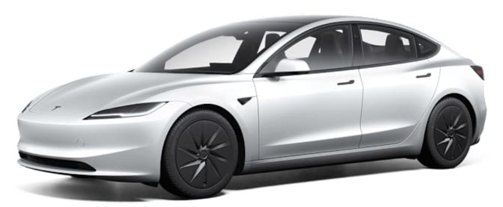
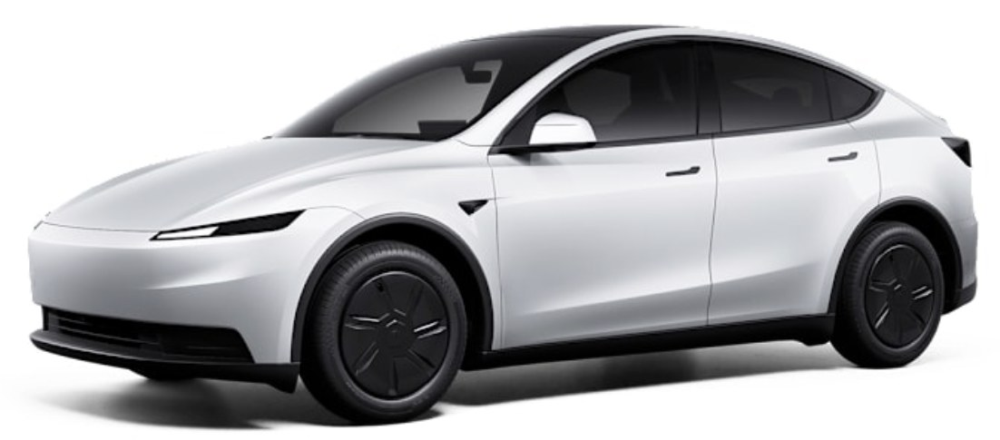

# Cheapest EVs per km

Updated 2026-11-23 19:27 UTC · 257 battery-electric cars from 2022 on · 20.000 km/yr · capital at 7% · best selling year chosen per car (max 12 yr)

Market: EVs lose about **17% of their value per year** at this mileage (fitted on all 182 EV listings, older ones included). Costs in today's krónur. Assumptions: `config.yaml`.

How the number is built

cost per km = (price − resale after N years + capital cost + charging + kílómetragjald + insurance + service + tyres + tax/skoðun + expected battery repairs after warranty) ÷ km driven. Resale comes from today's market: what the same model sells for N years older and 20.000·N km further on. N is whichever year gives the lowest cost per km.

---

**Bands:** 🟢 **Good** under 50 kr/km (10 cars) · 🟡 **Medium** 50–70 kr/km (96 cars) · 🔴 **Bad** 70+ kr/km (151 cars)

---

## 🟢 Good — under 50 kr/km

> 🟢 **under 50 kr/km ≈ under 1,0M kr per year** at 20.000 km/yr · 10 cars · cheap, efficient, holds its value — about as low as a 2022+ EV gets

🟢 **38.8 kr/km** · sell after **9 yr** · 2.390.000 kr

[Leapmotor T03](https://www.isband.is/product/leapmotor-t03/)  
🆕 NEW · 0 km · ÍSBAND (new) · leapmotor t03 · new: 2.890.000 kr list, rafbílastyrkur included (resale ≈ 225.724 kr)

kr/km: depreciation 12.0 · capital 7% 3.1 · charging 5.1 · km-gjald 7.0 · insurance 5.0 · service 2.9 · tyres 2.0 · tax/skoðun 1.2 · battery risk 0.5

⚠️ still getting cheaper per km at 9 yr / 180.000 km, where market data ends — keeping it longer is probably cheaper still; no nearly-new used ones to compare with: assumed it loses 10% on registration, then the normal EV depreciation; young brand in Iceland: depreciation & battery guessed

---

🟢 **43.1 kr/km** · sell after **9 yr** · 2.990.000 kr

[Leapmotor B03X Life](https://www.isband.is/product/leapmotor-b03x-life/)  
🆕 NEW · 0 km · ÍSBAND (new) · leapmotor b03x · new: 3.490.000 kr list, rafbílastyrkur included (resale ≈ 282.392 kr)

kr/km: depreciation 15.0 · capital 7% 3.9 · charging 5.4 · km-gjald 7.0 · insurance 5.2 · service 2.9 · tyres 2.0 · tax/skoðun 1.2 · battery risk 0.5

⚠️ still getting cheaper per km at 9 yr / 180.000 km, where market data ends — keeping it longer is probably cheaper still; no nearly-new used ones to compare with: assumed it loses 10% on registration, then the normal EV depreciation; young brand in Iceland: depreciation & battery guessed

---

🟢 **43.6 kr/km** · sell after **3 yr** · 1.690.000 kr

[Fiat 500 2022](https://bland.is/til-solu/farartaeki/bilar/fiat-500-2022/5302858/)  
2022 · 128.000 km · Bland · fiat 500e · 30% under market (market ≈ 2.398.031 kr, resale ≈ 826.181 kr)

kr/km: depreciation 14.4 · capital 7% 4.4 · charging 5.1 · km-gjald 7.0 · insurance 5.3 · service 2.9 · tyres 2.0 · tax/skoðun 1.2 · battery risk 1.2

⚠️ still getting cheaper per km at 3 yr / 188.000 km, where market data ends — keeping it longer is probably cheaper still; little market data for this model: depreciation borrowed from brand/all EVs

---

🟢 **45.5 kr/km** · sell after **8 yr** · 2.590.000 kr

[MAZDA MX-30](https://bland.is/til-solu/farartaeki/bilar/mazda-mx-30/5295862/)  
2023 · 25.000 km · Bland · mazda mx-30 · 19% under market (market ≈ 3.202.322 kr, resale ≈ 569.173 kr)

kr/km: depreciation 12.6 · capital 7% 4.9 · charging 6.1 · km-gjald 7.0 · insurance 5.3 · service 4.5 · tyres 2.0 · tax/skoðun 1.2 · battery risk 1.8

⚠️ still getting cheaper per km at 8 yr / 185.000 km, where market data ends — keeping it longer is probably cheaper still

---

🟢 **46.2 kr/km** · sell after **8 yr** · 2.690.000 kr

[Mazda MX-30 Exclusive-Line](https://notadir.brimborg.is/is/notadir-bilar/bill/KEV27)  
2023 · 24.410 km · Brimborg (used) · mazda mx-30 · 16% under market (market ≈ 3.209.355 kr, resale ≈ 586.944 kr)

kr/km: depreciation 13.1 · capital 7% 5.0 · charging 6.1 · km-gjald 7.0 · insurance 5.4 · service 4.5 · tyres 2.0 · tax/skoðun 1.2 · battery risk 1.8

⚠️ still getting cheaper per km at 8 yr / 184.000 km, where market data ends — keeping it longer is probably cheaper still

---

🟢 **46.8 kr/km** · sell after **7 yr** · 2.490.000 kr

[Mazda MX-30 Exclusive-Line](https://notadir.brimborg.is/is/notadir-bilar/bill/NGN09)  
2022 · 39.505 km · Brimborg (used) · mazda mx-30 · 8% under market (market ≈ 2.707.456 kr, resale ≈ 643.813 kr)

kr/km: depreciation 13.2 · capital 7% 4.9 · charging 6.1 · km-gjald 7.0 · insurance 5.3 · service 4.9 · tyres 2.0 · tax/skoðun 1.2 · battery risk 2.1

⚠️ still getting cheaper per km at 7 yr / 180.000 km, where market data ends — keeping it longer is probably cheaper still

---

🟢 **47.0 kr/km** · sell after **9 yr** · 3.590.000 kr

[Leapmotor B03X Design](https://www.isband.is/product/leapmotor-b03x-design/)  
🆕 NEW · 0 km · ÍSBAND (new) · leapmotor b03x · new: 4.090.000 kr list, rafbílastyrkur included (resale ≈ 339.059 kr)

kr/km: depreciation 18.1 · capital 7% 4.7 · charging 5.4 · km-gjald 7.0 · insurance 5.3 · service 2.9 · tyres 2.0 · tax/skoðun 1.2 · battery risk 0.5

⚠️ still getting cheaper per km at 9 yr / 180.000 km, where market data ends — keeping it longer is probably cheaper still; no nearly-new used ones to compare with: assumed it loses 10% on registration, then the normal EV depreciation; young brand in Iceland: depreciation & battery guessed

---

🟢 **48.8 kr/km** · sell after **8 yr** · 3.390.000 kr

[MG Mg5 Electric 2025](https://bland.is/til-solu/farartaeki/bilar/mg-mg5-electric-2025/5306951/)  
2025 · 23.000 km · Bland · mg5 · 25% under market (market ≈ 4.501.181 kr, resale ≈ 480.920 kr)

kr/km: depreciation 18.2 · capital 7% 5.5 · charging 5.8 · km-gjald 7.0 · insurance 5.4 · service 3.2 · tyres 2.0 · tax/skoðun 1.2 · battery risk 0.5

⚠️ still getting cheaper per km at 8 yr / 183.000 km, where market data ends — keeping it longer is probably cheaper still; little market data for this model: depreciation borrowed from brand/all EVs

---

🟢 **49.6 kr/km** · sell after **9 yr** · 3.990.000 kr

[Leapmotor B05 Design](https://www.isband.is/product/leapmotor-b05-design/)  
🆕 NEW · 0 km · ÍSBAND (new) · leapmotor b05 · new: 4.490.000 kr list, rafbílastyrkur included (resale ≈ 376.837 kr)

kr/km: depreciation 20.1 · capital 7% 5.2 · charging 5.4 · km-gjald 7.0 · insurance 5.4 · service 2.9 · tyres 2.0 · tax/skoðun 1.2 · battery risk 0.5

⚠️ still getting cheaper per km at 9 yr / 180.000 km, where market data ends — keeping it longer is probably cheaper still; no nearly-new used ones to compare with: assumed it loses 10% on registration, then the normal EV depreciation; young brand in Iceland: depreciation & battery guessed

---

🟢 **50.0 kr/km** · sell after **8 yr** · 3.190.000 kr

[Opel Mokka-e Ultimate](https://notadir.brimborg.is/is/notadir-bilar/bill/YDG93)  
2023 · 22.797 km · Brimborg (used) · opel mokka-e · 19% under market (market ≈ 3.932.112 kr, resale ≈ 445.867 kr)

kr/km: depreciation 17.2 · capital 7% 5.1 · charging 5.8 · km-gjald 7.0 · insurance 5.4 · service 4.5 · tyres 2.0 · tax/skoðun 1.2 · battery risk 1.8

⚠️ still getting cheaper per km at 8 yr / 183.000 km, where market data ends — keeping it longer is probably cheaper still; little market data for this model: depreciation borrowed from brand/all EVs

---

## 🟡 Medium — 50–70 kr/km

> 🟡 **50–70 kr/km ≈ 1,0–1,4M kr per year** at 20.000 km/yr · 96 cars · normal family EV — you pay for size, range or a newer car

🟡 **50.3 kr/km** · sell after **7 yr** · 2.890.000 kr

[Opel Mokka-e ULTIMATE 2022](https://bland.is/til-solu/farartaeki/bilar/opel-mokka-e-ultimate-2022/5302285/)  
2022 · 39.000 km · Bland · opel mokka-e · 13% under market (market ≈ 3.303.547 kr, resale ≈ 508.243 kr)

kr/km: depreciation 17.0 · capital 7% 5.0 · charging 5.8 · km-gjald 7.0 · insurance 5.4 · service 4.9 · tyres 2.0 · tax/skoðun 1.2 · battery risk 2.1

⚠️ still getting cheaper per km at 7 yr / 179.000 km, where market data ends — keeping it longer is probably cheaper still; little market data for this model: depreciation borrowed from brand/all EVs

---

🟡 **51.1 kr/km** · sell after **7 yr** · 3.100.000 kr

[Nissan Leaf N-Connecta  2022](https://bland.is/til-solu/farartaeki/bilar/nissan-leaf-n-connecta-2022/5296627/)  
2022 · 53.000 km · Bland · nissan leaf · 10% over market (market ≈ 2.809.971 kr, resale ≈ 772.890 kr)

kr/km: depreciation 16.6 · capital 7% 5.9 · charging 5.8 · km-gjald 7.0 · insurance 5.5 · service 4.9 · tyres 2.0 · tax/skoðun 1.2 · battery risk 2.1

⚠️ still getting cheaper per km at 7 yr / 193.000 km, where market data ends — keeping it longer is probably cheaper still

---

🟡 **51.1 kr/km** · sell after **9 yr** · 3.800.000 kr

[MG Comfort](https://bland.is/til-solu/farartaeki/bilar/mg-comfort/5289959/)  
2025 · 7.000 km · Bland · mg (other) · 22% under market (market ≈ 4.864.950 kr, resale ≈ 418.968 kr)

kr/km: depreciation 18.8 · capital 7% 5.6 · charging 6.5 · km-gjald 7.0 · insurance 5.5 · service 3.6 · tyres 2.0 · tax/skoðun 1.2 · battery risk 0.9

⚠️ still getting cheaper per km at 9 yr / 187.000 km, where market data ends — keeping it longer is probably cheaper still; little market data for this model: depreciation borrowed from brand/all EVs; model not recognised: consumption assumed

---

🟡 **51.4 kr/km** · sell after **9 yr** · 3.990.000 kr

[Citroen E-C4 MAX](https://notadir.brimborg.is/is/notadir-bilar/bill/EVL42)  
2025 · 11.533 km · Brimborg (used) · citroen e-c4 · 17% under market (market ≈ 4.824.083 kr, resale ≈ 723.096 kr)

kr/km: depreciation 18.1 · capital 7% 7.0 · charging 5.8 · km-gjald 7.0 · insurance 5.7 · service 3.6 · tyres 2.0 · tax/skoðun 1.2 · battery risk 0.9

⚠️ still getting cheaper per km at 9 yr / 192.000 km, where market data ends — keeping it longer is probably cheaper still

---

🟡 **51.4 kr/km** · sell after **7 yr** · 2.990.000 kr

[MG ZS EV 2022 LR Luxury](https://bland.is/til-solu/farartaeki/bilar/mg-zs-ev-2022-lr-luxury/5257047/)  
2022 · 45.000 km · Bland · mg zs ev · at market (market ≈ 2.997.534 kr, resale ≈ 512.209 kr)

kr/km: depreciation 17.7 · capital 7% 5.0 · charging 6.1 · km-gjald 7.0 · insurance 5.4 · service 4.9 · tyres 2.0 · tax/skoðun 1.2 · battery risk 2.1

⚠️ still getting cheaper per km at 7 yr / 185.000 km, where market data ends — keeping it longer is probably cheaper still; little market data for this model: depreciation borrowed from brand/all EVs

---

🟡 **51.8 kr/km** · sell after **7 yr** · 3.200.000 kr

[Nissan Leaf 62kwh 2022](https://bland.is/til-solu/farartaeki/bilar/nissan-leaf-62kwh-2022/5291168/)  
2022 · 54.000 km · Bland · nissan leaf · 14% over market (market ≈ 2.799.542 kr, resale ≈ 792.182 kr)

kr/km: depreciation 17.2 · capital 7% 6.1 · charging 5.8 · km-gjald 7.0 · insurance 5.5 · service 4.9 · tyres 2.0 · tax/skoðun 1.2 · battery risk 2.1

⚠️ still getting cheaper per km at 7 yr / 194.000 km, where market data ends — keeping it longer is probably cheaper still

---

🟡 **52.0 kr/km** · sell after **9 yr** · 4.090.000 kr

[Citroen E-C4 MAX](https://notadir.brimborg.is/is/notadir-bilar/bill/JJA22)  
2025 · 12.583 km · Brimborg (used) · citroen e-c4 · 15% under market (market ≈ 4.805.287 kr, resale ≈ 736.983 kr)

kr/km: depreciation 18.6 · capital 7% 7.1 · charging 5.8 · km-gjald 7.0 · insurance 5.7 · service 3.6 · tyres 2.0 · tax/skoðun 1.2 · battery risk 0.9

⚠️ still getting cheaper per km at 9 yr / 193.000 km, where market data ends — keeping it longer is probably cheaper still

---

🟡 **52.8 kr/km** · sell after **9 yr** · 3.500.000 kr

[Nissan Leaf Tekna 2022](https://bland.is/til-solu/farartaeki/bilar/nissan-leaf-tekna-2022/4880347/)  
2022 · 6.000 km · Bland · nissan leaf · 5% over market (market ≈ 3.346.529 kr, resale ≈ 605.213 kr)

kr/km: depreciation 16.1 · capital 7% 5.9 · charging 5.8 · km-gjald 7.0 · insurance 5.5 · service 5.9 · tyres 2.0 · tax/skoðun 1.2 · battery risk 3.4

⚠️ still getting cheaper per km at 9 yr / 186.000 km, where market data ends — keeping it longer is probably cheaper still

---

🟡 **52.9 kr/km** · sell after **9 yr** · 4.480.000 kr

[VW ID.3 PRO](https://www.hekla.is/is/bilar/nyir-bilar-syningasalur/vw-id3-pro-85)  
🆕 NEW · 0 km · Hekla (new) · vw id.3 · new: 5.980.000 kr list, rafbílastyrkur assumed (resale ≈ 423.115 kr)

kr/km: depreciation 22.5 · capital 7% 5.8 · charging 5.6 · km-gjald 7.0 · insurance 5.5 · service 2.9 · tyres 2.0 · tax/skoðun 1.2 · battery risk 0.3

⚠️ still getting cheaper per km at 9 yr / 180.000 km, where market data ends — keeping it longer is probably cheaper still; no nearly-new used ones to compare with: assumed it loses 10% on registration, then the normal EV depreciation; little market data for this model: depreciation borrowed from brand/all EVs

---

🟡 **53.3 kr/km** · sell after **9 yr** · 4.590.000 kr

[Ford Puma EV Premium](https://nyirbilar.brimborg.is/is/nyir-bilar/bill/146517)  
🆕 NEW · 0 km · Brimborg (new) · ford puma ev · new: 4.990.000 kr list, rafbílastyrkur included (resale ≈ 433.504 kr)

kr/km: depreciation 23.1 · capital 7% 6.0 · charging 5.3 · km-gjald 7.0 · insurance 5.5 · service 2.9 · tyres 2.0 · tax/skoðun 1.2 · battery risk 0.3

⚠️ still getting cheaper per km at 9 yr / 180.000 km, where market data ends — keeping it longer is probably cheaper still; no nearly-new used ones to compare with: assumed it loses 10% on registration, then the normal EV depreciation; little market data for this model: depreciation borrowed from brand/all EVs

---

🟡 **53.3 kr/km** · sell after **9 yr** · 4.599.000 kr

[Ford Puma EV Premium](https://nyirbilar.brimborg.is/is/nyir-bilar/bill/GKM99)  
🆕 NEW · 0 km · Brimborg (new) · ford puma ev · new: 5.209.000 kr list, rafbílastyrkur included (resale ≈ 434.354 kr)

kr/km: depreciation 23.1 · capital 7% 6.0 · charging 5.3 · km-gjald 7.0 · insurance 5.5 · service 2.9 · tyres 2.0 · tax/skoðun 1.2 · battery risk 0.3

⚠️ still getting cheaper per km at 9 yr / 180.000 km, where market data ends — keeping it longer is probably cheaper still; no nearly-new used ones to compare with: assumed it loses 10% on registration, then the normal EV depreciation; little market data for this model: depreciation borrowed from brand/all EVs

---

🟡 **54.2 kr/km** · sell after **8 yr** · 4.090.000 kr

[Citroen E-C4 MAX](https://notadir.brimborg.is/is/notadir-bilar/bill/ABT34)  
2024 · 23.490 km · Brimborg (used) · citroen e-c4 · at market (market ≈ 4.117.424 kr, resale ≈ 862.611 kr)

kr/km: depreciation 20.2 · capital 7% 7.4 · charging 5.8 · km-gjald 7.0 · insurance 5.8 · service 3.8 · tyres 2.0 · tax/skoðun 1.2 · battery risk 1.1

⚠️ still getting cheaper per km at 8 yr / 183.000 km, where market data ends — keeping it longer is probably cheaper still

---

🟡 **54.3 kr/km** · sell after **8 yr** · 3.190.000 kr

[Maxus EUNIQ 6](https://bland.is/til-solu/farartaeki/bilar/maxus-euniq-6/5296334/)  
2022 · 34.000 km · Bland · maxus · 19% under market (market ≈ 3.923.735 kr, resale ≈ 445.677 kr)

kr/km: depreciation 17.2 · capital 7% 5.1 · charging 7.5 · km-gjald 7.0 · insurance 5.4 · service 5.4 · tyres 2.0 · tax/skoðun 1.2 · battery risk 3.6

⚠️ still getting cheaper per km at 8 yr / 194.000 km, where market data ends — keeping it longer is probably cheaper still; young brand in Iceland: depreciation & battery guessed

---

🟡 **54.5 kr/km** · sell after **9 yr** · 4.769.000 kr

[Ford Puma EV Premium](https://nyirbilar.brimborg.is/is/nyir-bilar/bill/146518)  
🆕 NEW · 0 km · Brimborg (new) · ford puma ev · new: 5.169.000 kr list, rafbílastyrkur included (resale ≈ 450.410 kr)

kr/km: depreciation 24.0 · capital 7% 6.2 · charging 5.3 · km-gjald 7.0 · insurance 5.6 · service 2.9 · tyres 2.0 · tax/skoðun 1.2 · battery risk 0.3

⚠️ still getting cheaper per km at 9 yr / 180.000 km, where market data ends — keeping it longer is probably cheaper still; no nearly-new used ones to compare with: assumed it loses 10% on registration, then the normal EV depreciation; little market data for this model: depreciation borrowed from brand/all EVs

---

🟡 **54.6 kr/km** · sell after **9 yr** · 4.490.000 kr

[Citroen E-C4 MAX](https://notadir.brimborg.is/is/notadir-bilar/bill/KLN72)  
2025 · 16.790 km · Brimborg (used) · citroen e-c4 · 5% under market (market ≈ 4.730.708 kr, resale ≈ 791.620 kr)

kr/km: depreciation 20.5 · capital 7% 7.7 · charging 5.8 · km-gjald 7.0 · insurance 5.8 · service 3.6 · tyres 2.0 · tax/skoðun 1.2 · battery risk 0.9

⚠️ still getting cheaper per km at 9 yr / 197.000 km, where market data ends — keeping it longer is probably cheaper still

---

🟡 **55.2 kr/km** · sell after **9 yr** · 4.810.000 kr

[Peugeot E-2008 Allure](https://nyirbilar.brimborg.is/is/nyir-bilar/bill/RKV79)  
🆕 NEW · 0 km · Brimborg (new) · peugeot e-2008 · new: 5.590.000 kr list, rafbílastyrkur included (resale ≈ 454.282 kr)

kr/km: depreciation 24.2 · capital 7% 6.2 · charging 5.8 · km-gjald 7.0 · insurance 5.6 · service 2.9 · tyres 2.0 · tax/skoðun 1.2 · battery risk 0.3

⚠️ still getting cheaper per km at 9 yr / 180.000 km, where market data ends — keeping it longer is probably cheaper still; no nearly-new used ones to compare with: assumed it loses 10% on registration, then the normal EV depreciation; little market data for this model: depreciation borrowed from brand/all EVs

---

🟡 **55.4 kr/km** · sell after **9 yr** · 4.790.000 kr

[Leapmotor B10 Design](https://www.isband.is/product/leapmotor-b10-design/)  
🆕 NEW · 0 km · ÍSBAND (new) · leapmotor b10 · new: 5.290.000 kr list, rafbílastyrkur included (resale ≈ 452.393 kr)

kr/km: depreciation 24.1 · capital 7% 6.2 · charging 6.0 · km-gjald 7.0 · insurance 5.6 · service 2.9 · tyres 2.0 · tax/skoðun 1.2 · battery risk 0.5

⚠️ still getting cheaper per km at 9 yr / 180.000 km, where market data ends — keeping it longer is probably cheaper still; no nearly-new used ones to compare with: assumed it loses 10% on registration, then the normal EV depreciation; young brand in Iceland: depreciation & battery guessed

---

🟡 **56.4 kr/km** · sell after **9 yr** · 4.990.000 kr

[Peugeot E-2008 GT Exclusive](https://nyirbilar.brimborg.is/is/nyir-bilar/bill/149359)  
🆕 NEW · 0 km · Brimborg (new) · peugeot e-2008 · new: 5.770.000 kr list, rafbílastyrkur included (resale ≈ 471.282 kr)

kr/km: depreciation 25.1 · capital 7% 6.5 · charging 5.8 · km-gjald 7.0 · insurance 5.6 · service 2.9 · tyres 2.0 · tax/skoðun 1.2 · battery risk 0.3

⚠️ still getting cheaper per km at 9 yr / 180.000 km, where market data ends — keeping it longer is probably cheaper still; no nearly-new used ones to compare with: assumed it loses 10% on registration, then the normal EV depreciation; little market data for this model: depreciation borrowed from brand/all EVs

---

🟡 **56.8 kr/km** · sell after **9 yr** · 5.050.000 kr · 5 in stock

[Peugeot E-2008 GT Exclusive](https://nyirbilar.brimborg.is/is/nyir-bilar/bill/MNY80)  
🆕 NEW · 0 km · Brimborg (new) · peugeot e-2008 · new: 5.830.000 kr list, rafbílastyrkur included (resale ≈ 476.949 kr)

kr/km: depreciation 25.4 · capital 7% 6.6 · charging 5.8 · km-gjald 7.0 · insurance 5.6 · service 2.9 · tyres 2.0 · tax/skoðun 1.2 · battery risk 0.3

⚠️ still getting cheaper per km at 9 yr / 180.000 km, where market data ends — keeping it longer is probably cheaper still; no nearly-new used ones to compare with: assumed it loses 10% on registration, then the normal EV depreciation; little market data for this model: depreciation borrowed from brand/all EVs

---

🟡 **56.8 kr/km** · sell after **6 yr** · 3.400.000 kr

[MG Mg Marvel R Electric 2022](https://bland.is/til-solu/farartaeki/bilar/mg-mg-marvel-r-electric-2022/5303882/)  
2022 · 74.000 km · Bland · mg marvel r · 3% over market (market ≈ 3.300.153 kr, resale ≈ 739.191 kr)

kr/km: depreciation 22.2 · capital 7% 6.2 · charging 6.8 · km-gjald 7.0 · insurance 5.6 · service 4.4 · tyres 2.0 · tax/skoðun 1.2 · battery risk 1.4

⚠️ still getting cheaper per km at 6 yr / 194.000 km, where market data ends — keeping it longer is probably cheaper still; little market data for this model: depreciation borrowed from brand/all EVs

---

🟡 **56.9 kr/km** · sell after **9 yr** · 5.170.000 kr · 2 in stock

[VOLKSWAGEN ID. Polo Life](https://www.hekla.is/is/bilar/nyir-bilar-syningasalur/volkswagen-id-polo-8)  
🆕 NEW · 0 km · Hekla (new) · vw id.polo · new: 5.570.000 kr list, rafbílastyrkur included (resale ≈ 488.282 kr)

kr/km: depreciation 26.0 · capital 7% 6.7 · charging 5.1 · km-gjald 7.0 · insurance 5.7 · service 2.9 · tyres 2.0 · tax/skoðun 1.2 · battery risk 0.3

⚠️ still getting cheaper per km at 9 yr / 180.000 km, where market data ends — keeping it longer is probably cheaper still; no nearly-new used ones to compare with: assumed it loses 10% on registration, then the normal EV depreciation; little market data for this model: depreciation borrowed from brand/all EVs

---

🟡 **57.0 kr/km** · sell after **9 yr** · 5.080.000 kr

[Peugeot E-2008 GT Exclusive](https://nyirbilar.brimborg.is/is/nyir-bilar/bill/149361)  
🆕 NEW · 0 km · Brimborg (new) · peugeot e-2008 · new: 5.860.000 kr list, rafbílastyrkur included (resale ≈ 479.782 kr)

kr/km: depreciation 25.6 · capital 7% 6.6 · charging 5.8 · km-gjald 7.0 · insurance 5.6 · service 2.9 · tyres 2.0 · tax/skoðun 1.2 · battery risk 0.3

⚠️ still getting cheaper per km at 9 yr / 180.000 km, where market data ends — keeping it longer is probably cheaper still; no nearly-new used ones to compare with: assumed it loses 10% on registration, then the normal EV depreciation; little market data for this model: depreciation borrowed from brand/all EVs

---

🟡 **57.1 kr/km** · sell after **9 yr** · 5.100.000 kr · 🆕

[Peugeot E-2008 Allure](https://nyirbilar.brimborg.is/is/nyir-bilar/bill/151413)  
🆕 NEW · 0 km · Brimborg (new) · peugeot e-2008 · new: 5.500.000 kr list, rafbílastyrkur included (resale ≈ 481.671 kr)

kr/km: depreciation 25.7 · capital 7% 6.6 · charging 5.8 · km-gjald 7.0 · insurance 5.6 · service 2.9 · tyres 2.0 · tax/skoðun 1.2 · battery risk 0.3

⚠️ still getting cheaper per km at 9 yr / 180.000 km, where market data ends — keeping it longer is probably cheaper still; no nearly-new used ones to compare with: assumed it loses 10% on registration, then the normal EV depreciation; little market data for this model: depreciation borrowed from brand/all EVs

---

🟡 **57.5 kr/km** · sell after **9 yr** · 5.290.000 kr

[Tesla Model 3 RWD](https://www.tesla.com/is_is/model3/design)  
🆕 NEW · 0 km · Manual (new) · tesla model 3 · new: 5.790.000 kr list, rafbílastyrkur assumed (resale ≈ 830.678 kr)

kr/km: depreciation 24.8 · capital 7% 8.2 · charging 5.3 · km-gjald 7.0 · insurance 5.9 · service 2.9 · tyres 2.0 · tax/skoðun 1.2 · battery risk 0.3

⚠️ still getting cheaper per km at 9 yr / 180.000 km, where market data ends — keeping it longer is probably cheaper still; no nearly-new used ones to compare with: assumed it loses 10% on registration, then the normal EV depreciation

---

🟡 **57.7 kr/km** · sell after **9 yr** · 5.290.000 kr · 4 in stock

[Skoda Epiq 55](https://www.hekla.is/is/bilar/nyir-bilar-syningasalur/skoda-epiq-55)  
🆕 NEW · 0 km · Hekla (new) · skoda epiq · new: 5.690.000 kr list, rafbílastyrkur included (resale ≈ 499.616 kr)

kr/km: depreciation 26.6 · capital 7% 6.9 · charging 5.1 · km-gjald 7.0 · insurance 5.7 · service 2.9 · tyres 2.0 · tax/skoðun 1.2 · battery risk 0.3

⚠️ still getting cheaper per km at 9 yr / 180.000 km, where market data ends — keeping it longer is probably cheaper still; no nearly-new used ones to compare with: assumed it loses 10% on registration, then the normal EV depreciation; little market data for this model: depreciation borrowed from brand/all EVs

---

🟡 **57.9 kr/km** · sell after **9 yr** · 5.220.000 kr · 🆕

[Peugeot E-2008 Allure](https://nyirbilar.brimborg.is/is/nyir-bilar/bill/151414)  
🆕 NEW · 0 km · Brimborg (new) · peugeot e-2008 · new: 5.620.000 kr list, rafbílastyrkur included (resale ≈ 493.005 kr)

kr/km: depreciation 26.3 · capital 7% 6.8 · charging 5.8 · km-gjald 7.0 · insurance 5.7 · service 2.9 · tyres 2.0 · tax/skoðun 1.2 · battery risk 0.3

⚠️ still getting cheaper per km at 9 yr / 180.000 km, where market data ends — keeping it longer is probably cheaper still; no nearly-new used ones to compare with: assumed it loses 10% on registration, then the normal EV depreciation; little market data for this model: depreciation borrowed from brand/all EVs

---

🟡 **58.2 kr/km** · sell after **9 yr** · 5.360.000 kr

[VOLKSWAGEN ID. Polo Life](https://www.hekla.is/is/bilar/nyir-bilar-syningasalur/volkswagen-id-polo-14)  
🆕 NEW · 0 km · Hekla (new) · vw id.polo · new: 5.760.000 kr list, rafbílastyrkur included (resale ≈ 506.227 kr)

kr/km: depreciation 27.0 · capital 7% 7.0 · charging 5.1 · km-gjald 7.0 · insurance 5.7 · service 2.9 · tyres 2.0 · tax/skoðun 1.2 · battery risk 0.3

⚠️ still getting cheaper per km at 9 yr / 180.000 km, where market data ends — keeping it longer is probably cheaper still; no nearly-new used ones to compare with: assumed it loses 10% on registration, then the normal EV depreciation; little market data for this model: depreciation borrowed from brand/all EVs

---

🟡 **59.1 kr/km** · sell after **9 yr** · 5.500.000 kr

[VOLKSWAGEN ID. Polo Life](https://www.hekla.is/is/bilar/nyir-bilar-syningasalur/volkswagen-id-polo-12)  
🆕 NEW · 0 km · Hekla (new) · vw id.polo · new: 5.900.000 kr list, rafbílastyrkur included (resale ≈ 519.449 kr)

kr/km: depreciation 27.7 · capital 7% 7.1 · charging 5.1 · km-gjald 7.0 · insurance 5.7 · service 2.9 · tyres 2.0 · tax/skoðun 1.2 · battery risk 0.3

⚠️ still getting cheaper per km at 9 yr / 180.000 km, where market data ends — keeping it longer is probably cheaper still; no nearly-new used ones to compare with: assumed it loses 10% on registration, then the normal EV depreciation; little market data for this model: depreciation borrowed from brand/all EVs

---

🟡 **59.7 kr/km** · sell after **9 yr** · 5.590.000 kr · 2 in stock

[Skoda Epiq 55](https://www.hekla.is/is/bilar/nyir-bilar-syningasalur/epiq-2)  
🆕 NEW · 0 km · Hekla (new) · skoda epiq · new: 5.990.000 kr list, rafbílastyrkur included (resale ≈ 527.949 kr)

kr/km: depreciation 28.1 · capital 7% 7.3 · charging 5.1 · km-gjald 7.0 · insurance 5.7 · service 2.9 · tyres 2.0 · tax/skoðun 1.2 · battery risk 0.3

⚠️ still getting cheaper per km at 9 yr / 180.000 km, where market data ends — keeping it longer is probably cheaper still; no nearly-new used ones to compare with: assumed it loses 10% on registration, then the normal EV depreciation; little market data for this model: depreciation borrowed from brand/all EVs

---

🟡 **60.0 kr/km** · sell after **9 yr** · 5.430.000 kr (was 5.730.000)

[Mazda6e Takumi](https://nyirbilar.brimborg.is/is/nyir-bilar/bill/PDH37)  
🆕 NEW · 0 km · Brimborg (new) · unknown · new: 6.330.000 kr list, rafbílastyrkur included (resale ≈ 512.838 kr)

kr/km: depreciation 27.3 · capital 7% 7.0 · charging 6.5 · km-gjald 7.0 · insurance 5.7 · service 2.9 · tyres 2.0 · tax/skoðun 1.2 · battery risk 0.3

⚠️ still getting cheaper per km at 9 yr / 180.000 km, where market data ends — keeping it longer is probably cheaper still; no nearly-new used ones to compare with: assumed it loses 10% on registration, then the normal EV depreciation; little market data for this model: depreciation borrowed from brand/all EVs; model not recognised: consumption assumed

---

🟡 **60.1 kr/km** · sell after **9 yr** · 5.580.000 kr · 3 in stock

[VW ID.3 PRO](https://www.hekla.is/is/bilar/nyir-bilar-syningasalur/vw-id3-pro-39)  
🆕 NEW · 0 km · Hekla (new) · vw id.3 · new: 5.980.000 kr list, rafbílastyrkur included (resale ≈ 527.005 kr)

kr/km: depreciation 28.1 · capital 7% 7.2 · charging 5.6 · km-gjald 7.0 · insurance 5.7 · service 2.9 · tyres 2.0 · tax/skoðun 1.2 · battery risk 0.3

⚠️ still getting cheaper per km at 9 yr / 180.000 km, where market data ends — keeping it longer is probably cheaper still; no nearly-new used ones to compare with: assumed it loses 10% on registration, then the normal EV depreciation; little market data for this model: depreciation borrowed from brand/all EVs

---

🟡 **60.6 kr/km** · sell after **8 yr** · 4.590.000 kr

[Subaru Solterra 2023 frábært verð](https://bland.is/til-solu/farartaeki/bilar/subaru-solterra-2023-frabaert-verd/5291633/)  
2023 · 34.000 km · Bland · subaru solterra · 8% under market (market ≈ 4.982.548 kr, resale ≈ 625.443 kr)

kr/km: depreciation 24.8 · capital 7% 7.2 · charging 6.3 · km-gjald 7.0 · insurance 5.7 · service 4.5 · tyres 2.0 · tax/skoðun 1.2 · battery risk 1.8

⚠️ still getting cheaper per km at 8 yr / 194.000 km, where market data ends — keeping it longer is probably cheaper still; little market data for this model: depreciation borrowed from brand/all EVs

---

🟡 **60.6 kr/km** · sell after **5 yr** · 3.590.000 kr

[MG Mg Marvel R Electric 2022](https://bland.is/til-solu/farartaeki/bilar/mg-mg-marvel-r-electric-2022/5301420/)  
2022 · 86.000 km · Bland · mg marvel r · 14% over market (market ≈ 3.156.146 kr, resale ≈ 977.424 kr)

kr/km: depreciation 26.1 · capital 7% 7.1 · charging 6.8 · km-gjald 7.0 · insurance 5.7 · service 3.9 · tyres 2.0 · tax/skoðun 1.2 · battery risk 0.7

⚠️ still getting cheaper per km at 5 yr / 186.000 km, where market data ends — keeping it longer is probably cheaper still; little market data for this model: depreciation borrowed from brand/all EVs

---

🟡 **60.8 kr/km** · sell after **6 yr** · 4.090.000 kr

[Volkswagen, Vw Id.4 Pro 150 Kw 2023](https://bland.is/til-solu/farartaeki/bilar/volkswagen-vw-id-4-pro-150-kw-2023/5302122/)  
2023 · 63.000 km · Bland · vw id.4 · at market (market ≈ 4.110.889 kr, resale ≈ 895.431 kr)

kr/km: depreciation 26.6 · capital 7% 7.5 · charging 6.5 · km-gjald 7.0 · insurance 5.8 · service 3.6 · tyres 2.0 · tax/skoðun 1.2 · battery risk 0.6

⚠️ still getting cheaper per km at 6 yr / 183.000 km, where market data ends — keeping it longer is probably cheaper still; little market data for this model: depreciation borrowed from brand/all EVs

---

🟡 **61.3 kr/km** · sell after **9 yr** · 5.550.000 kr

[Tesla Model 3 2025](https://bland.is/til-solu/farartaeki/bilar/tesla-model-3-2025/5306195/)  
2025 · 14.000 km · Bland · tesla model 3 · 32% under market (market ≈ 8.103.511 kr, resale ≈ 1.044.489 kr)

kr/km: depreciation 25.0 · capital 7% 10.0 · charging 5.3 · km-gjald 7.0 · insurance 6.2 · service 3.6 · tyres 2.0 · tax/skoðun 1.2 · battery risk 0.9

⚠️ still getting cheaper per km at 9 yr / 194.000 km, where market data ends — keeping it longer is probably cheaper still

---

🟡 **61.6 kr/km** · sell after **9 yr** · 5.590.000 kr

[Tesla Model 3 2025](https://bland.is/til-solu/farartaeki/bilar/tesla-model-3-2025/5303426/)  
2025 · 11.000 km · Bland · tesla model 3 · 32% under market (market ≈ 8.194.406 kr, resale ≈ 1.052.853 kr)

kr/km: depreciation 25.2 · capital 7% 10.1 · charging 5.3 · km-gjald 7.0 · insurance 6.2 · service 3.6 · tyres 2.0 · tax/skoðun 1.2 · battery risk 0.9

⚠️ still getting cheaper per km at 9 yr / 191.000 km, where market data ends — keeping it longer is probably cheaper still

---

🟡 **61.6 kr/km** · sell after **9 yr** · 5.680.000 kr

[VW ID.4 PRO 4MOTION](https://www.hekla.is/is/bilar/nyir-bilar-syningasalur/vw-id4-pro-4motion-97)  
🆕 NEW · 0 km · Hekla (new) · vw id.4 · new: 7.180.000 kr list, rafbílastyrkur assumed (resale ≈ 536.450 kr)

kr/km: depreciation 28.6 · capital 7% 7.4 · charging 6.5 · km-gjald 7.0 · insurance 5.8 · service 2.9 · tyres 2.0 · tax/skoðun 1.2 · battery risk 0.3

⚠️ still getting cheaper per km at 9 yr / 180.000 km, where market data ends — keeping it longer is probably cheaper still; no nearly-new used ones to compare with: assumed it loses 10% on registration, then the normal EV depreciation; little market data for this model: depreciation borrowed from brand/all EVs

---

🟡 **61.7 kr/km** · sell after **9 yr** · 5.700.000 kr (was 6.000.000)

[Mazda6e Takumi Plus](https://nyirbilar.brimborg.is/is/nyir-bilar/bill/RXU96)  
🆕 NEW · 0 km · Brimborg (new) · unknown · new: 6.600.000 kr list, rafbílastyrkur included (resale ≈ 538.338 kr)

kr/km: depreciation 28.7 · capital 7% 7.4 · charging 6.5 · km-gjald 7.0 · insurance 5.8 · service 2.9 · tyres 2.0 · tax/skoðun 1.2 · battery risk 0.3

⚠️ still getting cheaper per km at 9 yr / 180.000 km, where market data ends — keeping it longer is probably cheaper still; no nearly-new used ones to compare with: assumed it loses 10% on registration, then the normal EV depreciation; little market data for this model: depreciation borrowed from brand/all EVs; model not recognised: consumption assumed

---

🟡 **61.9 kr/km** · sell after **9 yr** · 5.730.000 kr (was 6.030.000)

[Mazda6e Takumi Plus](https://nyirbilar.brimborg.is/is/nyir-bilar/bill/MHL89)  
🆕 NEW · 0 km · Brimborg (new) · unknown · new: 6.630.000 kr list, rafbílastyrkur included (resale ≈ 541.172 kr)

kr/km: depreciation 28.8 · capital 7% 7.4 · charging 6.5 · km-gjald 7.0 · insurance 5.8 · service 2.9 · tyres 2.0 · tax/skoðun 1.2 · battery risk 0.3

⚠️ still getting cheaper per km at 9 yr / 180.000 km, where market data ends — keeping it longer is probably cheaper still; no nearly-new used ones to compare with: assumed it loses 10% on registration, then the normal EV depreciation; little market data for this model: depreciation borrowed from brand/all EVs; model not recognised: consumption assumed

---

🟡 **62.3 kr/km** · sell after **9 yr** · 5.990.000 kr

[VOLKSWAGEN ID. Polo Style](https://www.hekla.is/is/bilar/nyir-bilar-syningasalur/volkswagen-id-polo-style-2)  
🆕 NEW · 0 km · Hekla (new) · vw id.polo · new: 6.390.000 kr list, rafbílastyrkur included (resale ≈ 565.728 kr)

kr/km: depreciation 30.1 · capital 7% 7.8 · charging 5.1 · km-gjald 7.0 · insurance 5.8 · service 2.9 · tyres 2.0 · tax/skoðun 1.2 · battery risk 0.3

⚠️ still getting cheaper per km at 9 yr / 180.000 km, where market data ends — keeping it longer is probably cheaper still; no nearly-new used ones to compare with: assumed it loses 10% on registration, then the normal EV depreciation; little market data for this model: depreciation borrowed from brand/all EVs

---

🟡 **62.7 kr/km** · sell after **9 yr** · 5.980.000 kr · 2 in stock

[VOLKSWAGEN ID. Cross Life](https://www.hekla.is/is/bilar/nyir-bilar-syningasalur/volkswagen-id-cross-life)  
🆕 NEW · 0 km · Hekla (new) · vw id.cross · new: 6.380.000 kr list, rafbílastyrkur included (resale ≈ 564.783 kr)

kr/km: depreciation 30.1 · capital 7% 7.8 · charging 5.6 · km-gjald 7.0 · insurance 5.8 · service 2.9 · tyres 2.0 · tax/skoðun 1.2 · battery risk 0.3

⚠️ still getting cheaper per km at 9 yr / 180.000 km, where market data ends — keeping it longer is probably cheaper still; no nearly-new used ones to compare with: assumed it loses 10% on registration, then the normal EV depreciation; little market data for this model: depreciation borrowed from brand/all EVs

---

🟡 **62.8 kr/km** · sell after **7 yr** · 4.790.000 kr

[Polestar 2 LRSM Pilot Lite](https://notadir.brimborg.is/is/notadir-bilar/bill/OLL89)  
2023 · 53.084 km · Brimborg (used) · polestar 2 · 14% under market (market ≈ 5.578.666 kr, resale ≈ 1.255.632 kr)

kr/km: depreciation 25.2 · capital 7% 9.6 · charging 6.3 · km-gjald 7.0 · insurance 6.1 · service 4.1 · tyres 2.0 · tax/skoðun 1.2 · battery risk 1.2

⚠️ still getting cheaper per km at 7 yr / 193.000 km, where market data ends — keeping it longer is probably cheaper still

---

🟡 **62.9 kr/km** · sell after **9 yr** · 6.029.990 kr

[Tesla Model Y RWD](https://www.tesla.com/is_is/modely/design)  
🆕 NEW · 0 km · Manual (new) · tesla model y · new: 6.529.990 kr list, rafbílastyrkur assumed (resale ≈ 946.878 kr)

kr/km: depreciation 28.2 · capital 7% 9.3 · charging 5.8 · km-gjald 7.0 · insurance 6.1 · service 2.9 · tyres 2.0 · tax/skoðun 1.2 · battery risk 0.3

⚠️ still getting cheaper per km at 9 yr / 180.000 km, where market data ends — keeping it longer is probably cheaper still; no nearly-new used ones to compare with: assumed it loses 10% on registration, then the normal EV depreciation

---

🟡 **63.0 kr/km** · sell after **5 yr** · 4.290.000 kr

[Hyundai Kona. 480 km drægni.](https://bland.is/til-solu/farartaeki/bilar/hyundai-kona-480-km-draegni-/5300445/)  
2023 · 92.000 km · Bland · hyundai kona electric · 14% over market (market ≈ 3.768.960 kr, resale ≈ 1.548.999 kr)

kr/km: depreciation 27.4 · capital 7% 9.5 · charging 5.3 · km-gjald 7.0 · insurance 6.1 · service 3.1 · tyres 2.0 · tax/skoðun 1.2 · battery risk 1.3

⚠️ still getting cheaper per km at 5 yr / 192.000 km, where market data ends — keeping it longer is probably cheaper still

---

🟡 **63.2 kr/km** · sell after **4 yr** · 3.890.000 kr

[Polestar 2 SRSM Base](https://notadir.brimborg.is/is/notadir-bilar/bill/KJX58)  
2022 · 101.612 km · Brimborg (used) · polestar 2 · 6% under market (market ≈ 4.156.124 kr, resale ≈ 1.763.254 kr)

kr/km: depreciation 26.6 · capital 7% 9.7 · charging 6.3 · km-gjald 7.0 · insurance 6.2 · service 3.4 · tyres 2.0 · tax/skoðun 1.2 · battery risk 0.8

⚠️ still getting cheaper per km at 4 yr / 182.000 km, where market data ends — keeping it longer is probably cheaper still

---

🟡 **63.3 kr/km** · sell after **9 yr** · 5.670.000 kr

[Mazda 6e 2025](https://bland.is/til-solu/farartaeki/bilar/mazda-6e-2025/5291215/)  
2025 · 11.000 km · Bland · mazda (other) · at market (market ≈ 5.629.344 kr, resale ≈ 594.150 kr)

kr/km: depreciation 28.2 · capital 7% 8.0 · charging 6.5 · km-gjald 7.0 · insurance 5.9 · service 3.6 · tyres 2.0 · tax/skoðun 1.2 · battery risk 0.9

⚠️ still getting cheaper per km at 9 yr / 191.000 km, where market data ends — keeping it longer is probably cheaper still; little market data for this model: depreciation borrowed from brand/all EVs; model not recognised: consumption assumed

---

🟡 **63.5 kr/km** · sell after **9 yr** · 6.180.000 kr · 3 in stock

[VOLKSWAGEN ID. Polo Style](https://www.hekla.is/is/bilar/nyir-bilar-syningasalur/volkswagen-id-polo-7)  
🆕 NEW · 0 km · Hekla (new) · vw id.polo · new: 6.580.000 kr list, rafbílastyrkur included (resale ≈ 583.672 kr)

kr/km: depreciation 31.1 · capital 7% 8.0 · charging 5.1 · km-gjald 7.0 · insurance 5.9 · service 2.9 · tyres 2.0 · tax/skoðun 1.2 · battery risk 0.3

⚠️ still getting cheaper per km at 9 yr / 180.000 km, where market data ends — keeping it longer is probably cheaper still; no nearly-new used ones to compare with: assumed it loses 10% on registration, then the normal EV depreciation; little market data for this model: depreciation borrowed from brand/all EVs

---

🟡 **63.8 kr/km** · sell after **9 yr** · 5.990.000 kr

[Leapmotor C10 Design AWD](https://www.isband.is/product/leapmotor-c10-design-awd/)  
🆕 NEW · 0 km · ÍSBAND (new) · leapmotor c10 · new: 6.490.000 kr list, rafbílastyrkur included (resale ≈ 565.728 kr)

kr/km: depreciation 30.1 · capital 7% 7.8 · charging 6.5 · km-gjald 7.0 · insurance 5.8 · service 2.9 · tyres 2.0 · tax/skoðun 1.2 · battery risk 0.5

⚠️ still getting cheaper per km at 9 yr / 180.000 km, where market data ends — keeping it longer is probably cheaper still; no nearly-new used ones to compare with: assumed it loses 10% on registration, then the normal EV depreciation; young brand in Iceland: depreciation & battery guessed

---

🟡 **64.0 kr/km** · sell after **9 yr** · 5.850.000 kr

[Skoda Elroq 85 2025](https://bland.is/til-solu/farartaeki/bilar/skoda-elroq-85-2025/5296752/)  
2025 · 9.000 km · Bland · skoda elroq · 15% under market (market ≈ 6.904.198 kr, resale ≈ 634.579 kr)

kr/km: depreciation 29.0 · capital 7% 8.6 · charging 5.8 · km-gjald 7.0 · insurance 6.0 · service 3.6 · tyres 2.0 · tax/skoðun 1.2 · battery risk 0.9

⚠️ still getting cheaper per km at 9 yr / 189.000 km, where market data ends — keeping it longer is probably cheaper still; little market data for this model: depreciation borrowed from brand/all EVs

---

🟡 **64.5 kr/km** · sell after **7 yr** · 4.790.000 kr

[Polestar 2 LRSM Plus](https://notadir.brimborg.is/is/notadir-bilar/bill/UBU46)  
2022 · 54.898 km · Brimborg (used) · polestar 2 · 3% under market (market ≈ 4.944.467 kr, resale ≈ 1.225.688 kr)

kr/km: depreciation 25.5 · capital 7% 9.4 · charging 6.3 · km-gjald 7.0 · insurance 6.1 · service 4.9 · tyres 2.0 · tax/skoðun 1.2 · battery risk 2.1

⚠️ still getting cheaper per km at 7 yr / 195.000 km, where market data ends — keeping it longer is probably cheaper still

---

🟡 **64.5 kr/km** · sell after **8 yr** · 5.490.000 kr

[Opel Grandland Electric GS](https://notadir.brimborg.is/is/notadir-bilar/bill/STL45)  
2025 · 26.244 km · Brimborg (used) · opel (other) · 3% under market (market ≈ 5.686.507 kr, resale ≈ 741.096 kr)

kr/km: depreciation 29.7 · capital 7% 8.5 · charging 6.5 · km-gjald 7.0 · insurance 6.0 · service 3.2 · tyres 2.0 · tax/skoðun 1.2 · battery risk 0.5

⚠️ still getting cheaper per km at 8 yr / 186.000 km, where market data ends — keeping it longer is probably cheaper still; little market data for this model: depreciation borrowed from brand/all EVs; model not recognised: consumption assumed

---

🟡 **65.2 kr/km** · sell after **7 yr** · 4.890.000 kr

[Polestar Polestar 2 2022](https://bland.is/til-solu/farartaeki/bilar/polestar-polestar-2-2022/5301968/)  
2022 · 51.000 km · Bland · polestar 2 · at market (market ≈ 5.016.650 kr, resale ≈ 1.249.734 kr)

kr/km: depreciation 26.0 · capital 7% 9.6 · charging 6.3 · km-gjald 7.0 · insurance 6.1 · service 4.9 · tyres 2.0 · tax/skoðun 1.2 · battery risk 2.1

⚠️ still getting cheaper per km at 7 yr / 191.000 km, where market data ends — keeping it longer is probably cheaper still

---

🟡 **65.4 kr/km** · sell after **8 yr** · 5.290.000 kr

[Volvo C40 Recharge Ultimate](https://notadir.brimborg.is/is/notadir-bilar/bill/BEL02)  
2023 · 25.175 km · Brimborg (used) · volvo c40 · 23% under market (market ≈ 6.898.359 kr, resale ≈ 1.174.965 kr)

kr/km: depreciation 25.7 · capital 7% 10.1 · charging 6.8 · km-gjald 7.0 · insurance 6.2 · service 4.5 · tyres 2.0 · tax/skoðun 1.2 · battery risk 1.8

⚠️ still getting cheaper per km at 8 yr / 185.000 km, where market data ends — keeping it longer is probably cheaper still

---

🟡 **65.9 kr/km** · sell after **7 yr** · 5.590.000 kr

[Tesla Model 3 2025](https://bland.is/til-solu/farartaeki/bilar/tesla-model-3-2025/5306863/)  
2025 · 44.000 km · Bland · tesla model 3 · 23% under market (market ≈ 7.248.214 kr, resale ≈ 1.497.144 kr)

kr/km: depreciation 29.2 · capital 7% 11.4 · charging 5.3 · km-gjald 7.0 · insurance 6.5 · service 2.8 · tyres 2.0 · tax/skoðun 1.2 · battery risk 0.5

⚠️ still getting cheaper per km at 7 yr / 184.000 km, where market data ends — keeping it longer is probably cheaper still

---

🟡 **66.0 kr/km** · sell after **7 yr** · 4.790.000 kr

[Hyundai Ioniq 5 2022 Rafmagn](https://bland.is/til-solu/farartaeki/bilar/hyundai-ioniq-5-2022-rafmagn/5296322/)  
2022 · 40.000 km · Bland · hyundai ioniq 5 · 4% over market (market ≈ 4.619.425 kr, resale ≈ 814.222 kr)

kr/km: depreciation 28.4 · capital 7% 8.0 · charging 6.5 · km-gjald 7.0 · insurance 5.9 · service 4.9 · tyres 2.0 · tax/skoðun 1.2 · battery risk 2.1

⚠️ still getting cheaper per km at 7 yr / 180.000 km, where market data ends — keeping it longer is probably cheaper still; little market data for this model: depreciation borrowed from brand/all EVs

---

🟡 **66.1 kr/km** · sell after **7 yr** · 4.790.000 kr

[Audi Q4 2022](https://bland.is/til-solu/farartaeki/bilar/audi-q4-2022/5292009/)  
2022 · 43.000 km · Bland · audi q4 e-tron · 22% under market (market ≈ 6.144.053 kr, resale ≈ 862.018 kr)

kr/km: depreciation 28.1 · capital 7% 8.4 · charging 6.5 · km-gjald 7.0 · insurance 5.9 · service 4.9 · tyres 2.0 · tax/skoðun 1.2 · battery risk 2.1

⚠️ still getting cheaper per km at 7 yr / 183.000 km, where market data ends — keeping it longer is probably cheaper still; little market data for this model: depreciation borrowed from brand/all EVs

---

🟡 **66.5 kr/km** · sell after **8 yr** · 5.290.000 kr

[Polestar 2 LRDM Performance](https://notadir.brimborg.is/is/notadir-bilar/bill/DHB92)  
2022 · 32.000 km · Brimborg (used) · polestar 2 · at market (market ≈ 5.383.861 kr, resale ≈ 1.118.136 kr)

kr/km: depreciation 26.1 · capital 7% 9.6 · charging 6.3 · km-gjald 7.0 · insurance 6.1 · service 5.4 · tyres 2.0 · tax/skoðun 1.2 · battery risk 2.7

⚠️ still getting cheaper per km at 8 yr / 192.000 km, where market data ends — keeping it longer is probably cheaper still

---

🟡 **66.5 kr/km** · sell after **7 yr** · 4.990.000 kr

[Volvo XC40 Recharge Pro](https://notadir.brimborg.is/is/notadir-bilar/bill/PBG83)  
2022 · 53.615 km · Brimborg (used) · volvo c40 · 10% under market (market ≈ 5.537.845 kr, resale ≈ 1.295.497 kr)

kr/km: depreciation 26.4 · capital 7% 9.9 · charging 6.8 · km-gjald 7.0 · insurance 6.2 · service 4.9 · tyres 2.0 · tax/skoðun 1.2 · battery risk 2.1

⚠️ still getting cheaper per km at 7 yr / 194.000 km, where market data ends — keeping it longer is probably cheaper still

---

🟡 **66.8 kr/km** · sell after **9 yr** · 6.490.000 kr

[Mazda CX-6e Takumi](https://nyirbilar.brimborg.is/is/nyir-bilar/bill/147011)  
🆕 NEW · 0 km · Brimborg (new) · mazda cx-6e · new: 6.890.000 kr list, rafbílastyrkur included (resale ≈ 612.950 kr)

kr/km: depreciation 32.7 · capital 7% 8.4 · charging 6.3 · km-gjald 7.0 · insurance 5.9 · service 2.9 · tyres 2.0 · tax/skoðun 1.2 · battery risk 0.3

⚠️ still getting cheaper per km at 9 yr / 180.000 km, where market data ends — keeping it longer is probably cheaper still; no nearly-new used ones to compare with: assumed it loses 10% on registration, then the normal EV depreciation; little market data for this model: depreciation borrowed from brand/all EVs

---

🟡 **66.9 kr/km** · sell after **8 yr** · 5.450.000 kr

[Polestar Polestar 78 Kwh 2023](https://bland.is/til-solu/farartaeki/bilar/polestar-polestar-78-kwh-2023/5302146/)  
2023 · 32.000 km · Bland · polestar (other) · 7% under market (market ≈ 5.835.449 kr, resale ≈ 740.593 kr)

kr/km: depreciation 29.4 · capital 7% 8.5 · charging 6.5 · km-gjald 7.0 · insurance 6.0 · service 4.5 · tyres 2.0 · tax/skoðun 1.2 · battery risk 1.8

⚠️ still getting cheaper per km at 8 yr / 192.000 km, where market data ends — keeping it longer is probably cheaper still; little market data for this model: depreciation borrowed from brand/all EVs; model not recognised: consumption assumed

---

🟡 **67.3 kr/km** · sell after **8 yr** · 5.990.000 kr

[Kia Ev3 2025](https://bland.is/til-solu/farartaeki/bilar/kia-ev3-2025/5301248/)  
2025 · 21.000 km · Bland · kia ev3 · 7% under market (market ≈ 6.453.113 kr, resale ≈ 814.972 kr)

kr/km: depreciation 32.3 · capital 7% 9.4 · charging 5.6 · km-gjald 7.0 · insurance 6.1 · service 3.2 · tyres 2.0 · tax/skoðun 1.2 · battery risk 0.5

⚠️ still getting cheaper per km at 8 yr / 181.000 km, where market data ends — keeping it longer is probably cheaper still; little market data for this model: depreciation borrowed from brand/all EVs

---

🟡 **67.3 kr/km** · sell after **7 yr** · 5.390.000 kr

[Polestar 2 LRDM Pilot Lite](https://notadir.brimborg.is/is/notadir-bilar/bill/ROZ34)  
2023 · 56.097 km · Brimborg (used) · polestar 2 · at market (market ≈ 5.516.520 kr, resale ≈ 1.376.867 kr)

kr/km: depreciation 28.7 · capital 7% 10.6 · charging 6.3 · km-gjald 7.0 · insurance 6.3 · service 4.1 · tyres 2.0 · tax/skoðun 1.2 · battery risk 1.2

⚠️ still getting cheaper per km at 7 yr / 196.000 km, where market data ends — keeping it longer is probably cheaper still

---

🟡 **67.5 kr/km** · sell after **8 yr** · 5.890.000 kr

[Polestar 2 LRDM Performance](https://notadir.brimborg.is/is/notadir-bilar/bill/UME97)  
2024 · 26.166 km · Brimborg (used) · polestar 2 · 15% under market (market ≈ 6.909.994 kr, resale ≈ 1.280.852 kr)

kr/km: depreciation 28.8 · capital 7% 11.0 · charging 6.3 · km-gjald 7.0 · insurance 6.4 · service 3.8 · tyres 2.0 · tax/skoðun 1.2 · battery risk 1.1

⚠️ still getting cheaper per km at 8 yr / 186.000 km, where market data ends — keeping it longer is probably cheaper still

---

🟡 **67.6 kr/km** · sell after **8 yr** · 5.890.000 kr

[Polestar 2 LRDM Performance](https://notadir.brimborg.is/is/notadir-bilar/bill/RKY59)  
2024 · 23.476 km · Brimborg (used) · polestar 2 · 16% under market (market ≈ 6.979.452 kr, resale ≈ 1.283.417 kr)

kr/km: depreciation 28.8 · capital 7% 11.0 · charging 6.3 · km-gjald 7.0 · insurance 6.4 · service 3.8 · tyres 2.0 · tax/skoðun 1.2 · battery risk 1.1

⚠️ still getting cheaper per km at 8 yr / 183.000 km, where market data ends — keeping it longer is probably cheaper still

---

🟡 **67.6 kr/km** · sell after **9 yr** · 6.730.000 kr

[VOLKSWAGEN ID. Cross Style](https://www.hekla.is/is/bilar/nyir-bilar-syningasalur/volkswagen-id-cross-style-3)  
🆕 NEW · 0 km · Hekla (new) · vw id.cross · new: 7.130.000 kr list, rafbílastyrkur included (resale ≈ 635.617 kr)

kr/km: depreciation 33.9 · capital 7% 8.7 · charging 5.6 · km-gjald 7.0 · insurance 6.0 · service 2.9 · tyres 2.0 · tax/skoðun 1.2 · battery risk 0.3

⚠️ still getting cheaper per km at 9 yr / 180.000 km, where market data ends — keeping it longer is probably cheaper still; no nearly-new used ones to compare with: assumed it loses 10% on registration, then the normal EV depreciation; little market data for this model: depreciation borrowed from brand/all EVs

---

🟡 **67.9 kr/km** · sell after **9 yr** · 6.670.000 kr · 2 in stock

[Mazda CX-6e Takumi](https://nyirbilar.brimborg.is/is/nyir-bilar/bill/EID87)  
🆕 NEW · 0 km · Brimborg (new) · mazda cx-6e · new: 7.070.000 kr list, rafbílastyrkur included (resale ≈ 629.950 kr)

kr/km: depreciation 33.6 · capital 7% 8.7 · charging 6.3 · km-gjald 7.0 · insurance 6.0 · service 2.9 · tyres 2.0 · tax/skoðun 1.2 · battery risk 0.3

⚠️ still getting cheaper per km at 9 yr / 180.000 km, where market data ends — keeping it longer is probably cheaper still; no nearly-new used ones to compare with: assumed it loses 10% on registration, then the normal EV depreciation; little market data for this model: depreciation borrowed from brand/all EVs

---

🟡 **67.9 kr/km** · sell after **6 yr** · 5.190.000 kr

[Polestar 2 LRDM Pilot Lite](https://notadir.brimborg.is/is/notadir-bilar/bill/DPK61)  
2023 · 61.543 km · Brimborg (used) · polestar 2 · 4% under market (market ≈ 5.405.941 kr, resale ≈ 1.606.100 kr)

kr/km: depreciation 29.9 · capital 7% 11.0 · charging 6.3 · km-gjald 7.0 · insurance 6.4 · service 3.6 · tyres 2.0 · tax/skoðun 1.2 · battery risk 0.6

⚠️ still getting cheaper per km at 6 yr / 182.000 km, where market data ends — keeping it longer is probably cheaper still

---

🟡 **68.0 kr/km** · sell after **9 yr** · 6.680.000 kr · 🆕 · 2 in stock

[Mazda CX-6e Takumi](https://nyirbilar.brimborg.is/is/nyir-bilar/bill/VGN99)  
🆕 NEW · 0 km · Brimborg (new) · mazda cx-6e · new: 7.080.000 kr list, rafbílastyrkur included (resale ≈ 630.895 kr)

kr/km: depreciation 33.6 · capital 7% 8.7 · charging 6.3 · km-gjald 7.0 · insurance 6.0 · service 2.9 · tyres 2.0 · tax/skoðun 1.2 · battery risk 0.3

⚠️ still getting cheaper per km at 9 yr / 180.000 km, where market data ends — keeping it longer is probably cheaper still; no nearly-new used ones to compare with: assumed it loses 10% on registration, then the normal EV depreciation; little market data for this model: depreciation borrowed from brand/all EVs

---

🟡 **68.1 kr/km** · sell after **7 yr** · 5.490.000 kr

[Polestar 2 LRDM Pilot Lite](https://notadir.brimborg.is/is/notadir-bilar/bill/HLM44)  
2023 · 55.486 km · Brimborg (used) · polestar 2 · at market (market ≈ 5.529.066 kr, resale ≈ 1.397.900 kr)

kr/km: depreciation 29.2 · capital 7% 10.7 · charging 6.3 · km-gjald 7.0 · insurance 6.3 · service 4.1 · tyres 2.0 · tax/skoðun 1.2 · battery risk 1.2

⚠️ still getting cheaper per km at 7 yr / 195.000 km, where market data ends — keeping it longer is probably cheaper still

---

🟡 **68.1 kr/km** · sell after **9 yr** · 6.700.000 kr · 2 in stock

[Mazda CX-6e Takumi](https://nyirbilar.brimborg.is/is/nyir-bilar/bill/147004)  
🆕 NEW · 0 km · Brimborg (new) · mazda cx-6e · new: 7.100.000 kr list, rafbílastyrkur included (resale ≈ 632.784 kr)

kr/km: depreciation 33.7 · capital 7% 8.7 · charging 6.3 · km-gjald 7.0 · insurance 6.0 · service 2.9 · tyres 2.0 · tax/skoðun 1.2 · battery risk 0.3

⚠️ still getting cheaper per km at 9 yr / 180.000 km, where market data ends — keeping it longer is probably cheaper still; no nearly-new used ones to compare with: assumed it loses 10% on registration, then the normal EV depreciation; little market data for this model: depreciation borrowed from brand/all EVs

---

🟡 **68.2 kr/km** · sell after **9 yr** · 6.790.000 kr · 5 in stock

[Skoda Elroq 85x 4x4](https://www.hekla.is/is/bilar/nyir-bilar-syningasalur/elroq-23)  
🆕 NEW · 0 km · Hekla (new) · skoda elroq · new: 7.190.000 kr list, rafbílastyrkur included (resale ≈ 641.284 kr)

kr/km: depreciation 34.2 · capital 7% 8.8 · charging 5.8 · km-gjald 7.0 · insurance 6.0 · service 2.9 · tyres 2.0 · tax/skoðun 1.2 · battery risk 0.3

⚠️ still getting cheaper per km at 9 yr / 180.000 km, where market data ends — keeping it longer is probably cheaper still; no nearly-new used ones to compare with: assumed it loses 10% on registration, then the normal EV depreciation; little market data for this model: depreciation borrowed from brand/all EVs

---

🟡 **68.3 kr/km** · sell after **9 yr** · 6.720.000 kr

[Mazda CX-6e Takumi](https://nyirbilar.brimborg.is/is/nyir-bilar/bill/KAF50)  
🆕 NEW · 0 km · Brimborg (new) · mazda cx-6e · new: 7.120.000 kr list, rafbílastyrkur included (resale ≈ 634.673 kr)

kr/km: depreciation 33.8 · capital 7% 8.7 · charging 6.3 · km-gjald 7.0 · insurance 6.0 · service 2.9 · tyres 2.0 · tax/skoðun 1.2 · battery risk 0.3

⚠️ still getting cheaper per km at 9 yr / 180.000 km, where market data ends — keeping it longer is probably cheaper still; no nearly-new used ones to compare with: assumed it loses 10% on registration, then the normal EV depreciation; little market data for this model: depreciation borrowed from brand/all EVs

---

🟡 **68.3 kr/km** · sell after **6 yr** · 4.740.000 kr

[Nissan Ariya Advance](https://notadir.brimborg.is/is/notadir-bilar/bill/TBB90)  
2022 · 74.774 km · Brimborg (used) · nissan ariya · 23% over market (market ≈ 3.839.545 kr, resale ≈ 993.906 kr)

kr/km: depreciation 31.2 · capital 7% 8.4 · charging 6.6 · km-gjald 7.0 · insurance 5.9 · service 4.4 · tyres 2.0 · tax/skoðun 1.2 · battery risk 1.4

⚠️ still getting cheaper per km at 6 yr / 195.000 km, where market data ends — keeping it longer is probably cheaper still; little market data for this model: depreciation borrowed from brand/all EVs

---

🟡 **68.3 kr/km** · sell after **8 yr** · 5.990.000 kr

[Polestar 2 LRDM Performance](https://notadir.brimborg.is/is/notadir-bilar/bill/PGL78)  
2024 · 17.489 km · Brimborg (used) · polestar 2 · 16% under market (market ≈ 7.136.558 kr, resale ≈ 1.306.623 kr)

kr/km: depreciation 29.3 · capital 7% 11.2 · charging 6.3 · km-gjald 7.0 · insurance 6.4 · service 3.8 · tyres 2.0 · tax/skoðun 1.2 · battery risk 1.1

⚠️ still getting cheaper per km at 8 yr / 177.000 km, where market data ends — keeping it longer is probably cheaper still

---

🟡 **68.4 kr/km** · sell after **9 yr** · 6.820.000 kr · 2 in stock

[Volvo EX30 Recharge Ultra LRAWD](https://nyirbilar.brimborg.is/is/nyir-bilar/bill/UIA92)  
🆕 NEW · 0 km · Brimborg (new) · volvo ex30 · new: 7.720.000 kr list, rafbílastyrkur included (resale ≈ 644.117 kr)

kr/km: depreciation 34.3 · capital 7% 8.9 · charging 5.8 · km-gjald 7.0 · insurance 6.0 · service 2.9 · tyres 2.0 · tax/skoðun 1.2 · battery risk 0.3

⚠️ still getting cheaper per km at 9 yr / 180.000 km, where market data ends — keeping it longer is probably cheaper still; no nearly-new used ones to compare with: assumed it loses 10% on registration, then the normal EV depreciation; little market data for this model: depreciation borrowed from brand/all EVs

---

🟡 **68.5 kr/km** · sell after **4 yr** · 4.390.000 kr

[Polestar 2 LRDM Pilot Lite](https://notadir.brimborg.is/is/notadir-bilar/bill/UJX47)  
2022 · 107.174 km · Brimborg (used) · polestar 2 · 8% over market (market ≈ 4.071.058 kr, resale ≈ 1.934.330 kr)

kr/km: depreciation 30.7 · capital 7% 10.7 · charging 6.3 · km-gjald 7.0 · insurance 6.3 · service 3.4 · tyres 2.0 · tax/skoðun 1.2 · battery risk 0.9

⚠️ still getting cheaper per km at 4 yr / 187.000 km, where market data ends — keeping it longer is probably cheaper still

---

🟡 **68.6 kr/km** · sell after **8 yr** · 5.590.000 kr

[Polestar 2 LRDM Performance](https://notadir.brimborg.is/is/notadir-bilar/bill/DHL86)  
2022 · 35.862 km · Brimborg (used) · polestar 2 · 5% over market (market ≈ 5.307.105 kr, resale ≈ 1.165.232 kr)

kr/km: depreciation 27.7 · capital 7% 10.0 · charging 6.3 · km-gjald 7.0 · insurance 6.2 · service 5.4 · tyres 2.0 · tax/skoðun 1.2 · battery risk 2.7

⚠️ still getting cheaper per km at 8 yr / 196.000 km, where market data ends — keeping it longer is probably cheaper still

---

🟡 **68.6 kr/km** · sell after **7 yr** · 5.490.000 kr

[Volvo XC40 Recharge Ultimate](https://notadir.brimborg.is/is/notadir-bilar/bill/RYK83)  
2023 · 55.044 km · Brimborg (used) · volvo c40 · 11% under market (market ≈ 6.173.267 kr, resale ≈ 1.429.054 kr)

kr/km: depreciation 29.0 · capital 7% 10.9 · charging 6.8 · km-gjald 7.0 · insurance 6.4 · service 4.1 · tyres 2.0 · tax/skoðun 1.2 · battery risk 1.2

⚠️ still getting cheaper per km at 7 yr / 195.000 km, where market data ends — keeping it longer is probably cheaper still

---

🟡 **68.8 kr/km** · sell after **9 yr** · 6.770.000 kr · 2 in stock

[VW ID.4 GTX 4MOTION](https://www.hekla.is/is/bilar/nyir-bilar-syningasalur/vw-id4-gtx-4motion-85)  
🆕 NEW · 0 km · Hekla (new) · vw id.4 · new: 8.270.000 kr list, rafbílastyrkur assumed (resale ≈ 639.395 kr)

kr/km: depreciation 34.1 · capital 7% 8.8 · charging 6.5 · km-gjald 7.0 · insurance 6.0 · service 2.9 · tyres 2.0 · tax/skoðun 1.2 · battery risk 0.3

⚠️ still getting cheaper per km at 9 yr / 180.000 km, where market data ends — keeping it longer is probably cheaper still; no nearly-new used ones to compare with: assumed it loses 10% on registration, then the normal EV depreciation; little market data for this model: depreciation borrowed from brand/all EVs

---

🟡 **68.8 kr/km** · sell after **9 yr** · 6.780.000 kr · 9 in stock

[VW ID.4 PRO 4MOTION](https://www.hekla.is/is/bilar/nyir-bilar-syningasalur/vw-id4-pro-4motion-73)  
🆕 NEW · 0 km · Hekla (new) · vw id.4 · new: 7.180.000 kr list, rafbílastyrkur included (resale ≈ 640.339 kr)

kr/km: depreciation 34.1 · capital 7% 8.8 · charging 6.5 · km-gjald 7.0 · insurance 6.0 · service 2.9 · tyres 2.0 · tax/skoðun 1.2 · battery risk 0.3

⚠️ still getting cheaper per km at 9 yr / 180.000 km, where market data ends — keeping it longer is probably cheaper still; no nearly-new used ones to compare with: assumed it loses 10% on registration, then the normal EV depreciation; little market data for this model: depreciation borrowed from brand/all EVs

---

🟡 **68.9 kr/km** · sell after **9 yr** · 6.920.000 kr · 2 in stock

[VOLKSWAGEN ID. Cross Style](https://www.hekla.is/is/bilar/nyir-bilar-syningasalur/volkswagen-id-cross-style-2)  
🆕 NEW · 0 km · Hekla (new) · vw id.cross · new: 7.320.000 kr list, rafbílastyrkur included (resale ≈ 653.562 kr)

kr/km: depreciation 34.8 · capital 7% 9.0 · charging 5.6 · km-gjald 7.0 · insurance 6.0 · service 2.9 · tyres 2.0 · tax/skoðun 1.2 · battery risk 0.3

⚠️ still getting cheaper per km at 9 yr / 180.000 km, where market data ends — keeping it longer is probably cheaper still; no nearly-new used ones to compare with: assumed it loses 10% on registration, then the normal EV depreciation; little market data for this model: depreciation borrowed from brand/all EVs

---

🟡 **69.0 kr/km** · sell after **7 yr** · 5.390.000 kr

[Polestar 2 LRDM Pilot Lite](https://notadir.brimborg.is/is/notadir-bilar/bill/JIL49)  
2022 · 47.655 km · Brimborg (used) · polestar 2 · 6% over market (market ≈ 5.079.431 kr, resale ≈ 1.354.322 kr)

kr/km: depreciation 28.8 · capital 7% 10.4 · charging 6.3 · km-gjald 7.0 · insurance 6.3 · service 4.9 · tyres 2.0 · tax/skoðun 1.2 · battery risk 2.1

⚠️ still getting cheaper per km at 7 yr / 188.000 km, where market data ends — keeping it longer is probably cheaper still

---

🟡 **69.0 kr/km** · sell after **7 yr** · 5.390.000 kr

[Polestar 2 LRDM Pilot](https://notadir.brimborg.is/is/notadir-bilar/bill/HXE83)  
2022 · 46.638 km · Brimborg (used) · polestar 2 · 6% over market (market ≈ 5.098.674 kr, resale ≈ 1.355.346 kr)

kr/km: depreciation 28.8 · capital 7% 10.4 · charging 6.3 · km-gjald 7.0 · insurance 6.3 · service 4.9 · tyres 2.0 · tax/skoðun 1.2 · battery risk 2.1

⚠️ still getting cheaper per km at 7 yr / 187.000 km, where market data ends — keeping it longer is probably cheaper still

---

🟡 **69.1 kr/km** · sell after **9 yr** · 6.350.000 kr

[Volkswagen, Vw Id.5 Gtx 4x4 220 Kw Nýskráður 2024](https://bland.is/til-solu/farartaeki/bilar/volkswagen-vw-id-5-gtx-4x4-220-kw-nyskradur-2024/5269647/)  
2024 · 6.000 km · Bland · vw id.5 · 5% over market (market ≈ 6.071.843 kr, resale ≈ 660.421 kr)

kr/km: depreciation 31.6 · capital 7% 8.9 · charging 6.5 · km-gjald 7.0 · insurance 6.0 · service 4.3 · tyres 2.0 · tax/skoðun 1.2 · battery risk 1.6

⚠️ still getting cheaper per km at 9 yr / 186.000 km, where market data ends — keeping it longer is probably cheaper still; little market data for this model: depreciation borrowed from brand/all EVs

---

🟡 **69.2 kr/km** · sell after **6 yr** · 5.200.000 kr

[Tesla Model Y 2022](https://bland.is/til-solu/farartaeki/bilar/tesla-model-y-2022/5300693/)  
2022 · 72.000 km · Bland · tesla model y · at market (market ≈ 5.201.103 kr, resale ≈ 1.596.196 kr)

kr/km: depreciation 30.0 · capital 7% 10.9 · charging 5.8 · km-gjald 7.0 · insurance 6.4 · service 4.4 · tyres 2.0 · tax/skoðun 1.2 · battery risk 1.4

⚠️ still getting cheaper per km at 6 yr / 192.000 km, where market data ends — keeping it longer is probably cheaper still

---

🟡 **69.2 kr/km** · sell after **9 yr** · 6.860.000 kr · 6 in stock

[Mazda CX-6e Takumi](https://nyirbilar.brimborg.is/is/nyir-bilar/bill/IOR09)  
🆕 NEW · 0 km · Brimborg (new) · mazda cx-6e · new: 7.260.000 kr list, rafbílastyrkur included (resale ≈ 647.895 kr)

kr/km: depreciation 34.5 · capital 7% 8.9 · charging 6.3 · km-gjald 7.0 · insurance 6.0 · service 2.9 · tyres 2.0 · tax/skoðun 1.2 · battery risk 0.3

⚠️ still getting cheaper per km at 9 yr / 180.000 km, where market data ends — keeping it longer is probably cheaper still; no nearly-new used ones to compare with: assumed it loses 10% on registration, then the normal EV depreciation; little market data for this model: depreciation borrowed from brand/all EVs

---

🟡 **69.3 kr/km** · sell after **8 yr** · 5.700.000 kr

[Polestar 2](https://bland.is/til-solu/farartaeki/bilar/polestar-2/5304321/)  
2022 · 36.000 km · Bland · polestar 2 · 7% over market (market ≈ 5.304.383 kr, resale ≈ 1.183.418 kr)

kr/km: depreciation 28.2 · capital 7% 10.2 · charging 6.3 · km-gjald 7.0 · insurance 6.2 · service 5.4 · tyres 2.0 · tax/skoðun 1.2 · battery risk 2.7

⚠️ still getting cheaper per km at 8 yr / 196.000 km, where market data ends — keeping it longer is probably cheaper still

---

🟡 **69.4 kr/km** · sell after **9 yr** · 6.890.000 kr · 6 in stock

[Mazda CX-6e Takumi](https://nyirbilar.brimborg.is/is/nyir-bilar/bill/LKN48)  
🆕 NEW · 0 km · Brimborg (new) · mazda cx-6e · new: 7.290.000 kr list, rafbílastyrkur included (resale ≈ 650.728 kr)

kr/km: depreciation 34.7 · capital 7% 8.9 · charging 6.3 · km-gjald 7.0 · insurance 6.0 · service 2.9 · tyres 2.0 · tax/skoðun 1.2 · battery risk 0.3

⚠️ still getting cheaper per km at 9 yr / 180.000 km, where market data ends — keeping it longer is probably cheaper still; no nearly-new used ones to compare with: assumed it loses 10% on registration, then the normal EV depreciation; little market data for this model: depreciation borrowed from brand/all EVs

---

🟡 **69.5 kr/km** · sell after **9 yr** · 6.980.000 kr · 8 in stock

[Skoda Elroq 85x 4x4](https://www.hekla.is/is/bilar/nyir-bilar-syningasalur/skoda-elroq-85x-4x4-277)  
🆕 NEW · 0 km · Hekla (new) · skoda elroq · new: 7.380.000 kr list, rafbílastyrkur included (resale ≈ 659.228 kr)

kr/km: depreciation 35.1 · capital 7% 9.1 · charging 5.8 · km-gjald 7.0 · insurance 6.1 · service 2.9 · tyres 2.0 · tax/skoðun 1.2 · battery risk 0.3

⚠️ still getting cheaper per km at 9 yr / 180.000 km, where market data ends — keeping it longer is probably cheaper still; no nearly-new used ones to compare with: assumed it loses 10% on registration, then the normal EV depreciation; little market data for this model: depreciation borrowed from brand/all EVs

---

🟡 **69.5 kr/km** · sell after **9 yr** · 6.910.000 kr · 4 in stock

[Mazda CX-6e Takumi](https://nyirbilar.brimborg.is/is/nyir-bilar/bill/SBZ10)  
🆕 NEW · 0 km · Brimborg (new) · mazda cx-6e · new: 7.310.000 kr list, rafbílastyrkur included (resale ≈ 652.617 kr)

kr/km: depreciation 34.8 · capital 7% 9.0 · charging 6.3 · km-gjald 7.0 · insurance 6.0 · service 2.9 · tyres 2.0 · tax/skoðun 1.2 · battery risk 0.3

⚠️ still getting cheaper per km at 9 yr / 180.000 km, where market data ends — keeping it longer is probably cheaper still; no nearly-new used ones to compare with: assumed it loses 10% on registration, then the normal EV depreciation; little market data for this model: depreciation borrowed from brand/all EVs

---

🟡 **69.6 kr/km** · sell after **9 yr** · 6.920.000 kr

[Mazda CX-6e Takumi Plus](https://nyirbilar.brimborg.is/is/nyir-bilar/bill/148334)  
🆕 NEW · 0 km · Brimborg (new) · mazda cx-6e · new: 7.320.000 kr list, rafbílastyrkur included (resale ≈ 653.562 kr)

kr/km: depreciation 34.8 · capital 7% 9.0 · charging 6.3 · km-gjald 7.0 · insurance 6.0 · service 2.9 · tyres 2.0 · tax/skoðun 1.2 · battery risk 0.3

⚠️ still getting cheaper per km at 9 yr / 180.000 km, where market data ends — keeping it longer is probably cheaper still; no nearly-new used ones to compare with: assumed it loses 10% on registration, then the normal EV depreciation; little market data for this model: depreciation borrowed from brand/all EVs

---

🟡 **69.6 kr/km** · sell after **9 yr** · 6.990.000 kr (was 7.090.000)

[Polestar 2 LRDM Plus](https://nyirbilar.brimborg.is/is/nyir-bilar/bill/NEZ09)  
🆕 NEW · 0 km · Brimborg (new) · polestar 2 · new: 7.390.000 kr list, rafbílastyrkur included (resale ≈ 1.097.626 kr)

kr/km: depreciation 32.7 · capital 7% 10.8 · charging 6.3 · km-gjald 7.0 · insurance 6.3 · service 2.9 · tyres 2.0 · tax/skoðun 1.2 · battery risk 0.3

⚠️ still getting cheaper per km at 9 yr / 180.000 km, where market data ends — keeping it longer is probably cheaper still; no nearly-new used ones to compare with: assumed it loses 10% on registration, then the normal EV depreciation

---

🟡 **69.6 kr/km** · sell after **6 yr** · 5.390.000 kr

[Polestar 2 LRDM Performance](https://notadir.brimborg.is/is/notadir-bilar/bill/SSP96)  
2023 · 58.530 km · Brimborg (used) · polestar 2 · at market (market ≈ 5.466.842 kr, resale ≈ 1.659.139 kr)

kr/km: depreciation 31.1 · capital 7% 11.4 · charging 6.3 · km-gjald 7.0 · insurance 6.4 · service 3.6 · tyres 2.0 · tax/skoðun 1.2 · battery risk 0.6

⚠️ still getting cheaper per km at 6 yr / 179.000 km, where market data ends — keeping it longer is probably cheaper still

---

🟡 **69.6 kr/km** · sell after **6 yr** · 5.390.000 kr

[Polestar 2 LRDM Pilot Lite](https://notadir.brimborg.is/is/notadir-bilar/bill/DUK42)  
2023 · 68.402 km · Brimborg (used) · polestar 2 · at market (market ≈ 5.269.820 kr, resale ≈ 1.647.003 kr)

kr/km: depreciation 31.2 · capital 7% 11.3 · charging 6.3 · km-gjald 7.0 · insurance 6.4 · service 3.6 · tyres 2.0 · tax/skoðun 1.2 · battery risk 0.6

⚠️ still getting cheaper per km at 6 yr / 188.000 km, where market data ends — keeping it longer is probably cheaper still

---

🟡 **69.7 kr/km** · sell after **7 yr** · 5.490.000 kr

[Volkswagen ID.5](https://notadir.brimborg.is/is/notadir-bilar/bill/KGU41)  
2023 · 38.390 km · Brimborg (used) · vw id.5 · 14% over market (market ≈ 4.803.274 kr, resale ≈ 915.213 kr)

kr/km: depreciation 32.7 · capital 7% 9.0 · charging 6.5 · km-gjald 7.0 · insurance 6.0 · service 4.1 · tyres 2.0 · tax/skoðun 1.2 · battery risk 1.2

⚠️ still getting cheaper per km at 7 yr / 178.000 km, where market data ends — keeping it longer is probably cheaper still; little market data for this model: depreciation borrowed from brand/all EVs

---

🟡 **69.9 kr/km** · sell after **8 yr** · 6.290.000 kr · 🆕

[Tesla Model Y LR AWD Árgerð 2024](https://bland.is/til-solu/farartaeki/bilar/tesla-model-y-lr-awd-argerd-2024/5307335/)  
2024 · 35.000 km · Bland · tesla model y · 16% under market (market ≈ 7.495.564 kr, resale ≈ 1.372.122 kr)

kr/km: depreciation 30.7 · capital 7% 11.8 · charging 5.8 · km-gjald 7.0 · insurance 6.5 · service 3.8 · tyres 2.0 · tax/skoðun 1.2 · battery risk 1.1

⚠️ still getting cheaper per km at 8 yr / 195.000 km, where market data ends — keeping it longer is probably cheaper still

---

## 🔴 Bad — 70+ kr/km

> 🔴 **70+ kr/km ≈ over 1,4M kr per year** at 20.000 km/yr · 151 cars · paying for luxury, not transport — every 10 kr/km ≈ 200.000 kr/yr

🔴 **70.1 kr/km** · sell after **6 yr** · 5.390.000 kr

[Volvo C40 Recharge Ultimate](https://notadir.brimborg.is/is/notadir-bilar/bill/FYK71)  
2023 · 60.453 km · Brimborg (used) · volvo c40 · 11% under market (market ≈ 6.050.356 kr, resale ≈ 1.693.135 kr)

kr/km: depreciation 30.8 · capital 7% 11.6 · charging 6.8 · km-gjald 7.0 · insurance 6.5 · service 3.6 · tyres 2.0 · tax/skoðun 1.2 · battery risk 0.6

⚠️ still getting cheaper per km at 6 yr / 180.000 km, where market data ends — keeping it longer is probably cheaper still

---

🔴 **70.2 kr/km** · sell after **8 yr** · 5.990.000 kr

[Ford Mustang Mach-E Premium LR AWD](https://notadir.brimborg.is/is/notadir-bilar/bill/BJH04)  
2023 · 20.142 km · Brimborg (used) · ford mustang mach-e · 9% under market (market ≈ 6.553.934 kr, resale ≈ 1.284.556 kr)

kr/km: depreciation 29.4 · capital 7% 11.0 · charging 6.8 · km-gjald 7.0 · insurance 6.4 · service 4.5 · tyres 2.0 · tax/skoðun 1.2 · battery risk 1.8

⚠️ still getting cheaper per km at 8 yr / 180.000 km, where market data ends — keeping it longer is probably cheaper still

---

🔴 **70.3 kr/km** · sell after **9 yr** · 7.210.000 kr

[VOLKSWAGEN ID. Polo GTI](https://www.hekla.is/is/bilar/nyir-bilar-syningasalur/volkswagen-id-polo-gti)  
🆕 NEW · 0 km · Hekla (new) · vw id.polo · new: 7.610.000 kr list, rafbílastyrkur included (resale ≈ 680.951 kr)

kr/km: depreciation 36.3 · capital 7% 9.4 · charging 5.1 · km-gjald 7.0 · insurance 6.1 · service 2.9 · tyres 2.0 · tax/skoðun 1.2 · battery risk 0.3

⚠️ still getting cheaper per km at 9 yr / 180.000 km, where market data ends — keeping it longer is probably cheaper still; no nearly-new used ones to compare with: assumed it loses 10% on registration, then the normal EV depreciation; little market data for this model: depreciation borrowed from brand/all EVs

---

🔴 **70.5 kr/km** · sell after **6 yr** · 5.490.000 kr

[Polestar 2 LRDM Performance](https://notadir.brimborg.is/is/notadir-bilar/bill/KBY16)  
2023 · 69.633 km · Brimborg (used) · polestar 2 · 5% over market (market ≈ 5.245.755 kr, resale ≈ 1.669.874 kr)

kr/km: depreciation 31.8 · capital 7% 11.5 · charging 6.3 · km-gjald 7.0 · insurance 6.5 · service 3.6 · tyres 2.0 · tax/skoðun 1.2 · battery risk 0.6

⚠️ still getting cheaper per km at 6 yr / 190.000 km, where market data ends — keeping it longer is probably cheaper still

---

🔴 **70.5 kr/km** · sell after **9 yr** · 6.690.000 kr

[Tesla Model Y - Long Range - AWD - 2024 model](https://bland.is/til-solu/farartaeki/bilar/tesla-model-y-long-range-awd-2024-model/5239636/)  
2024 · 16.000 km · Bland · tesla model y · 17% under market (market ≈ 8.044.228 kr, resale ≈ 1.211.079 kr)

kr/km: depreciation 30.4 · capital 7% 11.7 · charging 5.8 · km-gjald 7.0 · insurance 6.5 · service 4.3 · tyres 2.0 · tax/skoðun 1.2 · battery risk 1.6

⚠️ still getting cheaper per km at 9 yr / 196.000 km, where market data ends — keeping it longer is probably cheaper still

---

🔴 **70.6 kr/km** · sell after **9 yr** · 6.790.000 kr

[Ford Explorer EV AWD 2025](https://bland.is/til-solu/farartaeki/bilar/ford-explorer-ev-awd-2025/5264461/)  
2025 · 7.000 km · Bland · ford explorer ev · 9% under market (market ≈ 7.487.322 kr, resale ≈ 726.606 kr)

kr/km: depreciation 33.7 · capital 7% 9.8 · charging 6.1 · km-gjald 7.0 · insurance 6.2 · service 3.6 · tyres 2.0 · tax/skoðun 1.2 · battery risk 0.9

⚠️ still getting cheaper per km at 9 yr / 187.000 km, where market data ends — keeping it longer is probably cheaper still; little market data for this model: depreciation borrowed from brand/all EVs

---

🔴 **70.7 kr/km** · sell after **9 yr** · 7.100.000 kr · 2 in stock

[Mazda CX-6e Takumi Plus](https://nyirbilar.brimborg.is/is/nyir-bilar/bill/AIZ06)  
🆕 NEW · 0 km · Brimborg (new) · mazda cx-6e · new: 7.500.000 kr list, rafbílastyrkur included (resale ≈ 670.562 kr)

kr/km: depreciation 35.7 · capital 7% 9.2 · charging 6.3 · km-gjald 7.0 · insurance 6.1 · service 2.9 · tyres 2.0 · tax/skoðun 1.2 · battery risk 0.3

⚠️ still getting cheaper per km at 9 yr / 180.000 km, where market data ends — keeping it longer is probably cheaper still; no nearly-new used ones to compare with: assumed it loses 10% on registration, then the normal EV depreciation; little market data for this model: depreciation borrowed from brand/all EVs

---

🔴 **70.9 kr/km** · sell after **3 yr** · 4.190.000 kr

[Polestar 2 LRDM Pilot](https://notadir.brimborg.is/is/notadir-bilar/bill/OYY82)  
2022 · 126.361 km · Brimborg (used) · polestar 2 · 11% over market (market ≈ 3.790.751 kr, resale ≈ 2.217.738 kr)

kr/km: depreciation 32.9 · capital 7% 11.1 · charging 6.3 · km-gjald 7.0 · insurance 6.4 · service 2.9 · tyres 2.0 · tax/skoðun 1.2 · battery risk 1.2

⚠️ still getting cheaper per km at 3 yr / 186.000 km, where market data ends — keeping it longer is probably cheaper still

---

🔴 **70.9 kr/km** · sell after **9 yr** · 7.130.000 kr · 2 in stock

[Mazda CX-6e Takumi Plus](https://nyirbilar.brimborg.is/is/nyir-bilar/bill/149082)  
🆕 NEW · 0 km · Brimborg (new) · mazda cx-6e · new: 7.530.000 kr list, rafbílastyrkur included (resale ≈ 673.395 kr)

kr/km: depreciation 35.9 · capital 7% 9.3 · charging 6.3 · km-gjald 7.0 · insurance 6.1 · service 2.9 · tyres 2.0 · tax/skoðun 1.2 · battery risk 0.3

⚠️ still getting cheaper per km at 9 yr / 180.000 km, where market data ends — keeping it longer is probably cheaper still; no nearly-new used ones to compare with: assumed it loses 10% on registration, then the normal EV depreciation; little market data for this model: depreciation borrowed from brand/all EVs

---

🔴 **71.3 kr/km** · sell after **6 yr** · 5.590.000 kr

[Polestar 2 LRDM Performance](https://notadir.brimborg.is/is/notadir-bilar/bill/ZTB50)  
2023 · 67.897 km · Brimborg (used) · polestar 2 · 6% over market (market ≈ 5.279.724 kr, resale ≈ 1.696.352 kr)

kr/km: depreciation 32.4 · capital 7% 11.6 · charging 6.3 · km-gjald 7.0 · insurance 6.5 · service 3.6 · tyres 2.0 · tax/skoðun 1.2 · battery risk 0.6

⚠️ still getting cheaper per km at 6 yr / 188.000 km, where market data ends — keeping it longer is probably cheaper still

---

🔴 **71.3 kr/km** · sell after **8 yr** · 6.590.000 kr

[Polestar 2 LRDM Plus](https://notadir.brimborg.is/is/notadir-bilar/bill/KLE80)  
2025 · 21.000 km · Brimborg (used) · polestar 2 · 17% under market (market ≈ 7.894.074 kr, resale ≈ 1.439.063 kr)

kr/km: depreciation 32.2 · capital 7% 12.3 · charging 6.3 · km-gjald 7.0 · insurance 6.6 · service 3.2 · tyres 2.0 · tax/skoðun 1.2 · battery risk 0.5

⚠️ still getting cheaper per km at 8 yr / 181.000 km, where market data ends — keeping it longer is probably cheaper still

---

🔴 **71.3 kr/km** · sell after **9 yr** · 7.260.000 kr · 🆕 · 3 in stock

[Polestar 2 LRDM Plus](https://nyirbilar.brimborg.is/is/nyir-bilar/bill/UAA88)  
🆕 NEW · 0 km · Brimborg (new) · polestar 2 · new: 8.160.000 kr list, rafbílastyrkur included (resale ≈ 1.140.024 kr)

kr/km: depreciation 34.0 · capital 7% 11.2 · charging 6.3 · km-gjald 7.0 · insurance 6.4 · service 2.9 · tyres 2.0 · tax/skoðun 1.2 · battery risk 0.3

⚠️ still getting cheaper per km at 9 yr / 180.000 km, where market data ends — keeping it longer is probably cheaper still; no nearly-new used ones to compare with: assumed it loses 10% on registration, then the normal EV depreciation

---

🔴 **71.4 kr/km** · sell after **9 yr** · 7.220.000 kr

[Ford Explorer Premium](https://nyirbilar.brimborg.is/is/nyir-bilar/bill/TZB60)  
🆕 NEW · 0 km · Brimborg (new) · ford explorer ev · new: 8.120.000 kr list, rafbílastyrkur included (resale ≈ 681.895 kr)

kr/km: depreciation 36.3 · capital 7% 9.4 · charging 6.1 · km-gjald 7.0 · insurance 6.1 · service 2.9 · tyres 2.0 · tax/skoðun 1.2 · battery risk 0.3

⚠️ still getting cheaper per km at 9 yr / 180.000 km, where market data ends — keeping it longer is probably cheaper still; no nearly-new used ones to compare with: assumed it loses 10% on registration, then the normal EV depreciation; little market data for this model: depreciation borrowed from brand/all EVs

---

🔴 **71.5 kr/km** · sell after **9 yr** · 7.210.000 kr

[Peugeot E-3008 GT Exclusive AWD](https://nyirbilar.brimborg.is/is/nyir-bilar/bill/150858)  
🆕 NEW · 0 km · Brimborg (new) · peugeot e-3008 · new: 8.020.000 kr list, rafbílastyrkur included (resale ≈ 680.951 kr)

kr/km: depreciation 36.3 · capital 7% 9.4 · charging 6.3 · km-gjald 7.0 · insurance 6.1 · service 2.9 · tyres 2.0 · tax/skoðun 1.2 · battery risk 0.3

⚠️ still getting cheaper per km at 9 yr / 180.000 km, where market data ends — keeping it longer is probably cheaper still; no nearly-new used ones to compare with: assumed it loses 10% on registration, then the normal EV depreciation; little market data for this model: depreciation borrowed from brand/all EVs

---

🔴 **71.5 kr/km** · sell after **9 yr** · 7.290.000 kr

[Polestar 2 LRDM Plus](https://nyirbilar.brimborg.is/is/nyir-bilar/bill/TZF98)  
🆕 NEW · 0 km · Brimborg (new) · polestar 2 · new: 8.190.000 kr list, rafbílastyrkur included (resale ≈ 1.144.734 kr)

kr/km: depreciation 34.1 · capital 7% 11.2 · charging 6.3 · km-gjald 7.0 · insurance 6.4 · service 2.9 · tyres 2.0 · tax/skoðun 1.2 · battery risk 0.3

⚠️ still getting cheaper per km at 9 yr / 180.000 km, where market data ends — keeping it longer is probably cheaper still; no nearly-new used ones to compare with: assumed it loses 10% on registration, then the normal EV depreciation

---

🔴 **71.6 kr/km** · sell after **8 yr** · 6.190.000 kr

[Ford Mustang Mach-E Premium LR AWD](https://notadir.brimborg.is/is/notadir-bilar/bill/PTA54)  
2023 · 33.146 km · Brimborg (used) · ford mustang mach-e · at market (market ≈ 6.244.590 kr, resale ≈ 1.306.064 kr)

kr/km: depreciation 30.5 · capital 7% 11.2 · charging 6.8 · km-gjald 7.0 · insurance 6.4 · service 4.5 · tyres 2.0 · tax/skoðun 1.2 · battery risk 1.8

⚠️ still getting cheaper per km at 8 yr / 193.000 km, where market data ends — keeping it longer is probably cheaper still

---

🔴 **71.9 kr/km** · sell after **7 yr** · 5.990.000 kr

[Polestar 2 performance](https://bland.is/til-solu/farartaeki/bilar/polestar-2-performance/5294313/)  
2023 · 41.000 km · Bland · polestar 2 · at market (market ≈ 5.835.027 kr, resale ≈ 1.515.088 kr)

kr/km: depreciation 32.0 · capital 7% 11.6 · charging 6.3 · km-gjald 7.0 · insurance 6.5 · service 4.1 · tyres 2.0 · tax/skoðun 1.2 · battery risk 1.2

⚠️ still getting cheaper per km at 7 yr / 181.000 km, where market data ends — keeping it longer is probably cheaper still

---

🔴 **72.0 kr/km** · sell after **6 yr** · 5.750.000 kr

[Tesla Model Y Long Range](https://bland.is/til-solu/farartaeki/bilar/tesla-model-y-long-range/5172422/)  
2023 · 62.000 km · Bland · tesla model y · 5% under market (market ≈ 6.049.571 kr, resale ≈ 1.782.968 kr)

kr/km: depreciation 33.1 · capital 7% 12.2 · charging 5.8 · km-gjald 7.0 · insurance 6.6 · service 3.6 · tyres 2.0 · tax/skoðun 1.2 · battery risk 0.6

⚠️ still getting cheaper per km at 6 yr / 182.000 km, where market data ends — keeping it longer is probably cheaper still

---

🔴 **72.1 kr/km** · sell after **9 yr** · 7.300.000 kr · 3 in stock

[Peugeot E-3008 GT Exclusive AWD](https://nyirbilar.brimborg.is/is/nyir-bilar/bill/FZT20)  
🆕 NEW · 0 km · Brimborg (new) · peugeot e-3008 · new: 8.110.000 kr list, rafbílastyrkur included (resale ≈ 689.451 kr)

kr/km: depreciation 36.7 · capital 7% 9.5 · charging 6.3 · km-gjald 7.0 · insurance 6.1 · service 2.9 · tyres 2.0 · tax/skoðun 1.2 · battery risk 0.3

⚠️ still getting cheaper per km at 9 yr / 180.000 km, where market data ends — keeping it longer is probably cheaper still; no nearly-new used ones to compare with: assumed it loses 10% on registration, then the normal EV depreciation; little market data for this model: depreciation borrowed from brand/all EVs

---

🔴 **72.2 kr/km** · sell after **6 yr** · 5.500.000 kr

[Polestar 2 LRDM](https://bland.is/til-solu/farartaeki/bilar/polestar-2-lrdm/5264927/)  
2022 · 75.000 km · Bland · polestar 2 · 20% over market (market ≈ 4.588.386 kr, resale ≈ 1.628.120 kr)

kr/km: depreciation 32.3 · capital 7% 11.2 · charging 6.3 · km-gjald 7.0 · insurance 6.4 · service 4.4 · tyres 2.0 · tax/skoðun 1.2 · battery risk 1.4

⚠️ still getting cheaper per km at 6 yr / 195.000 km, where market data ends — keeping it longer is probably cheaper still

---

🔴 **72.4 kr/km** · sell after **5 yr** · 5.290.000 kr

[Tesla Model Y 2023](https://bland.is/til-solu/farartaeki/bilar/tesla-model-y-2023/5306819/)  
2023 · 97.000 km · Bland · tesla model y · at market (market ≈ 5.311.396 kr, resale ≈ 1.961.766 kr)

kr/km: depreciation 33.3 · capital 7% 12.0 · charging 5.8 · km-gjald 7.0 · insurance 6.6 · service 3.1 · tyres 2.0 · tax/skoðun 1.2 · battery risk 1.4

⚠️ still getting cheaper per km at 5 yr / 197.000 km, where market data ends — keeping it longer is probably cheaper still

---

🔴 **72.4 kr/km** · sell after **8 yr** · 6.390.000 kr

[Polestar 2 LRDM Pilot Lite](https://notadir.brimborg.is/is/notadir-bilar/bill/KEH55)  
2023 · 30.345 km · Brimborg (used) · polestar 2 · 5% over market (market ≈ 6.070.829 kr, resale ≈ 1.332.176 kr)

kr/km: depreciation 31.6 · capital 7% 11.5 · charging 6.3 · km-gjald 7.0 · insurance 6.5 · service 4.5 · tyres 2.0 · tax/skoðun 1.2 · battery risk 1.8

⚠️ still getting cheaper per km at 8 yr / 190.000 km, where market data ends — keeping it longer is probably cheaper still

---

🔴 **72.6 kr/km** · sell after **9 yr** · 7.460.000 kr (was 7.860.000) · 2 in stock

[Polestar 2 LRDM Plus](https://nyirbilar.brimborg.is/is/nyir-bilar/bill/VSU00)  
🆕 NEW · 0 km · Brimborg (new) · polestar 2 · new: 8.360.000 kr list, rafbílastyrkur included (resale ≈ 1.171.429 kr)

kr/km: depreciation 34.9 · capital 7% 11.5 · charging 6.3 · km-gjald 7.0 · insurance 6.5 · service 2.9 · tyres 2.0 · tax/skoðun 1.2 · battery risk 0.3

⚠️ still getting cheaper per km at 9 yr / 180.000 km, where market data ends — keeping it longer is probably cheaper still; no nearly-new used ones to compare with: assumed it loses 10% on registration, then the normal EV depreciation

---

🔴 **72.8 kr/km** · sell after **7 yr** · 5.950.000 kr

[Tesla Y Performance](https://bland.is/til-solu/farartaeki/bilar/tesla-y-performance/5222349/)  
2022 · 48.000 km · Bland · tesla model y · 5% over market (market ≈ 5.686.555 kr, resale ≈ 1.499.240 kr)

kr/km: depreciation 31.8 · capital 7% 11.5 · charging 5.8 · km-gjald 7.0 · insurance 6.5 · service 4.9 · tyres 2.0 · tax/skoðun 1.2 · battery risk 2.1

⚠️ still getting cheaper per km at 7 yr / 188.000 km, where market data ends — keeping it longer is probably cheaper still

---

🔴 **72.8 kr/km** · sell after **9 yr** · 7.490.000 kr

[Polestar 2 LRDM Plus](https://nyirbilar.brimborg.is/is/nyir-bilar/bill/BXR79)  
🆕 NEW · 0 km · Brimborg (new) · polestar 2 · new: 8.390.000 kr list, rafbílastyrkur included (resale ≈ 1.176.140 kr)

kr/km: depreciation 35.1 · capital 7% 11.5 · charging 6.3 · km-gjald 7.0 · insurance 6.5 · service 2.9 · tyres 2.0 · tax/skoðun 1.2 · battery risk 0.3

⚠️ still getting cheaper per km at 9 yr / 180.000 km, where market data ends — keeping it longer is probably cheaper still; no nearly-new used ones to compare with: assumed it loses 10% on registration, then the normal EV depreciation

---

🔴 **73.0 kr/km** · sell after **8 yr** · 6.390.000 kr

[Ford Mustang Mach-E Premium LR AWD](https://notadir.brimborg.is/is/notadir-bilar/bill/FZR78)  
2023 · 28.173 km · Brimborg (used) · ford mustang mach-e · at market (market ≈ 6.361.127 kr, resale ≈ 1.344.679 kr)

kr/km: depreciation 31.5 · capital 7% 11.6 · charging 6.8 · km-gjald 7.0 · insurance 6.5 · service 4.5 · tyres 2.0 · tax/skoðun 1.2 · battery risk 1.8

⚠️ still getting cheaper per km at 8 yr / 188.000 km, where market data ends — keeping it longer is probably cheaper still

---

🔴 **73.0 kr/km** · sell after **9 yr** · 7.390.000 kr

[Peugeot E-5008 Allure AWD](https://nyirbilar.brimborg.is/is/nyir-bilar/bill/ZAP19)  
🆕 NEW · 0 km · Brimborg (new) · peugeot e-5008 · new: 8.210.000 kr list, rafbílastyrkur included (resale ≈ 697.951 kr)

kr/km: depreciation 37.2 · capital 7% 9.6 · charging 6.6 · km-gjald 7.0 · insurance 6.1 · service 2.9 · tyres 2.0 · tax/skoðun 1.2 · battery risk 0.3

⚠️ still getting cheaper per km at 9 yr / 180.000 km, where market data ends — keeping it longer is probably cheaper still; no nearly-new used ones to compare with: assumed it loses 10% on registration, then the normal EV depreciation; little market data for this model: depreciation borrowed from brand/all EVs

---

🔴 **73.0 kr/km** · sell after **9 yr** · 7.520.000 kr · 3 in stock

[Volvo EX30CC Recharge Ultra LRAWD](https://nyirbilar.brimborg.is/is/nyir-bilar/bill/JOY36)  
🆕 NEW · 0 km · Brimborg (new) · volvo ex30 · new: 8.220.000 kr list, rafbílastyrkur included (resale ≈ 710.229 kr)

kr/km: depreciation 37.8 · capital 7% 9.8 · charging 5.8 · km-gjald 7.0 · insurance 6.2 · service 2.9 · tyres 2.0 · tax/skoðun 1.2 · battery risk 0.3

⚠️ still getting cheaper per km at 9 yr / 180.000 km, where market data ends — keeping it longer is probably cheaper still; no nearly-new used ones to compare with: assumed it loses 10% on registration, then the normal EV depreciation; little market data for this model: depreciation borrowed from brand/all EVs

---

🔴 **73.0 kr/km** · sell after **7 yr** · 6.390.000 kr

[Tesla Model Y 2024 - LongRange 4x4](https://bland.is/til-solu/farartaeki/bilar/tesla-model-y-2024-longrange-4x4/5276087/)  
2024 · 45.000 km · Bland · tesla model y · 12% under market (market ≈ 7.221.990 kr, resale ≈ 1.665.022 kr)

kr/km: depreciation 33.7 · capital 7% 12.7 · charging 5.8 · km-gjald 7.0 · insurance 6.7 · service 3.4 · tyres 2.0 · tax/skoðun 1.2 · battery risk 0.5

⚠️ still getting cheaper per km at 7 yr / 185.000 km, where market data ends — keeping it longer is probably cheaper still

---

🔴 **73.3 kr/km** · sell after **9 yr** · 7.490.000 kr · 2 in stock

[Peugeot E-3008 GT Exclusive AWD](https://nyirbilar.brimborg.is/is/nyir-bilar/bill/UTG80)  
🆕 NEW · 0 km · Brimborg (new) · peugeot e-3008 · new: 8.300.000 kr list, rafbílastyrkur included (resale ≈ 707.396 kr)

kr/km: depreciation 37.7 · capital 7% 9.7 · charging 6.3 · km-gjald 7.0 · insurance 6.2 · service 2.9 · tyres 2.0 · tax/skoðun 1.2 · battery risk 0.3

⚠️ still getting cheaper per km at 9 yr / 180.000 km, where market data ends — keeping it longer is probably cheaper still; no nearly-new used ones to compare with: assumed it loses 10% on registration, then the normal EV depreciation; little market data for this model: depreciation borrowed from brand/all EVs

---

🔴 **73.4 kr/km** · sell after **9 yr** · 7.590.000 kr · 3 in stock

[Volvo EX30CC Recharge Ultra LRAWD](https://nyirbilar.brimborg.is/is/nyir-bilar/bill/MUT39)  
🆕 NEW · 0 km · Brimborg (new) · volvo ex30 · new: 8.360.000 kr list, rafbílastyrkur included (resale ≈ 716.840 kr)

kr/km: depreciation 38.2 · capital 7% 9.8 · charging 5.8 · km-gjald 7.0 · insurance 6.2 · service 2.9 · tyres 2.0 · tax/skoðun 1.2 · battery risk 0.3

⚠️ still getting cheaper per km at 9 yr / 180.000 km, where market data ends — keeping it longer is probably cheaper still; no nearly-new used ones to compare with: assumed it loses 10% on registration, then the normal EV depreciation; little market data for this model: depreciation borrowed from brand/all EVs

---

🔴 **73.6 kr/km** · sell after **4 yr** · 4.890.000 kr

[Polestar 2 LRDM Performance](https://notadir.brimborg.is/is/notadir-bilar/bill/BKB93)  
2022 · 98.758 km · Brimborg (used) · polestar 2 · 16% over market (market ≈ 4.200.461 kr, resale ≈ 2.121.895 kr)

kr/km: depreciation 34.6 · capital 7% 11.8 · charging 6.3 · km-gjald 7.0 · insurance 6.5 · service 3.4 · tyres 2.0 · tax/skoðun 1.2 · battery risk 0.8

⚠️ still getting cheaper per km at 4 yr / 179.000 km, where market data ends — keeping it longer is probably cheaper still

---

🔴 **73.6 kr/km** · sell after **5 yr** · 5.290.000 kr

[Volvo XC40 Recharge Pro](https://notadir.brimborg.is/is/notadir-bilar/bill/DMH77)  
2022 · 79.396 km · Brimborg (used) · volvo c40 · 5% over market (market ≈ 5.031.659 kr, resale ≈ 1.940.652 kr)

kr/km: depreciation 33.5 · capital 7% 11.9 · charging 6.8 · km-gjald 7.0 · insurance 6.5 · service 3.9 · tyres 2.0 · tax/skoðun 1.2 · battery risk 0.7

⚠️ still getting cheaper per km at 5 yr / 179.000 km, where market data ends — keeping it longer is probably cheaper still

---

🔴 **73.8 kr/km** · sell after **9 yr** · 7.590.000 kr

[Ford Explorer Premium](https://nyirbilar.brimborg.is/is/nyir-bilar/bill/IZD16)  
🆕 NEW · 0 km · Brimborg (new) · ford explorer ev · new: 8.680.000 kr list, rafbílastyrkur included (resale ≈ 716.840 kr)

kr/km: depreciation 38.2 · capital 7% 9.8 · charging 6.1 · km-gjald 7.0 · insurance 6.2 · service 2.9 · tyres 2.0 · tax/skoðun 1.2 · battery risk 0.3

⚠️ still getting cheaper per km at 9 yr / 180.000 km, where market data ends — keeping it longer is probably cheaper still; no nearly-new used ones to compare with: assumed it loses 10% on registration, then the normal EV depreciation; little market data for this model: depreciation borrowed from brand/all EVs

---

🔴 **74.0 kr/km** · sell after **6 yr** · 5.790.000 kr

[Ford Mustang Mach-E Premium LR AWD](https://notadir.brimborg.is/is/notadir-bilar/bill/IVY31)  
2023 · 74.946 km · Brimborg (used) · ford mustang mach-e · 8% over market (market ≈ 5.345.740 kr, resale ≈ 1.749.076 kr)

kr/km: depreciation 33.7 · capital 7% 12.0 · charging 6.8 · km-gjald 7.0 · insurance 6.6 · service 3.6 · tyres 2.0 · tax/skoðun 1.2 · battery risk 1.1

⚠️ still getting cheaper per km at 6 yr / 195.000 km, where market data ends — keeping it longer is probably cheaper still

---

🔴 **74.1 kr/km** · sell after **9 yr** · 7.610.000 kr

[Peugeot E-3008 GT Exclusive AWD](https://nyirbilar.brimborg.is/is/nyir-bilar/bill/151360)  
🆕 NEW · 0 km · Brimborg (new) · peugeot e-3008 · new: 8.110.000 kr list, rafbílastyrkur assumed (resale ≈ 718.729 kr)

kr/km: depreciation 38.3 · capital 7% 9.9 · charging 6.3 · km-gjald 7.0 · insurance 6.2 · service 2.9 · tyres 2.0 · tax/skoðun 1.2 · battery risk 0.3

⚠️ still getting cheaper per km at 9 yr / 180.000 km, where market data ends — keeping it longer is probably cheaper still; no nearly-new used ones to compare with: assumed it loses 10% on registration, then the normal EV depreciation; little market data for this model: depreciation borrowed from brand/all EVs

---

🔴 **74.4 kr/km** · sell after **8 yr** · 6.490.000 kr

[Tesla Model Y 2022](https://bland.is/til-solu/farartaeki/bilar/tesla-model-y-2022/5302099/)  
2022 · 35.000 km · Bland · tesla model y · 9% over market (market ≈ 5.968.165 kr, resale ≈ 1.344.235 kr)

kr/km: depreciation 32.2 · capital 7% 11.6 · charging 5.8 · km-gjald 7.0 · insurance 6.5 · service 5.4 · tyres 2.0 · tax/skoðun 1.2 · battery risk 2.7

⚠️ still getting cheaper per km at 8 yr / 195.000 km, where market data ends — keeping it longer is probably cheaper still

---

🔴 **74.4 kr/km** · sell after **8 yr** · 6.490.000 kr

[Tesla Model Y 2022](https://bland.is/til-solu/farartaeki/bilar/tesla-model-y-2022/5265654/)  
2022 · 33.000 km · Bland · tesla model y · 8% over market (market ≈ 6.012.711 kr, resale ≈ 1.346.236 kr)

kr/km: depreciation 32.1 · capital 7% 11.6 · charging 5.8 · km-gjald 7.0 · insurance 6.5 · service 5.4 · tyres 2.0 · tax/skoðun 1.2 · battery risk 2.7

⚠️ still getting cheaper per km at 8 yr / 193.000 km, where market data ends — keeping it longer is probably cheaper still

---

🔴 **74.5 kr/km** · sell after **5 yr** · 5.490.000 kr

[Ford Mustang Mach-E Premium LR AWD](https://notadir.brimborg.is/is/notadir-bilar/bill/VIE78)  
2023 · 79.484 km · Brimborg (used) · ford mustang mach-e · 4% over market (market ≈ 5.256.299 kr, resale ≈ 2.016.670 kr)

kr/km: depreciation 34.7 · capital 7% 12.4 · charging 6.8 · km-gjald 7.0 · insurance 6.6 · service 3.1 · tyres 2.0 · tax/skoðun 1.2 · battery risk 0.6

⚠️ still getting cheaper per km at 5 yr / 179.000 km, where market data ends — keeping it longer is probably cheaper still

---

🔴 **74.6 kr/km** · sell after **6 yr** · 5.850.000 kr

[Tesla y performance](https://bland.is/til-solu/farartaeki/bilar/tesla-y-performance/5304279/)  
2022 · 63.000 km · Bland · tesla model y · 9% over market (market ≈ 5.378.091 kr, resale ≈ 1.765.691 kr)

kr/km: depreciation 34.0 · capital 7% 12.1 · charging 5.8 · km-gjald 7.0 · insurance 6.6 · service 4.4 · tyres 2.0 · tax/skoðun 1.2 · battery risk 1.4

⚠️ still getting cheaper per km at 6 yr / 183.000 km, where market data ends — keeping it longer is probably cheaper still

---

🔴 **74.7 kr/km** · sell after **9 yr** · 7.680.000 kr

[VW ID.4 GTX 4MOTION](https://www.hekla.is/is/bilar/nyir-bilar-syningasalur/vw-id4-gtx-4motion-128)  
🆕 NEW · 0 km · Hekla (new) · vw id.4 · new: 8.080.000 kr list, rafbílastyrkur included (resale ≈ 725.340 kr)

kr/km: depreciation 38.6 · capital 7% 10.0 · charging 6.5 · km-gjald 7.0 · insurance 6.2 · service 2.9 · tyres 2.0 · tax/skoðun 1.2 · battery risk 0.3

⚠️ still getting cheaper per km at 9 yr / 180.000 km, where market data ends — keeping it longer is probably cheaper still; no nearly-new used ones to compare with: assumed it loses 10% on registration, then the normal EV depreciation; little market data for this model: depreciation borrowed from brand/all EVs

---

🔴 **74.8 kr/km** · sell after **4 yr** · 5.090.000 kr

[Polestar 2 LRDM Pilot Lite](https://notadir.brimborg.is/is/notadir-bilar/bill/NHK71)  
2023 · 107.890 km · Brimborg (used) · polestar 2 · 12% over market (market ≈ 4.550.225 kr, resale ≈ 2.226.375 kr)

kr/km: depreciation 35.8 · capital 7% 12.3 · charging 6.3 · km-gjald 7.0 · insurance 6.6 · service 2.7 · tyres 2.0 · tax/skoðun 1.2 · battery risk 0.9

⚠️ still getting cheaper per km at 4 yr / 188.000 km, where market data ends — keeping it longer is probably cheaper still

---

🔴 **75.0 kr/km** · sell after **9 yr** · 7.690.000 kr · 3 in stock

[Peugeot E-5008 GT Exclusive AWD](https://nyirbilar.brimborg.is/is/nyir-bilar/bill/ZBF38)  
🆕 NEW · 0 km · Brimborg (new) · peugeot e-5008 · new: 8.710.000 kr list, rafbílastyrkur assumed (resale ≈ 726.285 kr)

kr/km: depreciation 38.7 · capital 7% 10.0 · charging 6.6 · km-gjald 7.0 · insurance 6.2 · service 2.9 · tyres 2.0 · tax/skoðun 1.2 · battery risk 0.3

⚠️ still getting cheaper per km at 9 yr / 180.000 km, where market data ends — keeping it longer is probably cheaper still; no nearly-new used ones to compare with: assumed it loses 10% on registration, then the normal EV depreciation; little market data for this model: depreciation borrowed from brand/all EVs

---

🔴 **75.1 kr/km** · sell after **9 yr** · 7.710.000 kr

[Peugeot E-5008 Allure AWD](https://nyirbilar.brimborg.is/is/nyir-bilar/bill/151361)  
🆕 NEW · 0 km · Brimborg (new) · peugeot e-5008 · new: 8.210.000 kr list, rafbílastyrkur assumed (resale ≈ 728.174 kr)

kr/km: depreciation 38.8 · capital 7% 10.0 · charging 6.6 · km-gjald 7.0 · insurance 6.2 · service 2.9 · tyres 2.0 · tax/skoðun 1.2 · battery risk 0.3

⚠️ still getting cheaper per km at 9 yr / 180.000 km, where market data ends — keeping it longer is probably cheaper still; no nearly-new used ones to compare with: assumed it loses 10% on registration, then the normal EV depreciation; little market data for this model: depreciation borrowed from brand/all EVs

---

🔴 **75.2 kr/km** · sell after **9 yr** · 7.860.000 kr

[Volvo EX30CC Recharge Ultra LRAWD](https://nyirbilar.brimborg.is/is/nyir-bilar/bill/NAH06)  
🆕 NEW · 0 km · Brimborg (new) · volvo ex30 · new: 8.360.000 kr list, rafbílastyrkur assumed (resale ≈ 742.340 kr)

kr/km: depreciation 39.5 · capital 7% 10.2 · charging 5.8 · km-gjald 7.0 · insurance 6.2 · service 2.9 · tyres 2.0 · tax/skoðun 1.2 · battery risk 0.3

⚠️ still getting cheaper per km at 9 yr / 180.000 km, where market data ends — keeping it longer is probably cheaper still; no nearly-new used ones to compare with: assumed it loses 10% on registration, then the normal EV depreciation; little market data for this model: depreciation borrowed from brand/all EVs

---

🔴 **75.3 kr/km** · sell after **9 yr** · 7.790.000 kr · 2 in stock

[Skoda Enyaq 85X](https://www.hekla.is/is/bilar/nyir-bilar-syningasalur/skoda-enyaq-85x-163)  
🆕 NEW · 0 km · Hekla (new) · skoda enyaq · new: 8.290.000 kr list, rafbílastyrkur assumed (resale ≈ 735.729 kr)

kr/km: depreciation 39.2 · capital 7% 10.1 · charging 6.3 · km-gjald 7.0 · insurance 6.2 · service 2.9 · tyres 2.0 · tax/skoðun 1.2 · battery risk 0.3

⚠️ still getting cheaper per km at 9 yr / 180.000 km, where market data ends — keeping it longer is probably cheaper still; no nearly-new used ones to compare with: assumed it loses 10% on registration, then the normal EV depreciation; little market data for this model: depreciation borrowed from brand/all EVs

---

🔴 **75.6 kr/km** · sell after **9 yr** · 7.550.000 kr

[Byd Sealion 7 2025](https://bland.is/til-solu/farartaeki/bilar/byd-sealion-7-2025/5225303/)  
2025 · 6.000 km · Bland · byd seal · at market (market ≈ 7.544.088 kr, resale ≈ 792.167 kr)

kr/km: depreciation 37.5 · capital 7% 10.7 · charging 6.0 · km-gjald 7.0 · insurance 6.3 · service 3.6 · tyres 2.0 · tax/skoðun 1.2 · battery risk 1.2

⚠️ still getting cheaper per km at 9 yr / 186.000 km, where market data ends — keeping it longer is probably cheaper still; young brand in Iceland: depreciation & battery guessed

---

🔴 **75.7 kr/km** · sell after **8 yr** · 6.980.000 kr

[Ford Mustang Mach-E Premium LR AWD](https://notadir.brimborg.is/is/notadir-bilar/bill/IUS47)  
2024 · 26.600 km · Brimborg (used) · ford mustang mach-e · at market (market ≈ 7.170.605 kr, resale ≈ 1.478.110 kr)

kr/km: depreciation 34.4 · capital 7% 12.7 · charging 6.8 · km-gjald 7.0 · insurance 6.7 · service 3.8 · tyres 2.0 · tax/skoðun 1.2 · battery risk 1.1

⚠️ still getting cheaper per km at 8 yr / 187.000 km, where market data ends — keeping it longer is probably cheaper still

---

🔴 **75.7 kr/km** · sell after **8 yr** · 6.990.000 kr

[Ford Mustang Mach-E Premium LR AWD](https://notadir.brimborg.is/is/notadir-bilar/bill/TJT06)  
2024 · 28.225 km · Brimborg (used) · ford mustang mach-e · at market (market ≈ 7.127.411 kr, resale ≈ 1.478.017 kr)

kr/km: depreciation 34.4 · capital 7% 12.7 · charging 6.8 · km-gjald 7.0 · insurance 6.7 · service 3.8 · tyres 2.0 · tax/skoðun 1.2 · battery risk 1.1

⚠️ still getting cheaper per km at 8 yr / 188.000 km, where market data ends — keeping it longer is probably cheaper still

---

🔴 **75.9 kr/km** · sell after **6 yr** · 6.090.000 kr

[Volvo C40 Recharge Ultimate](https://notadir.brimborg.is/is/notadir-bilar/bill/ZLA83)  
2023 · 67.349 km · Brimborg (used) · volvo c40 · 3% over market (market ≈ 5.897.198 kr, resale ≈ 1.857.322 kr)

kr/km: depreciation 35.3 · capital 7% 12.7 · charging 6.8 · km-gjald 7.0 · insurance 6.7 · service 3.6 · tyres 2.0 · tax/skoðun 1.2 · battery risk 0.6

⚠️ still getting cheaper per km at 6 yr / 187.000 km, where market data ends — keeping it longer is probably cheaper still

---

🔴 **75.9 kr/km** · sell after **9 yr** · 7.920.000 kr

[Ford Explorer Premium](https://nyirbilar.brimborg.is/is/nyir-bilar/bill/FIN28)  
🆕 NEW · 0 km · Brimborg (new) · ford explorer ev · new: 8.420.000 kr list, rafbílastyrkur assumed (resale ≈ 748.007 kr)

kr/km: depreciation 39.8 · capital 7% 10.3 · charging 6.1 · km-gjald 7.0 · insurance 6.3 · service 2.9 · tyres 2.0 · tax/skoðun 1.2 · battery risk 0.3

⚠️ still getting cheaper per km at 9 yr / 180.000 km, where market data ends — keeping it longer is probably cheaper still; no nearly-new used ones to compare with: assumed it loses 10% on registration, then the normal EV depreciation; little market data for this model: depreciation borrowed from brand/all EVs

---

🔴 **76.0 kr/km** · sell after **9 yr** · 7.870.000 kr

[VW ID.4 GTX 4MOTION](https://www.hekla.is/is/bilar/nyir-bilar-syningasalur/vw-id4-gtx-4motion-173)  
🆕 NEW · 0 km · Hekla (new) · vw id.4 · new: 8.270.000 kr list, rafbílastyrkur included (resale ≈ 743.285 kr)

kr/km: depreciation 39.6 · capital 7% 10.2 · charging 6.5 · km-gjald 7.0 · insurance 6.3 · service 2.9 · tyres 2.0 · tax/skoðun 1.2 · battery risk 0.3

⚠️ still getting cheaper per km at 9 yr / 180.000 km, where market data ends — keeping it longer is probably cheaper still; no nearly-new used ones to compare with: assumed it loses 10% on registration, then the normal EV depreciation; little market data for this model: depreciation borrowed from brand/all EVs

---

🔴 **76.2 kr/km** · sell after **7 yr** · 6.490.000 kr

[Ford Mustang Mach-E Premium LR AWD](https://notadir.brimborg.is/is/notadir-bilar/bill/TPF30)  
2023 · 37.106 km · Brimborg (used) · ford mustang mach-e · 5% over market (market ≈ 6.153.321 kr, resale ≈ 1.632.697 kr)

kr/km: depreciation 34.7 · capital 7% 12.5 · charging 6.8 · km-gjald 7.0 · insurance 6.6 · service 4.1 · tyres 2.0 · tax/skoðun 1.2 · battery risk 1.2

⚠️ still getting cheaper per km at 7 yr / 177.000 km, where market data ends — keeping it longer is probably cheaper still

---

🔴 **76.2 kr/km** · sell after **7 yr** · 6.490.000 kr

[Ford Mustang Mach-E Premium LR AWD](https://notadir.brimborg.is/is/notadir-bilar/bill/ENH29)  
2023 · 37.008 km · Brimborg (used) · ford mustang mach-e · 5% over market (market ≈ 6.155.564 kr, resale ≈ 1.632.815 kr)

kr/km: depreciation 34.7 · capital 7% 12.5 · charging 6.8 · km-gjald 7.0 · insurance 6.7 · service 4.1 · tyres 2.0 · tax/skoðun 1.2 · battery risk 1.2

⚠️ still getting cheaper per km at 7 yr / 177.000 km, where market data ends — keeping it longer is probably cheaper still

---

🔴 **76.4 kr/km** · sell after **5 yr** · 5.690.000 kr

[Volvo XC40 Recharge Ultimate AWD](https://notadir.brimborg.is/is/notadir-bilar/bill/UTH25)  
2023 · 86.658 km · Brimborg (used) · volvo c40 · 4% over market (market ≈ 5.488.664 kr, resale ≈ 2.093.264 kr)

kr/km: depreciation 36.0 · capital 7% 12.9 · charging 6.8 · km-gjald 7.0 · insurance 6.7 · service 3.1 · tyres 2.0 · tax/skoðun 1.2 · battery risk 0.7

⚠️ still getting cheaper per km at 5 yr / 187.000 km, where market data ends — keeping it longer is probably cheaper still

---

🔴 **76.5 kr/km** · sell after **9 yr** · 7.980.000 kr · 2 in stock

[Skoda Enyaq 85X](https://www.hekla.is/is/bilar/nyir-bilar-syningasalur/skoda-enyaq-85x-165)  
🆕 NEW · 0 km · Hekla (new) · skoda enyaq · new: 8.480.000 kr list, rafbílastyrkur assumed (resale ≈ 753.674 kr)

kr/km: depreciation 40.1 · capital 7% 10.4 · charging 6.3 · km-gjald 7.0 · insurance 6.3 · service 2.9 · tyres 2.0 · tax/skoðun 1.2 · battery risk 0.3

⚠️ still getting cheaper per km at 9 yr / 180.000 km, where market data ends — keeping it longer is probably cheaper still; no nearly-new used ones to compare with: assumed it loses 10% on registration, then the normal EV depreciation; little market data for this model: depreciation borrowed from brand/all EVs

---

🔴 **76.7 kr/km** · sell after **6 yr** · 6.190.000 kr · 🆕

[Volvo XC40 Recharge Ultimate AWD](https://notadir.brimborg.is/is/notadir-bilar/bill/VGE85)  
2023 · 62.085 km · Brimborg (used) · volvo c40 · at market (market ≈ 6.013.754 kr, resale ≈ 1.889.061 kr)

kr/km: depreciation 35.8 · capital 7% 13.0 · charging 6.8 · km-gjald 7.0 · insurance 6.7 · service 3.6 · tyres 2.0 · tax/skoðun 1.2 · battery risk 0.6

⚠️ still getting cheaper per km at 6 yr / 182.000 km, where market data ends — keeping it longer is probably cheaper still

---

🔴 **76.9 kr/km** · sell after **7 yr** · 6.590.000 kr

[Volvo C40 2023](https://bland.is/til-solu/farartaeki/bilar/volvo-c40-2023/5226396/)  
2023 · 46.000 km · Bland · volvo c40 · 3% over market (market ≈ 6.384.381 kr, resale ≈ 1.665.022 kr)

kr/km: depreciation 35.2 · capital 7% 12.8 · charging 6.8 · km-gjald 7.0 · insurance 6.7 · service 4.1 · tyres 2.0 · tax/skoðun 1.2 · battery risk 1.2

⚠️ still getting cheaper per km at 7 yr / 186.000 km, where market data ends — keeping it longer is probably cheaper still

---

🔴 **77.6 kr/km** · sell after **6 yr** · 6.290.000 kr

[Ford Mustang Mach-E Premium LR AWD](https://notadir.brimborg.is/is/notadir-bilar/bill/NNN07)  
2023 · 63.626 km · Brimborg (used) · ford mustang mach-e · 13% over market (market ≈ 5.575.536 kr, resale ≈ 1.884.700 kr)

kr/km: depreciation 36.7 · capital 7% 13.0 · charging 6.8 · km-gjald 7.0 · insurance 6.7 · service 3.6 · tyres 2.0 · tax/skoðun 1.2 · battery risk 0.6

⚠️ still getting cheaper per km at 6 yr / 184.000 km, where market data ends — keeping it longer is probably cheaper still

---

🔴 **77.8 kr/km** · sell after **9 yr** · 7.990.000 kr · 4 in stock

[VW ID. Buzz Pro Langur](https://www.hekla.is/is/bilar/nyir-bilar-syningasalur/vw-id-buzz-pro-langur)  
🆕 NEW · 0 km · Hekla (new) · vw id.buzz · new: 9.990.000 kr list, rafbílastyrkur assumed (resale ≈ 754.618 kr)

kr/km: depreciation 40.2 · capital 7% 10.4 · charging 7.5 · km-gjald 7.0 · insurance 6.3 · service 2.9 · tyres 2.0 · tax/skoðun 1.2 · battery risk 0.3

⚠️ still getting cheaper per km at 9 yr / 180.000 km, where market data ends — keeping it longer is probably cheaper still; no nearly-new used ones to compare with: assumed it loses 10% on registration, then the normal EV depreciation; little market data for this model: depreciation borrowed from brand/all EVs

---

🔴 **78.3 kr/km** · sell after **5 yr** · 5.890.000 kr

[Volvo Xc40 2023](https://bland.is/til-solu/farartaeki/bilar/volvo-xc40-2023/5297759/)  
2023 · 90.000 km · Bland · volvo c40 · 9% over market (market ≈ 5.420.885 kr, resale ≈ 2.146.580 kr)

kr/km: depreciation 37.4 · capital 7% 13.2 · charging 6.8 · km-gjald 7.0 · insurance 6.8 · service 3.1 · tyres 2.0 · tax/skoðun 1.2 · battery risk 0.8

⚠️ still getting cheaper per km at 5 yr / 190.000 km, where market data ends — keeping it longer is probably cheaper still

---

🔴 **78.4 kr/km** · sell after **9 yr** · 8.210.000 kr · 🆕 · 2 in stock

[Peugeot E-5008 GT Exclusive AWD](https://nyirbilar.brimborg.is/is/nyir-bilar/bill/151398)  
🆕 NEW · 0 km · Brimborg (new) · peugeot e-5008 · new: 8.710.000 kr list, rafbílastyrkur assumed (resale ≈ 775.396 kr)

kr/km: depreciation 41.3 · capital 7% 10.7 · charging 6.6 · km-gjald 7.0 · insurance 6.3 · service 2.9 · tyres 2.0 · tax/skoðun 1.2 · battery risk 0.3

⚠️ still getting cheaper per km at 9 yr / 180.000 km, where market data ends — keeping it longer is probably cheaper still; no nearly-new used ones to compare with: assumed it loses 10% on registration, then the normal EV depreciation; little market data for this model: depreciation borrowed from brand/all EVs

---

🔴 **78.5 kr/km** · sell after **9 yr** · 8.310.000 kr

[Ford Explorer Premium](https://nyirbilar.brimborg.is/is/nyir-bilar/bill/GDA69)  
🆕 NEW · 0 km · Brimborg (new) · ford explorer ev · new: 8.810.000 kr list, rafbílastyrkur assumed (resale ≈ 784.841 kr)

kr/km: depreciation 41.8 · capital 7% 10.8 · charging 6.1 · km-gjald 7.0 · insurance 6.3 · service 2.9 · tyres 2.0 · tax/skoðun 1.2 · battery risk 0.3

⚠️ still getting cheaper per km at 9 yr / 180.000 km, where market data ends — keeping it longer is probably cheaper still; no nearly-new used ones to compare with: assumed it loses 10% on registration, then the normal EV depreciation; little market data for this model: depreciation borrowed from brand/all EVs

---

🔴 **78.6 kr/km** · sell after **7 yr** · 6.990.000 kr · 🆕

[Volvo XC40 Recharge Ultimate AWD](https://notadir.brimborg.is/is/notadir-bilar/bill/IZU76)  
2024 · 37.520 km · Brimborg (used) · volvo c40 · 5% under market (market ≈ 7.384.031 kr, resale ≈ 1.796.918 kr)

kr/km: depreciation 37.1 · capital 7% 13.8 · charging 6.8 · km-gjald 7.0 · insurance 6.9 · service 3.4 · tyres 2.0 · tax/skoðun 1.2 · battery risk 0.5

⚠️ still getting cheaper per km at 7 yr / 178.000 km, where market data ends — keeping it longer is probably cheaper still

---

🔴 **79.5 kr/km** · sell after **9 yr** · 8.290.000 kr

[Toyota Bz4x VX 2026](https://bland.is/til-solu/farartaeki/bilar/toyota-bz4x-vx-2026/5293953/)  
2026 · 2.000 km · Bland · toyota bz4x · at market (market ≈ 8.431.035 kr, resale ≈ 872.887 kr)

kr/km: depreciation 41.2 · capital 7% 11.8 · charging 6.3 · km-gjald 7.0 · insurance 6.5 · service 3.1 · tyres 2.0 · tax/skoðun 1.2 · battery risk 0.4

⚠️ still getting cheaper per km at 9 yr / 182.000 km, where market data ends — keeping it longer is probably cheaper still; little market data for this model: depreciation borrowed from brand/all EVs

---

🔴 **79.8 kr/km** · sell after **9 yr** · 8.480.000 kr · 3 in stock

[Skoda Enyaq 85x](https://www.hekla.is/is/bilar/nyir-bilar-syningasalur/skoda-enyaq-85x-158)  
🆕 NEW · 0 km · Hekla (new) · skoda enyaq · new: 8.980.000 kr list, rafbílastyrkur assumed (resale ≈ 800.896 kr)

kr/km: depreciation 42.7 · capital 7% 11.0 · charging 6.3 · km-gjald 7.0 · insurance 6.4 · service 2.9 · tyres 2.0 · tax/skoðun 1.2 · battery risk 0.3

⚠️ still getting cheaper per km at 9 yr / 180.000 km, where market data ends — keeping it longer is probably cheaper still; no nearly-new used ones to compare with: assumed it loses 10% on registration, then the normal EV depreciation; little market data for this model: depreciation borrowed from brand/all EVs

---

🔴 **80.0 kr/km** · sell after **9 yr** · 8.490.000 kr

[Nýr Q4 e-tron quattro](https://www.hekla.is/is/bilar/nyir-bilar-syningasalur/nyr-q4-e-tron-quattro-4)  
🆕 NEW · 0 km · Hekla (new) · audi q4 e-tron · new: 9.490.000 kr list, rafbílastyrkur assumed (resale ≈ 801.841 kr)

kr/km: depreciation 42.7 · capital 7% 11.0 · charging 6.5 · km-gjald 7.0 · insurance 6.4 · service 2.9 · tyres 2.0 · tax/skoðun 1.2 · battery risk 0.3

⚠️ still getting cheaper per km at 9 yr / 180.000 km, where market data ends — keeping it longer is probably cheaper still; no nearly-new used ones to compare with: assumed it loses 10% on registration, then the normal EV depreciation; little market data for this model: depreciation borrowed from brand/all EVs

---

🔴 **80.4 kr/km** · sell after **9 yr** · 8.600.000 kr · 2 in stock

[Ford Explorer Premium](https://nyirbilar.brimborg.is/is/nyir-bilar/bill/ENA98)  
🆕 NEW · 0 km · Brimborg (new) · ford explorer ev · new: 9.100.000 kr list, rafbílastyrkur assumed (resale ≈ 812.230 kr)

kr/km: depreciation 43.3 · capital 7% 11.2 · charging 6.1 · km-gjald 7.0 · insurance 6.4 · service 2.9 · tyres 2.0 · tax/skoðun 1.2 · battery risk 0.3

⚠️ still getting cheaper per km at 9 yr / 180.000 km, where market data ends — keeping it longer is probably cheaper still; no nearly-new used ones to compare with: assumed it loses 10% on registration, then the normal EV depreciation; little market data for this model: depreciation borrowed from brand/all EVs

---

🔴 **80.5 kr/km** · sell after **6 yr** · 6.190.000 kr

[Kia Ev6 2022](https://bland.is/til-solu/farartaeki/bilar/kia-ev6-2022/5304222/)  
2022 · 73.000 km · Bland · kia ev6 · 36% over market (market ≈ 4.566.492 kr, resale ≈ 1.273.901 kr)

kr/km: depreciation 41.0 · capital 7% 10.8 · charging 6.3 · km-gjald 7.0 · insurance 6.4 · service 4.4 · tyres 2.0 · tax/skoðun 1.2 · battery risk 1.4

⚠️ still getting cheaper per km at 6 yr / 193.000 km, where market data ends — keeping it longer is probably cheaper still; little market data for this model: depreciation borrowed from brand/all EVs

---

🔴 **80.5 kr/km** · sell after **3 yr** · 4.890.000 kr

[Volvo XC40 Recharge Ultimate AWD](https://notadir.brimborg.is/is/notadir-bilar/bill/HKA90)  
2022 · 131.927 km · Brimborg (used) · volvo c40 · 18% over market (market ≈ 4.138.922 kr, resale ≈ 2.553.986 kr)

kr/km: depreciation 38.9 · capital 7% 12.8 · charging 6.8 · km-gjald 7.0 · insurance 6.7 · service 2.9 · tyres 2.0 · tax/skoðun 1.2 · battery risk 2.2

⚠️ still getting cheaper per km at 3 yr / 192.000 km, where market data ends — keeping it longer is probably cheaper still

---

🔴 **80.9 kr/km** · sell after **8 yr** · 7.490.000 kr

[BMW I4 35 M-Sport](https://bland.is/til-solu/farartaeki/bilar/bmw-i4-35-m-sport/5301541/)  
2023 · 20.000 km · Bland · bmw i4 · 7% over market (market ≈ 6.983.850 kr, resale ≈ 990.038 kr)

kr/km: depreciation 40.6 · capital 7% 11.4 · charging 5.8 · km-gjald 7.0 · insurance 6.5 · service 4.5 · tyres 2.0 · tax/skoðun 1.2 · battery risk 1.8

⚠️ still getting cheaper per km at 8 yr / 180.000 km, where market data ends — keeping it longer is probably cheaper still; little market data for this model: depreciation borrowed from brand/all EVs

---

🔴 **80.9 kr/km** · sell after **9 yr** · 8.490.000 kr

[VW ID. Buzz Pro Langur](https://www.hekla.is/is/bilar/nyir-bilar-syningasalur/vw-id-buzz-pro-long-wheelbase-210-kw-286-ps-3)  
🆕 NEW · 0 km · Hekla (new) · vw id.buzz · new: 9.990.000 kr list, rafbílastyrkur assumed · +14% vs a nearly-new used one (market ≈ 7.461.355 kr, resale ≈ 782.989 kr)

kr/km: depreciation 42.8 · capital 7% 10.8 · charging 7.5 · km-gjald 7.0 · insurance 6.4 · service 2.9 · tyres 2.0 · tax/skoðun 1.2 · battery risk 0.3

⚠️ still getting cheaper per km at 9 yr / 180.000 km, where market data ends — keeping it longer is probably cheaper still; little market data for this model: depreciation borrowed from brand/all EVs

---

🔴 **81.9 kr/km** · sell after **7 yr** · 6.950.000 kr

[BMW IX XDRIVE40](https://bland.is/til-solu/farartaeki/bilar/bmw-ix-xdrive40/5306139/)  
2023 · 49.000 km · Bland · bmw ix · 10% over market (market ≈ 6.339.343 kr, resale ≈ 1.168.298 kr)

kr/km: depreciation 41.3 · capital 7% 11.5 · charging 7.2 · km-gjald 7.0 · insurance 6.5 · service 4.1 · tyres 2.0 · tax/skoðun 1.2 · battery risk 1.2

⚠️ still getting cheaper per km at 7 yr / 189.000 km, where market data ends — keeping it longer is probably cheaper still; little market data for this model: depreciation borrowed from brand/all EVs

---

🔴 **82.3 kr/km** · sell after **5 yr** · 5.990.000 kr

[Skoda Enyaq Sportline 80x](https://bland.is/til-solu/farartaeki/bilar/skoda-enyaq-sportline-80x/5301301/)  
2023 · 80.000 km · Bland · skoda enyaq · 19% over market (market ≈ 5.013.375 kr, resale ≈ 1.614.892 kr)

kr/km: depreciation 43.8 · capital 7% 11.8 · charging 6.3 · km-gjald 7.0 · insurance 6.5 · service 3.1 · tyres 2.0 · tax/skoðun 1.2 · battery risk 0.6

⚠️ still getting cheaper per km at 5 yr / 180.000 km, where market data ends — keeping it longer is probably cheaper still; little market data for this model: depreciation borrowed from brand/all EVs

---

🔴 **83.1 kr/km** · sell after **9 yr** · 8.690.000 kr

[Ford Mustang Mach-E Premium LR AWD](https://notadir.brimborg.is/is/notadir-bilar/bill/MHG32)  
2025 · 9.725 km · Brimborg (used) · ford mustang mach-e · at market (market ≈ 8.556.305 kr, resale ≈ 1.511.499 kr)

kr/km: depreciation 39.9 · capital 7% 14.7 · charging 6.8 · km-gjald 7.0 · insurance 7.0 · service 3.6 · tyres 2.0 · tax/skoðun 1.2 · battery risk 0.9

⚠️ still getting cheaper per km at 9 yr / 190.000 km, where market data ends — keeping it longer is probably cheaper still

---

🔴 **83.3 kr/km** · sell after **9 yr** · 8.880.000 kr · 5 in stock

[Skoda Peaq 90x](https://www.hekla.is/is/bilar/nyir-bilar-syningasalur/skoda-peaq-90x-42)  
🆕 NEW · 0 km · Hekla (new) · skoda peaq · new: 9.380.000 kr list, rafbílastyrkur assumed (resale ≈ 838.675 kr)

kr/km: depreciation 44.7 · capital 7% 11.5 · charging 7.2 · km-gjald 7.0 · insurance 6.5 · service 2.9 · tyres 2.0 · tax/skoðun 1.2 · battery risk 0.3

⚠️ still getting cheaper per km at 9 yr / 180.000 km, where market data ends — keeping it longer is probably cheaper still; no nearly-new used ones to compare with: assumed it loses 10% on registration, then the normal EV depreciation; little market data for this model: depreciation borrowed from brand/all EVs

---

🔴 **83.3 kr/km** · sell after **9 yr** · 8.990.000 kr · 4 in stock

[Nýr Q4 e-tron quattro](https://www.hekla.is/is/bilar/nyir-bilar-syningasalur/q4-e-tron-2)  
🆕 NEW · 0 km · Hekla (new) · audi q4 e-tron · new: 9.490.000 kr list, rafbílastyrkur assumed (resale ≈ 849.064 kr)

kr/km: depreciation 45.2 · capital 7% 11.7 · charging 6.5 · km-gjald 7.0 · insurance 6.5 · service 2.9 · tyres 2.0 · tax/skoðun 1.2 · battery risk 0.3

⚠️ still getting cheaper per km at 9 yr / 180.000 km, where market data ends — keeping it longer is probably cheaper still; no nearly-new used ones to compare with: assumed it loses 10% on registration, then the normal EV depreciation; little market data for this model: depreciation borrowed from brand/all EVs

---

🔴 **84.3 kr/km** · sell after **7 yr** · 6.990.000 kr

[HONGQI E-HS9](https://bland.is/til-solu/farartaeki/bilar/hongqi-e-hs9/5292468/)  
2023 · 47.000 km · Bland · hongqi e-hs9 · 16% over market (market ≈ 6.001.889 kr, resale ≈ 1.160.904 kr)

kr/km: depreciation 41.6 · capital 7% 11.5 · charging 8.9 · km-gjald 7.0 · insurance 6.5 · service 4.1 · tyres 2.0 · tax/skoðun 1.2 · battery risk 1.6

⚠️ still getting cheaper per km at 7 yr / 187.000 km, where market data ends — keeping it longer is probably cheaper still; young brand in Iceland: depreciation & battery guessed

---

🔴 **84.6 kr/km** · sell after **9 yr** · 9.090.000 kr

[Polestar 4 Coupé LRDM Plus](https://nyirbilar.brimborg.is/is/nyir-bilar/bill/151067)  
🆕 NEW · 0 km · Brimborg (new) · polestar 3/4 · new: 9.590.000 kr list, rafbílastyrkur assumed (resale ≈ 858.508 kr)

kr/km: depreciation 45.7 · capital 7% 11.8 · charging 7.2 · km-gjald 7.0 · insurance 6.5 · service 2.9 · tyres 2.0 · tax/skoðun 1.2 · battery risk 0.3

⚠️ still getting cheaper per km at 9 yr / 180.000 km, where market data ends — keeping it longer is probably cheaper still; no nearly-new used ones to compare with: assumed it loses 10% on registration, then the normal EV depreciation; little market data for this model: depreciation borrowed from brand/all EVs

---

🔴 **85.1 kr/km** · sell after **9 yr** · 9.295.000 kr · 4 in stock

[Volvo EC40 Recharge Plus](https://nyirbilar.brimborg.is/is/nyir-bilar/bill/HSX38)  
🆕 NEW · 0 km · Brimborg (new) · volvo c40 · new: 9.795.000 kr list, rafbílastyrkur assumed (resale ≈ 1.459.576 kr)

kr/km: depreciation 43.5 · capital 7% 14.3 · charging 6.8 · km-gjald 7.0 · insurance 7.0 · service 2.9 · tyres 2.0 · tax/skoðun 1.2 · battery risk 0.3

⚠️ still getting cheaper per km at 9 yr / 180.000 km, where market data ends — keeping it longer is probably cheaper still; no nearly-new used ones to compare with: assumed it loses 10% on registration, then the normal EV depreciation

---

🔴 **85.5 kr/km** · sell after **9 yr** · 9.190.000 kr

[Volvo EC40 Recharge Plus](https://notadir.brimborg.is/is/notadir-bilar/bill/BYB39)  
2026 · 2.289 km · Brimborg (used) · volvo c40 · 13% under market (market ≈ 10.571.726 kr, resale ≈ 1.648.983 kr)

kr/km: depreciation 41.9 · capital 7% 15.9 · charging 6.8 · km-gjald 7.0 · insurance 7.2 · service 3.1 · tyres 2.0 · tax/skoðun 1.2 · battery risk 0.4

⚠️ still getting cheaper per km at 9 yr / 182.000 km, where market data ends — keeping it longer is probably cheaper still

---

🔴 **85.6 kr/km** · sell after **9 yr** · 9.235.000 kr · 7 in stock

[Volvo EX40 Recharge Plus](https://nyirbilar.brimborg.is/is/nyir-bilar/bill/149937)  
🆕 NEW · 0 km · Brimborg (new) · volvo xc40 recharge · new: 9.735.000 kr list, rafbílastyrkur assumed (resale ≈ 872.203 kr)

kr/km: depreciation 46.5 · capital 7% 12.0 · charging 7.2 · km-gjald 7.0 · insurance 6.6 · service 2.9 · tyres 2.0 · tax/skoðun 1.2 · battery risk 0.3

⚠️ still getting cheaper per km at 9 yr / 180.000 km, where market data ends — keeping it longer is probably cheaper still; no nearly-new used ones to compare with: assumed it loses 10% on registration, then the normal EV depreciation; little market data for this model: depreciation borrowed from brand/all EVs

---

🔴 **85.7 kr/km** · sell after **8 yr** · 7.999.999 kr

[Audi e-tron 55 S line ALL BLACK PANO 2023 TILBOÐ](https://bland.is/til-solu/farartaeki/bilar/audi-e-tron-55-s-line-all-black-pano-2023-tilbod/5247205/)  
2023 · 24.000 km · Bland · audi e-tron · 3% under market (market ≈ 8.276.716 kr, resale ≈ 1.696.504 kr)

kr/km: depreciation 39.4 · capital 7% 14.6 · charging 8.2 · km-gjald 7.0 · insurance 7.0 · service 4.5 · tyres 2.0 · tax/skoðun 1.2 · battery risk 1.8

⚠️ still getting cheaper per km at 8 yr / 184.000 km, where market data ends — keeping it longer is probably cheaper still

---

🔴 **85.9 kr/km** · sell after **9 yr** · 9.280.000 kr · 3 in stock

[Polestar 4 Coupé LRDM Plus](https://nyirbilar.brimborg.is/is/nyir-bilar/bill/RVT19)  
🆕 NEW · 0 km · Brimborg (new) · polestar 3/4 · new: 9.780.000 kr list, rafbílastyrkur assumed (resale ≈ 876.453 kr)

kr/km: depreciation 46.7 · capital 7% 12.0 · charging 7.2 · km-gjald 7.0 · insurance 6.6 · service 2.9 · tyres 2.0 · tax/skoðun 1.2 · battery risk 0.3

⚠️ still getting cheaper per km at 9 yr / 180.000 km, where market data ends — keeping it longer is probably cheaper still; no nearly-new used ones to compare with: assumed it loses 10% on registration, then the normal EV depreciation; little market data for this model: depreciation borrowed from brand/all EVs

---

🔴 **85.9 kr/km** · sell after **9 yr** · 9.290.000 kr

[Polestar 4 SUV LRDM Plus](https://nyirbilar.brimborg.is/is/nyir-bilar/bill/148758)  
🆕 NEW · 0 km · Brimborg (new) · polestar 3/4 · new: 9.790.000 kr list, rafbílastyrkur assumed (resale ≈ 877.397 kr)

kr/km: depreciation 46.7 · capital 7% 12.1 · charging 7.2 · km-gjald 7.0 · insurance 6.6 · service 2.9 · tyres 2.0 · tax/skoðun 1.2 · battery risk 0.3

⚠️ still getting cheaper per km at 9 yr / 180.000 km, where market data ends — keeping it longer is probably cheaper still; no nearly-new used ones to compare with: assumed it loses 10% on registration, then the normal EV depreciation; little market data for this model: depreciation borrowed from brand/all EVs

---

🔴 **86.0 kr/km** · sell after **9 yr** · 9.300.000 kr · 2 in stock

[Volvo EX40 Recharge Plus](https://nyirbilar.brimborg.is/is/nyir-bilar/bill/149372)  
🆕 NEW · 0 km · Brimborg (new) · volvo xc40 recharge · new: 9.800.000 kr list, rafbílastyrkur assumed (resale ≈ 878.342 kr)

kr/km: depreciation 46.8 · capital 7% 12.1 · charging 7.2 · km-gjald 7.0 · insurance 6.6 · service 2.9 · tyres 2.0 · tax/skoðun 1.2 · battery risk 0.3

⚠️ still getting cheaper per km at 9 yr / 180.000 km, where market data ends — keeping it longer is probably cheaper still; no nearly-new used ones to compare with: assumed it loses 10% on registration, then the normal EV depreciation; little market data for this model: depreciation borrowed from brand/all EVs

---

🔴 **86.1 kr/km** · sell after **9 yr** · 9.310.000 kr · 4 in stock

[Volvo EX40 Recharge Plus](https://nyirbilar.brimborg.is/is/nyir-bilar/bill/149371)  
🆕 NEW · 0 km · Brimborg (new) · volvo xc40 recharge · new: 9.810.000 kr list, rafbílastyrkur assumed (resale ≈ 879.286 kr)

kr/km: depreciation 46.8 · capital 7% 12.1 · charging 7.2 · km-gjald 7.0 · insurance 6.6 · service 2.9 · tyres 2.0 · tax/skoðun 1.2 · battery risk 0.3

⚠️ still getting cheaper per km at 9 yr / 180.000 km, where market data ends — keeping it longer is probably cheaper still; no nearly-new used ones to compare with: assumed it loses 10% on registration, then the normal EV depreciation; little market data for this model: depreciation borrowed from brand/all EVs

---

🔴 **86.2 kr/km** · sell after **9 yr** · 9.330.000 kr

[Polestar 4 Coupé LRDM Plus](https://nyirbilar.brimborg.is/is/nyir-bilar/bill/YFX39)  
🆕 NEW · 0 km · Brimborg (new) · polestar 3/4 · new: 9.830.000 kr list, rafbílastyrkur assumed (resale ≈ 881.175 kr)

kr/km: depreciation 46.9 · capital 7% 12.1 · charging 7.2 · km-gjald 7.0 · insurance 6.6 · service 2.9 · tyres 2.0 · tax/skoðun 1.2 · battery risk 0.3

⚠️ still getting cheaper per km at 9 yr / 180.000 km, where market data ends — keeping it longer is probably cheaper still; no nearly-new used ones to compare with: assumed it loses 10% on registration, then the normal EV depreciation; little market data for this model: depreciation borrowed from brand/all EVs

---

🔴 **86.5 kr/km** · sell after **9 yr** · 9.380.000 kr · 12 in stock

[Skoda Peaq 90x](https://www.hekla.is/is/bilar/nyir-bilar-syningasalur/skoda-peaq-90x-55)  
🆕 NEW · 0 km · Hekla (new) · skoda peaq · new: 9.880.000 kr list, rafbílastyrkur assumed (resale ≈ 885.897 kr)

kr/km: depreciation 47.2 · capital 7% 12.2 · charging 7.2 · km-gjald 7.0 · insurance 6.6 · service 2.9 · tyres 2.0 · tax/skoðun 1.2 · battery risk 0.3

⚠️ still getting cheaper per km at 9 yr / 180.000 km, where market data ends — keeping it longer is probably cheaper still; no nearly-new used ones to compare with: assumed it loses 10% on registration, then the normal EV depreciation; little market data for this model: depreciation borrowed from brand/all EVs

---

🔴 **86.7 kr/km** · sell after **9 yr** · 9.490.000 kr · 3 in stock

[VW ID. Buzz Pro Langur](https://www.hekla.is/is/bilar/nyir-bilar-syningasalur/vw-id-buzz-pro-langur-1)  
🆕 NEW · 0 km · Hekla (new) · vw id.buzz · new: 9.990.000 kr list, rafbílastyrkur assumed · +27% vs a nearly-new used one (market ≈ 7.461.355 kr, resale ≈ 782.989 kr)

kr/km: depreciation 48.4 · capital 7% 11.0 · charging 7.5 · km-gjald 7.0 · insurance 6.4 · service 2.9 · tyres 2.0 · tax/skoðun 1.2 · battery risk 0.3

⚠️ still getting cheaper per km at 9 yr / 180.000 km, where market data ends — keeping it longer is probably cheaper still; little market data for this model: depreciation borrowed from brand/all EVs

---

🔴 **87.1 kr/km** · sell after **8 yr** · 8.450.000 kr

[Mercedes-benz EQE 300 AMG STYLE Pano 21'' AIRMATIC](https://bland.is/til-solu/farartaeki/bilar/mercedes-benz-eqe-300-amg-style-pano-21-airmatic/5273813/)  
2024 · 34.000 km · Bland · mercedes eqe · 7% under market (market ≈ 9.095.680 kr, resale ≈ 1.149.476 kr)

kr/km: depreciation 45.6 · capital 7% 13.2 · charging 6.5 · km-gjald 7.0 · insurance 6.8 · service 3.8 · tyres 2.0 · tax/skoðun 1.2 · battery risk 1.1

⚠️ still getting cheaper per km at 8 yr / 194.000 km, where market data ends — keeping it longer is probably cheaper still; little market data for this model: depreciation borrowed from brand/all EVs

---

🔴 **87.3 kr/km** · sell after **9 yr** · 9.490.000 kr · 3 in stock

[Polestar 4 SUV LRDM Plus](https://nyirbilar.brimborg.is/is/nyir-bilar/bill/GRB40)  
🆕 NEW · 0 km · Brimborg (new) · polestar 3/4 · new: 9.990.000 kr list, rafbílastyrkur assumed (resale ≈ 896.286 kr)

kr/km: depreciation 47.7 · capital 7% 12.3 · charging 7.2 · km-gjald 7.0 · insurance 6.6 · service 2.9 · tyres 2.0 · tax/skoðun 1.2 · battery risk 0.3

⚠️ still getting cheaper per km at 9 yr / 180.000 km, where market data ends — keeping it longer is probably cheaper still; no nearly-new used ones to compare with: assumed it loses 10% on registration, then the normal EV depreciation; little market data for this model: depreciation borrowed from brand/all EVs

---

🔴 **87.6 kr/km** · sell after **6 yr** · 6.990.000 kr

[Audi Q4 Sportback 50 E-tron 2022](https://bland.is/til-solu/farartaeki/bilar/audi-q4-sportback-50-e-tron-2022/5291620/)  
2022 · 76.000 km · Bland · audi q4 e-tron · 29% over market (market ≈ 5.434.612 kr, resale ≈ 1.453.724 kr)

kr/km: depreciation 46.1 · capital 7% 12.4 · charging 6.5 · km-gjald 7.0 · insurance 6.6 · service 4.4 · tyres 2.0 · tax/skoðun 1.2 · battery risk 1.4

⚠️ still getting cheaper per km at 6 yr / 196.000 km, where market data ends — keeping it longer is probably cheaper still; little market data for this model: depreciation borrowed from brand/all EVs

---

🔴 **88.2 kr/km** · sell after **9 yr** · 9.290.000 kr

[Cadillac Lyriq 2025](https://bland.is/til-solu/farartaeki/bilar/cadillac-lyriq-2025/5291625/)  
2025 · 8.000 km · Bland · cadillac lyriq · 11% over market (market ≈ 8.337.318 kr, resale ≈ 954.016 kr)

kr/km: depreciation 46.3 · capital 7% 13.0 · charging 7.5 · km-gjald 7.0 · insurance 6.7 · service 3.6 · tyres 2.0 · tax/skoðun 1.2 · battery risk 0.9

⚠️ still getting cheaper per km at 9 yr / 188.000 km, where market data ends — keeping it longer is probably cheaper still; little market data for this model: depreciation borrowed from brand/all EVs

---

🔴 **89.0 kr/km** · sell after **9 yr** · 10.180.000 kr

[VW ID.7 GTX Tourer 4MOTION](https://www.hekla.is/is/bilar/nyir-bilar-syningasalur/vw-id7-gtx-tourer-4motion-29)  
🆕 NEW · 0 km · Hekla (new) · vw id.7 · new: 10.180.000 kr list, rafbílastyrkur included · +36% vs a nearly-new used one (market ≈ 7.461.355 kr, resale ≈ 782.989 kr)

kr/km: depreciation 52.2 · capital 7% 11.1 · charging 5.8 · km-gjald 7.0 · insurance 6.4 · service 2.9 · tyres 2.0 · tax/skoðun 1.2 · battery risk 0.3

⚠️ still getting cheaper per km at 9 yr / 180.000 km, where market data ends — keeping it longer is probably cheaper still; little market data for this model: depreciation borrowed from brand/all EVs

---

🔴 **90.9 kr/km** · sell after **9 yr** · 10.040.000 kr · 2 in stock

[Polestar 4 SUV LRDM Plus](https://nyirbilar.brimborg.is/is/nyir-bilar/bill/148781)  
🆕 NEW · 0 km · Brimborg (new) · polestar 3/4 · new: 10.040.000 kr list, rafbílastyrkur included (resale ≈ 948.231 kr)

kr/km: depreciation 50.5 · capital 7% 13.0 · charging 7.2 · km-gjald 7.0 · insurance 6.7 · service 2.9 · tyres 2.0 · tax/skoðun 1.2 · battery risk 0.3

⚠️ still getting cheaper per km at 9 yr / 180.000 km, where market data ends — keeping it longer is probably cheaper still; no nearly-new used ones to compare with: assumed it loses 10% on registration, then the normal EV depreciation; little market data for this model: depreciation borrowed from brand/all EVs

---

🔴 **93.3 kr/km** · sell after **8 yr** · 9.290.000 kr

[Audi Q8 E-tron 50 S-Line](https://bland.is/til-solu/farartaeki/bilar/audi-q8-e-tron-50-s-line/5298783/)  
2024 · 35.000 km · Bland · audi e-tron · 4% over market (market ≈ 8.903.846 kr, resale ≈ 1.940.168 kr)

kr/km: depreciation 45.9 · capital 7% 16.7 · charging 8.2 · km-gjald 7.0 · insurance 7.4 · service 3.8 · tyres 2.0 · tax/skoðun 1.2 · battery risk 1.1

⚠️ still getting cheaper per km at 8 yr / 195.000 km, where market data ends — keeping it longer is probably cheaper still

---

🔴 **93.5 kr/km** · sell after **9 yr** · 10.480.000 kr · 4 in stock

[Skoda Peaq 90x Sportline](https://www.hekla.is/is/bilar/nyir-bilar-syningasalur/skoda-peaq-90x-sportline-20)  
🆕 NEW · 0 km · Hekla (new) · skoda peaq · new: 10.480.000 kr list, rafbílastyrkur included · +15% vs a nearly-new used one (market ≈ 9.092.759 kr, resale ≈ 954.187 kr)

kr/km: depreciation 52.9 · capital 7% 13.2 · charging 7.2 · km-gjald 7.0 · insurance 6.8 · service 2.9 · tyres 2.0 · tax/skoðun 1.2 · battery risk 0.3

⚠️ still getting cheaper per km at 9 yr / 180.000 km, where market data ends — keeping it longer is probably cheaper still; little market data for this model: depreciation borrowed from brand/all EVs

---

🔴 **93.8 kr/km** · sell after **9 yr** · 10.485.000 kr

[Polestar 4 SUV LRDM Plus](https://nyirbilar.brimborg.is/is/nyir-bilar/bill/149553)  
🆕 NEW · 0 km · Brimborg (new) · polestar 3/4 · new: 10.485.000 kr list, rafbílastyrkur included (resale ≈ 990.259 kr)

kr/km: depreciation 52.7 · capital 7% 13.6 · charging 7.2 · km-gjald 7.0 · insurance 6.8 · service 2.9 · tyres 2.0 · tax/skoðun 1.2 · battery risk 0.3

⚠️ still getting cheaper per km at 9 yr / 180.000 km, where market data ends — keeping it longer is probably cheaper still; no nearly-new used ones to compare with: assumed it loses 10% on registration, then the normal EV depreciation; little market data for this model: depreciation borrowed from brand/all EVs

---

🔴 **95.7 kr/km** · sell after **9 yr** · 10.890.000 kr · 2 in stock

[Nýr Q4 e-tron quattro](https://www.hekla.is/is/bilar/nyir-bilar-syningasalur/q4-e-tron-8)  
🆕 NEW · 0 km · Hekla (new) · audi q4 e-tron · new: 11.390.000 kr list, rafbílastyrkur included (resale ≈ 1.028.510 kr)

kr/km: depreciation 54.8 · capital 7% 14.1 · charging 6.5 · km-gjald 7.0 · insurance 6.9 · service 2.9 · tyres 2.0 · tax/skoðun 1.2 · battery risk 0.3

⚠️ still getting cheaper per km at 9 yr / 180.000 km, where market data ends — keeping it longer is probably cheaper still; no nearly-new used ones to compare with: assumed it loses 10% on registration, then the normal EV depreciation; little market data for this model: depreciation borrowed from brand/all EVs

---

🔴 **95.7 kr/km** · sell after **9 yr** · 10.890.000 kr

[Volvo EX60 Plus](https://nyirbilar.brimborg.is/is/nyir-bilar/bill/148159)  
🆕 NEW · 0 km · Brimborg (new) · volvo ex60 · new: 10.890.000 kr list, rafbílastyrkur included (resale ≈ 1.028.510 kr)

kr/km: depreciation 54.8 · capital 7% 14.1 · charging 6.5 · km-gjald 7.0 · insurance 6.9 · service 2.9 · tyres 2.0 · tax/skoðun 1.2 · battery risk 0.3

⚠️ still getting cheaper per km at 9 yr / 180.000 km, where market data ends — keeping it longer is probably cheaper still; no nearly-new used ones to compare with: assumed it loses 10% on registration, then the normal EV depreciation; little market data for this model: depreciation borrowed from brand/all EVs

---

🔴 **97.1 kr/km** · sell after **9 yr** · 11.100.000 kr · 8 in stock

[Volvo EX60 Plus](https://nyirbilar.brimborg.is/is/nyir-bilar/bill/147686)  
🆕 NEW · 0 km · Brimborg (new) · volvo ex60 · new: 11.100.000 kr list, rafbílastyrkur included (resale ≈ 1.048.343 kr)

kr/km: depreciation 55.8 · capital 7% 14.4 · charging 6.5 · km-gjald 7.0 · insurance 7.0 · service 2.9 · tyres 2.0 · tax/skoðun 1.2 · battery risk 0.3

⚠️ still getting cheaper per km at 9 yr / 180.000 km, where market data ends — keeping it longer is probably cheaper still; no nearly-new used ones to compare with: assumed it loses 10% on registration, then the normal EV depreciation; little market data for this model: depreciation borrowed from brand/all EVs

---

🔴 **98.1 kr/km** · sell after **9 yr** · 11.250.000 kr

[Volvo EX60 Plus](https://nyirbilar.brimborg.is/is/nyir-bilar/bill/147787)  
🆕 NEW · 0 km · Brimborg (new) · volvo ex60 · new: 11.250.000 kr list, rafbílastyrkur included (resale ≈ 1.062.510 kr)

kr/km: depreciation 56.6 · capital 7% 14.6 · charging 6.5 · km-gjald 7.0 · insurance 7.0 · service 2.9 · tyres 2.0 · tax/skoðun 1.2 · battery risk 0.3

⚠️ still getting cheaper per km at 9 yr / 180.000 km, where market data ends — keeping it longer is probably cheaper still; no nearly-new used ones to compare with: assumed it loses 10% on registration, then the normal EV depreciation; little market data for this model: depreciation borrowed from brand/all EVs

---

🔴 **98.5 kr/km** · sell after **9 yr** · 11.490.000 kr

[Hyundai Ioniq 9 2026](https://bland.is/til-solu/farartaeki/bilar/hyundai-ioniq-9-2026/5304549/)  
2026 · 2.000 km · Bland · hyundai ioniq electric · 33% over market (market ≈ 8.648.265 kr, resale ≈ 1.139.147 kr)

kr/km: depreciation 57.5 · capital 7% 15.5 · charging 4.6 · km-gjald 7.0 · insurance 7.2 · service 3.1 · tyres 2.0 · tax/skoðun 1.2 · battery risk 0.4

⚠️ still getting cheaper per km at 9 yr / 182.000 km, where market data ends — keeping it longer is probably cheaper still; little market data for this model: depreciation borrowed from brand/all EVs

---

🔴 **99.0 kr/km** · sell after **9 yr** · 11.390.000 kr · 2 in stock

[Nýr Q4 e-tron quattro](https://www.hekla.is/is/bilar/nyir-bilar-syningasalur/q4-e-tron-1)  
🆕 NEW · 0 km · Hekla (new) · audi q4 e-tron · new: 11.390.000 kr list, rafbílastyrkur included (resale ≈ 1.075.732 kr)

kr/km: depreciation 57.3 · capital 7% 14.8 · charging 6.5 · km-gjald 7.0 · insurance 7.0 · service 2.9 · tyres 2.0 · tax/skoðun 1.2 · battery risk 0.3

⚠️ still getting cheaper per km at 9 yr / 180.000 km, where market data ends — keeping it longer is probably cheaper still; no nearly-new used ones to compare with: assumed it loses 10% on registration, then the normal EV depreciation; little market data for this model: depreciation borrowed from brand/all EVs

---

🔴 **99.1 kr/km** · sell after **9 yr** · 11.400.000 kr · 3 in stock

[Volvo EX60 Plus](https://nyirbilar.brimborg.is/is/nyir-bilar/bill/148223)  
🆕 NEW · 0 km · Brimborg (new) · volvo ex60 · new: 11.400.000 kr list, rafbílastyrkur included (resale ≈ 1.076.677 kr)

kr/km: depreciation 57.4 · capital 7% 14.8 · charging 6.5 · km-gjald 7.0 · insurance 7.0 · service 2.9 · tyres 2.0 · tax/skoðun 1.2 · battery risk 0.3

⚠️ still getting cheaper per km at 9 yr / 180.000 km, where market data ends — keeping it longer is probably cheaper still; no nearly-new used ones to compare with: assumed it loses 10% on registration, then the normal EV depreciation; little market data for this model: depreciation borrowed from brand/all EVs

---

🔴 **99.7 kr/km** · sell after **8 yr** · 9.780.000 kr

[Mercedes-benz Eqc 400 4matic 2023](https://bland.is/til-solu/farartaeki/bilar/mercedes-benz-eqc-400-4matic-2023/5255145/)  
2023 · 20.000 km · Bland · mercedes eqc · 15% over market (market ≈ 8.477.878 kr, resale ≈ 1.274.019 kr)

kr/km: depreciation 53.2 · capital 7% 14.7 · charging 8.2 · km-gjald 7.0 · insurance 7.0 · service 4.5 · tyres 2.0 · tax/skoðun 1.2 · battery risk 1.8

⚠️ still getting cheaper per km at 8 yr / 180.000 km, where market data ends — keeping it longer is probably cheaper still; little market data for this model: depreciation borrowed from brand/all EVs

---

🔴 **101.3 kr/km** · sell after **8 yr** · 10.390.000 kr

[Polestar 3 LRDM](https://notadir.brimborg.is/is/notadir-bilar/bill/RRL22)  
2024 · 27.720 km · Brimborg (used) · polestar 3/4 · 32% over market (market ≈ 7.889.979 kr, resale ≈ 1.318.121 kr)

kr/km: depreciation 56.7 · capital 7% 15.3 · charging 7.2 · km-gjald 7.0 · insurance 7.1 · service 3.8 · tyres 2.0 · tax/skoðun 1.2 · battery risk 1.1

⚠️ still getting cheaper per km at 8 yr / 188.000 km, where market data ends — keeping it longer is probably cheaper still; little market data for this model: depreciation borrowed from brand/all EVs

---

🔴 **101.6 kr/km** · sell after **9 yr** · 11.790.000 kr

[Volvo ES90 Ultra](https://nyirbilar.brimborg.is/is/nyir-bilar/bill/147799)  
🆕 NEW · 0 km · Brimborg (new) · volvo (other) · new: 11.790.000 kr list, rafbílastyrkur included (resale ≈ 1.113.511 kr)

kr/km: depreciation 59.3 · capital 7% 15.3 · charging 6.5 · km-gjald 7.0 · insurance 7.1 · service 2.9 · tyres 2.0 · tax/skoðun 1.2 · battery risk 0.3

⚠️ still getting cheaper per km at 9 yr / 180.000 km, where market data ends — keeping it longer is probably cheaper still; no nearly-new used ones to compare with: assumed it loses 10% on registration, then the normal EV depreciation; little market data for this model: depreciation borrowed from brand/all EVs; model not recognised: consumption assumed

---

🔴 **102.3 kr/km** · sell after **9 yr** · 11.890.000 kr

[Volvo EX60 Plus Performance](https://nyirbilar.brimborg.is/is/nyir-bilar/bill/147706)  
🆕 NEW · 0 km · Brimborg (new) · volvo ex60 · new: 11.890.000 kr list, rafbílastyrkur included (resale ≈ 1.122.955 kr)

kr/km: depreciation 59.8 · capital 7% 15.4 · charging 6.5 · km-gjald 7.0 · insurance 7.1 · service 2.9 · tyres 2.0 · tax/skoðun 1.2 · battery risk 0.3

⚠️ still getting cheaper per km at 9 yr / 180.000 km, where market data ends — keeping it longer is probably cheaper still; no nearly-new used ones to compare with: assumed it loses 10% on registration, then the normal EV depreciation; little market data for this model: depreciation borrowed from brand/all EVs

---

🔴 **103.0 kr/km** · sell after **9 yr** · 11.990.000 kr

[Volvo EX60 Ultra](https://nyirbilar.brimborg.is/is/nyir-bilar/bill/147696)  
🆕 NEW · 0 km · Brimborg (new) · volvo ex60 · new: 11.990.000 kr list, rafbílastyrkur included (resale ≈ 1.132.400 kr)

kr/km: depreciation 60.3 · capital 7% 15.6 · charging 6.5 · km-gjald 7.0 · insurance 7.2 · service 2.9 · tyres 2.0 · tax/skoðun 1.2 · battery risk 0.3

⚠️ still getting cheaper per km at 9 yr / 180.000 km, where market data ends — keeping it longer is probably cheaper still; no nearly-new used ones to compare with: assumed it loses 10% on registration, then the normal EV depreciation; little market data for this model: depreciation borrowed from brand/all EVs

---

🔴 **103.3 kr/km** · sell after **9 yr** · 11.990.000 kr · 2 in stock

[Audi Q6 e-tron quattro](https://www.hekla.is/is/bilar/nyir-bilar-syningasalur/audi-q6-e-tron-quattro-63)  
🆕 NEW · 0 km · Hekla (new) · audi q6 e-tron · new: 11.990.000 kr list, rafbílastyrkur included (resale ≈ 1.132.400 kr)

kr/km: depreciation 60.3 · capital 7% 15.6 · charging 6.8 · km-gjald 7.0 · insurance 7.2 · service 2.9 · tyres 2.0 · tax/skoðun 1.2 · battery risk 0.3

⚠️ still getting cheaper per km at 9 yr / 180.000 km, where market data ends — keeping it longer is probably cheaper still; no nearly-new used ones to compare with: assumed it loses 10% on registration, then the normal EV depreciation; little market data for this model: depreciation borrowed from brand/all EVs

---

🔴 **103.5 kr/km** · sell after **9 yr** · 12.070.000 kr

[Volvo EX60 Plus](https://nyirbilar.brimborg.is/is/nyir-bilar/bill/147331)  
🆕 NEW · 0 km · Brimborg (new) · volvo ex60 · new: 12.070.000 kr list, rafbílastyrkur included (resale ≈ 1.139.955 kr)

kr/km: depreciation 60.7 · capital 7% 15.7 · charging 6.5 · km-gjald 7.0 · insurance 7.2 · service 2.9 · tyres 2.0 · tax/skoðun 1.2 · battery risk 0.3

⚠️ still getting cheaper per km at 9 yr / 180.000 km, where market data ends — keeping it longer is probably cheaper still; no nearly-new used ones to compare with: assumed it loses 10% on registration, then the normal EV depreciation; little market data for this model: depreciation borrowed from brand/all EVs

---

🔴 **103.7 kr/km** · sell after **9 yr** · 12.100.000 kr · 8 in stock

[Volvo EX60 Plus Performance](https://nyirbilar.brimborg.is/is/nyir-bilar/bill/147707)  
🆕 NEW · 0 km · Brimborg (new) · volvo ex60 · new: 12.100.000 kr list, rafbílastyrkur included (resale ≈ 1.142.789 kr)

kr/km: depreciation 60.9 · capital 7% 15.7 · charging 6.5 · km-gjald 7.0 · insurance 7.2 · service 2.9 · tyres 2.0 · tax/skoðun 1.2 · battery risk 0.3

⚠️ still getting cheaper per km at 9 yr / 180.000 km, where market data ends — keeping it longer is probably cheaper still; no nearly-new used ones to compare with: assumed it loses 10% on registration, then the normal EV depreciation; little market data for this model: depreciation borrowed from brand/all EVs

---

🔴 **104.3 kr/km** · sell after **9 yr** · 12.200.000 kr · 7 in stock

[Volvo EX60 Ultra](https://nyirbilar.brimborg.is/is/nyir-bilar/bill/144814)  
🆕 NEW · 0 km · Brimborg (new) · volvo ex60 · new: 12.200.000 kr list, rafbílastyrkur included (resale ≈ 1.152.233 kr)

kr/km: depreciation 61.4 · capital 7% 15.8 · charging 6.5 · km-gjald 7.0 · insurance 7.2 · service 2.9 · tyres 2.0 · tax/skoðun 1.2 · battery risk 0.3

⚠️ still getting cheaper per km at 9 yr / 180.000 km, where market data ends — keeping it longer is probably cheaper still; no nearly-new used ones to compare with: assumed it loses 10% on registration, then the normal EV depreciation; little market data for this model: depreciation borrowed from brand/all EVs

---

🔴 **104.4 kr/km** · sell after **9 yr** · 12.070.000 kr

[Audi A6 Avant e-tron quattro](https://www.hekla.is/is/bilar/nyir-bilar-syningasalur/audi-a6-e-tron-avant-sportback)  
🆕 NEW · 0 km · Hekla (new) · audi e-tron · new: 12.070.000 kr list, rafbílastyrkur included (resale ≈ 1.895.328 kr)

kr/km: depreciation 56.5 · capital 7% 18.6 · charging 8.2 · km-gjald 7.0 · insurance 7.7 · service 2.9 · tyres 2.0 · tax/skoðun 1.2 · battery risk 0.3

⚠️ still getting cheaper per km at 9 yr / 180.000 km, where market data ends — keeping it longer is probably cheaper still; no nearly-new used ones to compare with: assumed it loses 10% on registration, then the normal EV depreciation

---

🔴 **105.1 kr/km** · sell after **9 yr** · 12.270.000 kr · 2 in stock

[Audi Q6 e-tron quattro](https://www.hekla.is/is/bilar/nyir-bilar-syningasalur/audi-q6-e-tron-quattro-96)  
🆕 NEW · 0 km · Hekla (new) · audi q6 e-tron · new: 12.270.000 kr list, rafbílastyrkur included (resale ≈ 1.158.844 kr)

kr/km: depreciation 61.7 · capital 7% 15.9 · charging 6.8 · km-gjald 7.0 · insurance 7.2 · service 2.9 · tyres 2.0 · tax/skoðun 1.2 · battery risk 0.3

⚠️ still getting cheaper per km at 9 yr / 180.000 km, where market data ends — keeping it longer is probably cheaper still; no nearly-new used ones to compare with: assumed it loses 10% on registration, then the normal EV depreciation; little market data for this model: depreciation borrowed from brand/all EVs

---

🔴 **105.3 kr/km** · sell after **9 yr** · 12.350.000 kr · 6 in stock

[Volvo EX60 Ultra](https://nyirbilar.brimborg.is/is/nyir-bilar/bill/150026)  
🆕 NEW · 0 km · Brimborg (new) · volvo ex60 · new: 12.350.000 kr list, rafbílastyrkur included (resale ≈ 1.166.400 kr)

kr/km: depreciation 62.1 · capital 7% 16.0 · charging 6.5 · km-gjald 7.0 · insurance 7.2 · service 2.9 · tyres 2.0 · tax/skoðun 1.2 · battery risk 0.3

⚠️ still getting cheaper per km at 9 yr / 180.000 km, where market data ends — keeping it longer is probably cheaper still; no nearly-new used ones to compare with: assumed it loses 10% on registration, then the normal EV depreciation; little market data for this model: depreciation borrowed from brand/all EVs

---

🔴 **107.0 kr/km** · sell after **9 yr** · 12.560.000 kr · 3 in stock

[Audi Q6 e-tron quattro](https://www.hekla.is/is/bilar/nyir-bilar-syningasalur/audi-q6-e-tron-quattro-95)  
🆕 NEW · 0 km · Hekla (new) · audi q6 e-tron · new: 12.560.000 kr list, rafbílastyrkur included (resale ≈ 1.186.233 kr)

kr/km: depreciation 63.2 · capital 7% 16.3 · charging 6.8 · km-gjald 7.0 · insurance 7.3 · service 2.9 · tyres 2.0 · tax/skoðun 1.2 · battery risk 0.3

⚠️ still getting cheaper per km at 9 yr / 180.000 km, where market data ends — keeping it longer is probably cheaper still; no nearly-new used ones to compare with: assumed it loses 10% on registration, then the normal EV depreciation; little market data for this model: depreciation borrowed from brand/all EVs

---

🔴 **107.1 kr/km** · sell after **9 yr** · 12.650.000 kr

[Volvo EX60 Ultra](https://nyirbilar.brimborg.is/is/nyir-bilar/bill/145832)  
🆕 NEW · 0 km · Brimborg (new) · volvo ex60 · new: 12.650.000 kr list, rafbílastyrkur included · +13% vs a nearly-new used one (market ≈ 11.145.731 kr, resale ≈ 1.169.625 kr)

kr/km: depreciation 63.8 · capital 7% 16.1 · charging 6.5 · km-gjald 7.0 · insurance 7.3 · service 2.9 · tyres 2.0 · tax/skoðun 1.2 · battery risk 0.3

⚠️ still getting cheaper per km at 9 yr / 180.000 km, where market data ends — keeping it longer is probably cheaper still; little market data for this model: depreciation borrowed from brand/all EVs

---

🔴 **107.4 kr/km** · sell after **9 yr** · 12.710.000 kr · 7 in stock

[Volvo EX60 Ultra](https://nyirbilar.brimborg.is/is/nyir-bilar/bill/150018)  
🆕 NEW · 0 km · Brimborg (new) · volvo ex60 · new: 12.710.000 kr list, rafbílastyrkur included · +14% vs a nearly-new used one (market ≈ 11.145.731 kr, resale ≈ 1.169.625 kr)

kr/km: depreciation 64.1 · capital 7% 16.1 · charging 6.5 · km-gjald 7.0 · insurance 7.3 · service 2.9 · tyres 2.0 · tax/skoðun 1.2 · battery risk 0.3

⚠️ still getting cheaper per km at 9 yr / 180.000 km, where market data ends — keeping it longer is probably cheaper still; little market data for this model: depreciation borrowed from brand/all EVs

---

🔴 **107.8 kr/km** · sell after **9 yr** · 12.780.000 kr

[Volvo EX60 Ultra](https://nyirbilar.brimborg.is/is/nyir-bilar/bill/GGZ80)  
🆕 NEW · 0 km · Brimborg (new) · volvo ex60 · new: 12.780.000 kr list, rafbílastyrkur included · +15% vs a nearly-new used one (market ≈ 11.145.731 kr, resale ≈ 1.169.625 kr)

kr/km: depreciation 64.5 · capital 7% 16.1 · charging 6.5 · km-gjald 7.0 · insurance 7.3 · service 2.9 · tyres 2.0 · tax/skoðun 1.2 · battery risk 0.3

⚠️ still getting cheaper per km at 9 yr / 180.000 km, where market data ends — keeping it longer is probably cheaper still; little market data for this model: depreciation borrowed from brand/all EVs

---

🔴 **108.5 kr/km** · sell after **9 yr** · 12.890.000 kr

[Volvo EX60 Ultra](https://nyirbilar.brimborg.is/is/nyir-bilar/bill/144818)  
🆕 NEW · 0 km · Brimborg (new) · volvo ex60 · new: 12.890.000 kr list, rafbílastyrkur included · +16% vs a nearly-new used one (market ≈ 11.145.731 kr, resale ≈ 1.169.625 kr)

kr/km: depreciation 65.1 · capital 7% 16.2 · charging 6.5 · km-gjald 7.0 · insurance 7.3 · service 2.9 · tyres 2.0 · tax/skoðun 1.2 · battery risk 0.3

⚠️ still getting cheaper per km at 9 yr / 180.000 km, where market data ends — keeping it longer is probably cheaper still; little market data for this model: depreciation borrowed from brand/all EVs

---

🔴 **108.9 kr/km** · sell after **9 yr** · 12.960.000 kr

[Volvo EX60 Ultra](https://nyirbilar.brimborg.is/is/nyir-bilar/bill/LLT38)  
🆕 NEW · 0 km · Brimborg (new) · volvo ex60 · new: 12.960.000 kr list, rafbílastyrkur included · +16% vs a nearly-new used one (market ≈ 11.145.731 kr, resale ≈ 1.169.625 kr)

kr/km: depreciation 65.5 · capital 7% 16.2 · charging 6.5 · km-gjald 7.0 · insurance 7.3 · service 2.9 · tyres 2.0 · tax/skoðun 1.2 · battery risk 0.3

⚠️ still getting cheaper per km at 9 yr / 180.000 km, where market data ends — keeping it longer is probably cheaper still; little market data for this model: depreciation borrowed from brand/all EVs

---

🔴 **108.9 kr/km** · sell after **9 yr** · 13.340.000 kr

[VW ID.Buzz GTX 4MOTION](https://www.hekla.is/is/bilar/nyir-bilar-syningasalur/vw-idbuzz-gtx-4motion-2)  
🆕 NEW · 0 km · Hekla (new) · vw id.buzz · new: 13.340.000 kr list, rafbílastyrkur included · +79% vs a nearly-new used one (market ≈ 7.461.355 kr, resale ≈ 782.989 kr)

kr/km: depreciation 69.8 · capital 7% 11.7 · charging 7.5 · km-gjald 7.0 · insurance 6.5 · service 2.9 · tyres 2.0 · tax/skoðun 1.2 · battery risk 0.3

⚠️ still getting cheaper per km at 9 yr / 180.000 km, where market data ends — keeping it longer is probably cheaper still; little market data for this model: depreciation borrowed from brand/all EVs

---

🔴 **109.0 kr/km** · sell after **9 yr** · 12.990.000 kr

[Volvo EX60 Ultra Performance](https://nyirbilar.brimborg.is/is/nyir-bilar/bill/147715)  
🆕 NEW · 0 km · Brimborg (new) · volvo ex60 · new: 12.990.000 kr list, rafbílastyrkur included · +17% vs a nearly-new used one (market ≈ 11.145.731 kr, resale ≈ 1.169.625 kr)

kr/km: depreciation 65.7 · capital 7% 16.2 · charging 6.5 · km-gjald 7.0 · insurance 7.3 · service 2.9 · tyres 2.0 · tax/skoðun 1.2 · battery risk 0.3

⚠️ still getting cheaper per km at 9 yr / 180.000 km, where market data ends — keeping it longer is probably cheaper still; little market data for this model: depreciation borrowed from brand/all EVs

---

🔴 **109.2 kr/km** · sell after **9 yr** · 13.010.000 kr

[Volvo EX60 Plus Performance](https://nyirbilar.brimborg.is/is/nyir-bilar/bill/147883)  
🆕 NEW · 0 km · Brimborg (new) · volvo ex60 · new: 13.010.000 kr list, rafbílastyrkur included · +17% vs a nearly-new used one (market ≈ 11.145.731 kr, resale ≈ 1.169.625 kr)

kr/km: depreciation 65.8 · capital 7% 16.2 · charging 6.5 · km-gjald 7.0 · insurance 7.3 · service 2.9 · tyres 2.0 · tax/skoðun 1.2 · battery risk 0.3

⚠️ still getting cheaper per km at 9 yr / 180.000 km, where market data ends — keeping it longer is probably cheaper still; little market data for this model: depreciation borrowed from brand/all EVs

---

🔴 **109.5 kr/km** · sell after **9 yr** · 13.430.000 kr

[VW ID.Buzz GTX 4MOTION](https://www.hekla.is/is/bilar/nyir-bilar-syningasalur/vw-idbuzz-gtx-4motion-1)  
🆕 NEW · 0 km · Hekla (new) · vw id.buzz · new: 13.430.000 kr list, rafbílastyrkur included · +80% vs a nearly-new used one (market ≈ 7.461.355 kr, resale ≈ 782.989 kr)

kr/km: depreciation 70.3 · capital 7% 11.8 · charging 7.5 · km-gjald 7.0 · insurance 6.5 · service 2.9 · tyres 2.0 · tax/skoðun 1.2 · battery risk 0.3

⚠️ still getting cheaper per km at 9 yr / 180.000 km, where market data ends — keeping it longer is probably cheaper still; little market data for this model: depreciation borrowed from brand/all EVs

---

🔴 **109.7 kr/km** · sell after **9 yr** · 13.100.000 kr

[Volvo EX60 Ultra](https://nyirbilar.brimborg.is/is/nyir-bilar/bill/145829)  
🆕 NEW · 0 km · Brimborg (new) · volvo ex60 · new: 13.100.000 kr list, rafbílastyrkur included · +18% vs a nearly-new used one (market ≈ 11.145.731 kr, resale ≈ 1.169.625 kr)

kr/km: depreciation 66.3 · capital 7% 16.2 · charging 6.5 · km-gjald 7.0 · insurance 7.3 · service 2.9 · tyres 2.0 · tax/skoðun 1.2 · battery risk 0.3

⚠️ still getting cheaper per km at 9 yr / 180.000 km, where market data ends — keeping it longer is probably cheaper still; little market data for this model: depreciation borrowed from brand/all EVs

---

🔴 **109.8 kr/km** · sell after **9 yr** · 13.130.000 kr · 2 in stock

[Volvo EX60 Ultra](https://nyirbilar.brimborg.is/is/nyir-bilar/bill/144823)  
🆕 NEW · 0 km · Brimborg (new) · volvo ex60 · new: 13.130.000 kr list, rafbílastyrkur included · +18% vs a nearly-new used one (market ≈ 11.145.731 kr, resale ≈ 1.169.625 kr)

kr/km: depreciation 66.4 · capital 7% 16.2 · charging 6.5 · km-gjald 7.0 · insurance 7.3 · service 2.9 · tyres 2.0 · tax/skoðun 1.2 · battery risk 0.3

⚠️ still getting cheaper per km at 9 yr / 180.000 km, where market data ends — keeping it longer is probably cheaper still; little market data for this model: depreciation borrowed from brand/all EVs

---

🔴 **110.3 kr/km** · sell after **9 yr** · 13.200.000 kr · 8 in stock

[Volvo EX60 Ultra Performance](https://nyirbilar.brimborg.is/is/nyir-bilar/bill/147717)  
🆕 NEW · 0 km · Brimborg (new) · volvo ex60 · new: 13.200.000 kr list, rafbílastyrkur included · +18% vs a nearly-new used one (market ≈ 11.145.731 kr, resale ≈ 1.169.625 kr)

kr/km: depreciation 66.8 · capital 7% 16.2 · charging 6.5 · km-gjald 7.0 · insurance 7.3 · service 2.9 · tyres 2.0 · tax/skoðun 1.2 · battery risk 0.3

⚠️ still getting cheaper per km at 9 yr / 180.000 km, where market data ends — keeping it longer is probably cheaper still; little market data for this model: depreciation borrowed from brand/all EVs

---

🔴 **110.4 kr/km** · sell after **9 yr** · 13.230.000 kr

[Volvo EX60 Ultra](https://nyirbilar.brimborg.is/is/nyir-bilar/bill/AJU18)  
🆕 NEW · 0 km · Brimborg (new) · volvo ex60 · new: 13.230.000 kr list, rafbílastyrkur included · +19% vs a nearly-new used one (market ≈ 11.145.731 kr, resale ≈ 1.169.625 kr)

kr/km: depreciation 67.0 · capital 7% 16.2 · charging 6.5 · km-gjald 7.0 · insurance 7.3 · service 2.9 · tyres 2.0 · tax/skoðun 1.2 · battery risk 0.3

⚠️ still getting cheaper per km at 9 yr / 180.000 km, where market data ends — keeping it longer is probably cheaper still; little market data for this model: depreciation borrowed from brand/all EVs

---

🔴 **110.6 kr/km** · sell after **8 yr** · 11.290.000 kr

[Mercedes-benz Eqs 450 4matic 2022](https://bland.is/til-solu/farartaeki/bilar/mercedes-benz-eqs-450-4matic-2022/5302030/)  
2022 · 34.000 km · Bland · mercedes eqs · 42% over market (market ≈ 7.961.840 kr, resale ≈ 1.411.255 kr)

kr/km: depreciation 61.7 · capital 7% 16.4 · charging 6.8 · km-gjald 7.0 · insurance 7.3 · service 5.4 · tyres 2.0 · tax/skoðun 1.2 · battery risk 2.7

⚠️ still getting cheaper per km at 8 yr / 194.000 km, where market data ends — keeping it longer is probably cheaper still; little market data for this model: depreciation borrowed from brand/all EVs

---

🔴 **110.8 kr/km** · sell after **9 yr** · 13.290.000 kr

[Volvo EX60 Ultra Performance](https://nyirbilar.brimborg.is/is/nyir-bilar/bill/150482)  
🆕 NEW · 0 km · Brimborg (new) · volvo ex60 · new: 13.290.000 kr list, rafbílastyrkur included · +19% vs a nearly-new used one (market ≈ 11.145.731 kr, resale ≈ 1.169.625 kr)

kr/km: depreciation 67.3 · capital 7% 16.2 · charging 6.5 · km-gjald 7.0 · insurance 7.3 · service 2.9 · tyres 2.0 · tax/skoðun 1.2 · battery risk 0.3

⚠️ still getting cheaper per km at 9 yr / 180.000 km, where market data ends — keeping it longer is probably cheaper still; little market data for this model: depreciation borrowed from brand/all EVs

---

🔴 **110.8 kr/km** · sell after **8 yr** · 11.790.000 kr

[Mercedes Benz EQE 500 SUV 4 Matic Panorama 360 Kam](https://bland.is/til-solu/farartaeki/bilar/mercedes-benz-eqe-500-suv-4-matic-panorama-360-kam/5281298/)  
2024 · 27.000 km · Bland · mercedes eqe · 26% over market (market ≈ 9.335.516 kr, resale ≈ 1.508.295 kr)

kr/km: depreciation 64.3 · capital 7% 17.5 · charging 6.5 · km-gjald 7.0 · insurance 7.5 · service 3.8 · tyres 2.0 · tax/skoðun 1.2 · battery risk 1.1

⚠️ still getting cheaper per km at 8 yr / 187.000 km, where market data ends — keeping it longer is probably cheaper still; little market data for this model: depreciation borrowed from brand/all EVs

---

🔴 **111.8 kr/km** · sell after **9 yr** · 13.470.000 kr

[Volvo EX60 Ultra](https://nyirbilar.brimborg.is/is/nyir-bilar/bill/PVJ07)  
🆕 NEW · 0 km · Brimborg (new) · volvo ex60 · new: 13.470.000 kr list, rafbílastyrkur included · +21% vs a nearly-new used one (market ≈ 11.145.731 kr, resale ≈ 1.169.625 kr)

kr/km: depreciation 68.3 · capital 7% 16.3 · charging 6.5 · km-gjald 7.0 · insurance 7.3 · service 2.9 · tyres 2.0 · tax/skoðun 1.2 · battery risk 0.3

⚠️ still getting cheaper per km at 9 yr / 180.000 km, where market data ends — keeping it longer is probably cheaper still; little market data for this model: depreciation borrowed from brand/all EVs

---

🔴 **113.7 kr/km** · sell after **9 yr** · 13.800.000 kr

[Volvo EX60 Ultra Performance](https://nyirbilar.brimborg.is/is/nyir-bilar/bill/147817)  
🆕 NEW · 0 km · Brimborg (new) · volvo ex60 · new: 13.800.000 kr list, rafbílastyrkur included · +24% vs a nearly-new used one (market ≈ 11.145.731 kr, resale ≈ 1.169.625 kr)

kr/km: depreciation 70.2 · capital 7% 16.3 · charging 6.5 · km-gjald 7.0 · insurance 7.3 · service 2.9 · tyres 2.0 · tax/skoðun 1.2 · battery risk 0.3

⚠️ still getting cheaper per km at 9 yr / 180.000 km, where market data ends — keeping it longer is probably cheaper still; little market data for this model: depreciation borrowed from brand/all EVs

---

🔴 **114.6 kr/km** · sell after **9 yr** · 13.960.000 kr

[Volvo EX60 Ultra Performance](https://nyirbilar.brimborg.is/is/nyir-bilar/bill/147814)  
🆕 NEW · 0 km · Brimborg (new) · volvo ex60 · new: 13.960.000 kr list, rafbílastyrkur included · +25% vs a nearly-new used one (market ≈ 11.145.731 kr, resale ≈ 1.169.625 kr)

kr/km: depreciation 71.1 · capital 7% 16.4 · charging 6.5 · km-gjald 7.0 · insurance 7.3 · service 2.9 · tyres 2.0 · tax/skoðun 1.2 · battery risk 0.3

⚠️ still getting cheaper per km at 9 yr / 180.000 km, where market data ends — keeping it longer is probably cheaper still; little market data for this model: depreciation borrowed from brand/all EVs

---

🔴 **115.2 kr/km** · sell after **9 yr** · 14.050.000 kr

[Volvo EX60 Ultra Performance](https://nyirbilar.brimborg.is/is/nyir-bilar/bill/147876)  
🆕 NEW · 0 km · Brimborg (new) · volvo ex60 · new: 14.050.000 kr list, rafbílastyrkur included · +26% vs a nearly-new used one (market ≈ 11.145.731 kr, resale ≈ 1.169.625 kr)

kr/km: depreciation 71.6 · capital 7% 16.4 · charging 6.5 · km-gjald 7.0 · insurance 7.3 · service 2.9 · tyres 2.0 · tax/skoðun 1.2 · battery risk 0.3

⚠️ still getting cheaper per km at 9 yr / 180.000 km, where market data ends — keeping it longer is probably cheaper still; little market data for this model: depreciation borrowed from brand/all EVs

---

🔴 **115.7 kr/km** · sell after **9 yr** · 14.140.000 kr

[Volvo EX60 Ultra Performance](https://nyirbilar.brimborg.is/is/nyir-bilar/bill/147987)  
🆕 NEW · 0 km · Brimborg (new) · volvo ex60 · new: 14.140.000 kr list, rafbílastyrkur included · +27% vs a nearly-new used one (market ≈ 11.145.731 kr, resale ≈ 1.169.625 kr)

kr/km: depreciation 72.1 · capital 7% 16.4 · charging 6.5 · km-gjald 7.0 · insurance 7.3 · service 2.9 · tyres 2.0 · tax/skoðun 1.2 · battery risk 0.3

⚠️ still getting cheaper per km at 9 yr / 180.000 km, where market data ends — keeping it longer is probably cheaper still; little market data for this model: depreciation borrowed from brand/all EVs

---

🔴 **115.9 kr/km** · sell after **9 yr** · 14.170.000 kr

[Volvo EX60 Ultra Performance](https://nyirbilar.brimborg.is/is/nyir-bilar/bill/147898)  
🆕 NEW · 0 km · Brimborg (new) · volvo ex60 · new: 14.170.000 kr list, rafbílastyrkur included · +27% vs a nearly-new used one (market ≈ 11.145.731 kr, resale ≈ 1.169.625 kr)

kr/km: depreciation 72.2 · capital 7% 16.4 · charging 6.5 · km-gjald 7.0 · insurance 7.3 · service 2.9 · tyres 2.0 · tax/skoðun 1.2 · battery risk 0.3

⚠️ still getting cheaper per km at 9 yr / 180.000 km, where market data ends — keeping it longer is probably cheaper still; little market data for this model: depreciation borrowed from brand/all EVs

---

🔴 **117.1 kr/km** · sell after **9 yr** · 14.220.000 kr · 3 in stock

[Audi Q6 e-tron quattro](https://www.hekla.is/is/bilar/nyir-bilar-syningasalur/audi-q6-e-tron-quattro-98)  
🆕 NEW · 0 km · Hekla (new) · audi q6 e-tron · new: 14.220.000 kr list, rafbílastyrkur included · +20% vs a nearly-new used one (market ≈ 11.879.837 kr, resale ≈ 1.246.661 kr)

kr/km: depreciation 72.1 · capital 7% 17.3 · charging 6.8 · km-gjald 7.0 · insurance 7.5 · service 2.9 · tyres 2.0 · tax/skoðun 1.2 · battery risk 0.3

⚠️ still getting cheaper per km at 9 yr / 180.000 km, where market data ends — keeping it longer is probably cheaper still; little market data for this model: depreciation borrowed from brand/all EVs

---

🔴 **117.8 kr/km** · sell after **9 yr** · 14.500.000 kr

[Volvo EX60 Ultra Performance](https://nyirbilar.brimborg.is/is/nyir-bilar/bill/147913)  
🆕 NEW · 0 km · Brimborg (new) · volvo ex60 · new: 14.500.000 kr list, rafbílastyrkur included · +30% vs a nearly-new used one (market ≈ 11.145.731 kr, resale ≈ 1.169.625 kr)

kr/km: depreciation 74.1 · capital 7% 16.5 · charging 6.5 · km-gjald 7.0 · insurance 7.3 · service 2.9 · tyres 2.0 · tax/skoðun 1.2 · battery risk 0.3

⚠️ still getting cheaper per km at 9 yr / 180.000 km, where market data ends — keeping it longer is probably cheaper still; little market data for this model: depreciation borrowed from brand/all EVs

---

🔴 **118.5 kr/km** · sell after **9 yr** · 14.620.000 kr

[Volvo EX60 Ultra Performance](https://nyirbilar.brimborg.is/is/nyir-bilar/bill/147770)  
🆕 NEW · 0 km · Brimborg (new) · volvo ex60 · new: 14.620.000 kr list, rafbílastyrkur included · +31% vs a nearly-new used one (market ≈ 11.145.731 kr, resale ≈ 1.169.625 kr)

kr/km: depreciation 74.7 · capital 7% 16.5 · charging 6.5 · km-gjald 7.0 · insurance 7.3 · service 2.9 · tyres 2.0 · tax/skoðun 1.2 · battery risk 0.3

⚠️ still getting cheaper per km at 9 yr / 180.000 km, where market data ends — keeping it longer is probably cheaper still; little market data for this model: depreciation borrowed from brand/all EVs

---

🔴 **120.6 kr/km** · sell after **9 yr** · 14.820.000 kr · 2 in stock

[Audi Q6 Sportback e-tron quattro](https://www.hekla.is/is/bilar/nyir-bilar-syningasalur/audi-q6-sportback-e-tron-quattro-10)  
🆕 NEW · 0 km · Hekla (new) · audi q6 e-tron · new: 14.820.000 kr list, rafbílastyrkur included · +25% vs a nearly-new used one (market ≈ 11.879.837 kr, resale ≈ 1.246.661 kr)

kr/km: depreciation 75.4 · capital 7% 17.4 · charging 6.8 · km-gjald 7.0 · insurance 7.5 · service 2.9 · tyres 2.0 · tax/skoðun 1.2 · battery risk 0.3

⚠️ still getting cheaper per km at 9 yr / 180.000 km, where market data ends — keeping it longer is probably cheaper still; little market data for this model: depreciation borrowed from brand/all EVs

---

🔴 **124.9 kr/km** · sell after **9 yr** · 14.950.000 kr

[Volvo EX90 ULTRA PERFORMANCE 2026](https://bland.is/til-solu/farartaeki/bilar/volvo-ex90-ultra-performance-2026/5292109/)  
2026 · 3.000 km · Bland · volvo ex90 · 15% over market (market ≈ 12.984.781 kr, resale ≈ 1.525.239 kr)

kr/km: depreciation 74.6 · capital 7% 20.7 · charging 7.8 · km-gjald 7.0 · insurance 8.1 · service 3.1 · tyres 2.0 · tax/skoðun 1.2 · battery risk 0.4

⚠️ still getting cheaper per km at 9 yr / 183.000 km, where market data ends — keeping it longer is probably cheaper still; little market data for this model: depreciation borrowed from brand/all EVs

---

🔴 **125.9 kr/km** · sell after **8 yr** · 13.890.000 kr · 🆕

[Volvo EX90 Ultra](https://notadir.brimborg.is/is/notadir-bilar/bill/HPE44)  
2025 · 28.740 km · Brimborg (used) · volvo ex90 · 32% over market (market ≈ 10.529.057 kr, resale ≈ 1.761.519 kr)

kr/km: depreciation 75.8 · capital 7% 20.4 · charging 7.8 · km-gjald 7.0 · insurance 8.0 · service 3.2 · tyres 2.0 · tax/skoðun 1.2 · battery risk 0.5

⚠️ still getting cheaper per km at 8 yr / 189.000 km, where market data ends — keeping it longer is probably cheaper still; little market data for this model: depreciation borrowed from brand/all EVs

---

🔴 **134.0 kr/km** · sell after **9 yr** · 16.680.000 kr · 7 in stock

[Volvo EX90 Ultra](https://nyirbilar.brimborg.is/is/nyir-bilar/bill/VIA39)  
🆕 NEW · 0 km · Brimborg (new) · volvo ex90 · new: 16.680.000 kr list, rafbílastyrkur included · +21% vs a nearly-new used one (market ≈ 13.736.251 kr, resale ≈ 1.441.472 kr)

kr/km: depreciation 84.7 · capital 7% 20.1 · charging 7.8 · km-gjald 7.0 · insurance 7.9 · service 2.9 · tyres 2.0 · tax/skoðun 1.2 · battery risk 0.3

⚠️ still getting cheaper per km at 9 yr / 180.000 km, where market data ends — keeping it longer is probably cheaper still; little market data for this model: depreciation borrowed from brand/all EVs

---

🔴 **137.3 kr/km** · sell after **8 yr** · 14.990.000 kr

[BMW I7 Xdrive60 2022](https://bland.is/til-solu/farartaeki/bilar/bmw-i7-xdrive60-2022/5282364/)  
2022 · 34.000 km · Bland · bmw i7 · 90% over market (market ≈ 7.879.090 kr, resale ≈ 1.766.786 kr)

kr/km: depreciation 82.6 · capital 7% 20.7 · charging 7.5 · km-gjald 7.0 · insurance 8.1 · service 5.4 · tyres 2.0 · tax/skoðun 1.2 · battery risk 2.7

⚠️ still getting cheaper per km at 8 yr / 194.000 km, where market data ends — keeping it longer is probably cheaper still; little market data for this model: depreciation borrowed from brand/all EVs

---

🔴 **138.2 kr/km** · sell after **9 yr** · 17.410.000 kr

[Volvo EX90 Ultra Black Edition](https://nyirbilar.brimborg.is/is/nyir-bilar/bill/149896)  
🆕 NEW · 0 km · Brimborg (new) · volvo ex90 · new: 17.410.000 kr list, rafbílastyrkur included · +27% vs a nearly-new used one (market ≈ 13.736.251 kr, resale ≈ 1.441.472 kr)

kr/km: depreciation 88.7 · capital 7% 20.2 · charging 7.8 · km-gjald 7.0 · insurance 8.0 · service 2.9 · tyres 2.0 · tax/skoðun 1.2 · battery risk 0.3

⚠️ still getting cheaper per km at 9 yr / 180.000 km, where market data ends — keeping it longer is probably cheaper still; little market data for this model: depreciation borrowed from brand/all EVs

---

🔴 **158.2 kr/km** · sell after **8 yr** · 18.500.000 kr

[Porsche Macan Turbo](https://bland.is/til-solu/farartaeki/bilar/porsche-macan-turbo/5301585/)  
2024 · 28.000 km · Bland · porsche (other) · 73% over market (market ≈ 10.708.191 kr, resale ≈ 2.222.942 kr)

kr/km: depreciation 101.7 · capital 7% 26.0 · charging 6.5 · km-gjald 7.0 · insurance 9.0 · service 3.8 · tyres 2.0 · tax/skoðun 1.2 · battery risk 1.1

⚠️ still getting cheaper per km at 8 yr / 188.000 km, where market data ends — keeping it longer is probably cheaper still; little market data for this model: depreciation borrowed from brand/all EVs; model not recognised: consumption assumed

---

Source status

- Bland: 1284
- Hekla (new): 169
- Brimborg (new): 203
- ÍSBAND (new): 19
- Brimborg (used): 66
- Manual (new): 2

