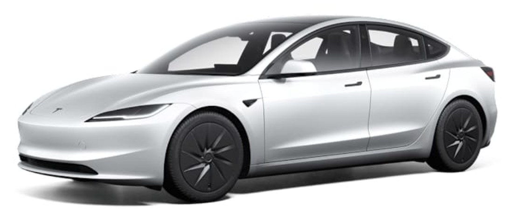
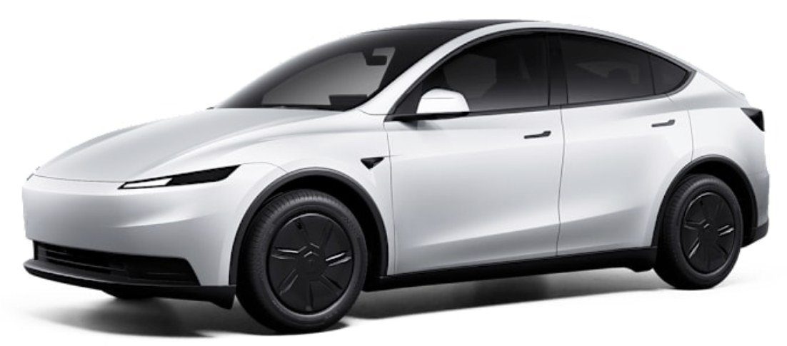

# Cheapest EVs per km

Updated 2026-10-30 14:30 UTC · 242 battery-electric cars from 2022 on · 20.000 km/yr · capital at 7% · best selling year chosen per car (max 12 yr)

Market: EVs lose about **15% of their value per year** at this mileage (fitted on all 159 EV listings, older ones included). Costs in today's krónur. Assumptions: `config.yaml`.

How the number is built

cost per km = (price − resale after N years + capital cost + charging + kílómetragjald + insurance + service + tyres + tax/skoðun + expected battery repairs after warranty) ÷ km driven. Resale comes from today's market: what the same model sells for N years older and 20.000·N km further on. N is whichever year gives the lowest cost per km.

---

**Bands:** 🟢 **Good** under 50 kr/km (19 cars) · 🟡 **Medium** 50–70 kr/km (128 cars) · 🔴 **Bad** 70+ kr/km (95 cars)

---

## 🟢 Good — under 50 kr/km

> 🟢 **under 50 kr/km ≈ under 1,0M kr per year** at 20.000 km/yr · 19 cars · cheap, efficient, holds its value — about as low as a 2022+ EV gets

🟢 **38.4 kr/km** · sell after **11 yr** · 2.390.000 kr

[Leapmotor T03](https://www.isband.is/product/leapmotor-t03/)  
🆕 NEW · 0 km · ÍSBAND (new) · leapmotor t03 · new: 2.890.000 kr list, rafbílastyrkur included (resale ≈ 200.531 kr)

kr/km: depreciation 10.0 · capital 7% 3.0 · charging 5.1 · km-gjald 7.0 · insurance 5.0 · service 3.6 · tyres 2.0 · tax/skoðun 1.2 · battery risk 1.6

⚠️ no nearly-new used ones to compare with: assumed it loses 10% on registration, then the normal EV depreciation; young brand in Iceland: depreciation & battery guessed

---

🟢 **42.0 kr/km** · sell after **12 yr** · 2.990.000 kr

[Leapmotor B03X Life](https://www.isband.is/product/leapmotor-b03x-life/)  
🆕 NEW · 0 km · ÍSBAND (new) · leapmotor b03x · new: 3.490.000 kr list, rafbílastyrkur included (resale ≈ 203.143 kr)

kr/km: depreciation 11.6 · capital 7% 3.5 · charging 5.4 · km-gjald 7.0 · insurance 5.1 · service 4.0 · tyres 2.0 · tax/skoðun 1.2 · battery risk 2.2

⚠️ no nearly-new used ones to compare with: assumed it loses 10% on registration, then the normal EV depreciation; young brand in Iceland: depreciation & battery guessed

---

🟢 **43.5 kr/km** · sell after **6 yr** · 2.090.000 kr

[Nissan Leaf 40kwh 2022](https://bland.is/til-solu/farartaeki/bilar/nissan-leaf-40kwh-2022/5296844/)  
2022 · 98.000 km · Bland · nissan leaf · 23% under market (market ≈ 2.730.214 kr, resale ≈ 790.800 kr)

kr/km: depreciation 10.8 · capital 7% 4.9 · charging 5.8 · km-gjald 7.0 · insurance 5.3 · service 4.4 · tyres 2.0 · tax/skoðun 1.2 · battery risk 2.1

---

🟢 **45.1 kr/km** · sell after **9 yr** · 2.390.000 kr

[Opel Corsa-e Ultimate](https://notadir.brimborg.is/is/notadir-bilar/bill/LHZ71)  
2022 · 46.686 km · Brimborg (used) · opel corsa-e · 24% under market (market ≈ 3.127.788 kr, resale ≈ 358.602 kr)

kr/km: depreciation 11.3 · capital 7% 3.9 · charging 5.3 · km-gjald 7.0 · insurance 5.2 · service 5.8 · tyres 2.0 · tax/skoðun 1.2 · battery risk 3.4

⚠️ still getting cheaper per km at 9 yr / 227.000 km, where market data ends — keeping it longer is probably cheaper still; little market data for this model: depreciation borrowed from brand/all EVs

---

🟢 **45.2 kr/km** · sell after **12 yr** · 3.590.000 kr

[Leapmotor B03X Design](https://www.isband.is/product/leapmotor-b03x-design/)  
🆕 NEW · 0 km · ÍSBAND (new) · leapmotor b03x · new: 4.090.000 kr list, rafbílastyrkur included (resale ≈ 243.908 kr)

kr/km: depreciation 13.9 · capital 7% 4.2 · charging 5.4 · km-gjald 7.0 · insurance 5.2 · service 4.0 · tyres 2.0 · tax/skoðun 1.2 · battery risk 2.2

⚠️ no nearly-new used ones to compare with: assumed it loses 10% on registration, then the normal EV depreciation; young brand in Iceland: depreciation & battery guessed

---

🟢 **45.2 kr/km** · sell after **7 yr** · 2.290.000 kr

[MG Mg5 Electric 2022](https://bland.is/til-solu/farartaeki/bilar/mg-mg5-electric-2022/5291994/)  
2022 · 90.000 km · Bland · mg5 · 17% under market (market ≈ 2.747.912 kr, resale ≈ 515.018 kr)

kr/km: depreciation 12.7 · capital 7% 4.3 · charging 5.8 · km-gjald 7.0 · insurance 5.2 · service 4.9 · tyres 2.0 · tax/skoðun 1.2 · battery risk 2.1

⚠️ still getting cheaper per km at 7 yr / 230.000 km, where market data ends — keeping it longer is probably cheaper still; little market data for this model: depreciation borrowed from brand/all EVs

---

🟢 **45.3 kr/km** · sell after **10 yr** · 2.590.000 kr

[MAZDA MX-30](https://bland.is/til-solu/farartaeki/bilar/mazda-mx-30/5295862/)  
2023 · 25.000 km · Bland · mazda mx-30 · 18% under market (market ≈ 3.170.256 kr, resale ≈ 310.494 kr)

kr/km: depreciation 11.4 · capital 7% 3.9 · charging 6.1 · km-gjald 7.0 · insurance 5.2 · service 5.5 · tyres 2.0 · tax/skoðun 1.2 · battery risk 3.0

⚠️ still getting cheaper per km at 10 yr / 225.000 km, where market data ends — keeping it longer is probably cheaper still; little market data for this model: depreciation borrowed from brand/all EVs

---

🟢 **45.6 kr/km** · sell after **9 yr** · 2.350.000 kr

[Mazda Mazda Mx-30 2022](https://bland.is/til-solu/farartaeki/bilar/mazda-mazda-mx-30-2022/5299610/)  
2022 · 22.000 km · Bland · mazda mx-30 · 17% under market (market ≈ 2.836.746 kr, resale ≈ 346.949 kr)

kr/km: depreciation 11.1 · capital 7% 3.8 · charging 6.1 · km-gjald 7.0 · insurance 5.2 · service 5.8 · tyres 2.0 · tax/skoðun 1.2 · battery risk 3.4

⚠️ little market data for this model: depreciation borrowed from brand/all EVs

---

🟢 **46.5 kr/km** · sell after **11 yr** · 2.790.000 kr

[Mazda MX-30 Exclusive-Line](https://notadir.brimborg.is/is/notadir-bilar/bill/VZA79)  
2023 · 18.363 km · Brimborg (used) · mazda mx-30 · 13% under market (market ≈ 3.217.427 kr, resale ≈ 267.625 kr)

kr/km: depreciation 11.5 · capital 7% 3.9 · charging 6.1 · km-gjald 7.0 · insurance 5.2 · service 6.0 · tyres 2.0 · tax/skoðun 1.2 · battery risk 3.6

⚠️ still getting cheaper per km at 11 yr / 238.000 km, where market data ends — keeping it longer is probably cheaper still; little market data for this model: depreciation borrowed from brand/all EVs

---

🟢 **47.1 kr/km** · sell after **8 yr** · 2.590.000 kr

[MG Mg4 Electric 12/ 2022](https://bland.is/til-solu/farartaeki/bilar/mg-mg4-electric-12-2022/5291832/)  
2022 · 66.000 km · Bland · mg4 · 12% under market (market ≈ 2.937.760 kr, resale ≈ 466.384 kr)

kr/km: depreciation 13.3 · capital 7% 4.5 · charging 5.8 · km-gjald 7.0 · insurance 5.3 · service 5.4 · tyres 2.0 · tax/skoðun 1.2 · battery risk 2.7

⚠️ still getting cheaper per km at 8 yr / 226.000 km, where market data ends — keeping it longer is probably cheaper still; little market data for this model: depreciation borrowed from brand/all EVs

---

🟢 **47.3 kr/km** · sell after **12 yr** · 3.990.000 kr

[Leapmotor B05 Design](https://www.isband.is/product/leapmotor-b05-design/)  
🆕 NEW · 0 km · ÍSBAND (new) · leapmotor b05 · new: 4.490.000 kr list, rafbílastyrkur included (resale ≈ 271.084 kr)

kr/km: depreciation 15.5 · capital 7% 4.6 · charging 5.4 · km-gjald 7.0 · insurance 5.3 · service 4.0 · tyres 2.0 · tax/skoðun 1.2 · battery risk 2.2

⚠️ no nearly-new used ones to compare with: assumed it loses 10% on registration, then the normal EV depreciation; young brand in Iceland: depreciation & battery guessed

---

🟢 **48.1 kr/km** · sell after **12 yr** · 4.280.000 kr

[Ford Puma EV Premium](https://nyirbilar.brimborg.is/is/nyir-bilar/bill/NHE86)  
🆕 NEW · 0 km · Brimborg (new) · ford puma ev · new: 4.990.000 kr list, rafbílastyrkur included (resale ≈ 290.787 kr)

kr/km: depreciation 16.6 · capital 7% 5.0 · charging 5.3 · km-gjald 7.0 · insurance 5.4 · service 4.0 · tyres 2.0 · tax/skoðun 1.2 · battery risk 1.7

⚠️ no nearly-new used ones to compare with: assumed it loses 10% on registration, then the normal EV depreciation; little market data for this model: depreciation borrowed from brand/all EVs

---

🟢 **48.7 kr/km** · sell after **10 yr** · 3.190.000 kr

[Opel Mokka-e Ultimate](https://notadir.brimborg.is/is/notadir-bilar/bill/YDG93)  
2023 · 22.797 km · Brimborg (used) · opel mokka-e · 17% under market (market ≈ 3.859.598 kr, resale ≈ 381.536 kr)

kr/km: depreciation 14.0 · capital 7% 4.8 · charging 5.8 · km-gjald 7.0 · insurance 5.3 · service 5.5 · tyres 2.0 · tax/skoðun 1.2 · battery risk 3.0

⚠️ still getting cheaper per km at 10 yr / 223.000 km, where market data ends — keeping it longer is probably cheaper still; little market data for this model: depreciation borrowed from brand/all EVs

---

🟢 **49.2 kr/km** · sell after **12 yr** · 4.490.000 kr

[Ford Puma EV Premium](https://nyirbilar.brimborg.is/is/nyir-bilar/bill/146517)  
🆕 NEW · 0 km · Brimborg (new) · ford puma ev · new: 4.990.000 kr list, rafbílastyrkur included (resale ≈ 305.054 kr)

kr/km: depreciation 17.4 · capital 7% 5.2 · charging 5.3 · km-gjald 7.0 · insurance 5.4 · service 4.0 · tyres 2.0 · tax/skoðun 1.2 · battery risk 1.7

⚠️ no nearly-new used ones to compare with: assumed it loses 10% on registration, then the normal EV depreciation; little market data for this model: depreciation borrowed from brand/all EVs

---

🟢 **49.3 kr/km** · sell after **12 yr** · 4.499.000 kr

[Ford Puma EV Premium](https://nyirbilar.brimborg.is/is/nyir-bilar/bill/GKM99)  
🆕 NEW · 0 km · Brimborg (new) · ford puma ev · new: 5.209.000 kr list, rafbílastyrkur included (resale ≈ 305.666 kr)

kr/km: depreciation 17.5 · capital 7% 5.2 · charging 5.3 · km-gjald 7.0 · insurance 5.4 · service 4.0 · tyres 2.0 · tax/skoðun 1.2 · battery risk 1.7

⚠️ no nearly-new used ones to compare with: assumed it loses 10% on registration, then the normal EV depreciation; little market data for this model: depreciation borrowed from brand/all EVs

---

🟢 **49.3 kr/km** · sell after **9 yr** · 3.300.000 kr

[Nissan Leaf  40kwh](https://bland.is/til-solu/farartaeki/bilar/nissan-leaf-40kwh/5258470/)  
2023 · 59.000 km · Bland · nissan leaf · at market (market ≈ 3.350.129 kr, resale ≈ 729.502 kr)

kr/km: depreciation 14.3 · capital 7% 6.1 · charging 5.8 · km-gjald 7.0 · insurance 5.5 · service 5.0 · tyres 2.0 · tax/skoðun 1.2 · battery risk 2.4

⚠️ still getting cheaper per km at 9 yr / 239.000 km, where market data ends — keeping it longer is probably cheaper still

---

🟢 **49.5 kr/km** · sell after **11 yr** · 3.800.000 kr

[MG Comfort](https://bland.is/til-solu/farartaeki/bilar/mg-comfort/5289959/)  
2025 · 7.000 km · Bland · mg (other) · 18% under market (market ≈ 4.657.386 kr, resale ≈ 368.975 kr)

kr/km: depreciation 15.6 · capital 7% 5.4 · charging 6.5 · km-gjald 7.0 · insurance 5.4 · service 4.4 · tyres 2.0 · tax/skoðun 1.2 · battery risk 2.0

⚠️ still getting cheaper per km at 11 yr / 227.000 km, where market data ends — keeping it longer is probably cheaper still; little market data for this model: depreciation borrowed from brand/all EVs; model not recognised: consumption assumed

---

🟢 **49.8 kr/km** · sell after **9 yr** · 2.990.000 kr · 🆕

[MG ZS EV 2022 LR Luxury](https://bland.is/til-solu/farartaeki/bilar/mg-zs-ev-2022-lr-luxury/5257047/)  
2022 · 45.000 km · Bland · mg zs ev · at market (market ≈ 3.059.340 kr, resale ≈ 427.080 kr)

kr/km: depreciation 14.2 · capital 7% 4.7 · charging 6.1 · km-gjald 7.0 · insurance 5.3 · service 5.8 · tyres 2.0 · tax/skoðun 1.2 · battery risk 3.4

⚠️ still getting cheaper per km at 9 yr / 225.000 km, where market data ends — keeping it longer is probably cheaper still; little market data for this model: depreciation borrowed from brand/all EVs

---

🟢 **49.8 kr/km** · sell after **9 yr** · 3.100.000 kr

[Nissan Leaf N-Connecta  2022](https://bland.is/til-solu/farartaeki/bilar/nissan-leaf-n-connecta-2022/5296627/)  
2022 · 53.000 km · Bland · nissan leaf · at market (market ≈ 3.017.776 kr, resale ≈ 679.564 kr)

kr/km: depreciation 13.4 · capital 7% 5.7 · charging 5.8 · km-gjald 7.0 · insurance 5.5 · service 5.8 · tyres 2.0 · tax/skoðun 1.2 · battery risk 3.4

⚠️ still getting cheaper per km at 9 yr / 233.000 km, where market data ends — keeping it longer is probably cheaper still

---

## 🟡 Medium — 50–70 kr/km

> 🟡 **50–70 kr/km ≈ 1,0–1,4M kr per year** at 20.000 km/yr · 128 cars · normal family EV — you pay for size, range or a newer car

🟡 **50.2 kr/km** · sell after **12 yr** · 4.669.000 kr

[Ford Puma EV Premium](https://nyirbilar.brimborg.is/is/nyir-bilar/bill/146518)  
🆕 NEW · 0 km · Brimborg (new) · ford puma ev · new: 5.169.000 kr list, rafbílastyrkur included (resale ≈ 317.216 kr)

kr/km: depreciation 18.1 · capital 7% 5.4 · charging 5.3 · km-gjald 7.0 · insurance 5.4 · service 4.0 · tyres 2.0 · tax/skoðun 1.2 · battery risk 1.7

⚠️ no nearly-new used ones to compare with: assumed it loses 10% on registration, then the normal EV depreciation; little market data for this model: depreciation borrowed from brand/all EVs

---

🟡 **50.3 kr/km** · sell after **10 yr** · 3.490.000 kr

[Citroen E-C4 X Shine Pack](https://notadir.brimborg.is/is/notadir-bilar/bill/GZZ04)  
2023 · 34.282 km · Brimborg (used) · citroen e-c4 · 7% under market (market ≈ 3.765.281 kr, resale ≈ 663.928 kr)

kr/km: depreciation 14.1 · capital 7% 6.1 · charging 5.8 · km-gjald 7.0 · insurance 5.6 · service 5.5 · tyres 2.0 · tax/skoðun 1.2 · battery risk 3.0

⚠️ still getting cheaper per km at 10 yr / 234.000 km, where market data ends — keeping it longer is probably cheaper still

---

🟡 **50.4 kr/km** · sell after **9 yr** · 3.200.000 kr

[Nissan Leaf 62kwh 2022](https://bland.is/til-solu/farartaeki/bilar/nissan-leaf-62kwh-2022/5291168/)  
2022 · 54.000 km · Bland · nissan leaf · 6% over market (market ≈ 3.011.068 kr, resale ≈ 696.735 kr)

kr/km: depreciation 13.9 · capital 7% 5.8 · charging 5.8 · km-gjald 7.0 · insurance 5.5 · service 5.8 · tyres 2.0 · tax/skoðun 1.2 · battery risk 3.4

⚠️ still getting cheaper per km at 9 yr / 234.000 km, where market data ends — keeping it longer is probably cheaper still

---

🟡 **50.5 kr/km** · sell after **10 yr** · 3.500.000 kr

[MG4 - Rafmagnsbíll](https://bland.is/til-solu/farartaeki/bilar/mg4-rafmagnsbill/5289431/)  
2023 · 27.000 km · Bland · mg4 · at market (market ≈ 3.604.800 kr, resale ≈ 405.345 kr)

kr/km: depreciation 15.5 · capital 7% 5.1 · charging 5.8 · km-gjald 7.0 · insurance 5.4 · service 5.5 · tyres 2.0 · tax/skoðun 1.2 · battery risk 3.0

⚠️ still getting cheaper per km at 10 yr / 227.000 km, where market data ends — keeping it longer is probably cheaper still; little market data for this model: depreciation borrowed from brand/all EVs

---

🟡 **52.0 kr/km** · sell after **12 yr** · 4.790.000 kr

[Leapmotor B10 Design](https://www.isband.is/product/leapmotor-b10-design/)  
🆕 NEW · 0 km · ÍSBAND (new) · leapmotor b10 · new: 5.290.000 kr list, rafbílastyrkur included (resale ≈ 325.437 kr)

kr/km: depreciation 18.6 · capital 7% 5.6 · charging 6.0 · km-gjald 7.0 · insurance 5.5 · service 4.0 · tyres 2.0 · tax/skoðun 1.2 · battery risk 2.2

⚠️ no nearly-new used ones to compare with: assumed it loses 10% on registration, then the normal EV depreciation; young brand in Iceland: depreciation & battery guessed

---

🟡 **52.0 kr/km** · sell after **11 yr** · 3.500.000 kr

[Nissan Leaf Tekna 2022](https://bland.is/til-solu/farartaeki/bilar/nissan-leaf-tekna-2022/4880347/)  
2022 · 6.000 km · Bland · nissan leaf · 4% over market (market ≈ 3.350.505 kr, resale ≈ 552.682 kr)

kr/km: depreciation 13.4 · capital 7% 5.7 · charging 5.8 · km-gjald 7.0 · insurance 5.5 · service 6.8 · tyres 2.0 · tax/skoðun 1.2 · battery risk 4.6

⚠️ still getting cheaper per km at 11 yr / 226.000 km, where market data ends — keeping it longer is probably cheaper still

---

🟡 **52.1 kr/km** · sell after **12 yr** · 5.070.000 kr · 2 in stock

[VOLKSWAGEN ID. Polo Life](https://www.hekla.is/is/bilar/nyir-bilar-syningasalur/volkswagen-id-polo-8)  
🆕 NEW · 0 km · Hekla (new) · vw id.polo · new: 5.570.000 kr list, rafbílastyrkur included (resale ≈ 344.460 kr)

kr/km: depreciation 19.7 · capital 7% 5.9 · charging 5.1 · km-gjald 7.0 · insurance 5.5 · service 4.0 · tyres 2.0 · tax/skoðun 1.2 · battery risk 1.7

⚠️ no nearly-new used ones to compare with: assumed it loses 10% on registration, then the normal EV depreciation; little market data for this model: depreciation borrowed from brand/all EVs

---

🟡 **52.3 kr/km** · sell after **10 yr** · 4.090.000 kr

[Citroen E-C4 MAX](https://notadir.brimborg.is/is/notadir-bilar/bill/ABT34)  
2024 · 23.446 km · Brimborg (used) · citroen e-c4 · 6% under market (market ≈ 4.339.534 kr, resale ≈ 775.476 kr)

kr/km: depreciation 16.6 · capital 7% 7.2 · charging 5.8 · km-gjald 7.0 · insurance 5.7 · service 4.7 · tyres 2.0 · tax/skoðun 1.2 · battery risk 2.2

⚠️ still getting cheaper per km at 10 yr / 223.000 km, where market data ends — keeping it longer is probably cheaper still

---

🟡 **52.4 kr/km** · sell after **8 yr** · 3.200.000 kr

[MG Mg Marvel R Electric 2022](https://bland.is/til-solu/farartaeki/bilar/mg-mg-marvel-r-electric-2022/5298992/)  
2022 · 73.000 km · Bland · mg marvel r · at market (market ≈ 3.280.861 kr, resale ≈ 564.700 kr)

kr/km: depreciation 16.5 · capital 7% 5.5 · charging 6.8 · km-gjald 7.0 · insurance 5.4 · service 5.4 · tyres 2.0 · tax/skoðun 1.2 · battery risk 2.7

⚠️ still getting cheaper per km at 8 yr / 233.000 km, where market data ends — keeping it longer is probably cheaper still; little market data for this model: depreciation borrowed from brand/all EVs

---

🟡 **52.7 kr/km** · sell after **11 yr** · 4.490.000 kr

[Citroen E-C4 MAX](https://notadir.brimborg.is/is/notadir-bilar/bill/KLN72)  
2025 · 16.790 km · Brimborg (used) · citroen e-c4 · 9% under market (market ≈ 4.955.061 kr, resale ≈ 729.467 kr)

kr/km: depreciation 17.1 · capital 7% 7.5 · charging 5.8 · km-gjald 7.0 · insurance 5.8 · service 4.4 · tyres 2.0 · tax/skoðun 1.2 · battery risk 2.0

⚠️ still getting cheaper per km at 11 yr / 237.000 km, where market data ends — keeping it longer is probably cheaper still

---

🟡 **52.7 kr/km** · sell after **12 yr** · 5.190.000 kr · 4 in stock

[Skoda Epiq 55](https://www.hekla.is/is/bilar/nyir-bilar-syningasalur/skoda-epiq-55)  
🆕 NEW · 0 km · Hekla (new) · skoda epiq · new: 5.690.000 kr list, rafbílastyrkur included (resale ≈ 352.613 kr)

kr/km: depreciation 20.2 · capital 7% 6.0 · charging 5.1 · km-gjald 7.0 · insurance 5.5 · service 4.0 · tyres 2.0 · tax/skoðun 1.2 · battery risk 1.7

⚠️ no nearly-new used ones to compare with: assumed it loses 10% on registration, then the normal EV depreciation; little market data for this model: depreciation borrowed from brand/all EVs

---

🟡 **52.9 kr/km** · sell after **12 yr** · 5.090.000 kr

[Peugeot E-2008 Allure](https://nyirbilar.brimborg.is/is/nyir-bilar/bill/RKV79)  
🆕 NEW · 0 km · Brimborg (new) · peugeot e-2008 · new: 5.590.000 kr list, rafbílastyrkur included (resale ≈ 345.819 kr)

kr/km: depreciation 19.8 · capital 7% 5.9 · charging 5.8 · km-gjald 7.0 · insurance 5.5 · service 4.0 · tyres 2.0 · tax/skoðun 1.2 · battery risk 1.7

⚠️ no nearly-new used ones to compare with: assumed it loses 10% on registration, then the normal EV depreciation; little market data for this model: depreciation borrowed from brand/all EVs

---

🟡 **52.9 kr/km** · sell after **12 yr** · 5.220.000 kr

[VOLKSWAGEN ID. Polo Life](https://www.hekla.is/is/bilar/nyir-bilar-syningasalur/volkswagen-id-polo-2)  
🆕 NEW · 0 km · Hekla (new) · vw id.polo · new: 5.720.000 kr list, rafbílastyrkur included (resale ≈ 354.651 kr)

kr/km: depreciation 20.3 · capital 7% 6.1 · charging 5.1 · km-gjald 7.0 · insurance 5.5 · service 4.0 · tyres 2.0 · tax/skoðun 1.2 · battery risk 1.7

⚠️ no nearly-new used ones to compare with: assumed it loses 10% on registration, then the normal EV depreciation; little market data for this model: depreciation borrowed from brand/all EVs

---

🟡 **53.1 kr/km** · sell after **12 yr** · 5.120.000 kr

[Peugeot E-2008 Allure](https://nyirbilar.brimborg.is/is/nyir-bilar/bill/SNN68)  
🆕 NEW · 0 km · Brimborg (new) · peugeot e-2008 · new: 5.620.000 kr list, rafbílastyrkur included (resale ≈ 347.857 kr)

kr/km: depreciation 19.9 · capital 7% 6.0 · charging 5.8 · km-gjald 7.0 · insurance 5.5 · service 4.0 · tyres 2.0 · tax/skoðun 1.2 · battery risk 1.7

⚠️ no nearly-new used ones to compare with: assumed it loses 10% on registration, then the normal EV depreciation; little market data for this model: depreciation borrowed from brand/all EVs

---

🟡 **53.1 kr/km** · sell after **12 yr** · 5.260.000 kr

[VOLKSWAGEN ID. Polo Life](https://www.hekla.is/is/bilar/nyir-bilar-syningasalur/volkswagen-id-polo-14)  
🆕 NEW · 0 km · Hekla (new) · vw id.polo · new: 5.760.000 kr list, rafbílastyrkur included (resale ≈ 357.369 kr)

kr/km: depreciation 20.4 · capital 7% 6.1 · charging 5.1 · km-gjald 7.0 · insurance 5.5 · service 4.0 · tyres 2.0 · tax/skoðun 1.2 · battery risk 1.7

⚠️ no nearly-new used ones to compare with: assumed it loses 10% on registration, then the normal EV depreciation; little market data for this model: depreciation borrowed from brand/all EVs

---

🟡 **53.7 kr/km** · sell after **12 yr** · 5.290.000 kr

[Tesla Model 3 RWD](https://www.tesla.com/is_is/model3/design)  
🆕 NEW · 0 km · Manual (new) · tesla model 3 · new: 5.790.000 kr list, rafbílastyrkur assumed (resale ≈ 644.755 kr)

kr/km: depreciation 19.4 · capital 7% 7.4 · charging 5.3 · km-gjald 7.0 · insurance 5.8 · service 4.0 · tyres 2.0 · tax/skoðun 1.2 · battery risk 1.7

⚠️ no nearly-new used ones to compare with: assumed it loses 10% on registration, then the normal EV depreciation

---

🟡 **53.8 kr/km** · sell after **12 yr** · 5.270.000 kr

[Peugeot E-2008 GT Exclusive](https://nyirbilar.brimborg.is/is/nyir-bilar/bill/ISE49)  
🆕 NEW · 0 km · Brimborg (new) · peugeot e-2008 · new: 5.770.000 kr list, rafbílastyrkur included (resale ≈ 358.048 kr)

kr/km: depreciation 20.5 · capital 7% 6.1 · charging 5.8 · km-gjald 7.0 · insurance 5.6 · service 4.0 · tyres 2.0 · tax/skoðun 1.2 · battery risk 1.7

⚠️ no nearly-new used ones to compare with: assumed it loses 10% on registration, then the normal EV depreciation; little market data for this model: depreciation borrowed from brand/all EVs

---

🟡 **53.9 kr/km** · sell after **12 yr** · 5.400.000 kr

[VOLKSWAGEN ID. Polo Life](https://www.hekla.is/is/bilar/nyir-bilar-syningasalur/volkswagen-id-polo-12)  
🆕 NEW · 0 km · Hekla (new) · vw id.polo · new: 5.900.000 kr list, rafbílastyrkur included (resale ≈ 366.881 kr)

kr/km: depreciation 21.0 · capital 7% 6.3 · charging 5.1 · km-gjald 7.0 · insurance 5.6 · service 4.0 · tyres 2.0 · tax/skoðun 1.2 · battery risk 1.7

⚠️ no nearly-new used ones to compare with: assumed it loses 10% on registration, then the normal EV depreciation; little market data for this model: depreciation borrowed from brand/all EVs

---

🟡 **53.9 kr/km** · sell after **12 yr** · 5.410.000 kr

[VOLKSWAGEN ID. Polo Life](https://www.hekla.is/is/bilar/nyir-bilar-syningasalur/volkswagen-id-polo-1)  
🆕 NEW · 0 km · Hekla (new) · vw id.polo · new: 5.910.000 kr list, rafbílastyrkur included (resale ≈ 367.560 kr)

kr/km: depreciation 21.0 · capital 7% 6.3 · charging 5.1 · km-gjald 7.0 · insurance 5.6 · service 4.0 · tyres 2.0 · tax/skoðun 1.2 · battery risk 1.7

⚠️ no nearly-new used ones to compare with: assumed it loses 10% on registration, then the normal EV depreciation; little market data for this model: depreciation borrowed from brand/all EVs

---

🟡 **54.2 kr/km** · sell after **12 yr** · 5.330.000 kr · 5 in stock

[Peugeot E-2008 GT Exclusive](https://nyirbilar.brimborg.is/is/nyir-bilar/bill/149357)  
🆕 NEW · 0 km · Brimborg (new) · peugeot e-2008 · new: 5.830.000 kr list, rafbílastyrkur included (resale ≈ 362.125 kr)

kr/km: depreciation 20.7 · capital 7% 6.2 · charging 5.8 · km-gjald 7.0 · insurance 5.6 · service 4.0 · tyres 2.0 · tax/skoðun 1.2 · battery risk 1.7

⚠️ no nearly-new used ones to compare with: assumed it loses 10% on registration, then the normal EV depreciation; little market data for this model: depreciation borrowed from brand/all EVs

---

🟡 **54.3 kr/km** · sell after **12 yr** · 5.360.000 kr

[Peugeot E-2008 GT Exclusive](https://nyirbilar.brimborg.is/is/nyir-bilar/bill/149361)  
🆕 NEW · 0 km · Brimborg (new) · peugeot e-2008 · new: 5.860.000 kr list, rafbílastyrkur included (resale ≈ 364.163 kr)

kr/km: depreciation 20.8 · capital 7% 6.2 · charging 5.8 · km-gjald 7.0 · insurance 5.6 · service 4.0 · tyres 2.0 · tax/skoðun 1.2 · battery risk 1.7

⚠️ no nearly-new used ones to compare with: assumed it loses 10% on registration, then the normal EV depreciation; little market data for this model: depreciation borrowed from brand/all EVs

---

🟡 **54.3 kr/km** · sell after **12 yr** · 5.490.000 kr · 2 in stock

[Skoda Epiq 55](https://www.hekla.is/is/bilar/nyir-bilar-syningasalur/epiq-2)  
🆕 NEW · 0 km · Hekla (new) · skoda epiq · new: 5.990.000 kr list, rafbílastyrkur included (resale ≈ 372.995 kr)

kr/km: depreciation 21.3 · capital 7% 6.4 · charging 5.1 · km-gjald 7.0 · insurance 5.6 · service 4.0 · tyres 2.0 · tax/skoðun 1.2 · battery risk 1.7

⚠️ no nearly-new used ones to compare with: assumed it loses 10% on registration, then the normal EV depreciation; little market data for this model: depreciation borrowed from brand/all EVs

---

🟡 **54.8 kr/km** · sell after **12 yr** · 5.480.000 kr · 4 in stock

[VW ID.3 PRO](https://www.hekla.is/is/bilar/nyir-bilar-syningasalur/vw-id3-pro-39)  
🆕 NEW · 0 km · Hekla (new) · vw id.3 · new: 5.980.000 kr list, rafbílastyrkur included (resale ≈ 372.316 kr)

kr/km: depreciation 21.3 · capital 7% 6.4 · charging 5.6 · km-gjald 7.0 · insurance 5.6 · service 4.0 · tyres 2.0 · tax/skoðun 1.2 · battery risk 1.7

⚠️ no nearly-new used ones to compare with: assumed it loses 10% on registration, then the normal EV depreciation; little market data for this model: depreciation borrowed from brand/all EVs

---

🟡 **56.4 kr/km** · sell after **12 yr** · 5.890.000 kr

[VOLKSWAGEN ID. Polo Style](https://www.hekla.is/is/bilar/nyir-bilar-syningasalur/volkswagen-id-polo-style-2)  
🆕 NEW · 0 km · Hekla (new) · vw id.polo · new: 6.390.000 kr list, rafbílastyrkur included (resale ≈ 400.172 kr)

kr/km: depreciation 22.9 · capital 7% 6.9 · charging 5.1 · km-gjald 7.0 · insurance 5.7 · service 4.0 · tyres 2.0 · tax/skoðun 1.2 · battery risk 1.7

⚠️ no nearly-new used ones to compare with: assumed it loses 10% on registration, then the normal EV depreciation; little market data for this model: depreciation borrowed from brand/all EVs

---

🟡 **56.9 kr/km** · sell after **12 yr** · 5.880.000 kr · 2 in stock

[VOLKSWAGEN ID. Cross Life](https://www.hekla.is/is/bilar/nyir-bilar-syningasalur/volkswagen-id-cross-life-1)  
🆕 NEW · 0 km · Hekla (new) · vw id.cross · new: 6.380.000 kr list, rafbílastyrkur included (resale ≈ 399.492 kr)

kr/km: depreciation 22.8 · capital 7% 6.8 · charging 5.6 · km-gjald 7.0 · insurance 5.7 · service 4.0 · tyres 2.0 · tax/skoðun 1.2 · battery risk 1.7

⚠️ no nearly-new used ones to compare with: assumed it loses 10% on registration, then the normal EV depreciation; little market data for this model: depreciation borrowed from brand/all EVs

---

🟡 **57.2 kr/km** · sell after **12 yr** · 5.780.000 kr

[Mazda6e Takumi](https://nyirbilar.brimborg.is/is/nyir-bilar/bill/REK18)  
🆕 NEW · 0 km · Brimborg (new) · unknown · new: 6.580.000 kr list, rafbílastyrkur included (resale ≈ 392.698 kr)

kr/km: depreciation 22.4 · capital 7% 6.7 · charging 6.5 · km-gjald 7.0 · insurance 5.7 · service 4.0 · tyres 2.0 · tax/skoðun 1.2 · battery risk 1.7

⚠️ no nearly-new used ones to compare with: assumed it loses 10% on registration, then the normal EV depreciation; little market data for this model: depreciation borrowed from brand/all EVs; model not recognised: consumption assumed

---

🟡 **57.4 kr/km** · sell after **12 yr** · 6.080.000 kr · 3 in stock

[VOLKSWAGEN ID. Polo Style](https://www.hekla.is/is/bilar/nyir-bilar-syningasalur/volkswagen-id-polo-7)  
🆕 NEW · 0 km · Hekla (new) · vw id.polo · new: 6.580.000 kr list, rafbílastyrkur included (resale ≈ 413.080 kr)

kr/km: depreciation 23.6 · capital 7% 7.1 · charging 5.1 · km-gjald 7.0 · insurance 5.7 · service 4.0 · tyres 2.0 · tax/skoðun 1.2 · battery risk 1.7

⚠️ no nearly-new used ones to compare with: assumed it loses 10% on registration, then the normal EV depreciation; little market data for this model: depreciation borrowed from brand/all EVs

---

🟡 **57.5 kr/km** · sell after **12 yr** · 5.830.000 kr

[Mazda6e Takumi](https://nyirbilar.brimborg.is/is/nyir-bilar/bill/PDH37)  
🆕 NEW · 0 km · Brimborg (new) · unknown · new: 6.630.000 kr list, rafbílastyrkur included (resale ≈ 396.095 kr)

kr/km: depreciation 22.6 · capital 7% 6.8 · charging 6.5 · km-gjald 7.0 · insurance 5.7 · service 4.0 · tyres 2.0 · tax/skoðun 1.2 · battery risk 1.7

⚠️ no nearly-new used ones to compare with: assumed it loses 10% on registration, then the normal EV depreciation; little market data for this model: depreciation borrowed from brand/all EVs; model not recognised: consumption assumed

---

🟡 **57.5 kr/km** · sell after **10 yr** · 5.100.000 kr · 🆕

[Tesla Model 3 2025](https://bland.is/til-solu/farartaeki/bilar/tesla-model-3-2025/5300297/)  
2025 · 41.000 km · Bland · tesla model 3 · 34% under market (market ≈ 7.767.434 kr, resale ≈ 1.039.472 kr)

kr/km: depreciation 20.3 · capital 7% 9.5 · charging 5.3 · km-gjald 7.0 · insurance 6.1 · service 4.0 · tyres 2.0 · tax/skoðun 1.2 · battery risk 2.0

⚠️ still getting cheaper per km at 10 yr / 241.000 km, where market data ends — keeping it longer is probably cheaper still

---

🟡 **57.6 kr/km** · sell after **7 yr** · 3.890.000 kr

[Polestar 2 SRSM Base](https://notadir.brimborg.is/is/notadir-bilar/bill/KJX58)  
2022 · 101.612 km · Brimborg (used) · polestar 2 · 9% under market (market ≈ 4.290.795 kr, resale ≈ 1.209.693 kr)

kr/km: depreciation 19.1 · capital 7% 8.3 · charging 6.3 · km-gjald 7.0 · insurance 5.9 · service 4.9 · tyres 2.0 · tax/skoðun 1.2 · battery risk 2.9

⚠️ still getting cheaper per km at 7 yr / 242.000 km, where market data ends — keeping it longer is probably cheaper still

---

🟡 **58.1 kr/km** · sell after **8 yr** · 4.500.000 kr

[Tesla Model Y 2023](https://bland.is/til-solu/farartaeki/bilar/tesla-model-y-2023/5292750/)  
2023 · 69.000 km · Bland · tesla model y · 24% under market (market ≈ 5.939.905 kr, resale ≈ 1.233.194 kr)

kr/km: depreciation 20.4 · capital 7% 9.3 · charging 5.8 · km-gjald 7.0 · insurance 6.1 · service 4.5 · tyres 2.0 · tax/skoðun 1.2 · battery risk 1.9

⚠️ still getting cheaper per km at 8 yr / 229.000 km, where market data ends — keeping it longer is probably cheaper still

---

🟡 **58.2 kr/km** · sell after **12 yr** · 6.029.990 kr

[Tesla Model Y RWD](https://www.tesla.com/is_is/modely/design)  
🆕 NEW · 0 km · Manual (new) · tesla model y · new: 6.529.990 kr list, rafbílastyrkur assumed (resale ≈ 734.946 kr)

kr/km: depreciation 22.1 · capital 7% 8.5 · charging 5.8 · km-gjald 7.0 · insurance 6.0 · service 4.0 · tyres 2.0 · tax/skoðun 1.2 · battery risk 1.7

⚠️ no nearly-new used ones to compare with: assumed it loses 10% on registration, then the normal EV depreciation

---

🟡 **58.3 kr/km** · sell after **9 yr** · 4.590.000 kr

[Polestar 2 SRSM Plus](https://notadir.brimborg.is/is/notadir-bilar/bill/VFM83)  
2023 · 57.975 km · Brimborg (used) · polestar 2 · 14% under market (market ≈ 5.319.662 kr, resale ≈ 1.041.910 kr)

kr/km: depreciation 19.7 · capital 7% 8.7 · charging 6.3 · km-gjald 7.0 · insurance 6.0 · service 5.0 · tyres 2.0 · tax/skoðun 1.2 · battery risk 2.4

⚠️ still getting cheaper per km at 9 yr / 238.000 km, where market data ends — keeping it longer is probably cheaper still

---

🟡 **58.8 kr/km** · sell after **5 yr** · 3.300.000 kr

[MG Mg Marvel R Electric 2022](https://bland.is/til-solu/farartaeki/bilar/mg-mg-marvel-r-electric-2022/5218418/)  
2022 · 125.000 km · Bland · mg marvel r · 13% over market (market ≈ 2.922.351 kr, resale ≈ 1.065.164 kr)

kr/km: depreciation 22.3 · capital 7% 7.0 · charging 6.8 · km-gjald 7.0 · insurance 5.7 · service 3.9 · tyres 2.0 · tax/skoðun 1.2 · battery risk 2.8

⚠️ still getting cheaper per km at 5 yr / 225.000 km, where market data ends — keeping it longer is probably cheaper still; little market data for this model: depreciation borrowed from brand/all EVs

---

🟡 **58.8 kr/km** · sell after **10 yr** · 4.790.000 kr

[Polestar 2 LRSM Pilot Lite](https://notadir.brimborg.is/is/notadir-bilar/bill/VRY57)  
2023 · 40.233 km · Brimborg (used) · polestar 2 · 13% under market (market ≈ 5.533.894 kr, resale ≈ 923.795 kr)

kr/km: depreciation 19.3 · capital 7% 8.5 · charging 6.3 · km-gjald 7.0 · insurance 6.0 · service 5.5 · tyres 2.0 · tax/skoðun 1.2 · battery risk 3.0

⚠️ still getting cheaper per km at 10 yr / 240.000 km, where market data ends — keeping it longer is probably cheaper still

---

🟡 **58.8 kr/km** · sell after **12 yr** · 5.990.000 kr

[Leapmotor C10 Design AWD](https://www.isband.is/product/leapmotor-c10-design-awd/)  
🆕 NEW · 0 km · ÍSBAND (new) · leapmotor c10 · new: 6.490.000 kr list, rafbílastyrkur included (resale ≈ 406.966 kr)

kr/km: depreciation 23.3 · capital 7% 7.0 · charging 6.5 · km-gjald 7.0 · insurance 5.7 · service 4.0 · tyres 2.0 · tax/skoðun 1.2 · battery risk 2.2

⚠️ no nearly-new used ones to compare with: assumed it loses 10% on registration, then the normal EV depreciation; young brand in Iceland: depreciation & battery guessed

---

🟡 **58.9 kr/km** · sell after **12 yr** · 6.100.000 kr

[Mazda6e Takumi Plus](https://nyirbilar.brimborg.is/is/nyir-bilar/bill/RXU96)  
🆕 NEW · 0 km · Brimborg (new) · unknown · new: 6.900.000 kr list, rafbílastyrkur included (resale ≈ 414.439 kr)

kr/km: depreciation 23.7 · capital 7% 7.1 · charging 6.5 · km-gjald 7.0 · insurance 5.7 · service 4.0 · tyres 2.0 · tax/skoðun 1.2 · battery risk 1.7

⚠️ no nearly-new used ones to compare with: assumed it loses 10% on registration, then the normal EV depreciation; little market data for this model: depreciation borrowed from brand/all EVs; model not recognised: consumption assumed

---

🟡 **59.0 kr/km** · sell after **12 yr** · 6.130.000 kr

[Mazda6e Takumi Plus](https://nyirbilar.brimborg.is/is/nyir-bilar/bill/GRY50)  
🆕 NEW · 0 km · Brimborg (new) · unknown · new: 6.930.000 kr list, rafbílastyrkur included (resale ≈ 416.477 kr)

kr/km: depreciation 23.8 · capital 7% 7.1 · charging 6.5 · km-gjald 7.0 · insurance 5.7 · service 4.0 · tyres 2.0 · tax/skoðun 1.2 · battery risk 1.7

⚠️ no nearly-new used ones to compare with: assumed it loses 10% on registration, then the normal EV depreciation; little market data for this model: depreciation borrowed from brand/all EVs; model not recognised: consumption assumed

---

🟡 **59.2 kr/km** · sell after **8 yr** · 4.590.000 kr

[Polestar 2 SRSM Plus](https://notadir.brimborg.is/is/notadir-bilar/bill/JKH73)  
2023 · 62.552 km · Brimborg (used) · polestar 2 · 13% under market (market ≈ 5.265.755 kr, resale ≈ 1.223.060 kr)

kr/km: depreciation 21.0 · capital 7% 9.2 · charging 6.3 · km-gjald 7.0 · insurance 6.1 · service 4.5 · tyres 2.0 · tax/skoðun 1.2 · battery risk 1.8

⚠️ still getting cheaper per km at 8 yr / 223.000 km, where market data ends — keeping it longer is probably cheaper still

---

🟡 **59.6 kr/km** · sell after **10 yr** · 4.900.000 kr

[Subaru Solterra 2023 ekinn aðeins 34.000 km.](https://bland.is/til-solu/farartaeki/bilar/subaru-solterra-2023-ekinn-adeins-34-000-km-/5291633/)  
2023 · 34.000 km · Bland · subaru solterra · 3% under market (market ≈ 5.052.904 kr, resale ≈ 567.622 kr)

kr/km: depreciation 21.7 · capital 7% 7.2 · charging 6.3 · km-gjald 7.0 · insurance 5.7 · service 5.5 · tyres 2.0 · tax/skoðun 1.2 · battery risk 3.0

⚠️ still getting cheaper per km at 10 yr / 234.000 km, where market data ends — keeping it longer is probably cheaper still; little market data for this model: depreciation borrowed from brand/all EVs

---

🟡 **59.7 kr/km** · sell after **12 yr** · 6.280.000 kr

[Peugeot E-3008 Allure](https://nyirbilar.brimborg.is/is/nyir-bilar/bill/KJB85)  
🆕 NEW · 0 km · Brimborg (new) · peugeot e-3008 · new: 7.080.000 kr list, rafbílastyrkur included (resale ≈ 426.668 kr)

kr/km: depreciation 24.4 · capital 7% 7.3 · charging 6.3 · km-gjald 7.0 · insurance 5.8 · service 4.0 · tyres 2.0 · tax/skoðun 1.2 · battery risk 1.7

⚠️ no nearly-new used ones to compare with: assumed it loses 10% on registration, then the normal EV depreciation; little market data for this model: depreciation borrowed from brand/all EVs

---

🟡 **59.7 kr/km** · sell after **12 yr** · 6.390.000 kr · 3 in stock

[Skoda Elroq 85x 4x4](https://www.hekla.is/is/bilar/nyir-bilar-syningasalur/elroq-29)  
🆕 NEW · 0 km · Hekla (new) · skoda elroq · new: 7.190.000 kr list, rafbílastyrkur included (resale ≈ 434.142 kr)

kr/km: depreciation 24.8 · capital 7% 7.4 · charging 5.8 · km-gjald 7.0 · insurance 5.8 · service 4.0 · tyres 2.0 · tax/skoðun 1.2 · battery risk 1.7

⚠️ no nearly-new used ones to compare with: assumed it loses 10% on registration, then the normal EV depreciation; little market data for this model: depreciation borrowed from brand/all EVs

---

🟡 **60.0 kr/km** · sell after **10 yr** · 4.690.000 kr

[Polestar 2 LRSM Pilot Lite](https://notadir.brimborg.is/is/notadir-bilar/bill/LMB57)  
2022 · 38.002 km · Brimborg (used) · polestar 2 · 5% under market (market ≈ 4.943.263 kr, resale ≈ 888.059 kr)

kr/km: depreciation 19.0 · capital 7% 8.2 · charging 6.3 · km-gjald 7.0 · insurance 5.9 · service 6.3 · tyres 2.0 · tax/skoðun 1.2 · battery risk 4.0

⚠️ still getting cheaper per km at 10 yr / 238.000 km, where market data ends — keeping it longer is probably cheaper still

---

🟡 **60.0 kr/km** · sell after **11 yr** · 5.670.000 kr

[Mazda 6e 2025](https://bland.is/til-solu/farartaeki/bilar/mazda-6e-2025/5291215/)  
2025 · 11.000 km · Bland · mazda (other) · 3% over market (market ≈ 5.491.096 kr, resale ≈ 525.218 kr)

kr/km: depreciation 23.4 · capital 7% 7.7 · charging 6.5 · km-gjald 7.0 · insurance 5.8 · service 4.4 · tyres 2.0 · tax/skoðun 1.2 · battery risk 2.0

⚠️ still getting cheaper per km at 11 yr / 231.000 km, where market data ends — keeping it longer is probably cheaper still; little market data for this model: depreciation borrowed from brand/all EVs; model not recognised: consumption assumed

---

🟡 **60.2 kr/km** · sell after **12 yr** · 6.390.000 kr · 2 in stock

[Mazda CX-6e Takumi](https://nyirbilar.brimborg.is/is/nyir-bilar/bill/147011)  
🆕 NEW · 0 km · Brimborg (new) · mazda cx-6e · new: 6.890.000 kr list, rafbílastyrkur included (resale ≈ 434.142 kr)

kr/km: depreciation 24.8 · capital 7% 7.4 · charging 6.3 · km-gjald 7.0 · insurance 5.8 · service 4.0 · tyres 2.0 · tax/skoðun 1.2 · battery risk 1.7

⚠️ no nearly-new used ones to compare with: assumed it loses 10% on registration, then the normal EV depreciation; little market data for this model: depreciation borrowed from brand/all EVs

---

🟡 **60.5 kr/km** · sell after **11 yr** · 5.850.000 kr

[Skoda Elroq 85 2025](https://bland.is/til-solu/farartaeki/bilar/skoda-elroq-85-2025/5296752/)  
2025 · 9.000 km · Bland · skoda elroq · 8% under market (market ≈ 6.347.874 kr, resale ≈ 554.360 kr)

kr/km: depreciation 24.1 · capital 7% 8.1 · charging 5.8 · km-gjald 7.0 · insurance 5.9 · service 4.4 · tyres 2.0 · tax/skoðun 1.2 · battery risk 2.0

⚠️ still getting cheaper per km at 11 yr / 229.000 km, where market data ends — keeping it longer is probably cheaper still; little market data for this model: depreciation borrowed from brand/all EVs

---

🟡 **60.7 kr/km** · sell after **12 yr** · 6.580.000 kr

[Skoda Elroq 85x 4x4](https://www.hekla.is/is/bilar/nyir-bilar-syningasalur/skoda-elroq-85x-4x4-277)  
🆕 NEW · 0 km · Hekla (new) · skoda elroq · new: 7.380.000 kr list, rafbílastyrkur included (resale ≈ 447.051 kr)

kr/km: depreciation 25.6 · capital 7% 7.7 · charging 5.8 · km-gjald 7.0 · insurance 5.8 · service 4.0 · tyres 2.0 · tax/skoðun 1.2 · battery risk 1.7

⚠️ no nearly-new used ones to compare with: assumed it loses 10% on registration, then the normal EV depreciation; little market data for this model: depreciation borrowed from brand/all EVs

---

🟡 **60.8 kr/km** · sell after **12 yr** · 6.630.000 kr

[VOLKSWAGEN ID. Cross Style](https://www.hekla.is/is/bilar/nyir-bilar-syningasalur/volkswagen-id-cross-style-3)  
🆕 NEW · 0 km · Hekla (new) · vw id.cross · new: 7.130.000 kr list, rafbílastyrkur included (resale ≈ 450.448 kr)

kr/km: depreciation 25.7 · capital 7% 7.7 · charging 5.6 · km-gjald 7.0 · insurance 5.8 · service 4.0 · tyres 2.0 · tax/skoðun 1.2 · battery risk 1.7

⚠️ no nearly-new used ones to compare with: assumed it loses 10% on registration, then the normal EV depreciation; little market data for this model: depreciation borrowed from brand/all EVs

---

🟡 **61.0 kr/km** · sell after **11 yr** · 5.990.000 kr

[KIA EV3 GT-Line 2025](https://bland.is/til-solu/farartaeki/bilar/kia-ev3-gt-line-2025/5294765/)  
2025 · 21.000 km · Bland · kia ev3 · at market (market ≈ 5.910.582 kr, resale ≈ 556.941 kr)

kr/km: depreciation 24.7 · capital 7% 8.2 · charging 5.6 · km-gjald 7.0 · insurance 5.9 · service 4.4 · tyres 2.0 · tax/skoðun 1.2 · battery risk 2.0

⚠️ still getting cheaper per km at 11 yr / 241.000 km, where market data ends — keeping it longer is probably cheaper still; little market data for this model: depreciation borrowed from brand/all EVs

---

🟡 **61.1 kr/km** · sell after **11 yr** · 5.690.000 kr

[Volvo EX30 Recharge Ultra LRRWD](https://notadir.brimborg.is/is/notadir-bilar/bill/BHK47)  
2024 · 14.892 km · Brimborg (used) · volvo ex30 · 14% under market (market ≈ 6.583.132 kr, resale ≈ 546.157 kr)

kr/km: depreciation 23.4 · capital 7% 8.0 · charging 5.8 · km-gjald 7.0 · insurance 5.9 · service 5.1 · tyres 2.0 · tax/skoðun 1.2 · battery risk 2.7

⚠️ still getting cheaper per km at 11 yr / 235.000 km, where market data ends — keeping it longer is probably cheaper still; little market data for this model: depreciation borrowed from brand/all EVs

---

🟡 **61.2 kr/km** · sell after **12 yr** · 6.580.000 kr · 2 in stock

[Mazda CX-6e Takumi](https://nyirbilar.brimborg.is/is/nyir-bilar/bill/146999)  
🆕 NEW · 0 km · Brimborg (new) · mazda cx-6e · new: 7.080.000 kr list, rafbílastyrkur included (resale ≈ 447.051 kr)

kr/km: depreciation 25.6 · capital 7% 7.7 · charging 6.3 · km-gjald 7.0 · insurance 5.8 · service 4.0 · tyres 2.0 · tax/skoðun 1.2 · battery risk 1.7

⚠️ no nearly-new used ones to compare with: assumed it loses 10% on registration, then the normal EV depreciation; little market data for this model: depreciation borrowed from brand/all EVs

---

🟡 **61.3 kr/km** · sell after **12 yr** · 6.590.000 kr · 2 in stock

[Mazda CX-6e Takumi](https://nyirbilar.brimborg.is/is/nyir-bilar/bill/147090)  
🆕 NEW · 0 km · Brimborg (new) · mazda cx-6e · new: 7.090.000 kr list, rafbílastyrkur included (resale ≈ 447.730 kr)

kr/km: depreciation 25.6 · capital 7% 7.7 · charging 6.3 · km-gjald 7.0 · insurance 5.8 · service 4.0 · tyres 2.0 · tax/skoðun 1.2 · battery risk 1.7

⚠️ no nearly-new used ones to compare with: assumed it loses 10% on registration, then the normal EV depreciation; little market data for this model: depreciation borrowed from brand/all EVs

---

🟡 **61.3 kr/km** · sell after **9 yr** · 4.790.000 kr

[Polestar 2 LRSM Plus](https://notadir.brimborg.is/is/notadir-bilar/bill/UBU46)  
2022 · 54.898 km · Brimborg (used) · polestar 2 · at market (market ≈ 4.760.851 kr, resale ≈ 1.054.408 kr)

kr/km: depreciation 20.8 · capital 7% 8.8 · charging 6.3 · km-gjald 7.0 · insurance 6.0 · service 5.8 · tyres 2.0 · tax/skoðun 1.2 · battery risk 3.4

⚠️ still getting cheaper per km at 9 yr / 235.000 km, where market data ends — keeping it longer is probably cheaper still

---

🟡 **61.3 kr/km** · sell after **7 yr** · 4.400.000 kr

[Polestar Polestar 2 2022](https://bland.is/til-solu/farartaeki/bilar/polestar-polestar-2-2022/5216910/)  
2022 · 99.000 km · Bland · polestar 2 · at market (market ≈ 4.315.809 kr, resale ≈ 1.336.541 kr)

kr/km: depreciation 21.9 · capital 7% 9.2 · charging 6.3 · km-gjald 7.0 · insurance 6.1 · service 4.9 · tyres 2.0 · tax/skoðun 1.2 · battery risk 2.8

⚠️ still getting cheaper per km at 7 yr / 239.000 km, where market data ends — keeping it longer is probably cheaper still

---

🟡 **61.4 kr/km** · sell after **12 yr** · 6.610.000 kr · 2 in stock

[Mazda CX-6e Takumi](https://nyirbilar.brimborg.is/is/nyir-bilar/bill/147004)  
🆕 NEW · 0 km · Brimborg (new) · mazda cx-6e · new: 7.110.000 kr list, rafbílastyrkur included (resale ≈ 449.089 kr)

kr/km: depreciation 25.7 · capital 7% 7.7 · charging 6.3 · km-gjald 7.0 · insurance 5.8 · service 4.0 · tyres 2.0 · tax/skoðun 1.2 · battery risk 1.7

⚠️ no nearly-new used ones to compare with: assumed it loses 10% on registration, then the normal EV depreciation; little market data for this model: depreciation borrowed from brand/all EVs

---

🟡 **61.5 kr/km** · sell after **12 yr** · 6.720.000 kr · 2 in stock

[Volvo EX30 Recharge Ultra LRAWD](https://nyirbilar.brimborg.is/is/nyir-bilar/bill/KMA49)  
🆕 NEW · 0 km · Brimborg (new) · volvo ex30 · new: 7.220.000 kr list, rafbílastyrkur included (resale ≈ 456.562 kr)

kr/km: depreciation 26.1 · capital 7% 7.8 · charging 5.8 · km-gjald 7.0 · insurance 5.8 · service 4.0 · tyres 2.0 · tax/skoðun 1.2 · battery risk 1.7

⚠️ no nearly-new used ones to compare with: assumed it loses 10% on registration, then the normal EV depreciation; little market data for this model: depreciation borrowed from brand/all EVs

---

🟡 **61.5 kr/km** · sell after **12 yr** · 6.640.000 kr

[Mazda CX-6e Takumi](https://nyirbilar.brimborg.is/is/nyir-bilar/bill/147001)  
🆕 NEW · 0 km · Brimborg (new) · mazda cx-6e · new: 7.140.000 kr list, rafbílastyrkur included (resale ≈ 451.127 kr)

kr/km: depreciation 25.8 · capital 7% 7.7 · charging 6.3 · km-gjald 7.0 · insurance 5.8 · service 4.0 · tyres 2.0 · tax/skoðun 1.2 · battery risk 1.7

⚠️ no nearly-new used ones to compare with: assumed it loses 10% on registration, then the normal EV depreciation; little market data for this model: depreciation borrowed from brand/all EVs

---

🟡 **61.8 kr/km** · sell after **10 yr** · 4.940.000 kr

[Hyundai Ioniq 5 2022 Rafmagn](https://bland.is/til-solu/farartaeki/bilar/hyundai-ioniq-5-2022-rafmagn/5296322/)  
2022 · 40.000 km · Bland · hyundai ioniq 5 · 9% over market (market ≈ 4.519.534 kr, resale ≈ 558.720 kr)

kr/km: depreciation 21.9 · capital 7% 7.1 · charging 6.5 · km-gjald 7.0 · insurance 5.7 · service 6.3 · tyres 2.0 · tax/skoðun 1.2 · battery risk 4.0

⚠️ still getting cheaper per km at 10 yr / 240.000 km, where market data ends — keeping it longer is probably cheaper still; little market data for this model: depreciation borrowed from brand/all EVs

---

🟡 **61.8 kr/km** · sell after **12 yr** · 6.820.000 kr · 2 in stock

[VOLKSWAGEN ID. Cross Style](https://www.hekla.is/is/bilar/nyir-bilar-syningasalur/volkswagen-id-cross-style-2)  
🆕 NEW · 0 km · Hekla (new) · vw id.cross · new: 7.320.000 kr list, rafbílastyrkur included (resale ≈ 463.357 kr)

kr/km: depreciation 26.5 · capital 7% 7.9 · charging 5.6 · km-gjald 7.0 · insurance 5.9 · service 4.0 · tyres 2.0 · tax/skoðun 1.2 · battery risk 1.7

⚠️ no nearly-new used ones to compare with: assumed it loses 10% on registration, then the normal EV depreciation; little market data for this model: depreciation borrowed from brand/all EVs

---

🟡 **61.8 kr/km** · sell after **12 yr** · 6.920.000 kr

[VOLKSWAGEN ID. Polo GTI](https://www.hekla.is/is/bilar/nyir-bilar-syningasalur/volkswagen-id-polo-gti)  
🆕 NEW · 0 km · Hekla (new) · vw id.polo · new: 7.420.000 kr list, rafbílastyrkur included (resale ≈ 470.151 kr)

kr/km: depreciation 26.9 · capital 7% 8.1 · charging 5.1 · km-gjald 7.0 · insurance 5.9 · service 4.0 · tyres 2.0 · tax/skoðun 1.2 · battery risk 1.7

⚠️ no nearly-new used ones to compare with: assumed it loses 10% on registration, then the normal EV depreciation; little market data for this model: depreciation borrowed from brand/all EVs

---

🟡 **61.9 kr/km** · sell after **12 yr** · 6.680.000 kr · 9 in stock

[VW ID.4 PRO 4MOTION](https://www.hekla.is/is/bilar/nyir-bilar-syningasalur/vw-id4-pro-4motion-73)  
🆕 NEW · 0 km · Hekla (new) · vw id.4 · new: 7.180.000 kr list, rafbílastyrkur included (resale ≈ 453.845 kr)

kr/km: depreciation 25.9 · capital 7% 7.8 · charging 6.5 · km-gjald 7.0 · insurance 5.8 · service 4.0 · tyres 2.0 · tax/skoðun 1.2 · battery risk 1.7

⚠️ no nearly-new used ones to compare with: assumed it loses 10% on registration, then the normal EV depreciation; little market data for this model: depreciation borrowed from brand/all EVs

---

🟡 **62.2 kr/km** · sell after **9 yr** · 4.790.000 kr

[Audi Q4 2022](https://bland.is/til-solu/farartaeki/bilar/audi-q4-2022/5292009/)  
2022 · 43.000 km · Bland · audi q4 e-tron · 16% under market (market ≈ 5.688.381 kr, resale ≈ 704.877 kr)

kr/km: depreciation 22.7 · capital 7% 7.8 · charging 6.5 · km-gjald 7.0 · insurance 5.8 · service 5.8 · tyres 2.0 · tax/skoðun 1.2 · battery risk 3.4

⚠️ still getting cheaper per km at 9 yr / 223.000 km, where market data ends — keeping it longer is probably cheaper still; little market data for this model: depreciation borrowed from brand/all EVs

---

🟡 **62.3 kr/km** · sell after **12 yr** · 6.780.000 kr · 5 in stock

[Mazda CX-6e Takumi](https://nyirbilar.brimborg.is/is/nyir-bilar/bill/UEY69)  
🆕 NEW · 0 km · Brimborg (new) · mazda cx-6e · new: 7.280.000 kr list, rafbílastyrkur included (resale ≈ 460.639 kr)

kr/km: depreciation 26.3 · capital 7% 7.9 · charging 6.3 · km-gjald 7.0 · insurance 5.9 · service 4.0 · tyres 2.0 · tax/skoðun 1.2 · battery risk 1.7

⚠️ no nearly-new used ones to compare with: assumed it loses 10% on registration, then the normal EV depreciation; little market data for this model: depreciation borrowed from brand/all EVs

---

🟡 **62.4 kr/km** · sell after **12 yr** · 6.810.000 kr · 5 in stock

[Mazda CX-6e Takumi](https://nyirbilar.brimborg.is/is/nyir-bilar/bill/NNR20)  
🆕 NEW · 0 km · Brimborg (new) · mazda cx-6e · new: 7.310.000 kr list, rafbílastyrkur included (resale ≈ 462.677 kr)

kr/km: depreciation 26.4 · capital 7% 7.9 · charging 6.3 · km-gjald 7.0 · insurance 5.9 · service 4.0 · tyres 2.0 · tax/skoðun 1.2 · battery risk 1.7

⚠️ no nearly-new used ones to compare with: assumed it loses 10% on registration, then the normal EV depreciation; little market data for this model: depreciation borrowed from brand/all EVs

---

🟡 **62.4 kr/km** · sell after **7 yr** · 4.690.000 kr

[Polestar 2 LRDM Pilot Lite](https://notadir.brimborg.is/is/notadir-bilar/bill/HTT44)  
2023 · 93.439 km · Brimborg (used) · polestar 2 · 5% under market (market ≈ 4.915.977 kr, resale ≈ 1.443.670 kr)

kr/km: depreciation 23.2 · capital 7% 9.9 · charging 6.3 · km-gjald 7.0 · insurance 6.2 · service 4.0 · tyres 2.0 · tax/skoðun 1.2 · battery risk 2.6

⚠️ still getting cheaper per km at 7 yr / 233.000 km, where market data ends — keeping it longer is probably cheaper still

---

🟡 **62.6 kr/km** · sell after **12 yr** · 6.840.000 kr · 4 in stock

[Mazda CX-6e Takumi](https://nyirbilar.brimborg.is/is/nyir-bilar/bill/SZD10)  
🆕 NEW · 0 km · Brimborg (new) · mazda cx-6e · new: 7.340.000 kr list, rafbílastyrkur included (resale ≈ 464.715 kr)

kr/km: depreciation 26.6 · capital 7% 8.0 · charging 6.3 · km-gjald 7.0 · insurance 5.9 · service 4.0 · tyres 2.0 · tax/skoðun 1.2 · battery risk 1.7

⚠️ no nearly-new used ones to compare with: assumed it loses 10% on registration, then the normal EV depreciation; little market data for this model: depreciation borrowed from brand/all EVs

---

🟡 **62.7 kr/km** · sell after **9 yr** · 5.290.000 kr

[Polestar 2 LRDM Pilot Lite](https://notadir.brimborg.is/is/notadir-bilar/bill/TLT75)  
2023 · 60.164 km · Brimborg (used) · polestar 2 · at market (market ≈ 5.293.812 kr, resale ≈ 1.166.062 kr)

kr/km: depreciation 22.9 · capital 7% 9.8 · charging 6.3 · km-gjald 7.0 · insurance 6.2 · service 5.0 · tyres 2.0 · tax/skoðun 1.2 · battery risk 2.4

⚠️ still getting cheaper per km at 9 yr / 240.000 km, where market data ends — keeping it longer is probably cheaper still

---

🟡 **62.7 kr/km** · sell after **10 yr** · 5.450.000 kr

[Polestar Polestar 2 2023](https://bland.is/til-solu/farartaeki/bilar/polestar-polestar-2-2023/5297554/)  
2023 · 32.000 km · Bland · polestar 2 · 3% under market (market ≈ 5.636.216 kr, resale ≈ 1.028.054 kr)

kr/km: depreciation 22.1 · capital 7% 9.5 · charging 6.3 · km-gjald 7.0 · insurance 6.1 · service 5.5 · tyres 2.0 · tax/skoðun 1.2 · battery risk 3.0

⚠️ still getting cheaper per km at 10 yr / 232.000 km, where market data ends — keeping it longer is probably cheaper still

---

🟡 **62.8 kr/km** · sell after **6 yr** · 4.390.000 kr

[Polestar 2 LRDM Pilot Lite](https://notadir.brimborg.is/is/notadir-bilar/bill/UJX47)  
2022 · 107.174 km · Brimborg (used) · polestar 2 · 4% over market (market ≈ 4.238.014 kr, resale ≈ 1.563.559 kr)

kr/km: depreciation 23.6 · capital 7% 9.8 · charging 6.3 · km-gjald 7.0 · insurance 6.2 · service 4.4 · tyres 2.0 · tax/skoðun 1.2 · battery risk 2.4

⚠️ still getting cheaper per km at 6 yr / 227.000 km, where market data ends — keeping it longer is probably cheaper still

---

🟡 **63.4 kr/km** · sell after **9 yr** · 5.390.000 kr

[Polestar 2 LRDM Performance](https://notadir.brimborg.is/is/notadir-bilar/bill/SSP96)  
2023 · 58.530 km · Brimborg (used) · polestar 2 · at market (market ≈ 5.313.096 kr, resale ≈ 1.184.524 kr)

kr/km: depreciation 23.4 · capital 7% 9.9 · charging 6.3 · km-gjald 7.0 · insurance 6.2 · service 5.0 · tyres 2.0 · tax/skoðun 1.2 · battery risk 2.4

⚠️ still getting cheaper per km at 9 yr / 239.000 km, where market data ends — keeping it longer is probably cheaper still

---

🟡 **63.4 kr/km** · sell after **11 yr** · 5.990.000 kr

[Polestar 2 LRDM Performance](https://notadir.brimborg.is/is/notadir-bilar/bill/PGL78)  
2024 · 17.442 km · Brimborg (used) · polestar 2 · 9% under market (market ≈ 6.549.837 kr, resale ≈ 971.374 kr)

kr/km: depreciation 22.8 · capital 7% 10.0 · charging 6.3 · km-gjald 7.0 · insurance 6.2 · service 5.1 · tyres 2.0 · tax/skoðun 1.2 · battery risk 2.7

⚠️ still getting cheaper per km at 11 yr / 237.000 km, where market data ends — keeping it longer is probably cheaper still

---

🟡 **63.4 kr/km** · sell after **9 yr** · 5.390.000 kr

[Polestar 2 LRDM Pilot Lite](https://notadir.brimborg.is/is/notadir-bilar/bill/ROZ34)  
2023 · 56.097 km · Brimborg (used) · polestar 2 · at market (market ≈ 5.341.941 kr, resale ≈ 1.185.807 kr)

kr/km: depreciation 23.4 · capital 7% 9.9 · charging 6.3 · km-gjald 7.0 · insurance 6.2 · service 5.0 · tyres 2.0 · tax/skoðun 1.2 · battery risk 2.4

⚠️ still getting cheaper per km at 9 yr / 236.000 km, where market data ends — keeping it longer is probably cheaper still

---

🟡 **63.4 kr/km** · sell after **12 yr** · 6.990.000 kr

[Mazda CX-6e Takumi Plus](https://nyirbilar.brimborg.is/is/nyir-bilar/bill/148334)  
🆕 NEW · 0 km · Brimborg (new) · mazda cx-6e · new: 7.490.000 kr list, rafbílastyrkur included (resale ≈ 474.906 kr)

kr/km: depreciation 27.1 · capital 7% 8.1 · charging 6.3 · km-gjald 7.0 · insurance 5.9 · service 4.0 · tyres 2.0 · tax/skoðun 1.2 · battery risk 1.7

⚠️ no nearly-new used ones to compare with: assumed it loses 10% on registration, then the normal EV depreciation; little market data for this model: depreciation borrowed from brand/all EVs

---

🟡 **63.8 kr/km** · sell after **12 yr** · 6.990.000 kr

[Polestar 2 LRDM Plus](https://nyirbilar.brimborg.is/is/nyir-bilar/bill/DFF39)  
🆕 NEW · 0 km · Brimborg (new) · polestar 2 · new: 7.990.000 kr list, rafbílastyrkur included (resale ≈ 851.954 kr)

kr/km: depreciation 25.6 · capital 7% 9.8 · charging 6.3 · km-gjald 7.0 · insurance 6.2 · service 4.0 · tyres 2.0 · tax/skoðun 1.2 · battery risk 1.7

⚠️ no nearly-new used ones to compare with: assumed it loses 10% on registration, then the normal EV depreciation

---

🟡 **63.8 kr/km** · sell after **5 yr** · 4.190.000 kr

[Polestar 2 LRDM Pilot](https://notadir.brimborg.is/is/notadir-bilar/bill/OYY82)  
2022 · 126.355 km · Brimborg (used) · polestar 2 · 3% over market (market ≈ 4.060.925 kr, resale ≈ 1.756.744 kr)

kr/km: depreciation 24.3 · capital 7% 10.0 · charging 6.3 · km-gjald 7.0 · insurance 6.2 · service 3.9 · tyres 2.0 · tax/skoðun 1.2 · battery risk 2.9

⚠️ still getting cheaper per km at 5 yr / 226.000 km, where market data ends — keeping it longer is probably cheaper still

---

🟡 **63.8 kr/km** · sell after **10 yr** · 5.890.000 kr

[Polestar 2 LRDM Performance](https://notadir.brimborg.is/is/notadir-bilar/bill/UME97)  
2024 · 26.166 km · Brimborg (used) · polestar 2 · 8% under market (market ≈ 6.423.906 kr, resale ≈ 1.122.931 kr)

kr/km: depreciation 23.8 · capital 7% 10.4 · charging 6.3 · km-gjald 7.0 · insurance 6.3 · service 4.7 · tyres 2.0 · tax/skoðun 1.2 · battery risk 2.2

⚠️ still getting cheaper per km at 10 yr / 226.000 km, where market data ends — keeping it longer is probably cheaper still

---

🟡 **63.8 kr/km** · sell after **10 yr** · 5.890.000 kr

[Polestar 2 LRDM Performance](https://notadir.brimborg.is/is/notadir-bilar/bill/RKY59)  
2024 · 23.225 km · Brimborg (used) · polestar 2 · 9% under market (market ≈ 6.466.086 kr, resale ≈ 1.124.402 kr)

kr/km: depreciation 23.8 · capital 7% 10.4 · charging 6.3 · km-gjald 7.0 · insurance 6.3 · service 4.7 · tyres 2.0 · tax/skoðun 1.2 · battery risk 2.2

⚠️ still getting cheaper per km at 10 yr / 223.000 km, where market data ends — keeping it longer is probably cheaper still

---

🟡 **64.0 kr/km** · sell after **9 yr** · 5.390.000 kr

[Volvo C40 Recharge Ultimate](https://notadir.brimborg.is/is/notadir-bilar/bill/FYK71)  
2023 · 60.453 km · Brimborg (used) · volvo c40 · 9% under market (market ≈ 5.920.126 kr, resale ≈ 1.210.432 kr)

kr/km: depreciation 23.2 · capital 7% 10.1 · charging 6.8 · km-gjald 7.0 · insurance 6.2 · service 5.0 · tyres 2.0 · tax/skoðun 1.2 · battery risk 2.4

⚠️ still getting cheaper per km at 9 yr / 240.000 km, where market data ends — keeping it longer is probably cheaper still

---

🟡 **64.0 kr/km** · sell after **9 yr** · 5.490.000 kr

[Polestar 2 LRDM Pilot Lite](https://notadir.brimborg.is/is/notadir-bilar/bill/HLM44)  
2023 · 55.486 km · Brimborg (used) · polestar 2 · at market (market ≈ 5.349.209 kr, resale ≈ 1.203.702 kr)

kr/km: depreciation 23.8 · capital 7% 10.1 · charging 6.3 · km-gjald 7.0 · insurance 6.2 · service 5.0 · tyres 2.0 · tax/skoðun 1.2 · battery risk 2.4

⚠️ still getting cheaper per km at 9 yr / 235.000 km, where market data ends — keeping it longer is probably cheaper still

---

🟡 **64.2 kr/km** · sell after **12 yr** · 7.140.000 kr

[Peugeot E-3008 Allure AWD](https://nyirbilar.brimborg.is/is/nyir-bilar/bill/AXR28)  
🆕 NEW · 0 km · Brimborg (new) · peugeot e-3008 · new: 7.640.000 kr list, rafbílastyrkur included (resale ≈ 485.098 kr)

kr/km: depreciation 27.7 · capital 7% 8.3 · charging 6.3 · km-gjald 7.0 · insurance 5.9 · service 4.0 · tyres 2.0 · tax/skoðun 1.2 · battery risk 1.7

⚠️ no nearly-new used ones to compare with: assumed it loses 10% on registration, then the normal EV depreciation; little market data for this model: depreciation borrowed from brand/all EVs

---

🟡 **64.4 kr/km** · sell after **12 yr** · 7.180.000 kr · 2 in stock

[Mazda CX-6e Takumi Plus](https://nyirbilar.brimborg.is/is/nyir-bilar/bill/IFT90)  
🆕 NEW · 0 km · Brimborg (new) · mazda cx-6e · new: 7.680.000 kr list, rafbílastyrkur included (resale ≈ 487.815 kr)

kr/km: depreciation 27.9 · capital 7% 8.4 · charging 6.3 · km-gjald 7.0 · insurance 5.9 · service 4.0 · tyres 2.0 · tax/skoðun 1.2 · battery risk 1.7

⚠️ no nearly-new used ones to compare with: assumed it loses 10% on registration, then the normal EV depreciation; little market data for this model: depreciation borrowed from brand/all EVs

---

🟡 **64.5 kr/km** · sell after **12 yr** · 7.210.000 kr · 2 in stock

[Mazda CX-6e Takumi Plus](https://nyirbilar.brimborg.is/is/nyir-bilar/bill/149082)  
🆕 NEW · 0 km · Brimborg (new) · mazda cx-6e · new: 7.710.000 kr list, rafbílastyrkur included · +11% vs a nearly-new used one (market ≈ 6.477.320 kr, resale ≈ 488.972 kr)

kr/km: depreciation 28.0 · capital 7% 8.4 · charging 6.3 · km-gjald 7.0 · insurance 5.9 · service 4.0 · tyres 2.0 · tax/skoðun 1.2 · battery risk 1.7

⚠️ little market data for this model: depreciation borrowed from brand/all EVs

---

🟡 **64.6 kr/km** · sell after **9 yr** · 5.490.000 kr

[Volvo XC40 Recharge Ultimate](https://notadir.brimborg.is/is/notadir-bilar/bill/RYK83)  
2023 · 55.033 km · Brimborg (used) · volvo c40 · 8% under market (market ≈ 5.991.962 kr, resale ≈ 1.231.331 kr)

kr/km: depreciation 23.7 · capital 7% 10.3 · charging 6.8 · km-gjald 7.0 · insurance 6.3 · service 5.0 · tyres 2.0 · tax/skoðun 1.2 · battery risk 2.4

⚠️ still getting cheaper per km at 9 yr / 235.000 km, where market data ends — keeping it longer is probably cheaper still

---

🟡 **64.7 kr/km** · sell after **8 yr** · 5.390.000 kr

[Polestar 2 LRDM Pilot Lite](https://notadir.brimborg.is/is/notadir-bilar/bill/DUK42)  
2023 · 68.402 km · Brimborg (used) · polestar 2 · 4% over market (market ≈ 5.197.648 kr, resale ≈ 1.387.196 kr)

kr/km: depreciation 25.0 · capital 7% 10.5 · charging 6.3 · km-gjald 7.0 · insurance 6.3 · service 4.5 · tyres 2.0 · tax/skoðun 1.2 · battery risk 1.8

⚠️ still getting cheaper per km at 8 yr / 228.000 km, where market data ends — keeping it longer is probably cheaper still

---

🟡 **64.7 kr/km** · sell after **12 yr** · 7.160.000 kr · 3 in stock

[Polestar 2 LRDM Plus](https://nyirbilar.brimborg.is/is/nyir-bilar/bill/EOA86)  
🆕 NEW · 0 km · Brimborg (new) · polestar 2 · new: 8.160.000 kr list, rafbílastyrkur included (resale ≈ 872.674 kr)

kr/km: depreciation 26.2 · capital 7% 10.1 · charging 6.3 · km-gjald 7.0 · insurance 6.2 · service 4.0 · tyres 2.0 · tax/skoðun 1.2 · battery risk 1.7

⚠️ no nearly-new used ones to compare with: assumed it loses 10% on registration, then the normal EV depreciation

---

🟡 **64.7 kr/km** · sell after **12 yr** · 7.270.000 kr

[Ford Explorer Premium](https://nyirbilar.brimborg.is/is/nyir-bilar/bill/TZB60)  
🆕 NEW · 0 km · Brimborg (new) · ford explorer ev · new: 8.120.000 kr list, rafbílastyrkur included (resale ≈ 493.930 kr)

kr/km: depreciation 28.2 · capital 7% 8.5 · charging 6.1 · km-gjald 7.0 · insurance 6.0 · service 4.0 · tyres 2.0 · tax/skoðun 1.2 · battery risk 1.7

⚠️ no nearly-new used ones to compare with: assumed it loses 10% on registration, then the normal EV depreciation; little market data for this model: depreciation borrowed from brand/all EVs

---

🟡 **64.8 kr/km** · sell after **12 yr** · 7.190.000 kr · 2 in stock

[Polestar 2 LRDM Plus](https://nyirbilar.brimborg.is/is/nyir-bilar/bill/TZF98)  
🆕 NEW · 0 km · Brimborg (new) · polestar 2 · new: 8.190.000 kr list, rafbílastyrkur included (resale ≈ 876.330 kr)

kr/km: depreciation 26.3 · capital 7% 10.1 · charging 6.3 · km-gjald 7.0 · insurance 6.2 · service 4.0 · tyres 2.0 · tax/skoðun 1.2 · battery risk 1.7

⚠️ no nearly-new used ones to compare with: assumed it loses 10% on registration, then the normal EV depreciation

---

🟡 **64.9 kr/km** · sell after **8 yr** · 4.990.000 kr

[Nissan ARIYA](https://notadir.brimborg.is/is/notadir-bilar/bill/TBB90)  
2022 · 74.774 km · Brimborg (used) · nissan ariya · 23% over market (market ≈ 4.066.041 kr, resale ≈ 841.037 kr)

kr/km: depreciation 25.9 · capital 7% 8.2 · charging 6.6 · km-gjald 7.0 · insurance 5.9 · service 5.4 · tyres 2.0 · tax/skoðun 1.2 · battery risk 2.7

⚠️ still getting cheaper per km at 8 yr / 235.000 km, where market data ends — keeping it longer is probably cheaper still; little market data for this model: depreciation borrowed from brand/all EVs

---

🟡 **65.0 kr/km** · sell after **7 yr** · 4.890.000 kr

[Polestar 2 LRDM Performance](https://notadir.brimborg.is/is/notadir-bilar/bill/BKB93)  
2022 · 98.758 km · Brimborg (used) · polestar 2 · 13% over market (market ≈ 4.318.133 kr, resale ≈ 1.454.501 kr)

kr/km: depreciation 24.5 · capital 7% 10.0 · charging 6.3 · km-gjald 7.0 · insurance 6.2 · service 4.9 · tyres 2.0 · tax/skoðun 1.2 · battery risk 2.8

⚠️ still getting cheaper per km at 7 yr / 239.000 km, where market data ends — keeping it longer is probably cheaper still

---

🟡 **65.1 kr/km** · sell after **9 yr** · 5.390.000 kr

[Polestar 2 LRDM Pilot](https://notadir.brimborg.is/is/notadir-bilar/bill/HXE83)  
2022 · 46.638 km · Brimborg (used) · polestar 2 · 11% over market (market ≈ 4.849.171 kr, resale ≈ 1.163.075 kr)

kr/km: depreciation 23.5 · capital 7% 9.8 · charging 6.3 · km-gjald 7.0 · insurance 6.2 · service 5.8 · tyres 2.0 · tax/skoðun 1.2 · battery risk 3.4

⚠️ still getting cheaper per km at 9 yr / 227.000 km, where market data ends — keeping it longer is probably cheaper still

---

🟡 **65.1 kr/km** · sell after **9 yr** · 5.390.000 kr

[Polestar 2 LRDM Pilot Lite](https://notadir.brimborg.is/is/notadir-bilar/bill/JIL49)  
2022 · 45.800 km · Brimborg (used) · polestar 2 · 11% over market (market ≈ 4.858.222 kr, resale ≈ 1.163.509 kr)

kr/km: depreciation 23.5 · capital 7% 9.8 · charging 6.3 · km-gjald 7.0 · insurance 6.2 · service 5.8 · tyres 2.0 · tax/skoðun 1.2 · battery risk 3.4

⚠️ still getting cheaper per km at 9 yr / 226.000 km, where market data ends — keeping it longer is probably cheaper still

---

🟡 **65.2 kr/km** · sell after **11 yr** · 6.350.000 kr

[Volkswagen, Vw Id.5 Gtx 4x4 220 Kw Nýskráður 2024](https://bland.is/til-solu/farartaeki/bilar/volkswagen-vw-id-5-gtx-4x4-220-kw-nyskradur-2024/5269647/)  
2024 · 6.000 km · Bland · vw id.5 · 16% over market (market ≈ 5.483.210 kr, resale ≈ 574.867 kr)

kr/km: depreciation 26.3 · capital 7% 8.4 · charging 6.5 · km-gjald 7.0 · insurance 5.9 · service 5.1 · tyres 2.0 · tax/skoðun 1.2 · battery risk 2.7

⚠️ still getting cheaper per km at 11 yr / 226.000 km, where market data ends — keeping it longer is probably cheaper still; little market data for this model: depreciation borrowed from brand/all EVs

---

🟡 **65.3 kr/km** · sell after **11 yr** · 6.590.000 kr

[Polestar 2 LRDM Plus](https://notadir.brimborg.is/is/notadir-bilar/bill/KLE80)  
2025 · 21.000 km · Brimborg (used) · polestar 2 · 10% under market (market ≈ 7.310.803 kr, resale ≈ 1.071.766 kr)

kr/km: depreciation 25.1 · capital 7% 11.0 · charging 6.3 · km-gjald 7.0 · insurance 6.4 · service 4.4 · tyres 2.0 · tax/skoðun 1.2 · battery risk 2.0

⚠️ still getting cheaper per km at 11 yr / 241.000 km, where market data ends — keeping it longer is probably cheaper still

---

🟡 **65.4 kr/km** · sell after **8 yr** · 5.490.000 kr · 🆕

[Polestar 2 LRDM Performance](https://notadir.brimborg.is/is/notadir-bilar/bill/KBY16)  
2023 · 69.633 km · Brimborg (used) · polestar 2 · 6% over market (market ≈ 5.183.429 kr, resale ≈ 1.406.977 kr)

kr/km: depreciation 25.5 · capital 7% 10.7 · charging 6.3 · km-gjald 7.0 · insurance 6.3 · service 4.5 · tyres 2.0 · tax/skoðun 1.2 · battery risk 1.9

⚠️ still getting cheaper per km at 8 yr / 230.000 km, where market data ends — keeping it longer is probably cheaper still

---

🟡 **65.5 kr/km** · sell after **11 yr** · 6.290.000 kr

[Peugeot E-5008 GT](https://notadir.brimborg.is/is/notadir-bilar/bill/SXA29)  
2024 · 15.639 km · Brimborg (used) · peugeot e-5008 · 18% under market (market ≈ 7.686.398 kr, resale ≈ 610.389 kr)

kr/km: depreciation 25.8 · capital 7% 8.9 · charging 6.6 · km-gjald 7.0 · insurance 6.0 · service 5.1 · tyres 2.0 · tax/skoðun 1.2 · battery risk 2.7

⚠️ still getting cheaper per km at 11 yr / 236.000 km, where market data ends — keeping it longer is probably cheaper still; little market data for this model: depreciation borrowed from brand/all EVs

---

🟡 **65.5 kr/km** · sell after **12 yr** · 7.490.000 kr

[Volvo EX30CC Recharge Ultra LRAWD](https://nyirbilar.brimborg.is/is/nyir-bilar/bill/TNH91)  
🆕 NEW · 0 km · Brimborg (new) · volvo ex30 · new: 8.220.000 kr list, rafbílastyrkur included (resale ≈ 508.877 kr)

kr/km: depreciation 29.1 · capital 7% 8.7 · charging 5.8 · km-gjald 7.0 · insurance 6.0 · service 4.0 · tyres 2.0 · tax/skoðun 1.2 · battery risk 1.7

⚠️ no nearly-new used ones to compare with: assumed it loses 10% on registration, then the normal EV depreciation; little market data for this model: depreciation borrowed from brand/all EVs

---

🟡 **65.7 kr/km** · sell after **12 yr** · 7.360.000 kr · 2 in stock

[Polestar 2 LRDM Plus](https://nyirbilar.brimborg.is/is/nyir-bilar/bill/GNM60)  
🆕 NEW · 0 km · Brimborg (new) · polestar 2 · new: 8.360.000 kr list, rafbílastyrkur included (resale ≈ 897.050 kr)

kr/km: depreciation 26.9 · capital 7% 10.3 · charging 6.3 · km-gjald 7.0 · insurance 6.3 · service 4.0 · tyres 2.0 · tax/skoðun 1.2 · battery risk 1.7

⚠️ no nearly-new used ones to compare with: assumed it loses 10% on registration, then the normal EV depreciation

---

🟡 **65.9 kr/km** · sell after **12 yr** · 7.390.000 kr

[Polestar 2 LRDM Plus](https://nyirbilar.brimborg.is/is/nyir-bilar/bill/BXR79)  
🆕 NEW · 0 km · Brimborg (new) · polestar 2 · new: 8.390.000 kr list, rafbílastyrkur included (resale ≈ 900.707 kr)

kr/km: depreciation 27.0 · capital 7% 10.4 · charging 6.3 · km-gjald 7.0 · insurance 6.3 · service 4.0 · tyres 2.0 · tax/skoðun 1.2 · battery risk 1.7

⚠️ no nearly-new used ones to compare with: assumed it loses 10% on registration, then the normal EV depreciation

---

🟡 **65.9 kr/km** · sell after **10 yr** · 5.990.000 kr

[Polestar 2 performance](https://bland.is/til-solu/farartaeki/bilar/polestar-2-performance/5294313/)  
2023 · 41.000 km · Bland · polestar 2 · 8% over market (market ≈ 5.524.457 kr, resale ≈ 1.104.334 kr)

kr/km: depreciation 24.4 · capital 7% 10.2 · charging 6.3 · km-gjald 7.0 · insurance 6.3 · service 5.5 · tyres 2.0 · tax/skoðun 1.2 · battery risk 3.0

⚠️ still getting cheaper per km at 10 yr / 241.000 km, where market data ends — keeping it longer is probably cheaper still

---

🟡 **65.9 kr/km** · sell after **12 yr** · 7.410.000 kr · 2 in stock

[Peugeot E-5008 Allure AWD](https://nyirbilar.brimborg.is/is/nyir-bilar/bill/ZAP19)  
🆕 NEW · 0 km · Brimborg (new) · peugeot e-5008 · new: 8.210.000 kr list, rafbílastyrkur included (resale ≈ 503.442 kr)

kr/km: depreciation 28.8 · capital 7% 8.6 · charging 6.6 · km-gjald 7.0 · insurance 6.0 · service 4.0 · tyres 2.0 · tax/skoðun 1.2 · battery risk 1.7

⚠️ no nearly-new used ones to compare with: assumed it loses 10% on registration, then the normal EV depreciation; little market data for this model: depreciation borrowed from brand/all EVs

---

🟡 **66.0 kr/km** · sell after **12 yr** · 7.480.000 kr · 3 in stock

[Skoda Enyaq 85x](https://www.hekla.is/is/bilar/nyir-bilar-syningasalur/skoda-enyaq-85x-160)  
🆕 NEW · 0 km · Hekla (new) · skoda enyaq · new: 8.480.000 kr list, rafbílastyrkur included (resale ≈ 508.197 kr)

kr/km: depreciation 29.0 · capital 7% 8.7 · charging 6.3 · km-gjald 7.0 · insurance 6.0 · service 4.0 · tyres 2.0 · tax/skoðun 1.2 · battery risk 1.7

⚠️ no nearly-new used ones to compare with: assumed it loses 10% on registration, then the normal EV depreciation; little market data for this model: depreciation borrowed from brand/all EVs

---

🟡 **66.0 kr/km** · sell after **8 yr** · 5.590.000 kr

[Polestar 2 LRDM Performance](https://notadir.brimborg.is/is/notadir-bilar/bill/ZTB50)  
2023 · 67.897 km · Brimborg (used) · polestar 2 · 7% over market (market ≈ 5.203.493 kr, resale ≈ 1.428.545 kr)

kr/km: depreciation 26.0 · capital 7% 10.8 · charging 6.3 · km-gjald 7.0 · insurance 6.4 · service 4.5 · tyres 2.0 · tax/skoðun 1.2 · battery risk 1.8

⚠️ still getting cheaper per km at 8 yr / 228.000 km, where market data ends — keeping it longer is probably cheaper still

---

🟡 **66.2 kr/km** · sell after **11 yr** · 6.790.000 kr

[Ford Explorer EV AWD 2025](https://bland.is/til-solu/farartaeki/bilar/ford-explorer-ev-awd-2025/5264461/)  
2025 · 7.000 km · Bland · ford explorer ev · 7% under market (market ≈ 7.292.753 kr, resale ≈ 642.119 kr)

kr/km: depreciation 27.9 · capital 7% 9.4 · charging 6.1 · km-gjald 7.0 · insurance 6.1 · service 4.4 · tyres 2.0 · tax/skoðun 1.2 · battery risk 2.0

⚠️ still getting cheaper per km at 11 yr / 227.000 km, where market data ends — keeping it longer is probably cheaper still; little market data for this model: depreciation borrowed from brand/all EVs

---

🟡 **66.3 kr/km** · sell after **12 yr** · 7.570.000 kr

[Ford Explorer Premium](https://nyirbilar.brimborg.is/is/nyir-bilar/bill/FIN28)  
🆕 NEW · 0 km · Brimborg (new) · ford explorer ev · new: 8.420.000 kr list, rafbílastyrkur included (resale ≈ 514.312 kr)

kr/km: depreciation 29.4 · capital 7% 8.8 · charging 6.1 · km-gjald 7.0 · insurance 6.0 · service 4.0 · tyres 2.0 · tax/skoðun 1.2 · battery risk 1.7

⚠️ no nearly-new used ones to compare with: assumed it loses 10% on registration, then the normal EV depreciation; little market data for this model: depreciation borrowed from brand/all EVs

---

🟡 **66.6 kr/km** · sell after **12 yr** · 7.600.000 kr · 2 in stock

[Peugeot E-3008 GT Exclusive AWD](https://nyirbilar.brimborg.is/is/nyir-bilar/bill/BZM59)  
🆕 NEW · 0 km · Brimborg (new) · peugeot e-3008 · new: 8.100.000 kr list, rafbílastyrkur included (resale ≈ 516.350 kr)

kr/km: depreciation 29.5 · capital 7% 8.8 · charging 6.3 · km-gjald 7.0 · insurance 6.0 · service 4.0 · tyres 2.0 · tax/skoðun 1.2 · battery risk 1.7

⚠️ no nearly-new used ones to compare with: assumed it loses 10% on registration, then the normal EV depreciation; little market data for this model: depreciation borrowed from brand/all EVs

---

🟡 **66.7 kr/km** · sell after **12 yr** · 7.580.000 kr

[VW ID.4 GTX 4MOTION](https://www.hekla.is/is/bilar/nyir-bilar-syningasalur/vw-id4-gtx-4motion-128)  
🆕 NEW · 0 km · Hekla (new) · vw id.4 · new: 8.080.000 kr list, rafbílastyrkur included (resale ≈ 514.992 kr)

kr/km: depreciation 29.4 · capital 7% 8.8 · charging 6.5 · km-gjald 7.0 · insurance 6.0 · service 4.0 · tyres 2.0 · tax/skoðun 1.2 · battery risk 1.7

⚠️ no nearly-new used ones to compare with: assumed it loses 10% on registration, then the normal EV depreciation; little market data for this model: depreciation borrowed from brand/all EVs

---

🟡 **66.7 kr/km** · sell after **12 yr** · 7.720.000 kr · 3 in stock

[Volvo EX30CC Recharge Ultra LRAWD](https://nyirbilar.brimborg.is/is/nyir-bilar/bill/JOY36)  
🆕 NEW · 0 km · Brimborg (new) · volvo ex30 · new: 8.220.000 kr list, rafbílastyrkur included (resale ≈ 524.503 kr)

kr/km: depreciation 30.0 · capital 7% 9.0 · charging 5.8 · km-gjald 7.0 · insurance 6.0 · service 4.0 · tyres 2.0 · tax/skoðun 1.2 · battery risk 1.7

⚠️ no nearly-new used ones to compare with: assumed it loses 10% on registration, then the normal EV depreciation; little market data for this model: depreciation borrowed from brand/all EVs

---

🟡 **66.9 kr/km** · sell after **11 yr** · 6.690.000 kr

[Tesla Model Y - Long Range - AWD - 2024 model](https://bland.is/til-solu/farartaeki/bilar/tesla-model-y-long-range-awd-2024-model/5239636/)  
2024 · 16.000 km · Bland · tesla model y · 11% under market (market ≈ 7.519.252 kr, resale ≈ 1.090.874 kr)

kr/km: depreciation 25.5 · capital 7% 11.2 · charging 5.8 · km-gjald 7.0 · insurance 6.4 · service 5.1 · tyres 2.0 · tax/skoðun 1.2 · battery risk 2.7

⚠️ still getting cheaper per km at 11 yr / 236.000 km, where market data ends — keeping it longer is probably cheaper still

---

🟡 **67.1 kr/km** · sell after **8 yr** · 5.500.000 kr

[Polestar 2 LRDM](https://bland.is/til-solu/farartaeki/bilar/polestar-2-lrdm/5264927/)  
2022 · 75.000 km · Bland · polestar 2 · 21% over market (market ≈ 4.552.574 kr, resale ≈ 1.372.926 kr)

kr/km: depreciation 25.8 · capital 7% 10.4 · charging 6.3 · km-gjald 7.0 · insurance 6.3 · service 5.4 · tyres 2.0 · tax/skoðun 1.2 · battery risk 2.7

⚠️ still getting cheaper per km at 8 yr / 235.000 km, where market data ends — keeping it longer is probably cheaper still

---

🟡 **67.4 kr/km** · sell after **12 yr** · 7.860.000 kr · 2 in stock

[Volvo EX30CC Recharge Ultra LRAWD](https://nyirbilar.brimborg.is/is/nyir-bilar/bill/149890)  
🆕 NEW · 0 km · Brimborg (new) · volvo ex30 · new: 8.360.000 kr list, rafbílastyrkur included (resale ≈ 534.015 kr)

kr/km: depreciation 30.5 · capital 7% 9.1 · charging 5.8 · km-gjald 7.0 · insurance 6.1 · service 4.0 · tyres 2.0 · tax/skoðun 1.2 · battery risk 1.7

⚠️ no nearly-new used ones to compare with: assumed it loses 10% on registration, then the normal EV depreciation; little market data for this model: depreciation borrowed from brand/all EVs

---

🟡 **67.5 kr/km** · sell after **8 yr** · 5.800.000 kr

[Tesla Model Y 2023](https://bland.is/til-solu/farartaeki/bilar/tesla-model-y-2023/5299183/)  
2023 · 74.000 km · Bland · tesla model y · at market (market ≈ 5.874.180 kr, resale ≈ 1.507.431 kr)

kr/km: depreciation 26.8 · capital 7% 11.4 · charging 5.8 · km-gjald 7.0 · insurance 6.5 · service 4.5 · tyres 2.0 · tax/skoðun 1.2 · battery risk 2.3

⚠️ still getting cheaper per km at 8 yr / 234.000 km, where market data ends — keeping it longer is probably cheaper still

---

🟡 **67.6 kr/km** · sell after **12 yr** · 7.790.000 kr

[Skoda Enyaq 85x](https://www.hekla.is/is/bilar/nyir-bilar-syningasalur/skoda-enyaq-85x-159)  
🆕 NEW · 0 km · Hekla (new) · skoda enyaq · new: 8.790.000 kr list, rafbílastyrkur included (resale ≈ 529.259 kr)

kr/km: depreciation 30.3 · capital 7% 9.1 · charging 6.3 · km-gjald 7.0 · insurance 6.1 · service 4.0 · tyres 2.0 · tax/skoðun 1.2 · battery risk 1.7

⚠️ no nearly-new used ones to compare with: assumed it loses 10% on registration, then the normal EV depreciation; little market data for this model: depreciation borrowed from brand/all EVs

---

🟡 **67.6 kr/km** · sell after **10 yr** · 6.490.000 kr

[Toyota 4x4, BZ4X, 2024. Ný vetrardekk fylgja.](https://bland.is/til-solu/farartaeki/bilar/toyota-4x4-bz4x-2024-ny-vetrardekk-fylgja-/5293248/)  
2024 · 26.000 km · Bland · toyota bz4x · 4% over market (market ≈ 6.218.461 kr, resale ≈ 740.844 kr)

kr/km: depreciation 28.7 · capital 7% 9.4 · charging 6.3 · km-gjald 7.0 · insurance 6.1 · service 4.7 · tyres 2.0 · tax/skoðun 1.2 · battery risk 2.2

⚠️ still getting cheaper per km at 10 yr / 226.000 km, where market data ends — keeping it longer is probably cheaper still; little market data for this model: depreciation borrowed from brand/all EVs

---

🟡 **67.6 kr/km** · sell after **12 yr** · 7.800.000 kr · 2 in stock

[Peugeot E-3008 GT Exclusive AWD](https://nyirbilar.brimborg.is/is/nyir-bilar/bill/UTG80)  
🆕 NEW · 0 km · Brimborg (new) · peugeot e-3008 · new: 8.300.000 kr list, rafbílastyrkur included (resale ≈ 529.939 kr)

kr/km: depreciation 30.3 · capital 7% 9.1 · charging 6.3 · km-gjald 7.0 · insurance 6.1 · service 4.0 · tyres 2.0 · tax/skoðun 1.2 · battery risk 1.7

⚠️ no nearly-new used ones to compare with: assumed it loses 10% on registration, then the normal EV depreciation; little market data for this model: depreciation borrowed from brand/all EVs

---

🟡 **67.6 kr/km** · sell after **12 yr** · 7.770.000 kr · 5 in stock

[VW ID.4 GTX 4MOTION](https://www.hekla.is/is/bilar/nyir-bilar-syningasalur/vw-id4-gtx-4motion-71)  
🆕 NEW · 0 km · Hekla (new) · vw id.4 · new: 8.270.000 kr list, rafbílastyrkur included (resale ≈ 527.900 kr)

kr/km: depreciation 30.2 · capital 7% 9.0 · charging 6.5 · km-gjald 7.0 · insurance 6.1 · service 4.0 · tyres 2.0 · tax/skoðun 1.2 · battery risk 1.7

⚠️ no nearly-new used ones to compare with: assumed it loses 10% on registration, then the normal EV depreciation; little market data for this model: depreciation borrowed from brand/all EVs

---

🟡 **67.7 kr/km** · sell after **7 yr** · 5.490.000 kr

[Tesla Model 3 2022 PERFORMANS](https://bland.is/til-solu/farartaeki/bilar/tesla-model-3-2022-performans/5297556/)  
2022 · 88.000 km · Bland · tesla model 3 · 12% over market (market ≈ 4.912.863 kr, resale ≈ 1.637.316 kr)

kr/km: depreciation 27.5 · capital 7% 11.3 · charging 5.3 · km-gjald 7.0 · insurance 6.4 · service 4.9 · tyres 2.0 · tax/skoðun 1.2 · battery risk 2.1

⚠️ still getting cheaper per km at 7 yr / 228.000 km, where market data ends — keeping it longer is probably cheaper still

---

🟡 **67.8 kr/km** · sell after **11 yr** · 6.390.000 kr

[Ford Mustang Mach-E Premium LR AWD](https://notadir.brimborg.is/is/notadir-bilar/bill/BJH04)  
2023 · 20.142 km · Brimborg (used) · ford mustang mach-e · at market (market ≈ 6.485.470 kr, resale ≈ 1.020.911 kr)

kr/km: depreciation 24.4 · capital 7% 10.5 · charging 6.8 · km-gjald 7.0 · insurance 6.3 · service 6.0 · tyres 2.0 · tax/skoðun 1.2 · battery risk 3.6

⚠️ still getting cheaper per km at 11 yr / 240.000 km, where market data ends — keeping it longer is probably cheaper still

---

🟡 **68.3 kr/km** · sell after **9 yr** · 5.950.000 kr

[Tesla Y Performance](https://bland.is/til-solu/farartaeki/bilar/tesla-y-performance/5222349/)  
2022 · 48.000 km · Bland · tesla model y · 8% over market (market ≈ 5.532.249 kr, resale ≈ 1.292.401 kr)

kr/km: depreciation 25.9 · capital 7% 10.8 · charging 5.8 · km-gjald 7.0 · insurance 6.4 · service 5.8 · tyres 2.0 · tax/skoðun 1.2 · battery risk 3.4

⚠️ still getting cheaper per km at 9 yr / 228.000 km, where market data ends — keeping it longer is probably cheaper still

---

🟡 **68.3 kr/km** · sell after **12 yr** · 7.960.000 kr · 🆕

[Ford Explorer Premium](https://nyirbilar.brimborg.is/is/nyir-bilar/bill/GDA69)  
🆕 NEW · 0 km · Brimborg (new) · ford explorer ev · new: 8.810.000 kr list, rafbílastyrkur included (resale ≈ 540.809 kr)

kr/km: depreciation 30.9 · capital 7% 9.3 · charging 6.1 · km-gjald 7.0 · insurance 6.1 · service 4.0 · tyres 2.0 · tax/skoðun 1.2 · battery risk 1.7

⚠️ no nearly-new used ones to compare with: assumed it loses 10% on registration, then the normal EV depreciation; little market data for this model: depreciation borrowed from brand/all EVs

---

🟡 **68.5 kr/km** · sell after **8 yr** · 5.790.000 kr

[Ford Mustang Mach-E Premium LR AWD](https://notadir.brimborg.is/is/notadir-bilar/bill/IVY31)  
2023 · 74.946 km · Brimborg (used) · ford mustang mach-e · at market (market ≈ 5.740.848 kr, resale ≈ 1.498.455 kr)

kr/km: depreciation 26.8 · capital 7% 11.4 · charging 6.8 · km-gjald 7.0 · insurance 6.4 · service 4.5 · tyres 2.0 · tax/skoðun 1.2 · battery risk 2.3

⚠️ still getting cheaper per km at 8 yr / 235.000 km, where market data ends — keeping it longer is probably cheaper still

---

🟡 **68.6 kr/km** · sell after **12 yr** · 7.980.000 kr

[Skoda Enyaq 85x](https://www.hekla.is/is/bilar/nyir-bilar-syningasalur/skoda-enyaq-85x-158)  
🆕 NEW · 0 km · Hekla (new) · skoda enyaq · new: 8.980.000 kr list, rafbílastyrkur included (resale ≈ 542.168 kr)

kr/km: depreciation 31.0 · capital 7% 9.3 · charging 6.3 · km-gjald 7.0 · insurance 6.1 · service 4.0 · tyres 2.0 · tax/skoðun 1.2 · battery risk 1.7

⚠️ no nearly-new used ones to compare with: assumed it loses 10% on registration, then the normal EV depreciation; little market data for this model: depreciation borrowed from brand/all EVs

---

🟡 **68.9 kr/km** · sell after **10 yr** · 6.390.000 kr

[Ford Mustang Mach-E Premium LR AWD](https://notadir.brimborg.is/is/notadir-bilar/bill/PTA54)  
2023 · 33.146 km · Brimborg (used) · ford mustang mach-e · at market (market ≈ 6.300.481 kr, resale ≈ 1.193.923 kr)

kr/km: depreciation 26.0 · capital 7% 11.1 · charging 6.8 · km-gjald 7.0 · insurance 6.4 · service 5.5 · tyres 2.0 · tax/skoðun 1.2 · battery risk 3.0

⚠️ still getting cheaper per km at 10 yr / 233.000 km, where market data ends — keeping it longer is probably cheaper still

---

🟡 **68.9 kr/km** · sell after **10 yr** · 6.390.000 kr

[Ford Mustang Mach-E Premium LR AWD](https://notadir.brimborg.is/is/notadir-bilar/bill/FZR78)  
2023 · 28.172 km · Brimborg (used) · ford mustang mach-e · at market (market ≈ 6.370.607 kr, resale ≈ 1.196.569 kr)

kr/km: depreciation 26.0 · capital 7% 11.1 · charging 6.8 · km-gjald 7.0 · insurance 6.4 · service 5.5 · tyres 2.0 · tax/skoðun 1.2 · battery risk 3.0

⚠️ still getting cheaper per km at 10 yr / 228.000 km, where market data ends — keeping it longer is probably cheaper still

---

🟡 **69.1 kr/km** · sell after **9 yr** · 6.190.000 kr

[Ford Mustang Mach-E Premium LR AWD](https://notadir.brimborg.is/is/notadir-bilar/bill/TEE83)  
2023 · 53.815 km · Brimborg (used) · ford mustang mach-e · at market (market ≈ 6.017.251 kr, resale ≈ 1.356.549 kr)

kr/km: depreciation 26.9 · capital 7% 11.4 · charging 6.8 · km-gjald 7.0 · insurance 6.4 · service 5.0 · tyres 2.0 · tax/skoðun 1.2 · battery risk 2.4

⚠️ still getting cheaper per km at 9 yr / 234.000 km, where market data ends — keeping it longer is probably cheaper still

---

🟡 **69.5 kr/km** · sell after **12 yr** · 8.180.000 kr

[Ford Explorer Premium](https://nyirbilar.brimborg.is/is/nyir-bilar/bill/IZD16)  
🆕 NEW · 0 km · Brimborg (new) · ford explorer ev · new: 8.680.000 kr list, rafbílastyrkur included (resale ≈ 555.756 kr)

kr/km: depreciation 31.8 · capital 7% 9.5 · charging 6.1 · km-gjald 7.0 · insurance 6.1 · service 4.0 · tyres 2.0 · tax/skoðun 1.2 · battery risk 1.7

⚠️ no nearly-new used ones to compare with: assumed it loses 10% on registration, then the normal EV depreciation; little market data for this model: depreciation borrowed from brand/all EVs

---

🟡 **69.5 kr/km** · sell after **10 yr** · 6.490.000 kr

[Ford Mustang Mach-E Premium LR AWD](https://notadir.brimborg.is/is/notadir-bilar/bill/TPF30)  
2023 · 37.106 km · Brimborg (used) · ford mustang mach-e · 4% over market (market ≈ 6.245.203 kr, resale ≈ 1.206.719 kr)

kr/km: depreciation 26.4 · capital 7% 11.2 · charging 6.8 · km-gjald 7.0 · insurance 6.4 · service 5.5 · tyres 2.0 · tax/skoðun 1.2 · battery risk 3.0

⚠️ still getting cheaper per km at 10 yr / 237.000 km, where market data ends — keeping it longer is probably cheaper still

---

🟡 **69.5 kr/km** · sell after **10 yr** · 6.490.000 kr

[Ford Mustang Mach-E Premium LR AWD](https://notadir.brimborg.is/is/notadir-bilar/bill/ENH29)  
2023 · 37.008 km · Brimborg (used) · ford mustang mach-e · 4% over market (market ≈ 6.246.565 kr, resale ≈ 1.206.771 kr)

kr/km: depreciation 26.4 · capital 7% 11.2 · charging 6.8 · km-gjald 7.0 · insurance 6.4 · service 5.5 · tyres 2.0 · tax/skoðun 1.2 · battery risk 3.0

⚠️ still getting cheaper per km at 10 yr / 237.000 km, where market data ends — keeping it longer is probably cheaper still

---

🟡 **69.7 kr/km** · sell after **8 yr** · 6.200.000 kr

[Tesla Model Y Performance 2023](https://bland.is/til-solu/farartaeki/bilar/tesla-model-y-performance-2023/5290900/)  
2023 · 66.000 km · Bland · tesla model y · 4% over market (market ≈ 5.979.692 kr, resale ≈ 1.595.713 kr)

kr/km: depreciation 28.8 · capital 7% 12.1 · charging 5.8 · km-gjald 7.0 · insurance 6.6 · service 4.5 · tyres 2.0 · tax/skoðun 1.2 · battery risk 1.8

⚠️ still getting cheaper per km at 8 yr / 226.000 km, where market data ends — keeping it longer is probably cheaper still

---

## 🔴 Bad — 70+ kr/km

> 🔴 **70+ kr/km ≈ over 1,4M kr per year** at 20.000 km/yr · 95 cars · paying for luxury, not transport — every 10 kr/km ≈ 200.000 kr/yr

🔴 **70.1 kr/km** · sell after **12 yr** · 8.210.000 kr · 4 in stock

[Peugeot E-5008 GT Exclusive AWD](https://nyirbilar.brimborg.is/is/nyir-bilar/bill/149236)  
🆕 NEW · 0 km · Brimborg (new) · peugeot e-5008 · new: 8.710.000 kr list, rafbílastyrkur included (resale ≈ 557.794 kr)

kr/km: depreciation 31.9 · capital 7% 9.6 · charging 6.6 · km-gjald 7.0 · insurance 6.1 · service 4.0 · tyres 2.0 · tax/skoðun 1.2 · battery risk 1.7

⚠️ no nearly-new used ones to compare with: assumed it loses 10% on registration, then the normal EV depreciation; little market data for this model: depreciation borrowed from brand/all EVs

---

🔴 **70.2 kr/km** · sell after **10 yr** · 6.490.000 kr

[Tesla Model Y 2022](https://bland.is/til-solu/farartaeki/bilar/tesla-model-y-2022/5265654/)  
2022 · 33.000 km · Bland · tesla model y · 13% over market (market ≈ 5.720.032 kr, resale ≈ 1.185.705 kr)

kr/km: depreciation 26.5 · capital 7% 11.0 · charging 5.8 · km-gjald 7.0 · insurance 6.4 · service 6.3 · tyres 2.0 · tax/skoðun 1.2 · battery risk 4.0

⚠️ still getting cheaper per km at 10 yr / 233.000 km, where market data ends — keeping it longer is probably cheaper still

---

🔴 **70.8 kr/km** · sell after **9 yr** · 5.990.000 kr

[Jaguar I-pace 2022  í Ábyrgð](https://bland.is/til-solu/farartaeki/bilar/jaguar-i-pace-2022-i-abyrgd/5141630/)  
2022 · 52.000 km · Bland · jaguar i-pace · 22% over market (market ≈ 4.899.190 kr, resale ≈ 1.268.147 kr)

kr/km: depreciation 26.2 · capital 7% 10.7 · charging 8.2 · km-gjald 7.0 · insurance 6.3 · service 5.8 · tyres 2.0 · tax/skoðun 1.2 · battery risk 3.4

⚠️ still getting cheaper per km at 9 yr / 232.000 km, where market data ends — keeping it longer is probably cheaper still

---

🔴 **70.9 kr/km** · sell after **10 yr** · 6.980.000 kr

[Ford Mustang Mach-E Premium LR AWD](https://notadir.brimborg.is/is/notadir-bilar/bill/IUS47)  
2024 · 26.600 km · Brimborg (used) · ford mustang mach-e · at market (market ≈ 7.192.392 kr, resale ≈ 1.315.710 kr)

kr/km: depreciation 28.3 · capital 7% 12.2 · charging 6.8 · km-gjald 7.0 · insurance 6.6 · service 4.7 · tyres 2.0 · tax/skoðun 1.2 · battery risk 2.2

⚠️ still getting cheaper per km at 10 yr / 227.000 km, where market data ends — keeping it longer is probably cheaper still

---

🔴 **71.0 kr/km** · sell after **10 yr** · 6.990.000 kr

[Ford Mustang Mach-E Premium LR AWD](https://notadir.brimborg.is/is/notadir-bilar/bill/TJT06)  
2024 · 28.225 km · Brimborg (used) · ford mustang mach-e · at market (market ≈ 7.166.430 kr, resale ≈ 1.316.265 kr)

kr/km: depreciation 28.4 · capital 7% 12.2 · charging 6.8 · km-gjald 7.0 · insurance 6.6 · service 4.7 · tyres 2.0 · tax/skoðun 1.2 · battery risk 2.2

⚠️ still getting cheaper per km at 10 yr / 228.000 km, where market data ends — keeping it longer is probably cheaper still

---

🔴 **71.1 kr/km** · sell after **11 yr** · 6.990.000 kr

[Ford Mustang Mach-E GT LR AWD](https://notadir.brimborg.is/is/notadir-bilar/bill/OYY53)  
2023 · 14.745 km · Brimborg (used) · ford mustang mach-e · 6% over market (market ≈ 6.563.831 kr, resale ≈ 1.099.542 kr)

kr/km: depreciation 26.8 · capital 7% 11.3 · charging 6.8 · km-gjald 7.0 · insurance 6.4 · service 6.0 · tyres 2.0 · tax/skoðun 1.2 · battery risk 3.6

⚠️ still getting cheaper per km at 11 yr / 235.000 km, where market data ends — keeping it longer is probably cheaper still

---

🔴 **71.2 kr/km** · sell after **5 yr** · 4.890.000 kr

[Volvo XC40 Recharge Ultimate AWD](https://notadir.brimborg.is/is/notadir-bilar/bill/HKA90)  
2022 · 131.927 km · Brimborg (used) · volvo c40 · 9% over market (market ≈ 4.488.297 kr, resale ≈ 2.028.036 kr)

kr/km: depreciation 28.6 · capital 7% 11.6 · charging 6.8 · km-gjald 7.0 · insurance 6.5 · service 3.9 · tyres 2.0 · tax/skoðun 1.2 · battery risk 3.6

⚠️ still getting cheaper per km at 5 yr / 232.000 km, where market data ends — keeping it longer is probably cheaper still

---

🔴 **71.2 kr/km** · sell after **12 yr** · 8.480.000 kr · 2 in stock

[Skoda Enyaq RS](https://www.hekla.is/is/bilar/nyir-bilar-syningasalur/skoda-enyaq-rs-15)  
🆕 NEW · 0 km · Hekla (new) · skoda enyaq · new: 9.980.000 kr list, rafbílastyrkur included (resale ≈ 576.138 kr)

kr/km: depreciation 32.9 · capital 7% 9.9 · charging 6.3 · km-gjald 7.0 · insurance 6.2 · service 4.0 · tyres 2.0 · tax/skoðun 1.2 · battery risk 1.7

⚠️ no nearly-new used ones to compare with: assumed it loses 10% on registration, then the normal EV depreciation; little market data for this model: depreciation borrowed from brand/all EVs

---

🔴 **71.4 kr/km** · sell after **8 yr** · 6.290.000 kr

[Ford Mustang Mach-E Premium LR AWD](https://notadir.brimborg.is/is/notadir-bilar/bill/NNN07)  
2023 · 63.621 km · Brimborg (used) · ford mustang mach-e · 7% over market (market ≈ 5.887.367 kr, resale ≈ 1.609.201 kr)

kr/km: depreciation 29.3 · capital 7% 12.2 · charging 6.8 · km-gjald 7.0 · insurance 6.6 · service 4.5 · tyres 2.0 · tax/skoðun 1.2 · battery risk 1.8

⚠️ still getting cheaper per km at 8 yr / 224.000 km, where market data ends — keeping it longer is probably cheaper still

---

🔴 **71.4 kr/km** · sell after **12 yr** · 8.290.000 kr (was 8.490.000)

[Toyota Bz4x VX 2026](https://bland.is/til-solu/farartaeki/bilar/toyota-bz4x-vx-2026/5293953/)  
2026 · 2.000 km · Bland · toyota bz4x · at market (market ≈ 8.302.793 kr, resale ≈ 626.004 kr)

kr/km: depreciation 31.9 · capital 7% 10.6 · charging 6.3 · km-gjald 7.0 · insurance 6.3 · service 4.2 · tyres 2.0 · tax/skoðun 1.2 · battery risk 1.8

⚠️ little market data for this model: depreciation borrowed from brand/all EVs

---

🔴 **71.4 kr/km** · sell after **7 yr** · 5.890.000 kr

[Volvo Xc40 2023](https://bland.is/til-solu/farartaeki/bilar/volvo-xc40-2023/5297759/)  
2023 · 90.000 km · Bland · volvo c40 · 6% over market (market ≈ 5.543.387 kr, resale ≈ 1.774.414 kr)

kr/km: depreciation 29.4 · capital 7% 12.2 · charging 6.8 · km-gjald 7.0 · insurance 6.6 · service 4.0 · tyres 2.0 · tax/skoðun 1.2 · battery risk 2.1

⚠️ still getting cheaper per km at 7 yr / 230.000 km, where market data ends — keeping it longer is probably cheaper still

---

🔴 **71.6 kr/km** · sell after **12 yr** · 8.490.000 kr · 3 in stock

[VW ID. Buzz Pro Langur](https://www.hekla.is/is/bilar/nyir-bilar-syningasalur/vw-id-buzz-pro-long-wheelbase-210-kw-286-ps-3)  
🆕 NEW · 0 km · Hekla (new) · vw id.buzz · new: 9.990.000 kr list, rafbílastyrkur included · +25% vs a nearly-new used one (market ≈ 6.795.240 kr, resale ≈ 512.971 kr)

kr/km: depreciation 33.2 · capital 7% 8.9 · charging 7.5 · km-gjald 7.0 · insurance 6.0 · service 4.0 · tyres 2.0 · tax/skoðun 1.2 · battery risk 1.7

⚠️ little market data for this model: depreciation borrowed from brand/all EVs

---

🔴 **71.6 kr/km** · sell after **9 yr** · 6.590.000 kr

[Volvo C40 2023](https://bland.is/til-solu/farartaeki/bilar/volvo-c40-2023/5226396/)  
2023 · 46.000 km · Bland · volvo c40 · 8% over market (market ≈ 6.113.628 kr, resale ≈ 1.430.775 kr)

kr/km: depreciation 28.7 · capital 7% 12.0 · charging 6.8 · km-gjald 7.0 · insurance 6.6 · service 5.0 · tyres 2.0 · tax/skoðun 1.2 · battery risk 2.4

⚠️ still getting cheaper per km at 9 yr / 226.000 km, where market data ends — keeping it longer is probably cheaper still

---

🔴 **71.7 kr/km** · sell after **12 yr** · 8.600.000 kr · 🆕 · 2 in stock

[Ford Explorer Premium](https://nyirbilar.brimborg.is/is/nyir-bilar/bill/ENA98)  
🆕 NEW · 0 km · Brimborg (new) · ford explorer ev · new: 9.100.000 kr list, rafbílastyrkur included (resale ≈ 584.291 kr)

kr/km: depreciation 33.4 · capital 7% 10.0 · charging 6.1 · km-gjald 7.0 · insurance 6.2 · service 4.0 · tyres 2.0 · tax/skoðun 1.2 · battery risk 1.7

⚠️ no nearly-new used ones to compare with: assumed it loses 10% on registration, then the normal EV depreciation; little market data for this model: depreciation borrowed from brand/all EVs

---

🔴 **71.9 kr/km** · sell after **8 yr** · 5.990.000 kr

[Audi Q4 Sportback 50 E-tron 2022](https://bland.is/til-solu/farartaeki/bilar/audi-q4-sportback-50-e-tron-2022/5291620/)  
2022 · 76.000 km · Bland · audi q4 e-tron · 13% over market (market ≈ 5.285.618 kr, resale ≈ 1.025.795 kr)

kr/km: depreciation 31.0 · capital 7% 9.9 · charging 6.5 · km-gjald 7.0 · insurance 6.2 · service 5.4 · tyres 2.0 · tax/skoðun 1.2 · battery risk 2.7

⚠️ still getting cheaper per km at 8 yr / 236.000 km, where market data ends — keeping it longer is probably cheaper still; little market data for this model: depreciation borrowed from brand/all EVs

---

🔴 **72.5 kr/km** · sell after **10 yr** · 7.690.000 kr

[Tesla MODEL Y LR AWD PREMIUM](https://bland.is/til-solu/farartaeki/bilar/tesla-model-y-lr-awd-premium/5298308/)  
2026 · 29.000 km · Bland · tesla model y · 17% under market (market ≈ 9.246.071 kr, resale ≈ 1.494.974 kr)

kr/km: depreciation 31.0 · capital 7% 13.8 · charging 5.8 · km-gjald 7.0 · insurance 6.9 · service 3.4 · tyres 2.0 · tax/skoðun 1.2 · battery risk 1.5

⚠️ still getting cheaper per km at 10 yr / 229.000 km, where market data ends — keeping it longer is probably cheaper still

---

🔴 **73.7 kr/km** · sell after **12 yr** · 8.790.000 kr

[Polestar 4 LRDM Plus](https://nyirbilar.brimborg.is/is/nyir-bilar/bill/FIZ50)  
🆕 NEW · 0 km · Brimborg (new) · polestar 3/4 · new: 9.590.000 kr list, rafbílastyrkur included (resale ≈ 597.200 kr)

kr/km: depreciation 34.1 · capital 7% 10.2 · charging 7.2 · km-gjald 7.0 · insurance 6.3 · service 4.0 · tyres 2.0 · tax/skoðun 1.2 · battery risk 1.7

⚠️ no nearly-new used ones to compare with: assumed it loses 10% on registration, then the normal EV depreciation; little market data for this model: depreciation borrowed from brand/all EVs

---

🔴 **74.0 kr/km** · sell after **12 yr** · 8.990.000 kr · 5 in stock

[Nýr Q4 e-tron quattro](https://www.hekla.is/is/bilar/nyir-bilar-syningasalur/q4-e-tron-2)  
🆕 NEW · 0 km · Hekla (new) · audi q4 e-tron · new: 9.490.000 kr list, rafbílastyrkur included (resale ≈ 610.788 kr)

kr/km: depreciation 34.9 · capital 7% 10.5 · charging 6.5 · km-gjald 7.0 · insurance 6.3 · service 4.0 · tyres 2.0 · tax/skoðun 1.2 · battery risk 1.7

⚠️ no nearly-new used ones to compare with: assumed it loses 10% on registration, then the normal EV depreciation; little market data for this model: depreciation borrowed from brand/all EVs

---

🔴 **74.1 kr/km** · sell after **12 yr** · 8.880.000 kr · 4 in stock

[Skoda Peaq 90x](https://www.hekla.is/is/bilar/nyir-bilar-syningasalur/skoda-peaq-90x-19)  
🆕 NEW · 0 km · Hekla (new) · skoda peaq · new: 9.380.000 kr list, rafbílastyrkur included · +13% vs a nearly-new used one (market ≈ 7.890.963 kr, resale ≈ 595.687 kr)

kr/km: depreciation 34.5 · capital 7% 10.2 · charging 7.2 · km-gjald 7.0 · insurance 6.3 · service 4.0 · tyres 2.0 · tax/skoðun 1.2 · battery risk 1.7

⚠️ little market data for this model: depreciation borrowed from brand/all EVs

---

🔴 **75.4 kr/km** · sell after **12 yr** · 9.190.000 kr

[Skoda Peaq 90x](https://www.hekla.is/is/bilar/nyir-bilar-syningasalur/skoda-peaq-90x-65)  
🆕 NEW · 0 km · Hekla (new) · skoda peaq · new: 9.690.000 kr list, rafbílastyrkur included · +16% vs a nearly-new used one (market ≈ 7.890.963 kr, resale ≈ 595.687 kr)

kr/km: depreciation 35.8 · capital 7% 10.3 · charging 7.2 · km-gjald 7.0 · insurance 6.3 · service 4.0 · tyres 2.0 · tax/skoðun 1.2 · battery risk 1.7

⚠️ little market data for this model: depreciation borrowed from brand/all EVs

---

🔴 **75.9 kr/km** · sell after **12 yr** · 9.490.000 kr · 4 in stock

[VW ID. Buzz Pro Langur](https://www.hekla.is/is/bilar/nyir-bilar-syningasalur/vw-id-buzz-pro-langur-3)  
🆕 NEW · 0 km · Hekla (new) · vw id.buzz · new: 9.990.000 kr list, rafbílastyrkur included · +40% vs a nearly-new used one (market ≈ 6.795.240 kr, resale ≈ 512.971 kr)

kr/km: depreciation 37.4 · capital 7% 9.1 · charging 7.5 · km-gjald 7.0 · insurance 6.1 · service 4.0 · tyres 2.0 · tax/skoðun 1.2 · battery risk 1.7

⚠️ little market data for this model: depreciation borrowed from brand/all EVs

---

🔴 **76.2 kr/km** · sell after **12 yr** · 9.380.000 kr · 7 in stock

[Skoda Peaq 90x](https://www.hekla.is/is/bilar/nyir-bilar-syningasalur/skoda-peaq-90x-12)  
🆕 NEW · 0 km · Hekla (new) · skoda peaq · new: 9.880.000 kr list, rafbílastyrkur included · +19% vs a nearly-new used one (market ≈ 7.890.963 kr, resale ≈ 595.687 kr)

kr/km: depreciation 36.6 · capital 7% 10.3 · charging 7.2 · km-gjald 7.0 · insurance 6.3 · service 4.0 · tyres 2.0 · tax/skoðun 1.2 · battery risk 1.7

⚠️ little market data for this model: depreciation borrowed from brand/all EVs

---

🔴 **76.3 kr/km** · sell after **12 yr** · 9.290.000 kr

[Polestar 4 SUV LRDM Plus](https://nyirbilar.brimborg.is/is/nyir-bilar/bill/148758)  
🆕 NEW · 0 km · Brimborg (new) · polestar 3/4 · new: 9.790.000 kr list, rafbílastyrkur included (resale ≈ 631.170 kr)

kr/km: depreciation 36.1 · capital 7% 10.8 · charging 7.2 · km-gjald 7.0 · insurance 6.4 · service 4.0 · tyres 2.0 · tax/skoðun 1.2 · battery risk 1.7

⚠️ no nearly-new used ones to compare with: assumed it loses 10% on registration, then the normal EV depreciation; little market data for this model: depreciation borrowed from brand/all EVs

---

🔴 **76.4 kr/km** · sell after **12 yr** · 9.310.000 kr · 7 in stock

[Volvo EX40 Recharge Plus](https://nyirbilar.brimborg.is/is/nyir-bilar/bill/149367)  
🆕 NEW · 0 km · Brimborg (new) · volvo xc40 recharge · new: 9.810.000 kr list, rafbílastyrkur included (resale ≈ 632.529 kr)

kr/km: depreciation 36.2 · capital 7% 10.8 · charging 7.2 · km-gjald 7.0 · insurance 6.4 · service 4.0 · tyres 2.0 · tax/skoðun 1.2 · battery risk 1.7

⚠️ no nearly-new used ones to compare with: assumed it loses 10% on registration, then the normal EV depreciation; little market data for this model: depreciation borrowed from brand/all EVs

---

🔴 **76.5 kr/km** · sell after **12 yr** · 9.295.000 kr · 4 in stock

[Volvo EC40 Recharge Plus](https://nyirbilar.brimborg.is/is/nyir-bilar/bill/149394)  
🆕 NEW · 0 km · Brimborg (new) · volvo c40 · new: 9.795.000 kr list, rafbílastyrkur included (resale ≈ 1.132.892 kr)

kr/km: depreciation 34.0 · capital 7% 13.1 · charging 6.8 · km-gjald 7.0 · insurance 6.7 · service 4.0 · tyres 2.0 · tax/skoðun 1.2 · battery risk 1.7

⚠️ no nearly-new used ones to compare with: assumed it loses 10% on registration, then the normal EV depreciation

---

🔴 **76.7 kr/km** · sell after **12 yr** · 9.490.000 kr · 3 in stock

[Nýr Q4 e-tron quattro](https://www.hekla.is/is/bilar/nyir-bilar-syningasalur/q4-e-tron-4)  
🆕 NEW · 0 km · Hekla (new) · audi q4 e-tron · new: 9.990.000 kr list, rafbílastyrkur included (resale ≈ 644.759 kr)

kr/km: depreciation 36.9 · capital 7% 11.0 · charging 6.5 · km-gjald 7.0 · insurance 6.4 · service 4.0 · tyres 2.0 · tax/skoðun 1.2 · battery risk 1.7

⚠️ no nearly-new used ones to compare with: assumed it loses 10% on registration, then the normal EV depreciation; little market data for this model: depreciation borrowed from brand/all EVs

---

🔴 **77.0 kr/km** · sell after **10 yr** · 7.190.000 kr

[Mercedes-benz Eqc 400 4matic 2022](https://bland.is/til-solu/farartaeki/bilar/mercedes-benz-eqc-400-4matic-2022/5288806/)  
2022 · 31.000 km · Bland · mercedes eqc · at market (market ≈ 7.028.336 kr, resale ≈ 1.341.080 kr)

kr/km: depreciation 29.2 · capital 7% 12.4 · charging 8.2 · km-gjald 7.0 · insurance 6.6 · service 6.3 · tyres 2.0 · tax/skoðun 1.2 · battery risk 4.0

⚠️ still getting cheaper per km at 10 yr / 231.000 km, where market data ends — keeping it longer is probably cheaper still

---

🔴 **77.2 kr/km** · sell after **12 yr** · 10.180.000 kr

[VW ID.7 GTX Tourer 4MOTION](https://www.hekla.is/is/bilar/nyir-bilar-syningasalur/vw-id7-gtx-tourer-4motion-29)  
🆕 NEW · 0 km · Hekla (new) · vw id.7 · new: 10.180.000 kr list, rafbílastyrkur included · +50% vs a nearly-new used one (market ≈ 6.795.240 kr, resale ≈ 512.971 kr)

kr/km: depreciation 40.3 · capital 7% 9.2 · charging 5.8 · km-gjald 7.0 · insurance 6.1 · service 4.0 · tyres 2.0 · tax/skoðun 1.2 · battery risk 1.7

⚠️ little market data for this model: depreciation borrowed from brand/all EVs

---

🔴 **77.4 kr/km** · sell after **12 yr** · 9.490.000 kr · 3 in stock

[Polestar 4 SUV LRDM Plus](https://nyirbilar.brimborg.is/is/nyir-bilar/bill/148780)  
🆕 NEW · 0 km · Brimborg (new) · polestar 3/4 · new: 9.990.000 kr list, rafbílastyrkur included (resale ≈ 644.759 kr)

kr/km: depreciation 36.9 · capital 7% 11.0 · charging 7.2 · km-gjald 7.0 · insurance 6.4 · service 4.0 · tyres 2.0 · tax/skoðun 1.2 · battery risk 1.7

⚠️ no nearly-new used ones to compare with: assumed it loses 10% on registration, then the normal EV depreciation; little market data for this model: depreciation borrowed from brand/all EVs

---

🔴 **77.4 kr/km** · sell after **9 yr** · 6.990.000 kr

[Mercedes-Benz EQC400 4matic Progressive 9/2022](https://bland.is/til-solu/farartaeki/bilar/mercedes-benz-eqc400-4matic-progressive-9-2022/5144696/)  
2022 · 60.000 km · Bland · mercedes eqc · 6% over market (market ≈ 6.589.090 kr, resale ≈ 1.522.475 kr)

kr/km: depreciation 30.4 · capital 7% 12.8 · charging 8.2 · km-gjald 7.0 · insurance 6.7 · service 5.8 · tyres 2.0 · tax/skoðun 1.2 · battery risk 3.4

⚠️ still getting cheaper per km at 9 yr / 240.000 km, where market data ends — keeping it longer is probably cheaper still

---

🔴 **77.7 kr/km** · sell after **9 yr** · 6.990.000 kr

[HONGQI E-HS9](https://bland.is/til-solu/farartaeki/bilar/hongqi-e-hs9/5292468/)  
2023 · 47.000 km · Bland · hongqi e-hs9 · 18% over market (market ≈ 5.948.393 kr, resale ≈ 962.296 kr)

kr/km: depreciation 33.5 · capital 7% 10.7 · charging 8.9 · km-gjald 7.0 · insurance 6.3 · service 5.0 · tyres 2.0 · tax/skoðun 1.2 · battery risk 3.1

⚠️ still getting cheaper per km at 9 yr / 227.000 km, where market data ends — keeping it longer is probably cheaper still; young brand in Iceland: depreciation & battery guessed

---

🔴 **77.7 kr/km** · sell after **11 yr** · 8.690.000 kr

[Ford Mustang Mach-E Premium LR AWD](https://notadir.brimborg.is/is/notadir-bilar/bill/MHG32)  
2025 · 9.725 km · Brimborg (used) · ford mustang mach-e · 3% over market (market ≈ 8.401.473 kr, resale ≈ 1.374.946 kr)

kr/km: depreciation 33.3 · capital 7% 14.1 · charging 6.8 · km-gjald 7.0 · insurance 6.9 · service 4.4 · tyres 2.0 · tax/skoðun 1.2 · battery risk 2.0

⚠️ still getting cheaper per km at 11 yr / 230.000 km, where market data ends — keeping it longer is probably cheaper still

---

🔴 **77.7 kr/km** · sell after **12 yr** · 9.730.000 kr

[Skoda Peaq 90x](https://www.hekla.is/is/bilar/nyir-bilar-syningasalur/skoda-peaq-90x-18)  
🆕 NEW · 0 km · Hekla (new) · skoda peaq · new: 10.230.000 kr list, rafbílastyrkur included · +23% vs a nearly-new used one (market ≈ 7.890.963 kr, resale ≈ 595.687 kr)

kr/km: depreciation 38.1 · capital 7% 10.3 · charging 7.2 · km-gjald 7.0 · insurance 6.3 · service 4.0 · tyres 2.0 · tax/skoðun 1.2 · battery risk 1.7

⚠️ little market data for this model: depreciation borrowed from brand/all EVs

---

🔴 **79.4 kr/km** · sell after **11 yr** · 9.190.000 kr

[Volvo EC40 Recharge Plus](https://notadir.brimborg.is/is/notadir-bilar/bill/BYB39)  
2026 · 2.289 km · Brimborg (used) · volvo c40 · 4% under market (market ≈ 9.595.404 kr, resale ≈ 1.476.603 kr)

kr/km: depreciation 35.1 · capital 7% 15.1 · charging 6.8 · km-gjald 7.0 · insurance 7.1 · service 3.8 · tyres 2.0 · tax/skoðun 1.2 · battery risk 1.3

⚠️ still getting cheaper per km at 11 yr / 222.000 km, where market data ends — keeping it longer is probably cheaper still

---

🔴 **79.7 kr/km** · sell after **12 yr** · 10.180.000 kr

[Skoda Peaq 90x Sportline](https://www.hekla.is/is/bilar/nyir-bilar-syningasalur/skoda-peaq-90x-sportline)  
🆕 NEW · 0 km · Hekla (new) · skoda peaq · new: 10.180.000 kr list, rafbílastyrkur included · +29% vs a nearly-new used one (market ≈ 7.890.963 kr, resale ≈ 595.687 kr)

kr/km: depreciation 39.9 · capital 7% 10.4 · charging 7.2 · km-gjald 7.0 · insurance 6.3 · service 4.0 · tyres 2.0 · tax/skoðun 1.2 · battery risk 1.7

⚠️ little market data for this model: depreciation borrowed from brand/all EVs

---

🔴 **79.8 kr/km** · sell after **11 yr** · 8.990.000 kr

[Polestar 4 LRDM Plus](https://notadir.brimborg.is/is/notadir-bilar/bill/VNA78)  
2025 · 7.564 km · Brimborg (used) · polestar 3/4 · 8% under market (market ≈ 9.767.950 kr, resale ≈ 852.138 kr)

kr/km: depreciation 37.0 · capital 7% 12.5 · charging 7.2 · km-gjald 7.0 · insurance 6.6 · service 4.4 · tyres 2.0 · tax/skoðun 1.2 · battery risk 2.0

⚠️ still getting cheaper per km at 11 yr / 228.000 km, where market data ends — keeping it longer is probably cheaper still; little market data for this model: depreciation borrowed from brand/all EVs

---

🔴 **80.0 kr/km** · sell after **10 yr** · 7.999.999 kr

[Audi e-tron 55 S line ALL BLACK PANO 2023 TILBOÐ](https://bland.is/til-solu/farartaeki/bilar/audi-e-tron-55-s-line-all-black-pano-2023-tilbod/5247205/)  
2023 · 24.000 km · Bland · audi e-tron · 6% over market (market ≈ 7.546.303 kr, resale ≈ 1.481.562 kr)

kr/km: depreciation 32.6 · capital 7% 13.7 · charging 8.2 · km-gjald 7.0 · insurance 6.9 · service 5.5 · tyres 2.0 · tax/skoðun 1.2 · battery risk 3.0

⚠️ still getting cheaper per km at 10 yr / 224.000 km, where market data ends — keeping it longer is probably cheaper still

---

🔴 **80.2 kr/km** · sell after **12 yr** · 10.040.000 kr · 2 in stock

[Polestar 4 SUV LRDM Plus](https://nyirbilar.brimborg.is/is/nyir-bilar/bill/148781)  
🆕 NEW · 0 km · Brimborg (new) · polestar 3/4 · new: 10.040.000 kr list, rafbílastyrkur included (resale ≈ 682.126 kr)

kr/km: depreciation 39.0 · capital 7% 11.7 · charging 7.2 · km-gjald 7.0 · insurance 6.5 · service 4.0 · tyres 2.0 · tax/skoðun 1.2 · battery risk 1.7

⚠️ no nearly-new used ones to compare with: assumed it loses 10% on registration, then the normal EV depreciation; little market data for this model: depreciation borrowed from brand/all EVs

---

🔴 **81.0 kr/km** · sell after **12 yr** · 10.480.000 kr

[Skoda Peaq 90x Sportline](https://www.hekla.is/is/bilar/nyir-bilar-syningasalur/skoda-peaq-90x-sportline-2)  
🆕 NEW · 0 km · Hekla (new) · skoda peaq · new: 10.480.000 kr list, rafbílastyrkur included · +33% vs a nearly-new used one (market ≈ 7.890.963 kr, resale ≈ 595.687 kr)

kr/km: depreciation 41.2 · capital 7% 10.5 · charging 7.2 · km-gjald 7.0 · insurance 6.3 · service 4.0 · tyres 2.0 · tax/skoðun 1.2 · battery risk 1.7

⚠️ little market data for this model: depreciation borrowed from brand/all EVs

---

🔴 **81.5 kr/km** · sell after **11 yr** · 9.290.000 kr

[Cadillac Lyriq 2025](https://bland.is/til-solu/farartaeki/bilar/cadillac-lyriq-2025/5291625/)  
2025 · 8.000 km · Bland · cadillac lyriq · 15% over market (market ≈ 8.057.270 kr, resale ≈ 841.766 kr)

kr/km: depreciation 38.4 · capital 7% 12.4 · charging 7.5 · km-gjald 7.0 · insurance 6.6 · service 4.4 · tyres 2.0 · tax/skoðun 1.2 · battery risk 2.0

⚠️ still getting cheaper per km at 11 yr / 228.000 km, where market data ends — keeping it longer is probably cheaper still; little market data for this model: depreciation borrowed from brand/all EVs

---

🔴 **82.8 kr/km** · sell after **6 yr** · 6.650.000 kr

[Mercedes-benz Eqc 400 4matic 2022](https://bland.is/til-solu/farartaeki/bilar/mercedes-benz-eqc-400-4matic-2022/5157657/)  
2022 · 110.000 km · Bland · mercedes eqc · 13% over market (market ≈ 5.895.259 kr, resale ≈ 2.328.456 kr)

kr/km: depreciation 36.0 · capital 7% 14.6 · charging 8.2 · km-gjald 7.0 · insurance 7.0 · service 4.4 · tyres 2.0 · tax/skoðun 1.2 · battery risk 2.5

⚠️ still getting cheaper per km at 6 yr / 230.000 km, where market data ends — keeping it longer is probably cheaper still

---

🔴 **83.8 kr/km** · sell after **12 yr** · 10.890.000 kr

[Volvo EX60 Plus](https://nyirbilar.brimborg.is/is/nyir-bilar/bill/147683)  
🆕 NEW · 0 km · Brimborg (new) · volvo ex60 · new: 10.890.000 kr list, rafbílastyrkur included · +13% vs a nearly-new used one (market ≈ 9.632.205 kr, resale ≈ 727.133 kr)

kr/km: depreciation 42.3 · capital 7% 12.5 · charging 6.5 · km-gjald 7.0 · insurance 6.6 · service 4.0 · tyres 2.0 · tax/skoðun 1.2 · battery risk 1.7

⚠️ little market data for this model: depreciation borrowed from brand/all EVs

---

🔴 **83.9 kr/km** · sell after **12 yr** · 11.150.000 kr

[Skoda Peaq 90x Sportline](https://www.hekla.is/is/bilar/nyir-bilar-syningasalur/skoda-peaq-90x-sportline-10)  
🆕 NEW · 0 km · Hekla (new) · skoda peaq · new: 11.150.000 kr list, rafbílastyrkur included · +41% vs a nearly-new used one (market ≈ 7.890.963 kr, resale ≈ 595.687 kr)

kr/km: depreciation 44.0 · capital 7% 10.6 · charging 7.2 · km-gjald 7.0 · insurance 6.3 · service 4.0 · tyres 2.0 · tax/skoðun 1.2 · battery risk 1.7

⚠️ little market data for this model: depreciation borrowed from brand/all EVs

---

🔴 **84.8 kr/km** · sell after **12 yr** · 11.100.000 kr · 8 in stock

[Volvo EX60 Plus](https://nyirbilar.brimborg.is/is/nyir-bilar/bill/147686)  
🆕 NEW · 0 km · Brimborg (new) · volvo ex60 · new: 11.100.000 kr list, rafbílastyrkur included · +15% vs a nearly-new used one (market ≈ 9.632.205 kr, resale ≈ 727.133 kr)

kr/km: depreciation 43.2 · capital 7% 12.5 · charging 6.5 · km-gjald 7.0 · insurance 6.6 · service 4.0 · tyres 2.0 · tax/skoðun 1.2 · battery risk 1.7

⚠️ little market data for this model: depreciation borrowed from brand/all EVs

---

🔴 **84.9 kr/km** · sell after **12 yr** · 10.990.000 kr · 2 in stock

[Audi Q6 e-tron quattro](https://www.hekla.is/is/bilar/nyir-bilar-syningasalur/audi-q6-e-tron-quattro-56)  
🆕 NEW · 0 km · Hekla (new) · audi q6 e-tron · new: 10.990.000 kr list, rafbílastyrkur included (resale ≈ 746.670 kr)

kr/km: depreciation 42.7 · capital 7% 12.8 · charging 6.8 · km-gjald 7.0 · insurance 6.7 · service 4.0 · tyres 2.0 · tax/skoðun 1.2 · battery risk 1.7

⚠️ no nearly-new used ones to compare with: assumed it loses 10% on registration, then the normal EV depreciation; little market data for this model: depreciation borrowed from brand/all EVs

---

🔴 **85.4 kr/km** · sell after **12 yr** · 11.250.000 kr

[Volvo EX60 Plus](https://nyirbilar.brimborg.is/is/nyir-bilar/bill/147787)  
🆕 NEW · 0 km · Brimborg (new) · volvo ex60 · new: 11.250.000 kr list, rafbílastyrkur included · +17% vs a nearly-new used one (market ≈ 9.632.205 kr, resale ≈ 727.133 kr)

kr/km: depreciation 43.8 · capital 7% 12.5 · charging 6.5 · km-gjald 7.0 · insurance 6.6 · service 4.0 · tyres 2.0 · tax/skoðun 1.2 · battery risk 1.7

⚠️ little market data for this model: depreciation borrowed from brand/all EVs

---

🔴 **86.1 kr/km** · sell after **12 yr** · 11.400.000 kr · 3 in stock

[Volvo EX60 Plus](https://nyirbilar.brimborg.is/is/nyir-bilar/bill/148223)  
🆕 NEW · 0 km · Brimborg (new) · volvo ex60 · new: 11.400.000 kr list, rafbílastyrkur included · +18% vs a nearly-new used one (market ≈ 9.632.205 kr, resale ≈ 727.133 kr)

kr/km: depreciation 44.5 · capital 7% 12.6 · charging 6.5 · km-gjald 7.0 · insurance 6.7 · service 4.0 · tyres 2.0 · tax/skoðun 1.2 · battery risk 1.7

⚠️ little market data for this model: depreciation borrowed from brand/all EVs

---

🔴 **86.6 kr/km** · sell after **12 yr** · 11.390.000 kr · 4 in stock

[Nýr Q4 e-tron quattro](https://www.hekla.is/is/bilar/nyir-bilar-syningasalur/q4-e-tron-1)  
🆕 NEW · 0 km · Hekla (new) · audi q4 e-tron · new: 11.390.000 kr list, rafbílastyrkur included (resale ≈ 773.846 kr)

kr/km: depreciation 44.2 · capital 7% 13.3 · charging 6.5 · km-gjald 7.0 · insurance 6.8 · service 4.0 · tyres 2.0 · tax/skoðun 1.2 · battery risk 1.7

⚠️ no nearly-new used ones to compare with: assumed it loses 10% on registration, then the normal EV depreciation; little market data for this model: depreciation borrowed from brand/all EVs

---

🔴 **87.3 kr/km** · sell after **10 yr** · 9.490.000 kr

[Audi Q8 E-tron 50 S-Line](https://bland.is/til-solu/farartaeki/bilar/audi-q8-e-tron-50-s-line/5298783/)  
2024 · 35.000 km · Bland · audi e-tron · 15% over market (market ≈ 8.284.695 kr, resale ≈ 1.730.491 kr)

kr/km: depreciation 38.8 · capital 7% 16.1 · charging 8.2 · km-gjald 7.0 · insurance 7.3 · service 4.7 · tyres 2.0 · tax/skoðun 1.2 · battery risk 2.2

⚠️ still getting cheaper per km at 10 yr / 235.000 km, where market data ends — keeping it longer is probably cheaper still

---

🔴 **87.8 kr/km** · sell after **12 yr** · 11.790.000 kr

[Volvo ES90 Ultra](https://nyirbilar.brimborg.is/is/nyir-bilar/bill/147799)  
🆕 NEW · 0 km · Brimborg (new) · volvo (other) · new: 11.790.000 kr list, rafbílastyrkur included · +22% vs a nearly-new used one (market ≈ 9.632.205 kr, resale ≈ 727.133 kr)

kr/km: depreciation 46.1 · capital 7% 12.6 · charging 6.5 · km-gjald 7.0 · insurance 6.7 · service 4.0 · tyres 2.0 · tax/skoðun 1.2 · battery risk 1.7

⚠️ little market data for this model: depreciation borrowed from brand/all EVs; model not recognised: consumption assumed

---

🔴 **87.8 kr/km** · sell after **12 yr** · 11.790.000 kr

[Volvo EX60 Plus](https://nyirbilar.brimborg.is/is/nyir-bilar/bill/DIF60)  
🆕 NEW · 0 km · Brimborg (new) · volvo ex60 · new: 11.790.000 kr list, rafbílastyrkur included · +22% vs a nearly-new used one (market ≈ 9.632.205 kr, resale ≈ 727.133 kr)

kr/km: depreciation 46.1 · capital 7% 12.6 · charging 6.5 · km-gjald 7.0 · insurance 6.7 · service 4.0 · tyres 2.0 · tax/skoðun 1.2 · battery risk 1.7

⚠️ little market data for this model: depreciation borrowed from brand/all EVs

---

🔴 **88.2 kr/km** · sell after **12 yr** · 11.890.000 kr

[Volvo EX60 Plus Performance](https://nyirbilar.brimborg.is/is/nyir-bilar/bill/147706)  
🆕 NEW · 0 km · Brimborg (new) · volvo ex60 · new: 11.890.000 kr list, rafbílastyrkur included · +23% vs a nearly-new used one (market ≈ 9.632.205 kr, resale ≈ 727.133 kr)

kr/km: depreciation 46.5 · capital 7% 12.6 · charging 6.5 · km-gjald 7.0 · insurance 6.7 · service 4.0 · tyres 2.0 · tax/skoðun 1.2 · battery risk 1.7

⚠️ little market data for this model: depreciation borrowed from brand/all EVs

---

🔴 **88.2 kr/km** · sell after **11 yr** · 9.780.000 kr

[Mercedes-benz Eqc 400 4matic 2023](https://bland.is/til-solu/farartaeki/bilar/mercedes-benz-eqc-400-4matic-2023/5255145/)  
2023 · 20.000 km · Bland · mercedes eqc · 21% over market (market ≈ 8.103.202 kr, resale ≈ 1.500.380 kr)

kr/km: depreciation 37.6 · capital 7% 15.5 · charging 8.2 · km-gjald 7.0 · insurance 7.1 · service 6.0 · tyres 2.0 · tax/skoðun 1.2 · battery risk 3.6

⚠️ still getting cheaper per km at 11 yr / 240.000 km, where market data ends — keeping it longer is probably cheaper still

---

🔴 **88.6 kr/km** · sell after **12 yr** · 11.990.000 kr

[Volvo EX60 Ultra](https://nyirbilar.brimborg.is/is/nyir-bilar/bill/147696)  
🆕 NEW · 0 km · Brimborg (new) · volvo ex60 · new: 11.990.000 kr list, rafbílastyrkur included · +24% vs a nearly-new used one (market ≈ 9.632.205 kr, resale ≈ 727.133 kr)

kr/km: depreciation 46.9 · capital 7% 12.6 · charging 6.5 · km-gjald 7.0 · insurance 6.7 · service 4.0 · tyres 2.0 · tax/skoðun 1.2 · battery risk 1.7

⚠️ little market data for this model: depreciation borrowed from brand/all EVs

---

🔴 **89.0 kr/km** · sell after **12 yr** · 12.070.000 kr

[Volvo EX60 Plus](https://nyirbilar.brimborg.is/is/nyir-bilar/bill/147331)  
🆕 NEW · 0 km · Brimborg (new) · volvo ex60 · new: 12.070.000 kr list, rafbílastyrkur included · +25% vs a nearly-new used one (market ≈ 9.632.205 kr, resale ≈ 727.133 kr)

kr/km: depreciation 47.3 · capital 7% 12.7 · charging 6.5 · km-gjald 7.0 · insurance 6.7 · service 4.0 · tyres 2.0 · tax/skoðun 1.2 · battery risk 1.7

⚠️ little market data for this model: depreciation borrowed from brand/all EVs

---

🔴 **89.1 kr/km** · sell after **12 yr** · 12.100.000 kr · 8 in stock

[Volvo EX60 Plus Performance](https://nyirbilar.brimborg.is/is/nyir-bilar/bill/147707)  
🆕 NEW · 0 km · Brimborg (new) · volvo ex60 · new: 12.100.000 kr list, rafbílastyrkur included · +26% vs a nearly-new used one (market ≈ 9.632.205 kr, resale ≈ 727.133 kr)

kr/km: depreciation 47.4 · capital 7% 12.7 · charging 6.5 · km-gjald 7.0 · insurance 6.7 · service 4.0 · tyres 2.0 · tax/skoðun 1.2 · battery risk 1.7

⚠️ little market data for this model: depreciation borrowed from brand/all EVs

---

🔴 **89.4 kr/km** · sell after **12 yr** · 11.990.000 kr

[Audi Q6 e-tron quattro](https://www.hekla.is/is/bilar/nyir-bilar-syningasalur/audi-q6-e-tron-quattro-60)  
🆕 NEW · 0 km · Hekla (new) · audi q6 e-tron · new: 11.990.000 kr list, rafbílastyrkur included · +19% vs a nearly-new used one (market ≈ 10.074.228 kr, resale ≈ 760.502 kr)

kr/km: depreciation 46.8 · capital 7% 13.1 · charging 6.8 · km-gjald 7.0 · insurance 6.8 · service 4.0 · tyres 2.0 · tax/skoðun 1.2 · battery risk 1.7

⚠️ little market data for this model: depreciation borrowed from brand/all EVs

---

🔴 **89.5 kr/km** · sell after **12 yr** · 12.200.000 kr · 7 in stock

[Volvo EX60 Ultra](https://nyirbilar.brimborg.is/is/nyir-bilar/bill/147698)  
🆕 NEW · 0 km · Brimborg (new) · volvo ex60 · new: 12.200.000 kr list, rafbílastyrkur included · +27% vs a nearly-new used one (market ≈ 9.632.205 kr, resale ≈ 727.133 kr)

kr/km: depreciation 47.8 · capital 7% 12.7 · charging 6.5 · km-gjald 7.0 · insurance 6.7 · service 4.0 · tyres 2.0 · tax/skoðun 1.2 · battery risk 1.7

⚠️ little market data for this model: depreciation borrowed from brand/all EVs

---

🔴 **90.2 kr/km** · sell after **12 yr** · 12.350.000 kr · 7 in stock

[Volvo EX60 Ultra](https://nyirbilar.brimborg.is/is/nyir-bilar/bill/150026)  
🆕 NEW · 0 km · Brimborg (new) · volvo ex60 · new: 12.350.000 kr list, rafbílastyrkur included · +28% vs a nearly-new used one (market ≈ 9.632.205 kr, resale ≈ 727.133 kr)

kr/km: depreciation 48.4 · capital 7% 12.7 · charging 6.5 · km-gjald 7.0 · insurance 6.7 · service 4.0 · tyres 2.0 · tax/skoðun 1.2 · battery risk 1.7

⚠️ little market data for this model: depreciation borrowed from brand/all EVs

---

🔴 **90.3 kr/km** · sell after **9 yr** · 8.990.000 kr

[Porsche Taycan 2022](https://bland.is/til-solu/farartaeki/bilar/porsche-taycan-2022/5300037/)  
2022 · 54.000 km · Bland · porsche taycan · 42% over market (market ≈ 6.310.615 kr, resale ≈ 1.190.884 kr)

kr/km: depreciation 43.3 · capital 7% 13.3 · charging 7.5 · km-gjald 7.0 · insurance 6.8 · service 5.8 · tyres 2.0 · tax/skoðun 1.2 · battery risk 3.4

⚠️ still getting cheaper per km at 9 yr / 234.000 km, where market data ends — keeping it longer is probably cheaper still; little market data for this model: depreciation borrowed from brand/all EVs

---

🔴 **90.4 kr/km** · sell after **12 yr** · 12.410.000 kr

[Volvo EX60 Ultra](https://nyirbilar.brimborg.is/is/nyir-bilar/bill/HBR19)  
🆕 NEW · 0 km · Brimborg (new) · volvo ex60 · new: 12.410.000 kr list, rafbílastyrkur included · +29% vs a nearly-new used one (market ≈ 9.632.205 kr, resale ≈ 727.133 kr)

kr/km: depreciation 48.7 · capital 7% 12.7 · charging 6.5 · km-gjald 7.0 · insurance 6.7 · service 4.0 · tyres 2.0 · tax/skoðun 1.2 · battery risk 1.7

⚠️ little market data for this model: depreciation borrowed from brand/all EVs

---

🔴 **91.7 kr/km** · sell after **12 yr** · 12.710.000 kr · 8 in stock

[Volvo EX60 Ultra](https://nyirbilar.brimborg.is/is/nyir-bilar/bill/150017)  
🆕 NEW · 0 km · Brimborg (new) · volvo ex60 · new: 12.710.000 kr list, rafbílastyrkur included · +32% vs a nearly-new used one (market ≈ 9.632.205 kr, resale ≈ 727.133 kr)

kr/km: depreciation 49.9 · capital 7% 12.7 · charging 6.5 · km-gjald 7.0 · insurance 6.7 · service 4.0 · tyres 2.0 · tax/skoðun 1.2 · battery risk 1.7

⚠️ little market data for this model: depreciation borrowed from brand/all EVs

---

🔴 **91.8 kr/km** · sell after **12 yr** · 12.720.000 kr

[Volvo EX60 Ultra](https://nyirbilar.brimborg.is/is/nyir-bilar/bill/KDB77)  
🆕 NEW · 0 km · Brimborg (new) · volvo ex60 · new: 12.720.000 kr list, rafbílastyrkur included · +32% vs a nearly-new used one (market ≈ 9.632.205 kr, resale ≈ 727.133 kr)

kr/km: depreciation 50.0 · capital 7% 12.8 · charging 6.5 · km-gjald 7.0 · insurance 6.7 · service 4.0 · tyres 2.0 · tax/skoðun 1.2 · battery risk 1.7

⚠️ little market data for this model: depreciation borrowed from brand/all EVs

---

🔴 **91.9 kr/km** · sell after **12 yr** · 12.560.000 kr

[Audi Q6 e-tron quattro](https://www.hekla.is/is/bilar/nyir-bilar-syningasalur/audi-q6-e-tron-quattro-95)  
🆕 NEW · 0 km · Hekla (new) · audi q6 e-tron · new: 12.560.000 kr list, rafbílastyrkur included · +25% vs a nearly-new used one (market ≈ 10.074.228 kr, resale ≈ 760.502 kr)

kr/km: depreciation 49.2 · capital 7% 13.2 · charging 6.8 · km-gjald 7.0 · insurance 6.8 · service 4.0 · tyres 2.0 · tax/skoðun 1.2 · battery risk 1.7

⚠️ little market data for this model: depreciation borrowed from brand/all EVs

---

🔴 **92.0 kr/km** · sell after **12 yr** · 12.780.000 kr · 🆕

[Volvo EX60 Ultra](https://nyirbilar.brimborg.is/is/nyir-bilar/bill/GGZ80)  
🆕 NEW · 0 km · Brimborg (new) · volvo ex60 · new: 12.780.000 kr list, rafbílastyrkur included · +33% vs a nearly-new used one (market ≈ 9.632.205 kr, resale ≈ 727.133 kr)

kr/km: depreciation 50.2 · capital 7% 12.8 · charging 6.5 · km-gjald 7.0 · insurance 6.7 · service 4.0 · tyres 2.0 · tax/skoðun 1.2 · battery risk 1.7

⚠️ little market data for this model: depreciation borrowed from brand/all EVs

---

🔴 **92.0 kr/km** · sell after **10 yr** · 10.390.000 kr

[Polestar 3 LRDM](https://notadir.brimborg.is/is/notadir-bilar/bill/RRL22)  
2024 · 27.720 km · Brimborg (used) · polestar 3/4 · 25% over market (market ≈ 8.301.382 kr, resale ≈ 1.143.712 kr)

kr/km: depreciation 46.2 · capital 7% 14.6 · charging 7.2 · km-gjald 7.0 · insurance 7.0 · service 4.7 · tyres 2.0 · tax/skoðun 1.2 · battery risk 2.2

⚠️ still getting cheaper per km at 10 yr / 228.000 km, where market data ends — keeping it longer is probably cheaper still; little market data for this model: depreciation borrowed from brand/all EVs

---

🔴 **92.1 kr/km** · sell after **11 yr** · 10.990.000 kr

[Polestar 3 LRDM](https://notadir.brimborg.is/is/notadir-bilar/bill/HPZ56)  
2024 · 15.974 km · Brimborg (used) · polestar 3/4 · 29% over market (market ≈ 8.521.231 kr, resale ≈ 973.733 kr)

kr/km: depreciation 45.5 · capital 7% 14.3 · charging 7.2 · km-gjald 7.0 · insurance 7.0 · service 5.1 · tyres 2.0 · tax/skoðun 1.2 · battery risk 2.7

⚠️ still getting cheaper per km at 11 yr / 236.000 km, where market data ends — keeping it longer is probably cheaper still; little market data for this model: depreciation borrowed from brand/all EVs

---

🔴 **92.5 kr/km** · sell after **12 yr** · 12.890.000 kr

[Volvo EX60 Ultra](https://nyirbilar.brimborg.is/is/nyir-bilar/bill/144818)  
🆕 NEW · 0 km · Brimborg (new) · volvo ex60 · new: 12.890.000 kr list, rafbílastyrkur included · +34% vs a nearly-new used one (market ≈ 9.632.205 kr, resale ≈ 727.133 kr)

kr/km: depreciation 50.7 · capital 7% 12.8 · charging 6.5 · km-gjald 7.0 · insurance 6.7 · service 4.0 · tyres 2.0 · tax/skoðun 1.2 · battery risk 1.7

⚠️ little market data for this model: depreciation borrowed from brand/all EVs

---

🔴 **92.6 kr/km** · sell after **12 yr** · 12.070.000 kr

[Audi A6 Avant e-tron quattro](https://www.hekla.is/is/bilar/nyir-bilar-syningasalur/audi-a6-e-tron-avant-sportback)  
🆕 NEW · 0 km · Hekla (new) · audi e-tron · new: 12.070.000 kr list, rafbílastyrkur included (resale ≈ 1.471.114 kr)

kr/km: depreciation 44.2 · capital 7% 16.9 · charging 8.2 · km-gjald 7.0 · insurance 7.4 · service 4.0 · tyres 2.0 · tax/skoðun 1.2 · battery risk 1.7

⚠️ no nearly-new used ones to compare with: assumed it loses 10% on registration, then the normal EV depreciation

---

🔴 **92.6 kr/km** · sell after **12 yr** · 13.340.000 kr

[VW ID.Buzz GTX 4MOTION](https://www.hekla.is/is/bilar/nyir-bilar-syningasalur/vw-idbuzz-gtx-4motion-2)  
🆕 NEW · 0 km · Hekla (new) · vw id.buzz · new: 13.340.000 kr list, rafbílastyrkur included · +96% vs a nearly-new used one (market ≈ 6.795.240 kr, resale ≈ 512.971 kr)

kr/km: depreciation 53.4 · capital 7% 9.6 · charging 7.5 · km-gjald 7.0 · insurance 6.2 · service 4.0 · tyres 2.0 · tax/skoðun 1.2 · battery risk 1.7

⚠️ little market data for this model: depreciation borrowed from brand/all EVs

---

🔴 **92.8 kr/km** · sell after **12 yr** · 12.960.000 kr

[Volvo EX60 Ultra](https://nyirbilar.brimborg.is/is/nyir-bilar/bill/LLT38)  
🆕 NEW · 0 km · Brimborg (new) · volvo ex60 · new: 12.960.000 kr list, rafbílastyrkur included · +35% vs a nearly-new used one (market ≈ 9.632.205 kr, resale ≈ 727.133 kr)

kr/km: depreciation 51.0 · capital 7% 12.8 · charging 6.5 · km-gjald 7.0 · insurance 6.7 · service 4.0 · tyres 2.0 · tax/skoðun 1.2 · battery risk 1.7

⚠️ little market data for this model: depreciation borrowed from brand/all EVs

---

🔴 **93.0 kr/km** · sell after **12 yr** · 12.990.000 kr

[Volvo EX60 Ultra Performance](https://nyirbilar.brimborg.is/is/nyir-bilar/bill/147715)  
🆕 NEW · 0 km · Brimborg (new) · volvo ex60 · new: 12.990.000 kr list, rafbílastyrkur included · +35% vs a nearly-new used one (market ≈ 9.632.205 kr, resale ≈ 727.133 kr)

kr/km: depreciation 51.1 · capital 7% 12.8 · charging 6.5 · km-gjald 7.0 · insurance 6.7 · service 4.0 · tyres 2.0 · tax/skoðun 1.2 · battery risk 1.7

⚠️ little market data for this model: depreciation borrowed from brand/all EVs

---

🔴 **93.0 kr/km** · sell after **12 yr** · 13.430.000 kr

[VW ID.Buzz GTX 4MOTION](https://www.hekla.is/is/bilar/nyir-bilar-syningasalur/vw-idbuzz-gtx-4motion-1)  
🆕 NEW · 0 km · Hekla (new) · vw id.buzz · new: 13.430.000 kr list, rafbílastyrkur included · +98% vs a nearly-new used one (market ≈ 6.795.240 kr, resale ≈ 512.971 kr)

kr/km: depreciation 53.8 · capital 7% 9.6 · charging 7.5 · km-gjald 7.0 · insurance 6.2 · service 4.0 · tyres 2.0 · tax/skoðun 1.2 · battery risk 1.7

⚠️ little market data for this model: depreciation borrowed from brand/all EVs

---

🔴 **93.0 kr/km** · sell after **12 yr** · 13.010.000 kr

[Volvo EX60 Plus Performance](https://nyirbilar.brimborg.is/is/nyir-bilar/bill/147883)  
🆕 NEW · 0 km · Brimborg (new) · volvo ex60 · new: 13.010.000 kr list, rafbílastyrkur included · +35% vs a nearly-new used one (market ≈ 9.632.205 kr, resale ≈ 727.133 kr)

kr/km: depreciation 51.2 · capital 7% 12.8 · charging 6.5 · km-gjald 7.0 · insurance 6.7 · service 4.0 · tyres 2.0 · tax/skoðun 1.2 · battery risk 1.7

⚠️ little market data for this model: depreciation borrowed from brand/all EVs

---

🔴 **93.1 kr/km** · sell after **12 yr** · 13.020.000 kr

[Volvo EX60 Ultra](https://nyirbilar.brimborg.is/is/nyir-bilar/bill/ITY70)  
🆕 NEW · 0 km · Brimborg (new) · volvo ex60 · new: 13.020.000 kr list, rafbílastyrkur included · +35% vs a nearly-new used one (market ≈ 9.632.205 kr, resale ≈ 727.133 kr)

kr/km: depreciation 51.2 · capital 7% 12.8 · charging 6.5 · km-gjald 7.0 · insurance 6.7 · service 4.0 · tyres 2.0 · tax/skoðun 1.2 · battery risk 1.7

⚠️ little market data for this model: depreciation borrowed from brand/all EVs

---

🔴 **93.4 kr/km** · sell after **12 yr** · 13.100.000 kr

[Volvo EX60 Ultra](https://nyirbilar.brimborg.is/is/nyir-bilar/bill/145829)  
🆕 NEW · 0 km · Brimborg (new) · volvo ex60 · new: 13.100.000 kr list, rafbílastyrkur included · +36% vs a nearly-new used one (market ≈ 9.632.205 kr, resale ≈ 727.133 kr)

kr/km: depreciation 51.6 · capital 7% 12.8 · charging 6.5 · km-gjald 7.0 · insurance 6.7 · service 4.0 · tyres 2.0 · tax/skoðun 1.2 · battery risk 1.7

⚠️ little market data for this model: depreciation borrowed from brand/all EVs

---

🔴 **93.6 kr/km** · sell after **12 yr** · 13.130.000 kr · 2 in stock

[Volvo EX60 Ultra](https://nyirbilar.brimborg.is/is/nyir-bilar/bill/144823)  
🆕 NEW · 0 km · Brimborg (new) · volvo ex60 · new: 13.130.000 kr list, rafbílastyrkur included · +36% vs a nearly-new used one (market ≈ 9.632.205 kr, resale ≈ 727.133 kr)

kr/km: depreciation 51.7 · capital 7% 12.8 · charging 6.5 · km-gjald 7.0 · insurance 6.7 · service 4.0 · tyres 2.0 · tax/skoðun 1.2 · battery risk 1.7

⚠️ little market data for this model: depreciation borrowed from brand/all EVs

---

🔴 **93.9 kr/km** · sell after **12 yr** · 13.200.000 kr · 8 in stock

[Volvo EX60 Ultra Performance](https://nyirbilar.brimborg.is/is/nyir-bilar/bill/147717)  
🆕 NEW · 0 km · Brimborg (new) · volvo ex60 · new: 13.200.000 kr list, rafbílastyrkur included · +37% vs a nearly-new used one (market ≈ 9.632.205 kr, resale ≈ 727.133 kr)

kr/km: depreciation 52.0 · capital 7% 12.8 · charging 6.5 · km-gjald 7.0 · insurance 6.7 · service 4.0 · tyres 2.0 · tax/skoðun 1.2 · battery risk 1.7

⚠️ little market data for this model: depreciation borrowed from brand/all EVs

---

🔴 **94.0 kr/km** · sell after **12 yr** · 13.230.000 kr

[Volvo EX60 Ultra](https://nyirbilar.brimborg.is/is/nyir-bilar/bill/AJU18)  
🆕 NEW · 0 km · Brimborg (new) · volvo ex60 · new: 13.230.000 kr list, rafbílastyrkur included · +37% vs a nearly-new used one (market ≈ 9.632.205 kr, resale ≈ 727.133 kr)

kr/km: depreciation 52.1 · capital 7% 12.8 · charging 6.5 · km-gjald 7.0 · insurance 6.7 · service 4.0 · tyres 2.0 · tax/skoðun 1.2 · battery risk 1.7

⚠️ little market data for this model: depreciation borrowed from brand/all EVs

---

🔴 **94.3 kr/km** · sell after **12 yr** · 13.290.000 kr

[Volvo EX60 Ultra Performance](https://nyirbilar.brimborg.is/is/nyir-bilar/bill/150482)  
🆕 NEW · 0 km · Brimborg (new) · volvo ex60 · new: 13.290.000 kr list, rafbílastyrkur included · +38% vs a nearly-new used one (market ≈ 9.632.205 kr, resale ≈ 727.133 kr)

kr/km: depreciation 52.3 · capital 7% 12.8 · charging 6.5 · km-gjald 7.0 · insurance 6.7 · service 4.0 · tyres 2.0 · tax/skoðun 1.2 · battery risk 1.7

⚠️ little market data for this model: depreciation borrowed from brand/all EVs

---

🔴 **95.0 kr/km** · sell after **12 yr** · 13.470.000 kr · 3 in stock

[Volvo EX60 Ultra](https://nyirbilar.brimborg.is/is/nyir-bilar/bill/VOG89)  
🆕 NEW · 0 km · Brimborg (new) · volvo ex60 · new: 13.470.000 kr list, rafbílastyrkur included · +40% vs a nearly-new used one (market ≈ 9.632.205 kr, resale ≈ 727.133 kr)

kr/km: depreciation 53.1 · capital 7% 12.9 · charging 6.5 · km-gjald 7.0 · insurance 6.7 · service 4.0 · tyres 2.0 · tax/skoðun 1.2 · battery risk 1.7

⚠️ little market data for this model: depreciation borrowed from brand/all EVs

---

🔴 **96.5 kr/km** · sell after **12 yr** · 13.800.000 kr

[Volvo EX60 Ultra Performance](https://nyirbilar.brimborg.is/is/nyir-bilar/bill/147817)  
🆕 NEW · 0 km · Brimborg (new) · volvo ex60 · new: 13.800.000 kr list, rafbílastyrkur included · +43% vs a nearly-new used one (market ≈ 9.632.205 kr, resale ≈ 727.133 kr)

kr/km: depreciation 54.5 · capital 7% 12.9 · charging 6.5 · km-gjald 7.0 · insurance 6.7 · service 4.0 · tyres 2.0 · tax/skoðun 1.2 · battery risk 1.7

⚠️ little market data for this model: depreciation borrowed from brand/all EVs

---

🔴 **97.2 kr/km** · sell after **12 yr** · 13.960.000 kr

[Volvo EX60 Ultra Performance](https://nyirbilar.brimborg.is/is/nyir-bilar/bill/147814)  
🆕 NEW · 0 km · Brimborg (new) · volvo ex60 · new: 13.960.000 kr list, rafbílastyrkur included · +45% vs a nearly-new used one (market ≈ 9.632.205 kr, resale ≈ 727.133 kr)

kr/km: depreciation 55.1 · capital 7% 12.9 · charging 6.5 · km-gjald 7.0 · insurance 6.7 · service 4.0 · tyres 2.0 · tax/skoðun 1.2 · battery risk 1.7

⚠️ little market data for this model: depreciation borrowed from brand/all EVs

---

🔴 **97.6 kr/km** · sell after **12 yr** · 14.050.000 kr

[Volvo EX60 Ultra Performance](https://nyirbilar.brimborg.is/is/nyir-bilar/bill/147876)  
🆕 NEW · 0 km · Brimborg (new) · volvo ex60 · new: 14.050.000 kr list, rafbílastyrkur included · +46% vs a nearly-new used one (market ≈ 9.632.205 kr, resale ≈ 727.133 kr)

kr/km: depreciation 55.5 · capital 7% 12.9 · charging 6.5 · km-gjald 7.0 · insurance 6.7 · service 4.0 · tyres 2.0 · tax/skoðun 1.2 · battery risk 1.7

⚠️ little market data for this model: depreciation borrowed from brand/all EVs

---

🔴 **97.9 kr/km** · sell after **12 yr** · 14.140.000 kr

[Volvo EX60 Ultra Performance](https://nyirbilar.brimborg.is/is/nyir-bilar/bill/147987)  
🆕 NEW · 0 km · Brimborg (new) · volvo ex60 · new: 14.140.000 kr list, rafbílastyrkur included · +47% vs a nearly-new used one (market ≈ 9.632.205 kr, resale ≈ 727.133 kr)

kr/km: depreciation 55.9 · capital 7% 13.0 · charging 6.5 · km-gjald 7.0 · insurance 6.7 · service 4.0 · tyres 2.0 · tax/skoðun 1.2 · battery risk 1.7

⚠️ little market data for this model: depreciation borrowed from brand/all EVs

---

🔴 **98.1 kr/km** · sell after **12 yr** · 14.170.000 kr

[Volvo EX60 Ultra Performance](https://nyirbilar.brimborg.is/is/nyir-bilar/bill/147898)  
🆕 NEW · 0 km · Brimborg (new) · volvo ex60 · new: 14.170.000 kr list, rafbílastyrkur included · +47% vs a nearly-new used one (market ≈ 9.632.205 kr, resale ≈ 727.133 kr)

kr/km: depreciation 56.0 · capital 7% 13.0 · charging 6.5 · km-gjald 7.0 · insurance 6.7 · service 4.0 · tyres 2.0 · tax/skoðun 1.2 · battery risk 1.7

⚠️ little market data for this model: depreciation borrowed from brand/all EVs

---

🔴 **99.5 kr/km** · sell after **12 yr** · 14.500.000 kr

[Volvo EX60 Ultra Performance](https://nyirbilar.brimborg.is/is/nyir-bilar/bill/147913)  
🆕 NEW · 0 km · Brimborg (new) · volvo ex60 · new: 14.500.000 kr list, rafbílastyrkur included · +51% vs a nearly-new used one (market ≈ 9.632.205 kr, resale ≈ 727.133 kr)

kr/km: depreciation 57.4 · capital 7% 13.0 · charging 6.5 · km-gjald 7.0 · insurance 6.7 · service 4.0 · tyres 2.0 · tax/skoðun 1.2 · battery risk 1.7

⚠️ little market data for this model: depreciation borrowed from brand/all EVs

---

🔴 **99.7 kr/km** · sell after **10 yr** · 11.790.000 kr

[Mercedes Benz EQE 500 SUV 4 Matic Panorama 360 Kam](https://bland.is/til-solu/farartaeki/bilar/mercedes-benz-eqe-500-suv-4-matic-panorama-360-kam/5281298/)  
2024 · 27.000 km · Bland · mercedes eqe · 36% over market (market ≈ 8.689.879 kr, resale ≈ 1.277.050 kr)

kr/km: depreciation 52.6 · capital 7% 16.3 · charging 6.5 · km-gjald 7.0 · insurance 7.3 · service 4.7 · tyres 2.0 · tax/skoðun 1.2 · battery risk 2.2

⚠️ still getting cheaper per km at 10 yr / 227.000 km, where market data ends — keeping it longer is probably cheaper still; little market data for this model: depreciation borrowed from brand/all EVs

---

🔴 **100.0 kr/km** · sell after **12 yr** · 14.620.000 kr

[Volvo EX60 Ultra Performance](https://nyirbilar.brimborg.is/is/nyir-bilar/bill/147770)  
🆕 NEW · 0 km · Brimborg (new) · volvo ex60 · new: 14.620.000 kr list, rafbílastyrkur included · +52% vs a nearly-new used one (market ≈ 9.632.205 kr, resale ≈ 727.133 kr)

kr/km: depreciation 57.9 · capital 7% 13.0 · charging 6.5 · km-gjald 7.0 · insurance 6.7 · service 4.0 · tyres 2.0 · tax/skoðun 1.2 · battery risk 1.7

⚠️ little market data for this model: depreciation borrowed from brand/all EVs

---

🔴 **100.2 kr/km** · sell after **12 yr** · 14.490.000 kr

[Audi Q6 e-tron quattro](https://www.hekla.is/is/bilar/nyir-bilar-syningasalur/audi-q6-e-tron-quattro-89)  
🆕 NEW · 0 km · Hekla (new) · audi q6 e-tron · new: 14.490.000 kr list, rafbílastyrkur included · +44% vs a nearly-new used one (market ≈ 10.074.228 kr, resale ≈ 760.502 kr)

kr/km: depreciation 57.2 · capital 7% 13.5 · charging 6.8 · km-gjald 7.0 · insurance 6.8 · service 4.0 · tyres 2.0 · tax/skoðun 1.2 · battery risk 1.7

⚠️ little market data for this model: depreciation borrowed from brand/all EVs

---

🔴 **101.7 kr/km** · sell after **12 yr** · 14.820.000 kr · 2 in stock

[Audi Q6 Sportback e-tron quattro](https://www.hekla.is/is/bilar/nyir-bilar-syningasalur/audi-q6-sportback-e-tron-quattro-11)  
🆕 NEW · 0 km · Hekla (new) · audi q6 e-tron · new: 14.820.000 kr list, rafbílastyrkur included · +47% vs a nearly-new used one (market ≈ 10.074.228 kr, resale ≈ 760.502 kr)

kr/km: depreciation 58.6 · capital 7% 13.6 · charging 6.8 · km-gjald 7.0 · insurance 6.8 · service 4.0 · tyres 2.0 · tax/skoðun 1.2 · battery risk 1.7

⚠️ little market data for this model: depreciation borrowed from brand/all EVs

---

🔴 **108.3 kr/km** · sell after **10 yr** · 12.900.000 kr

[Til Sölu Tesla Model S Long Range - 5/2023 - 685hp](https://bland.is/til-solu/farartaeki/bilar/til-solu-tesla-model-s-long-range-5-2023-685hp/5287686/)  
2023 · 28.000 km · Bland · tesla model s · 33% over market (market ≈ 9.696.903 kr, resale ≈ 1.402.790 kr)

kr/km: depreciation 57.5 · capital 7% 17.9 · charging 6.6 · km-gjald 7.0 · insurance 7.6 · service 5.5 · tyres 2.0 · tax/skoðun 1.2 · battery risk 3.0

⚠️ still getting cheaper per km at 10 yr / 228.000 km, where market data ends — keeping it longer is probably cheaper still; little market data for this model: depreciation borrowed from brand/all EVs

---

🔴 **112.2 kr/km** · sell after **12 yr** · 16.680.000 kr

[Volvo EX90 Ultra](https://nyirbilar.brimborg.is/is/nyir-bilar/bill/MUN36)  
🆕 NEW · 0 km · Brimborg (new) · volvo ex90 · new: 16.680.000 kr list, rafbílastyrkur included · +45% vs a nearly-new used one (market ≈ 11.521.487 kr, resale ≈ 869.755 kr)

kr/km: depreciation 65.9 · capital 7% 15.5 · charging 7.8 · km-gjald 7.0 · insurance 7.2 · service 4.0 · tyres 2.0 · tax/skoðun 1.2 · battery risk 1.7

⚠️ little market data for this model: depreciation borrowed from brand/all EVs

---

🔴 **113.2 kr/km** · sell after **9 yr** · 12.900.000 kr

[Mercedes-benz Eqs 450 4matic 2023](https://bland.is/til-solu/farartaeki/bilar/mercedes-benz-eqs-450-4matic-2023/5284789/)  
2023 · 45.000 km · Bland · mercedes eqs · 60% over market (market ≈ 8.059.834 kr, resale ≈ 1.669.491 kr)

kr/km: depreciation 62.4 · capital 7% 18.7 · charging 6.8 · km-gjald 7.0 · insurance 7.7 · service 5.0 · tyres 2.0 · tax/skoðun 1.2 · battery risk 2.4

⚠️ still getting cheaper per km at 9 yr / 225.000 km, where market data ends — keeping it longer is probably cheaper still; little market data for this model: depreciation borrowed from brand/all EVs

---

🔴 **116.7 kr/km** · sell after **11 yr** · 15.750.000 kr

[Volvo EX90 ULTRA PERFORMANCE 2026](https://bland.is/til-solu/farartaeki/bilar/volvo-ex90-ultra-performance-2026/5292109/)  
2026 · 3.000 km · Bland · volvo ex90 · 43% over market (market ≈ 11.008.166 kr, resale ≈ 1.366.812 kr)

kr/km: depreciation 65.4 · capital 7% 20.2 · charging 7.8 · km-gjald 7.0 · insurance 8.0 · service 3.8 · tyres 2.0 · tax/skoðun 1.2 · battery risk 1.3

⚠️ still getting cheaper per km at 11 yr / 223.000 km, where market data ends — keeping it longer is probably cheaper still; little market data for this model: depreciation borrowed from brand/all EVs

---

Source status

- Bland: 1190
- Hekla (new): 139
- Brimborg (new): 188
- ÍSBAND (new): 19
- Brimborg (used): 57
- Manual (new): 2

